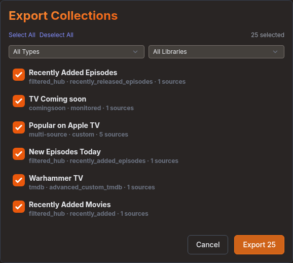

# Collection Export / Import

Export writes your collection configs to a JSON file. Import reads that file and creates new collections in a library you choose. Use it to copy collections to another Agregarr instance, reuse a setup in another library, or share a config.

For base collection behaviour, see the [upstream docs](https://agregarr.org). The collection options are on the [Collections](Collections.md) page.

## Export

1. Open the **All Collections** page. The Home, Library, and Recommended pages use the same buttons.
2. Click **Export**. It's disabled when there aren't any collections.
3. In the **Export Collections** window, tick the collections you want. They're all ticked by default.
4. Click **Export N**, where N is the number ticked.

Your browser downloads a single JSON file. For one collection, the filename is `agregarr-collection-NAME.json`. The collection name is lower case, with spaces and symbols replaced by hyphens. For several collections, the filename is `agregarr-collections-export.json`.

### Choosing what to export

- **Select All** and **Deselect All** only affect collections currently shown by the filters.
- The type filter starts on **All Types**. If your collections span more than one library, you'll also see an **All Libraries** filter.
- Each row shows the type, subtype, and either the number of sources for a multi-source collection or the item limit.

Only Agregarr collections appear here. Plex hubs and pre-existing collections aren't exported.

## Import

1. Click **Import** next to **Export**, then choose a `.json` file. It must be 1 MB or smaller.
2. In the **Import Collections** window, tick the collections you want to bring in. They're all ticked by default.
3. Choose the target from the **Library** list ("Select library"). **Import N** stays disabled until you've picked one.
4. Check any notices under the library list, then click **Import N**.

A message tells you how many collections were imported. They'll then appear in your collection lists.

Import only saves the configs and marks them as changed since the last sync. Run a collection sync, or wait for the next one, to create the collections in Plex.

### Choosing which sources to import

Multi-source collections have an arrow beside their name. Expand one to see its sources, with each source showing its list title or URL and type. Untick any source you don't want to import. The row then shows "N of M sources". Unticking every source also unticks the collection.

### Notices

Import shows a notice for each matching config in the file:

- Overseerr collections: Overseerr needs to be configured.
- Tautulli statistics collections: Tautulli needs to be configured.
- Radarr tag and Sonarr tag collections: Radarr or Sonarr needs to be configured.
- Networks collections: they use FlixPatrol scraping.
- Networks Originals collections: they need an MDBList API key.
- Collections that create placeholders: configure Radarr and Sonarr for download status.
- Collections that filter by Radarr or Sonarr tags: configure the servers after import.
- Collections that use direct download, or Overseerr for requests: configure them after import.

### Names and libraries

- If the target library already has a collection with the same name, the imported collection is renamed, for example "Trending Movies (1)". Existing collections are never replaced.
- Every collection in an import goes into the one library you chose. Import doesn't check whether the library type matches the collections, so use a movie library for movie collections and a TV library for TV collections.
- Imported collections get new IDs, and their sort positions start at 0.
- A collection with a time restriction starts active or inactive based on that restriction at the time of import.

## What travels with an export

The file records the settings that define the collection. That includes:

- Name, type, subtype, and the title template, including custom templates and the dynamic title prefix.
- Visibility settings, and whether the collection is promoted in the library.
- List URLs for Trakt, IMDb, Letterboxd, MDBList, TVDB, AniList, and TMDB, plus TMDB advanced filters.
- Item limits, minimum year, minimum IMDb rating and votes, Rotten Tomatoes minimums, and **Item Order**.
- Smart collection settings, **Plex Label**, and Library Essentials include and exclude choices.
- Separator settings, and the **Sort Title** with its full-title marker.
- **Label Exclusion** labels.
- Placeholder settings, including the date window, **Skip items with an estimated release date** and **Include mid-season episodes (TV)**.
- Grab Missing Items settings and filters, direct download options apart from server selections, time restrictions, and custom sync schedules.
- Multi-source settings: combine mode and the sources. Each source keeps its type, subtype, list URL, time period, priority, custom days, minimum plays, networks country, TMDB advanced filters (**Custom Advanced Filters**) and resolved title.
- Whether custom wallpaper, summary, and theme are enabled, plus the summary text.

Source IDs are renumbered from 1 in the file. The file also stores format version 1.0 and the export time.

## What does not travel

Anything tied to a specific instance or a file on disk stays behind:

- The collection's ID, library, Plex collection keys, and any link to sibling collections.
- **Target User**.
- Radarr, Sonarr, and Overseerr server, profile, root folder, and tag selections, including the Coming Soon server, tag, and root folder choices. You'll need to set these again after import.
- Uploaded posters, wallpaper and theme files, and the poster template choice.
- The **Collection Mutual Exclusion** settings.
- Sync history, errors and warnings, and the changed and missing flags.

## Older exports

Import only reads fields written by the current export format. Anything else in the file is ignored, and those settings use their defaults when the collection is created.

Two older field names matter here. Older versions stored the placeholder date window as `comingSoonDays` and `comingSoonReleasedDays`. Export converts these to the current names, **Days Ahead** and **Only include items released within**, so files written by a current version are fine. Import doesn't convert the old names. If your file still uses them, set **Days Ahead** and **Only include items released within** on the imported collection yourself.

Import also drops the old genre, country, and language exclusion fields. Current versions store those under the filter settings, which do travel.

Sort titles from older files don't have a full-title marker, so they keep their original meaning after import: the typed text is placed before the collection name. A sort title written in the current **Sort Title** field is treated as the full title.

Files with a format version other than 1.0 are refused. Files without a version are accepted. Every collection needs a name and a type, or the whole import is refused.

## Limits

- The browser refuses import files larger than 1 MB. The server refuses any request larger than 2 MB.
- You need to be signed in to export or import.
