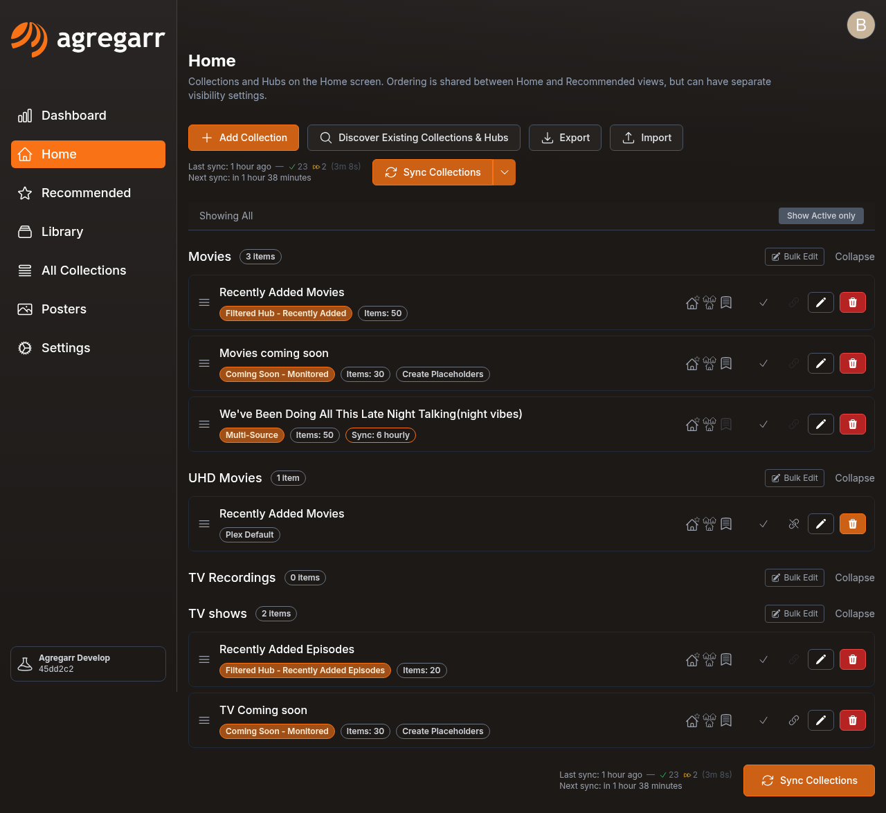
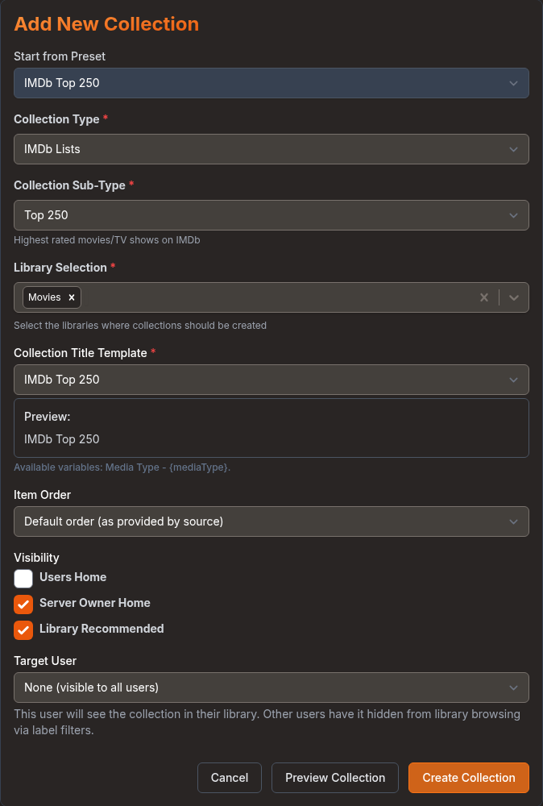
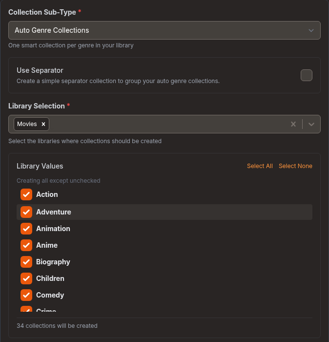
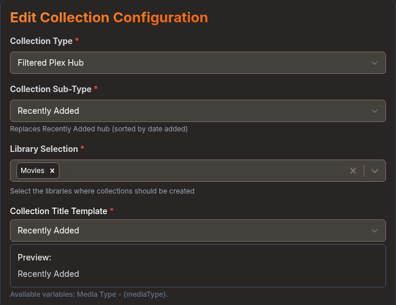

# Collections

Collection features added in this fork. For the base collection behaviour, see the [upstream docs](https://agregarr.org).

## Collection Presets

**Start from Preset** pre-fills the new collection form with one of 12 preset configs. You'll only see it while creating a collection.

| Preset | Source | Media | Max Items |
|--------|--------|-------|-----------|
| Trending Movies Today | TMDB | Movies | 20 |
| Trending TV Today | TMDB | TV | 20 |
| TMDB Top Rated Movies | TMDB | Movies | 50 |
| TMDB Top Rated TV | TMDB | TV | 50 |
| IMDb Top 250 | IMDb | Movies | 250 |
| IMDb Most Popular Movies | IMDb | Movies | 30 |
| IMDb Most Popular TV | IMDb | TV | 30 |
| Upcoming Movies | Coming Soon | Movies | 30 |
| Upcoming TV | Coming Soon | TV | 30 |
| Trakt Trending Movies | Trakt | Movies | 20 |
| Trakt Trending TV | Trakt | TV | 20 |
| Netflix Top 10 Movies | Networks | Movies | 10 |

Presets turn on **Server Owner Home** and **Library Recommended**, with **Users Home** left off. Coming Soon presets also turn on placeholder creation. Trakt presets stay hidden until you've configured Trakt credentials. You can edit every field after choosing a preset.

---

## Library Essentials

Select **Plex Library**, then pick an Essentials subtype. Agregarr builds smart collections from the library's metadata.

| Subtype | What it creates |
|---------|----------------|
| Auto Genre Collections | One smart collection per genre |
| Auto Decade Collections | One per decade (2020s, 2010s, ...) |
| Auto Resolution Collections | One per quality level (4K, 1080p, ...) |
| Auto Content Rating Collections | One per content rating |

### Include / Exclude mode

The **Library Values** panel lists every value found in that library. Everything starts ticked, and the panel reads **Creating all except unchecked**. You can use it in two ways:

- **Exclude mode** (the default): untick anything you don't want.
- **Include mode**: click **Select None**, then tick only the values you want. The panel changes to **Creating only checked**.

**Select All** switches back to exclude mode with nothing excluded. Change the library or subtype and the list starts again with everything ticked. The running count shows how many collections it'll create, and any value matching an existing Plex collection gets an **Existing collection** badge.

### Separators

The **Use Separator** checkbox adds a separator collection above the group, such as "Genre Collections". It sorts directly before the collections in that group.

### Visibility

Users Home, Server Owner Home and Library Recommended are off by default. The collections still appear in the Collections tab, without filling up the home screens.

---

## Separator Collections

These are empty collections with a title card poster, useful for breaking up long collection rows.

Select **Plex Library** > **Separator**. There are three fields:

- **Separator Title**: shown on the poster and used as the collection name
- **Posters**: upload your own, or leave it blank to use the generated template
- **Visibility**: the standard visibility checkboxes

---

## Label Collections

Select **Plex Library** > **Label**, then choose a library and a **Plex Label**. Agregarr includes only items from that library carrying the label, and refreshes the membership on every sync. Each config supports one label.

---

## Per-User Collection Targeting

The **Target User** dropdown in the collection config lists every Plex user. Once you select one, label filters hide the collection from other users while they're browsing the library.

Default: "None (visible to all users)."

!!! note "The server owner always sees every collection"
    Targeting works by adding label filters to the other users' sharing restrictions in Plex. Those restrictions only exist for accounts the server is shared with. The server owner's own account doesn't have any. That's how Plex works, and Agregarr can't change it: if you watch as the owner, you'll see every targeted collection, whoever it was meant for.

    The workaround is to not watch as the owner. Add a managed user to your Plex Home, or use a second Plex account the server is shared with, and do your watching there. That user gets filtered like everyone else, so it only sees its own collections.

Setting a Target User while **Users Home** is on shows a warning about Home visibility.

Target User works with standard collections, multi-source collections, and the Recently Added and Recently Released hubs. It doesn't affect Auto Franchise, Auto Director, Auto Actor, Library Essentials, separator, or Overseerr collections. Those manage their own labels.

---

## Sort Title

The **Sort Title** field controls the collection's position in Plex. It appears when you edit a collection from the Library, Home, or Recommended pages. You won't see it from All Collections, on standalone separators, or on Recommended when the collection also appears on Home. In that last case, Home controls the order.

- A padded prefix such as `!020_` puts the collection at that position. Agregarr reads the number, so promoting, demoting, and dragging still work.
- Promoted collections get a sort title containing `!`, a three-digit position, an underscore, and the name. For example, `!001_IMDb Popular`.
- Clear the field to switch back to automatic positioning.

**Collection Sort Format** under **Settings** > **Plex** controls how a leading "The", "A", or "An" is sorted. The options are **Off (sort exactly as typed)**, **Strip (e.g. "The Accountant" → "Accountant")**, and **Move to End (e.g. "The Accountant" → "Accountant, The")**. This changes the sort title only. The collection name stays as it is.

---

## Filtered Hubs

Choose **Filtered Plex Hub**, then pick a subtype. Each subtype creates a smart collection that leaves out anything with the `trailer-placeholder` label, keeping placeholders out of the hub.

| Subtype | What it lists |
|---------|---------------|
| Recently Added | Items by date added |
| Recently Released | Items by release date |
| Recently Added Episodes | Shows by their most recently added episode (TV libraries only) |
| Recently Added Episodes (Individual) | The episodes themselves, by date added (TV libraries only) |
| Recently Released Episodes (Individual) | The episodes themselves, by air date, newest first (TV libraries only) |

Recently Released Episodes (Individual) never includes episodes with a future air date. Both Individual hubs also leave out shows carrying the `trailer-placeholder` label.

The two Individual hubs don't use collection exclusions or automatic posters. **Label Exclusion** isn't available for Filtered Plex Hub collections.

### Replacing Plex's Recently Added hub

A filtered hub sits alongside Plex's own **Recently Added Movies** or **Recently Added TV** hub. It doesn't replace the existing hub. Turn Plex's hub off, or both will appear: one with placeholders and one without.

1. Add a **Filtered Plex Hub** collection for the library. Use **Recently Added** for a movie library and **Recently Added Episodes** for a TV library.
2. Tick the **Visibility** boxes you want on the new hub, such as **Users Home**, **Server Owner Home**, and **Library Recommended**.
3. Find Plex's own Recently Added hub for that library on the **Home** or **Recommended** page. It has a **Plex Default** badge. Edit it and untick all three **Visibility** boxes.

For TV libraries, use **Recently Added Episodes**, not **Recently Added**. Plex keeps the date when a show was first added. For a Coming Soon show, that's the date its placeholder was created.

**Recently Added** sorts shows by that date. If a placeholder was created in January and the first episodes arrive in March, the show keeps its January date and sits behind anything added in between. **Recently Added Episodes** sorts each show by its newest episode, so the show moves to the front when those episodes arrive.

Sorting the TV library by **Date Added** in Plex has the same problem because it uses the same show-level date.

---

## Collection Options

These options show when you add or edit a collection. The examples below use **Filtered Plex Hub**, with differences for other types called out where needed. Saving a collection doesn't change Plex immediately. Changes are applied the next time the collection syncs, every 12 hours by default, or earlier if you click **Sync Collections**.

### Collection Title Template

Sets the name shown in Plex. The dropdown contains presets for the selected type. Pick **Custom** to enter your own text, or separate movie and TV values if you selected both library types. `{mediaType}` becomes "Movie" or "TV Show". `{mediaType}s` uses the plural. **Preview** shows the resulting name for each selected library. If Agregarr can't fetch the preview, it shows "Preview unavailable".

A template is required, so the first preset is selected by default. Agregarr rewrites the name on every sync. Changing the template will rename the existing Plex collection.

### Visibility

**Users Home**, **Server Owner Home** and **Library Recommended** set where Plex promotes the collection. New collections start with all three ticked. Library Essentials types start with none ticked. Presets tick only **Server Owner Home** and **Library Recommended**.

With none ticked, the form warns "No visibility options selected. Collection will only appear in library tab." The collection still exists and continues to sync. Some types lock these options. Auto Franchise and Auto Director/Actor, for example, are library tab only. To limit the collection to particular users, see [Per-User Collection Targeting](#per-user-collection-targeting).

### Shuffle position on Home/Recommended screens

Off by default. When ticked, the collection swaps positions with other ticked collections in the same library. Unticked collections stay where they are.

- It only moves collections that already have a Home position.
- It needs at least two ticked collections in a library. With fewer than two, nothing moves.
- The shuffle runs at the end of each full sync. It also runs from the **Randomize Home Order** job on the Jobs page, daily at 6am by default. Agregarr skips it while a sync is running.

### Max Items

Sets the maximum number of items the collection can hold. New collections start at 30. The allowed range is 1 to 9999, and leaving the box blank saves 50. For a Filtered Plex Hub, Agregarr writes the limit into the hub itself. That's why the form adds "(applies to smart collection)". Other types order the list first (see **Item Order**), then cut it to this number.

### Posters

**Auto-generate Collection posters** builds a poster from the collection name and its items during sync. It's enabled for new collections. It's disabled for imported Plex collections and the automatic Genre, Decade, Resolution and Content Rating collections. Agregarr only rebuilds the poster when the template, name or items change.

**Select Template** appears when auto-generate is ticked, with the default template already selected. Untick auto-generate to show one upload slot per library instead.

!!! note "Episode hubs don't get an automatic poster"
    **Recently Added Episodes (Individual)** and **Recently Released Episodes (Individual)** don't offer **Auto-generate Collection posters**. The poster section has upload slots instead. Upload a poster if you want one.

### Apply item overlays during sync

Off by default, and always on for Coming Soon. Overlays normally reach items when the overlay job runs, daily at 3am by default. With this ticked, Agregarr applies overlays to this collection's items straight after the collection sync. It only touches items in that collection and needs overlay templates configured for the library. See [Overlays](Overlays.md).

### Wallpapers and Theme

There are three separate tick boxes, all off by default: **Custom Wallpaper**, **Custom Summary** and **Custom Theme Music**. Ticking one shows its input. Wallpaper and theme uploads need a library selected first.

- Wallpaper: JPEG, PNG or WebP, up to 10MB, one per library.
- Summary: free text, written to the Plex collection description.
- Theme music: MP3, WAV, FLAC, OGG, AAC or M4A, up to 10MB, one per library.

Agregarr applies them on every sync but doesn't upload unchanged files again. Untick **Custom Wallpaper** or **Custom Theme Music**, or remove the file, and Agregarr removes the wallpaper or theme from the Plex collection on the next sync. It only does that while Plex still shows the one Agregarr uploaded. If you've picked a different one in Plex since, it stays.

Unticking **Custom Summary** stops Agregarr setting the summary. The text stays in Plex, so clear it there if you want it gone.

### Time Restrictions

**Always Active** is ticked by default. Untick it to limit when the collection is active:

- **Date Ranges** use DD-MM, include both end days and can cross the new year (for example 05-12 to 26-01).
- **Days of the Week** limit it to selected days. If both are set, both must match.

Agregarr checks the restrictions whenever the collection syncs, using the server's clock. A collection can therefore lag its window by up to one sync interval. Outside the window, **Remove from Plex when inactive** deletes the Plex collection. Otherwise, the collection stays and uses its inactive visibility settings, which default to **Library Recommended** only.

Unticking **Always Active** without adding a date range or changing a day box leaves the collection active every day.

### Collection Mutual Exclusion

Tick **Enable collection exclusion**, then select other collections from the same library. Items in those collections are excluded from this one. This section only appears when the library has other collections available to select.

At sync time, Agregarr reads the other collection's current contents from Plex. That collection must already exist and have synced. If Plex can't find it, Agregarr skips it and continues the sync.

Filtered Plex Hubs sync after all other collections. They apply exclusions as a Plex filter using the other collection's title. The two Individual episode hubs don't offer exclusions.

### Item Order and Custom sync timing

**Item Order** defaults to "Default order (as provided by source)" and isn't shown for Filtered Plex Hubs. Agregarr applies the order before **Max Items** cuts the list. **Enable custom sync timing** (under **Time Restrictions**) isn't shown for Filtered Plex Hubs either. For other types, see [Item Order](#item-order) and [Cycle Lists](Cycle-Lists.md).

Also see [Sort Title](#sort-title) and [Label Exclusion](#label-exclusion).

---

## More Sources and Options

### IMDb Bottom 100

**IMDb Lists** includes a **Bottom 100** subtype for IMDb's lowest rated movies. Movies only.

### TVDB Lists

**TVDB Lists** is a collection source with a **Custom List** subtype. Paste the list URL into **Custom TVDB List URL**, then click **Validate**. You can also use it as a source in multi-source collections.

Items keep their order from the TVDB list. Movie libraries take the movies, while TV libraries take the series. If a list mixes both, you'll need one collection for each library. Anything missing from your library uses the same missing-item options as the other sources.

### Random Lists

Letterboxd, Trakt, IMDb, and TMDB each have a **Random Lists** subtype. During a single sync, separate random-list collections won't choose the same list while unused lists are still available.

To supply your own pool or remove lists from rotation, edit the source file in the config folder: `random-lists/trakt.txt`, `random-lists/tmdb.txt`, `random-lists/imdb.txt` or `random-lists/letterboxd.txt`. Set `enabled=true`, then add one URL per line for the lists you want to use. Add `exclude=URL` lines for any lists you want kept out.

### Dynamic title prefix

A prefix box appears when the title template is **Dynamic Title from Random List** or **Dynamic Title from Active Source**. Its text goes in front of the generated title. For example, a prefix containing an emoji and a list titled "Musical" produces the emoji, a space, then "Musical".

### Item Order

For multi-source collections, **Item Order** applies to each source list before the item limit. Agregarr then orders the combined list again. **Reverse order** affects each source list only.

Coming Soon collections using **Trakt Anticipated** also get a **Trakt ranking** option under Item Order.

### Auto Franchise

Auto Franchise Collections has two settings:

- **Minimum movies in library**: Agregarr doesn't create collections for franchises with fewer movies than this in your library. If one already exists, the next sync removes it. The default is 2, with a minimum of 1.
- **Count only released movies**: unreleased or undated TMDB entries aren't counted towards the franchise size. This is off by default.

Setting the minimum to 1 with Grab Missing Items on can send many more requests. The year and rating filters still apply.

### Label Exclusion

**Label Exclusion** removes items carrying any listed Plex label from the collection during sync. Type a label and press Enter. Adding `trailer-placeholder`, for example, keeps placeholders out.

You won't see this option for Filtered Plex Hub, Auto Director, or Auto Actor collections. If the labels exclude every item, Agregarr empties the existing Plex collection.

### Minimum IMDb votes

Under **Grab Missing Items**, **Minimum IMDb votes** appears beside **Minimum IMDb rating**. It defaults to 0, meaning there's no limit. Once set, items without IMDb vote data are skipped. Placeholder filters don't include this field.

---

## Smart Collection Sort

Tick **Create Smart Collection** to make a smart collection for the viewing user. **Filter to Unwatched Items Only** and **Smart Collection Sort Order** then appear. The unwatched filter is a separate checkbox, on by default.

There are 31 sort options, including **Last Episode Added (Newest First)**, which uses each show's newest Plex episode.

New smart collections use **Release Date (Newest First)** by default.

---

## Coming Soon

### Root folder filter

**Monitored in Radarr/Sonarr** collections can filter on the root folder path under **Monitored Source Settings**:

- **Radarr Root Folder (Movies)** and **Sonarr Root Folder (TV Shows)** restrict the collection to items under a specific root.
- Both start at **All Root Folders**. The available options come from the selected server.

This is handy when one Radarr or Sonarr server feeds several Plex libraries.

The same section also has server selection when you've configured two or more servers. **Filter by Tags** appears when the server has tags, with **Tag Filter Mode** set to include or exclude.

The **Monitored in Radarr/Sonarr** subtype is described as "Unreleased monitored movies, and shows with an upcoming season premiere".

### Mid-season episodes

**Include mid-season episodes (TV)** is available on Monitored collections. It includes shows whose next episode falls inside the **Days Ahead** window, rather than limiting the collection to season premieres. The show must already exist in Plex, and Agregarr won't create a placeholder for it. This is off by default.

### Skip estimated release dates

Under **Placeholder Creation**, Coming Soon and Multiple Sources collections include **Skip items with an estimated release date**. This leaves out movies that only have a cinema date, where the current date is estimated as the cinema release plus 90 days until TMDB adds a digital or physical release. It's off by default.

---

## Collection Ownership

Agregarr marks collections it manages with a Plex label beginning with `Agregarr`. If a Plex collection doesn't have one of those labels, Agregarr doesn't treat it as its own. It appears as **Pre-Existing** after **Discover Existing Collections & Hubs**.

To stop Agregarr ordering, applying visibility to, or changing sort titles on collections created by other tools, add their Plex labels under **Settings** > **General** > **Exclude from Ordering (Plex Label)**. The field accepts a comma-separated list. A collection is excluded when it has an exact matching label, or a label that starts with the listed value followed by an underscore. Matching isn't case-sensitive.

---

## Export / Import

Use **Export** on a collection page to choose collections and save them to a JSON file. **Import** loads that file into the library you choose, with per-source selection for multi-source collections. See [Collection Export/Import](Collection-Export-Import.md).
