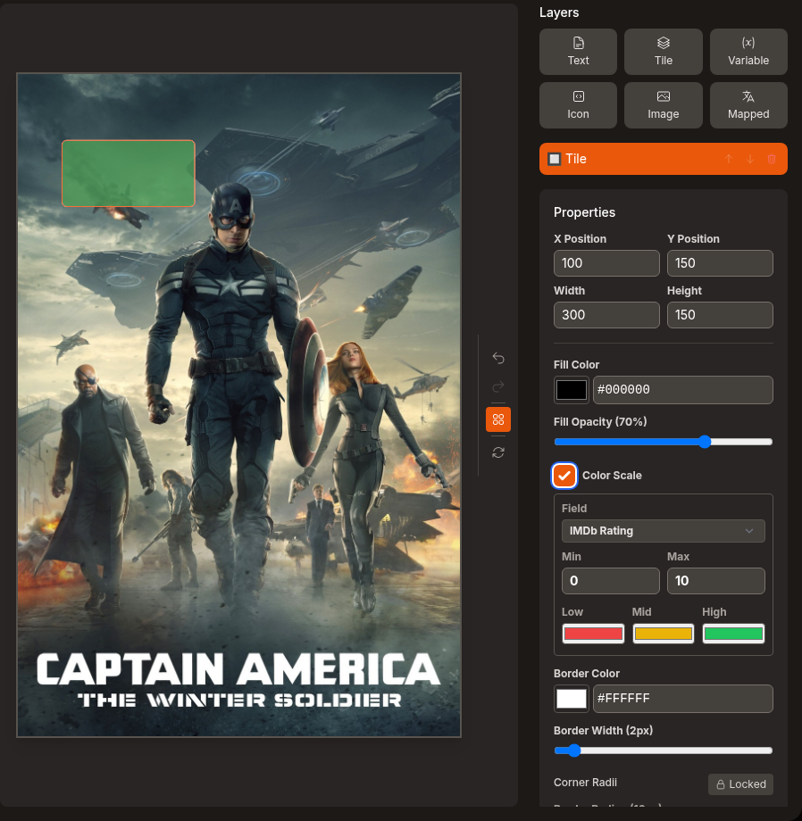

# Color Scale

A Tile element can change its fill colour based on a number, such as a rating. Low ratings show one colour, high ratings show another, and the values between them are blended. A rating badge can fade from red to green, for example.

For tile basics and templates in general, see the [upstream docs](https://agregarr.org).

## Turn it on

1. Open an overlay template in the editor (**Posters > Poster Overlays > Overlay Templates**).
2. Add a **Tile** element, or select one.
3. Tick **Color Scale** in the element properties.

The default scale uses **IMDb Rating** from 0 to 10, with red at the low end and green at the high end. Untick it and the scale is removed, so the tile goes back to its **Fill Color**.

The editor preview uses the sample item you're previewing to colour the tile.

---

## Settings

| Setting | What it does |
|---------|--------------|
| **Field** | The number that drives the colour: **IMDb Rating**, **TMDB Rating**, **RT Critic Score** or **RT Audience Score**. |
| **Min** | The value that gets the **Low** colour. |
| **Max** | The value that gets the **High** colour. |
| **Low** | Colour at **Min** and below. |
| **Mid** | Optional colour halfway between **Min** and **Max**. |
| **High** | Colour at **Max** and above. |

---

## How a value becomes a colour

The value sits somewhere between **Min** and **Max**. Anything below **Min** is treated as **Min**, while anything above **Max** is treated as **Max**.

- **Two colours.** The tile blends directly from **Low** to **High**. A value halfway between **Min** and **Max** gets the colour halfway between them.
- **Three colours.** Pick a colour with the **Mid** swatch to add it to the scale. The swatch starts out yellow, but that yellow isn't used until you pick a colour. The first half of the range blends from **Low** to **Mid**. The second half blends from **Mid** to **High**. A value exactly halfway gets the **Mid** colour.

If **Min** and **Max** are the same, the tile is **Low** below that value and **High** at it or above. Clear the **Min** or **Max** box and leave it, and it goes back to the last number.

Example: **Min** 3, **Max** 8, **Low** red, **Mid** yellow, **High** green. Ratings of 3 or less are red, 5.5 is yellow, and 8 or more is green.

To go back to two colours, untick **Color Scale** and tick it again. This resets the scale.

If the item doesn't have a value for the selected field, such as an unrated title, the tile falls back to its **Fill Color**. **Fill Opacity** still applies on top of the scale colour.

---

## Colour text box

The **Fill Color**, **Border Color** and **Text Color** swatches in the overlay editor have a text box beside them. So do the colour swatches in the collection poster editor. Type a colour in any of these forms:

- `#rrggbb`
- `#rrggbbaa`
- `rgb(r, g, b)`
- `rgba(r, g, b, a)`

The colour applies as soon as the text is valid. If you leave the box with an invalid colour, it goes back to the last one it accepted.

The **Low**, **Mid** and **High** swatches in a Color Scale are plain colour pickers. They don't have a text box.
