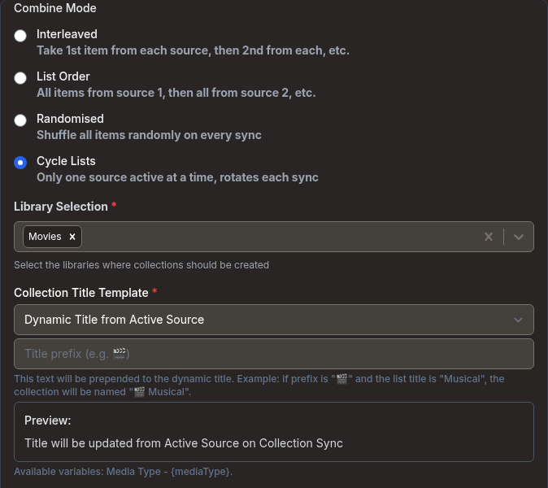

# Cycle Lists

## What it does

Cycle Lists lets several lists share one row on your Plex Home. You create one collection with multiple sources. Each time the collection syncs, it swaps in the next source and can take that list's name. For example, forty Letterboxd and Trakt lists can become one row that shows a different list on each sync, so once a week on a weekly schedule.

Only the list currently showing is fetched. The others wait their turn and don't exist as collections in your library until then.

## Rotation or Cycle Lists?

Rotation does a similar job for collections you already have. They suit different starting points:

- **Cycle Lists**: you have lots of lists (Trakt, Letterboxd, IMDb) and want them to take turns in one row. Only the list showing exists as a collection.
- **Rotation**: you already have collections in Plex, made by Agregarr, by hand or by another tool, and want a few of them on Home at a time. Every collection stays in your library; the rotation changes whether it shows on Home and Library Recommended, and where.

## Set it up

1. Open the collections page and click **Add Collection**.
2. Set **Collection Type** to **Multiple Sources**.
3. Under **Sources**, click **Add Source** and fill in each one. Add as many as you like. Once you've added at least two sources, **Library Selection** appears below them. Choose a library and the rest of the form appears.
4. Under **Combine Mode**, choose **Cycle Lists**.
5. Set **Collection Title Template** to **Dynamic Title from Active Source** if you want the collection named after the list currently showing (see below).
6. Set **Max Items** and **Item Order** if you need them, then save.

### Adding sources

Each source has a **Source Type**. If that type has sub-types, choose one under **Collection Sub-Type**. For your own lists, choose **Custom List** (**Custom Collection** for TMDB) and paste the list address into **Custom URL**, then click **Validate URL**. Once validated, the source heading shows the list name, for example "2. My Favourite Films". To build a source from TMDB filters instead of a list, choose **TMDB Lists** and **Custom Advanced Filters** (see [TMDB Custom Advanced Filters](TMDB-Advanced-Filters.md)).

**Source Type** includes:

- **Seerr Requests**
- **Tautulli Statistics** (shown as **Tracearr Statistics** when Tracearr is set up)
- **Trakt Lists**
- **Letterboxd Lists**
- **TMDB Lists**
- **IMDb Lists**
- **MDBList Lists**
- **TVDB Lists**
- **Networks**
- **Streaming Originals**
- **Radarr Tags**
- **Sonarr Tags**
- **AniList**
- **MyAnimeList**
- **Coming Soon**

You can mix these types however you like. The **Remove** button appears once there's more than one source.

Sources are lists from outside services and the other source types above. They aren't existing Plex collections.

### The four combine modes

**Combine Mode** uses radio buttons. New Multiple Sources collections start on **List Order**.

- **Interleaved**: takes the 1st item from each source, then the 2nd from each, and so on.
- **List Order**: takes every item from source 1, then every item from source 2, and so on.
- **Randomised**: shuffles all items on every sync.
- **Cycle Lists**: keeps one source active at a time and moves to the next on each sync.

The first three modes merge every source into one large collection. Only **Cycle Lists** shows one list at a time. If every source is **Coming Soon**, you'll get **Release Date**, **Cycle Lists** and **Randomised** instead. Cycle Lists sorts each source by release date in that case.

### Naming the collection after the list

With **Cycle Lists** selected, the **Collection Title Template** menu offers **Dynamic Title from Active Source** and **Custom**. **Custom** keeps one fixed collection name. With **Dynamic Title from Active Source**, the preview reads "Title will be updated from Active Source on Collection Sync". Each sync renames the same Plex collection to match the list now showing.

A text box appears below the menu for a title prefix. Anything you enter goes before the list title, with a space between them. A prefix of "Weekly:" and a list named "Musical" gives you "Weekly: Musical". Switching to another template clears the prefix.

The title comes from the source:

- **Custom List** sources use the list title from its website. This works with Trakt, TMDB (collection or list addresses), IMDb, Letterboxd, AniList, TVDB and MDBList lists. Trakt and MDBList lists need those services configured. If the page loads without a title, a generic name such as "IMDb List" or "Letterboxd List" is used.
- Built-in lists have fixed names, such as "Trending Now" for Trakt trending or "Top Rated" for TMDB top rated. If a sub-type has no fixed name, its sub-type name is used with capital letters.

If Agregarr can't work out a title, such as when the list site is unreachable or Trakt credentials are missing, the collection keeps its existing name for that sync.

## When it moves to the next list

The collection keeps its own sync counter. Each sync moves it forward by one.

- **Default**: the counter advances on every full collections sync. That means the **Plex Collections Sync** job, which runs every 12 hours by default, and the **Sync Collections** button.
- **Custom schedule**: when you turn on the collection's own schedule, the full sync skips it. The collection then advances only on its own schedule or during a manual sync. Open the collection and find **Custom Sync Schedule** under **Time Restrictions**. Tick **Enable custom sync timing** and choose a **Schedule**:

  - **Every 10 minutes**, **Every 15 minutes**, **Every 30 minutes**
  - **Every hour**, **Every 2 hours**, **Every 3 hours**, **Every 6 hours**, **Every 12 hours**
  - **Once daily**, **Every 2 days**, **Every 3 days**
  - **Once weekly**, **Every 2 weeks**
  - **Once monthly** (every 30 days), **Every 3 months**, **Every 6 months**, **Once yearly**
  - **Custom Cron Expression**

  You can also use a custom cron. Choose **Custom Cron Expression** and enter it under **Custom cron expression**. The example in the field is `0 9 * * MON`, which runs every Monday at 9 AM.

  For preset schedules, **Start on next sync** is ticked by default. If the preset is an hour or longer and the box stays ticked, the cycle starts counting from when you save, and saving a newly enabled schedule runs a sync straight away, which moves to the next list immediately.

Other things that move it, or don't:

- A manual sync of that collection moves it forward like any other sync. Use the collection's status icon, which you can click when the collection has a sync error or needs syncing.
- **Collections Quick Sync** doesn't move it.
- **Preview Collection** doesn't move it. In the preview, **Refresh** steps through the sources from the first one. That's separate from the live position.
- Editing the collection doesn't reset its position. Restarting the app doesn't reset it either, because the counter is saved with the collection.

### The order

Lists appear in the same order as they do under **Sources**. After the last source, the position wraps back to the start. The first sync after you create the collection shows the first source, and each sync after that moves to the next one.

You can't move a source up or down. **Add Source** puts it at the end, while **Remove** takes one out. Changing the number of sources mid-cycle can make the current list jump somewhere else. Removing a source also moves every later source up one place. Add new sources when you don't mind where the cycle lands.

If the next list has no items you own, the sync leaves the Plex collection and its title as they were. The next sync moves on to the list after it. If a list can't load, the collection shows a sync error.

## Mixing shows, episodes, movies

When you validate custom lists, Agregarr checks what each one contains. If one list contains episodes and any source, including that list, contains movies or TV shows, this warning appears under **Combine Mode**:

> Warning: Conflicting episodes/TV show lists detected across sources. Only "Cycle Lists" mode is available to prevent collection type conflicts.

The other three modes are greyed out and marked "(Disabled - mixed content detected)". If the collection was using one of those modes, Agregarr switches it to **Cycle Lists**. One list at a time means Plex never has to mix the two kinds in one collection. Preset sources count as movies and shows, so the check only triggers when a validated custom list contains episodes.

## Poster, item limit and sort order

- **Poster**: with **Auto-generate Collection posters** ticked, the poster is rebuilt on each sync using the type of the list currently showing. A Trakt list gets a Trakt poster, while a Netflix Top 10 gets a Netflix one. Other combine modes use a generic multi-source poster. Untick the option if you want to upload posters yourself.
- **Max Items** applies to the list currently showing. The default is 50.
- **Item Order** applies to the list currently showing. Choose **Default order (as provided by source)** to keep the source's own order.
- Missing-item handling also applies only to the list currently showing, since the others aren't fetched.

## Limits

- It's one collection, so it fills one row.
- Lists that aren't currently showing don't exist as collections in your library.
- Sources are lists and the other source types above, not existing Plex collections.
