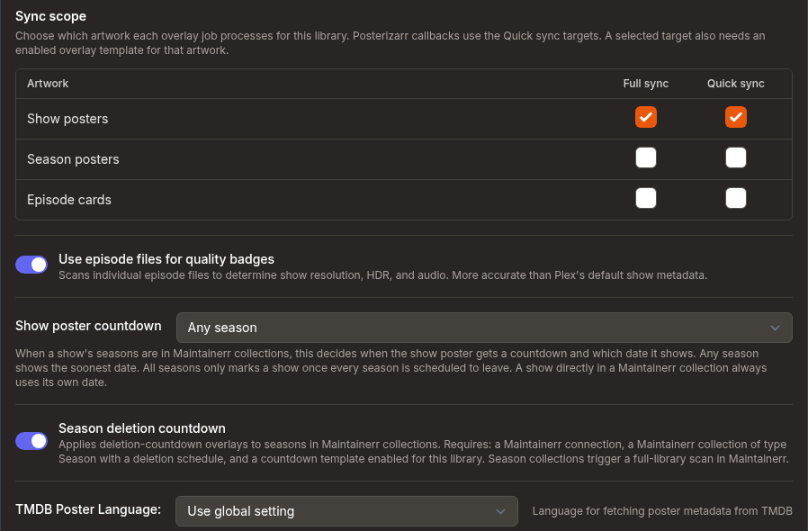

# Episode Scanning

Episode scanning reads a show's episode files and rolls the values up. Show and season posters can then show resolution, HDR, Dolby Vision, HDR10+, and Atmos badges that match the files you actually have.

## Turn it on

1. Go to **Posters > Poster Overlays > Library Configuration**.
2. Click **Configure** on a show library.
3. Turn on **Use episode files for quality badges**.
4. Click **Save Configuration**.

The toggle only shows up for show libraries. It's off by default.

Scanning runs during the library's full overlay sync. Quick syncs and collection-driven overlay runs don't scan Plex. They use the results from the last full sync.

---

## What it changes

With the toggle on, show and season posters use the rolled-up values in the usual fields. That means **Resolution**, **HDR**, **Dolby Vision**, **Dolby Vision Profile**, **HDR10+**, **Video Codec**, **Audio Codec**, **Audio Profile**, **Audio Channels** and **Bit Depth** describe the episodes. Presets such as **4K Resolution**, **HDR10**, **Dolby Vision** and **Resolution** already use these fields, so they'll follow the roll-up without any changes.

Shows also get extra fields in the **Episode Media** group, including **4K Episode %**, **HDR Episode Count** and **DV Episode %**. **Media Source (aggregated/show)** shows whether the poster used the roll-up (`aggregated`) or Plex's own show details (`show`). Raw fields such as **Show Resolution (Raw)** and **Show HDR (Raw)** keep Plex's show-level values.

**Days Since Last Episode Added** and **Last Episode Added Date** come from the same scan. See [Overlay Variables](Overlay-Variables.md#episode-media).

---

## How values are rolled up

| Value | Rule |
|-------|------|
| Resolution, video codec, audio codec, audio channels, bit depth | The most common value among the episodes. For resolution, a tie goes to the higher resolution. |
| Audio Profile (Atmos, DTS:X and so on) | The most common value. A tie goes to the better format. |
| HDR, Dolby Vision, HDR10+ | On when at least half of the episodes have it. |
| Dolby Vision Profile | The most common profile among the Dolby Vision episodes. |
| Counts and percentages | Number of episodes with 4K, HDR or Dolby Vision, and that number as a percentage of the episodes counted, rounded to a whole number. |

**Shows.** Season 0 (Specials) is left out of the quality roll-up. If a show only has specials, it uses those instead. **Days Since Last Episode Added** still counts specials.

**Seasons.** Each season is rolled up from its own episodes. Season posters only get these badges when season artwork is included in the library sync. Tick **Season posters** under **Full sync** (or **Quick sync**) in the library's **Sync scope** table, then use a template with **Season poster** selected under **Artwork Targets**.

---

## Atmos and HDR10+ badges

- **Atmos:** the built-in **Audio Codec** preset only works for movies. For show and season posters, add a **Mapped** element to a template and set **Source Field** to **Audio Profile**. The element picks the icon that matches the rolled-up **Audio Profile** value.
- **HDR10+:** use the **HDR10+** condition (in the **Plex Data** group) on a template.

---

## What it costs

Every full sync reads the library's episode list from Plex. That's cheap, and it's enough to get resolution.

Stream-level detail needs extra Plex metadata requests for the episodes. Agregarr only fetches it when an enabled template needs it: any template using **HDR**, **Dolby Vision**, **Dolby Vision Profile**, **Bit Depth**, **Color Transfer**, **HDR Episode Count**, **HDR Episode %**, **DV Episode Count** or **DV Episode %**, or a show or season template using **Audio Profile** or **HDR10+**. A resolution-only setup doesn't make those requests.

Agregarr fetches details for episodes that are new, changed, or don't have saved results yet, then caches them. Saved results older than 7 days are ignored and fetched again. The first sync after adding one of those fields to a template will be the slowest.

---

## Limits

- **Test Specific Media** doesn't run the episode scan, so the **Episode Media** fields are empty there. Check them after a full sync.
- A show that's in Plex but has no scanned episodes keeps Plex's own details.
