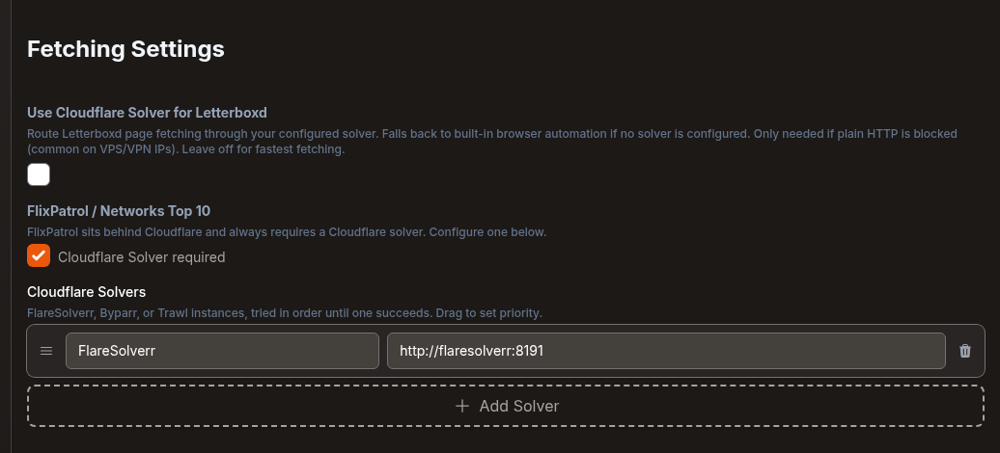
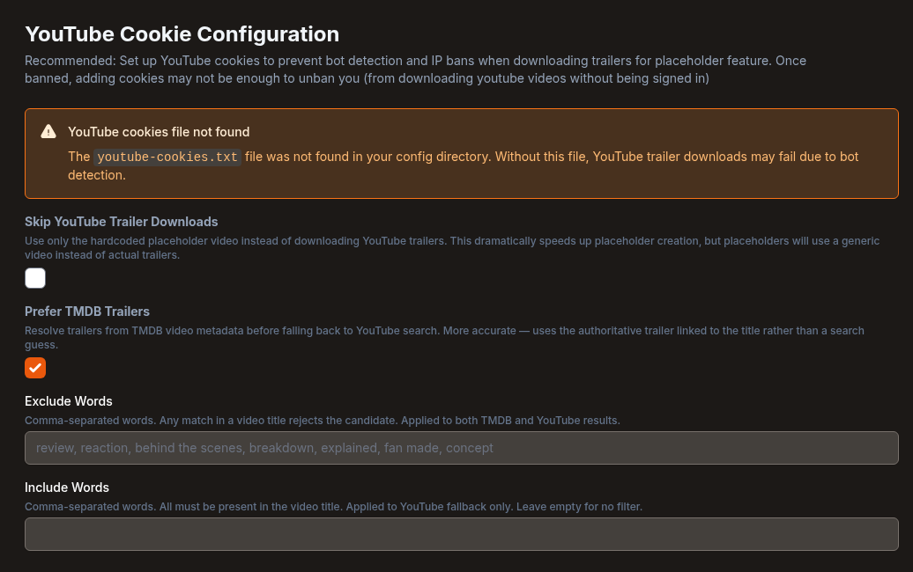

# Integrations

These integrations are specific to the fork. For Plex, Radarr, Sonarr, and TMDB setup, see the [upstream docs](https://agregarr.org).

## Cloudflare Solver

Networks Top 10 collections pull data from FlixPatrol, which sits behind Cloudflare. They need a solver. The image includes a headless Chromium browser that Agregarr uses when you haven't configured one, but it can't reliably get past FlixPatrol's challenge. If you have a Networks collection, the [Cloudflare Solver health check](Health-Checks.md#the-cloudflare-solver-check) reports an error until you add a solver.

### Supported solvers

- [FlareSolverr](https://github.com/FlareSolverr/FlareSolverr)
- [Byparr](https://github.com/ThePhaseless/Byparr)
- Trawl

### Setup

1. Run a solver next to Agregarr. There's a compose example below.
2. In **Settings > Sources**, find **Cloudflare Solvers** under **Fetching Settings**. Press **Add Solver**, give it a name, and enter its URL, for example `http://flaresolverr:8191`.
3. Add more instances if you want a fallback. Agregarr tries them in order. Drag a row using **Drag to reorder** to change its priority.
4. Press **Save Changes**.



```yaml
services:
  agregarr:
    image: bitr8/agregarr:latest
    # ... your existing config

  flaresolverr:
    image: ghcr.io/flaresolverr/flaresolverr:latest
    container_name: flaresolverr
    environment:
      - LOG_LEVEL=info
    ports:
      - "8191:8191"
    restart: unless-stopped
```

Use `:latest` for the Agregarr image, or pin a release such as `:2.13.0`.

When both containers share a network, use the service name. Otherwise, use the host IP and published port.

### Behaviour

- Once you've configured a solver, Agregarr won't fall back to the built-in browser. If every solver is down, the health check reports it.
- FlixPatrol always goes through the solvers, or through the built-in browser when you haven't set one. Plain HTTP isn't an option for it.
- The first failure from an instance is free. After two failures in a row, Agregarr skips that instance for that site for 1 minute. Each failure after that doubles the wait, up to 16 minutes. If the next failure happens more than 20 minutes after the previous wait ended, the count starts again. Other instances keep going.
- Fetched pages stay cached for 5 minutes.
- If FlixPatrol's overview page doesn't have a section for a platform, Agregarr reads that platform's own Top 10 page instead. Peacock and Hulu use FlixPatrol's United States page.
- Sometimes a solver loads the page and the site still refuses it. The log says so, for example `solver loaded flixpatrol.com but the site returned HTTP 403`. If every solver is refused, the health check stays red for up to 24 hours, or until a later fetch works. Cloudflare may be challenging your server's IP address. Run the solver through a VPN.
- The old single "FlareSolverr URL" setting moves to this list automatically.

### Letterboxd

Letterboxd normally works over plain HTTP, but some VPS and VPN IP ranges get Cloudflare challenges. Turn on **Use Cloudflare Solver for Letterboxd** in **Settings > Sources** to route requests through your solvers. If you haven't configured a solver, it falls back to the built-in browser. Leave this off unless Letterboxd is actually blocking you. Plain HTTP is faster. While the toggle is off, a health check warns if Letterboxd was blocked during the last 8 hours.

---

## Tracearr

You can use Tracearr instead of Tautulli for watch statistics. Its settings are under **Settings > Sources**, in **Tracearr Settings**.

1. Enter **Hostname or IP Address**, **Port** (default 3000), **Use SSL**, **URL Base** if you have one, and your **API Key**.
2. Press **Test Connection**. When it connects, the **Server** list fills in. Leave it on **All servers** to count plays from every server Tracearr tracks, or choose one.
3. Turn on **Use Tracearr for statistics** and press **Save Changes**.

While it's on and both the host and API key are set:

- The statistics collection type is labelled **Tracearr Statistics** instead of **Tautulli Statistics**.
- Collection statistics and weekly play counts on the dashboard come from Tracearr.
- Agregarr asks Tracearr for no more than the last 365 days. Longer ranges are capped at 365, and the dashboard **Days:** box only accepts 1 to 365.
- Results stay cached for 5 minutes.

If Agregarr can't read from Tracearr, the dashboard shows **Tracearr Connection Failed** with a **Check Tracearr Settings** button. Turn the toggle off to switch back to Tautulli.

---

## Seerr

Set up Seerr under **Settings > Downloads**, in **Seerr Settings**.

The **Keep placeholder ignore patterns in Seerr** option is in the Seerr connection window. It's off by default. When you turn it on, Agregarr adds the two patterns matching its placeholder files to Seerr's **Ignored Path Patterns**. That stops Seerr counting placeholders as available media. Agregarr checks them during each full **Plex Collections Sync** and puts back any pattern that's gone missing.

The window shows the current state beside the checkbox: **Both patterns present**, **{count} of 2 patterns missing**, or **Seerr build doesn't support Ignored Path Patterns**.

This needs a Seerr build with an **Ignored Path Patterns** setting. The checkbox help text lists `rubeanie/seerr:ignore-media-regex` as one that has it. The [Seerr Placeholder Patterns health check](Health-Checks.md#the-seerr-check) reports any problems.

---

## Maintainerr

Connect Maintainerr to put deletion countdowns on movie, show, and season posters. Maintainerr's collection schedules provide the dates.

You'll find the connection fields under **Settings > Sources > Maintainerr Settings (Poster Overlays Only)**: hostname, port (default 6246), API key, and SSL. **Test Connection** checks the details before saving. A health check catches problems later.

Days remaining is `deleteAfterDays` minus the number of days since the item's `addDate`. If an item belongs to more than one collection, the soonest date wins.

**Season countdowns need Maintainerr 3.4.0+.** Older versions return the collection type as a number, so Agregarr ignores those collections. Movie and show countdowns work with any version.

Full details: [Maintainerr Countdown](Maintainerr-Countdown.md).

---

## Sonarr-First Next-Episode Dates

The fork asks Sonarr first for a show's next episode date. If Sonarr doesn't track the show, it falls back to TMDB. A failed Sonarr lookup means "unknown", not "no upcoming episode", so an outage doesn't wipe existing countdowns.

There's nothing else to configure. If Sonarr is connected, Agregarr checks it first.

---

## IMDb charts

The IMDb Top 250, Top 250 English, Bottom 100, Popular, and Box Office collections read from IMDb's public GraphQL API. Agregarr rejects responses with fewer items than expected for every chart except Box Office.

---

## TMDB Trailer Resolution

Before searching YouTube, the fork checks TMDB's video metadata for a placeholder trailer. The lookup runs in this order:

1. **TMDB videos.** Only YouTube trailers and teasers count. Trailers come before teasers, official uploads before fan uploads, and newer videos first. Agregarr tries up to three and accepts videos under 10 minutes.
2. **YouTube search.** Agregarr searches for the title, year, and "official trailer", then checks the top 10 results. It downloads the first result that passes the word lists if it's under 3 minutes 30 seconds. If it's longer, Agregarr uses the static placeholder video.
3. **Static placeholder video.** Used when neither source finds a trailer.

The same downloader that fetches trailers also runs the YouTube search. It uses your `youtube-cookies.txt` file if you've added one.

### Settings



All of these are under **Settings > Downloads**:

| Setting | Default | What it does |
|---------|---------|--------------|
| **Prefer TMDB Trailers** | On | Check TMDB video metadata before YouTube |
| **Exclude Words** | Blank, which uses a built-in list | Any match rejects the candidate. Both TMDB and YouTube. The built-in list is `review, reaction, behind the scenes, breakdown, explained, fan made, concept` |
| **Include Words** | Empty | All must match; empty = no filter. YouTube fallback only |
| **Skip YouTube Trailer Downloads** | Off | Skip trailers entirely, TMDB included, and use the static placeholder. Faster |

Downloads are capped at 1080p.

### YouTube cookies

Export cookies from a logged-in browser in Netscape format, then save them as `youtube-cookies.txt` in your Agregarr config folder. **Settings > Downloads** shows whether Agregarr found the file. If it's empty or isn't in Netscape format, the screen shows **YouTube cookies file is not valid** and downloads continue without it. The collection form shows a **YouTube Cookies Not Configured** warning when the file is missing or invalid.
