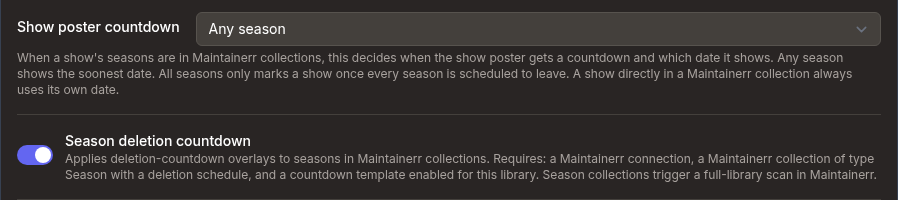

# Maintainerr Countdown

Agregarr adds Maintainerr deletion countdowns to movie, show, and season posters: "DELETING IN 5 DAYS".

## Setup

1. Connect Maintainerr. See [Integrations](Integrations.md#maintainerr).
2. Turn on the **Maintainerr Deleting Soon** preset, or any template using the **Days Until Maintainerr Action** variable, in **Posters > Poster Overlays > Library Configuration**.
3. Show libraries also get **Show poster countdown** and **Season deletion countdown** controls in the same **Configure** window.

---

## The countdown

Agregarr takes the collection's delete-after days and subtracts the whole days since Maintainerr added the item. If an item is in several collections, the earliest deletion date wins. Collections without a delete-after setting above zero don't count.

Negative numbers mean the item is overdue. The **Maintainerr Deleting Soon** preset only applies when **Days Until Maintainerr Action** is 0 or more, so it won't draw a banner for overdue items. Custom templates can handle the number differently (see [Overlay Variables](Overlay-Variables.md#other-variables)).

---

## Show posters

A show directly included in a Maintainerr collection always uses its own date. If only its seasons are scheduled, the **Show poster countdown** dropdown controls what happens:

| Option | Behaviour |
|--------|-----------|
| **Any season** | Starts when any season is scheduled. Uses the earliest deletion date. Default. |
| **All seasons (earliest)** | Starts only when every season is scheduled. Uses the earliest deletion date, the day the first season goes. |
| **All seasons (latest)** | Starts only when every season is scheduled. Uses the latest deletion date, the day the show disappears. |

The all-seasons modes only count Maintainerr collections with the Season type. Every season Plex lists for the show needs a deletion date, including Specials. If a season isn't scheduled, or Maintainerr can't identify one of its entries, there's no countdown.

The dropdown stays greyed out until Maintainerr is connected in **Settings**. It works separately from the season poster setting, so turning off **Season deletion countdown** doesn't change the show poster countdown.

---

## Season posters

The **Season deletion countdown** toggle only appears for show libraries, and it's off by default. It needs:

- a Maintainerr connection,
- a Maintainerr collection of type Season with a deletion schedule, and
- a countdown template enabled for the library.

Agregarr always draws countdown templates on seasons Maintainerr has scheduled. If **Season posters** is also ticked under **Full sync** in the library's **Sync scope**, it draws your enabled season poster templates as well.

**Requires Maintainerr 3.4.0+.** Older versions skip season collections. Movie and show countdowns that match an item directly still work on any version.

---

## Poster restore

Agregarr saves the original season poster before drawing an overlay. On the library's next full overlay sync, it restores that poster if the season leaves its collection or the toggle is switched off. If the season no longer exists in Plex, Agregarr drops the saved copy instead. It only removes a saved copy after restoring the poster or confirming that the season is gone from Plex. Failed restores stay queued for the next run.

When **Season posters** is included in the library's full sync and a season poster template is enabled, the full season sync owns the finished poster. Agregarr won't restore the original over it.

---

## Safety

If Agregarr can't reach Maintainerr, or Maintainerr's reply contains no media lists, it skips the season pass. No season overlays are drawn, and no posters are restored. An empty list from a reachable Maintainerr means those seasons have left their collections, so Agregarr restores their posters.

If Maintainerr returns a season entry without a Plex ID, or Plex can't be queried for one of the seasons, Agregarr treats the run as unfinished and restores nothing.
