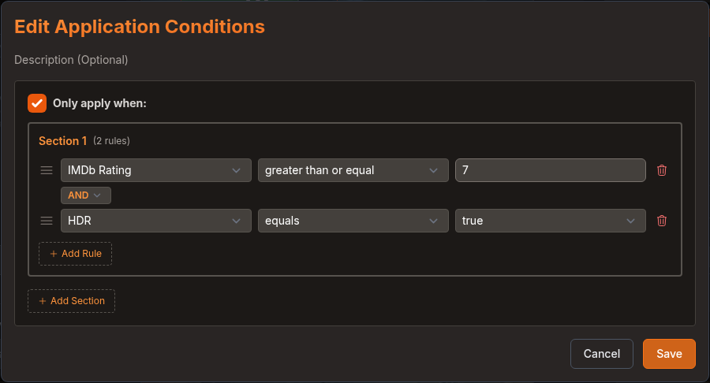

# Overlay Conditions

Show/hide rules run at render time. There are three kinds: **application conditions** on overlay templates decide whether a template applies to an item, **element conditions** on overlay templates decide whether one element of a template is drawn, and **element conditions** on poster templates decide whether an element appears for a collection. No condition means it always applies.

## Overlay templates

In the overlay template editor, find **Application Condition** and click **Edit Conditions**. This opens the **Edit Application Conditions** window. Tick the **Always apply (no condition)** box to add rules. Its label changes to **Only apply when:** and the rule builder appears with one rule, `Days Until Release` `greater than or equal` `0`. Untick it to go back to always applying.



Rules are split into sections. **Add Rule** adds another rule to the current section, and the bin icon removes one. **Add Section** creates a new section, and **Remove Section** removes one (it appears once there are two or more). Drag a rule by its handle to reorder it within its section. The **AND** / **OR** choices between rules stay where they are when you drag.

Rules within a section use **AND** or **OR** between each pair, with **AND** as the default. Sections use **AND** or **OR** as well, but default to **OR**. Everything is read left to right with no precedence: `A AND B OR C` means `(A AND B) OR C`. If you need `A AND (B OR C)`, put `A` in one section and `B OR C` in another, joined by **AND**. A section with no rules matches every item, so remove empty sections.

Each rule has a field, operator, and value. The dropdown groups fields like this:

| Group | Examples |
|-------|----------|
| TMDB Data | **Title**, **Year**, **Genre**, **Network (TV)**, **Streaming Provider**, **TMDB Status (TV)** |
| Plex Data | **Versions**, **Has Multiple Versions**, **Resolution**, **HDR**, **HDR10+**, **Dolby Vision**, **Audio Format**, **Audio Profile**, **Edition**, **File Path**, **Days Since Added** |
| Ratings | **IMDb Rating**, **RT Critics Score**, **Is IMDb Top 250**, **Plex User Rating** |
| Collections | **Collection** (membership in an Agregarr or Plex collection) |
| Status | **Media Type (movie/show)**, **Days Until Release**, **Release Date Is Estimated**, **Downloaded**, **Is Monitored**, **Total Seasons (TV)**, **Missing Episode Count (TV)**, **Radarr Tags**, **Plex Label**, **Days Until Maintainerr Action** |
| Episode Media | **4K Episode %**, **HDR Episode Count**, **Multi-Version Episode Count**, **Days Since Last Episode Added**, **Show Resolution (Raw)**, **Show HDR (Raw)** |

The **Status** group also contains the movie release date fields: **Theatrical Release Date (Movies)**, **Digital Release Date (Movies)**, **Physical Release Date (Movies)**, the matching **Days Since ... Release** fields, **Days Since Home Release** and **Release Date Source (digital/physical/estimate)**. Release dates are stored as `YYYY-MM-DD`, so **begins with** `2026-12` matches December 2026. Days-since values go negative before the date. To test how long ago something was added or played, use **Days Since Added**, **Days Since Last Played** or **Days Since Last Episode Added**. [Overlay Variables](Overlay-Variables.md) lists what each field contains.

### Operators

Available operators are **equals**, **not equals**, **greater than**, **greater than or equal**, **less than**, **less than or equal**, **contains**, **does not contain**, **regex**, **begins with**, **ends with**, **in** and **exists**. Each field only shows the operators that work for it:

- Number fields, such as **IMDb Rating**, **Total Seasons (TV)** and the counts and percentages in the **Episode Media** group, take **equals**, **not equals**, the greater-than and less-than operators, **in** and **exists**.
- Yes/no fields such as **HDR**, **Show HDR (Raw)** and **Downloaded** use **equals** or **not equals** with a **true** / **false** value.
- **Collection** and **Plex Label** support **equals** and **not equals**, with the value picked from a list. **Radarr Tags** and **Sonarr Tags** also pick their value from a list.
- Text fields take every operator except greater-than and less-than.

Text matching ignores case. **regex** matches anywhere in the text unless you anchor it with `^` and `$`, and a pattern with a mistake in it never matches. With **in**, enter a comma-separated list such as `4k, 1080`. Spaces around the items don't matter. If a value contains a comma, **in** can't match it. If you change the operator, the value is converted to suit it, so check it before saving.

Fields that hold a list, such as **Radarr Tags**, **Audio Languages (All)**, **Subtitle Languages**, **Collection** and **Plex Label**, match when any item in the list matches. **Collection** only counts collections that exist in Plex.

A rule fails when the item has no value for that field, apart from a few exceptions. **not equals** and **does not contain** match an absent field, while **exists** matches when set to `false`.

### Items with more than one version

Plex can hold two or more versions of the same movie or episode, for example an upgrade you kept next to the original. **Versions** is the number of versions Plex lists for the item, and **Has Multiple Versions** is a yes/no field that is true when that number is above 1. Two 1080p copies count as 2, the same as Plex's own duplicate filter.

To match items with several versions, use `Has Multiple Versions` `equals` `true`, or `Versions` `greater than` `1`. Don't use `Versions` `not equals` `1`. When an item has no value for a field, most rules don't match it, but **not equals** does. Show and season posters never have a **Versions** value, so that rule would match every one of them. **greater than** and **Has Multiple Versions** don't have that problem.

Movies and episodes get **Versions** from their own files. Show and season posters have no files, so they use **Has Multiple Versions** and **Multi-Version Episode Count** instead. These come from Episode Scanning, so turn on **Use episode files for quality badges** for the library. A show is true when any of its episodes (Specials left out) has more than one version. A season is true when one of its own episodes does. Season 0 (Specials) never gets a count. **Multi-Version Episode Count** is the number of such episodes. Until the first scan finishes, or when scanning is off, these fields are empty and rules on them don't match. **Test Specific Media** doesn't run the scan, so check show and season posters after a full sync. For a ready-made badge, see [Overlay Examples](Overlay-Examples.md#badge-items-with-more-than-one-version).

The other file details, such as **Resolution** and **Audio Format**, still describe the first version only.

Example, a NEW banner shown only on recent movies:

```
Media Type (movie/show) equals movie
AND Days Since Release (incl. release day) less than or equal 14
```

**Testing:** On the Overlay Templates tab, **Test Specific Media** runs every template enabled for that item's library against a real library item. Expand a template to see **Condition Evaluation:**. Each rule shows its field, operator and value, the **AND** / **OR** before it, whether it matched, and the item's value as `(actual: value)`. A missing field appears as `(actual: missing)`. On a show library with [Episode Scanning](Episode-Scanning.md) on, the test uses the latest scan results, the same as a sync. The result poster also applies element conditions, which aren't listed under **Condition Evaluation:**.

---

## Overlay template elements

Any element in an overlay template can have its own condition. Use this to put several versions of a badge in one template, for example a gold 4K label and a white 1080 label in the same spot, or a release ribbon that reads **TODAY**, **TOMORROW** or a countdown depending on the date.

Select the element, scroll to the bottom of its **Properties**, and click **Edit Conditions** next to **Show conditionally**. This opens **Edit Element Conditions**. Tick **Always show (no condition)** to add rules, and its label changes to **Only show when:**. The window works like the template's **Edit Application Conditions**, with the same fields, operators, sections and **AND** / **OR**. Elements with a condition are marked in the layer list. Untick **Only show when:** to remove the condition.

The element is drawn only when the template applies to the item and the element's own condition matches. On the editor canvas, elements whose condition doesn't match the preview poster are hidden, except the selected element, which is shown faded so you can still edit it. The editor checks conditions against a sample item: 4K, HDR and Dolby Vision, 7.1 audio, 14 days until release, next episode in 32 days and 5 days until Maintainerr acts, with the real title and ratings of the preview poster shown. The image on the template's card uses the same sample. Use **Test Specific Media** to see the other versions on real items.

**Check Layout** knows that two elements can never show together when their conditions rule each other out, for example `Resolution equals 4K` and `Resolution equals 1080`, or `IMDb Rating greater than or equal 8` and `IMDb Rating less than 6`, and doesn't warn about them overlapping.

**Variables:** A template can hold only one **Variable** element without a condition. You can add more Variable elements as long as each has a condition. When a Variable's field has no value for an item, the whole template is skipped for that item, tiles included. A Variable whose condition doesn't match doesn't count, so give each version of a text its own condition and only the one that shows needs its data.

For a worked example, see [One banner that changes its wording](Overlay-Examples.md#one-banner-that-changes-its-wording).

---

## Poster template elements

Each element in the poster template editor has a **Show conditionally** checkbox. Ticking it adds a rule for **Subtype**, and the element stays hidden until you enter a value. Rules use AND. Click **Add rule** to add more, and the bin icon removes one.

| Field | Values |
|-------|--------|
| Collection Type | the collection's source, as chosen in the collection form, such as `plex`, `trakt`, `imdb`, `letterboxd`, `tmdb`, `networks`, `multi-source`, `comingsoon` |
| Subtype | e.g. `genre`, `decade`, `contentRating` |
| Media Type | `movie` / `tv` |
| Name | collection name |
| Item Count | number of items in the collection |

Available operators are = / ≠ / contains. Item Count uses = / ≠ and > ≥ < ≤ instead of contains.

For example, show item-count text only on large collections with `Item Count ≥ 10`. For a movie-only badge, use `Media Type = movie`.

**Preview:** Conditions update live on the editor canvas after you choose a preview collection, using the same values as the finished poster. Without a preview collection, every element shows.
