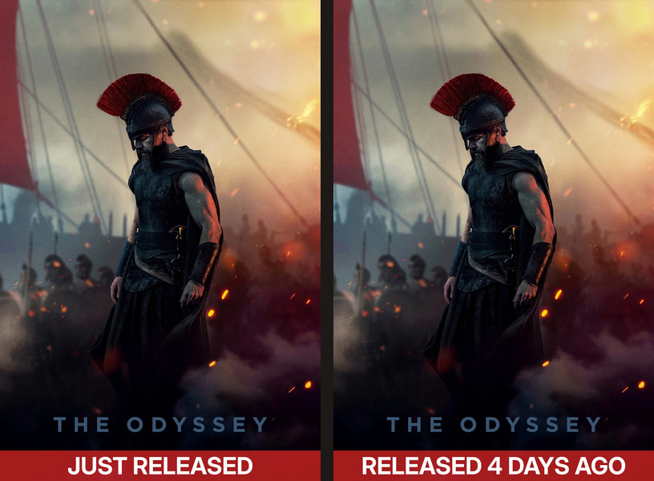

# Overlay Examples

Worked examples combining templates, variables, and [conditions](Overlay-Conditions.md) to do more than a single preset can on its own.

## One banner that changes its wording

A single template can show different text on different items. This example uses one red banner that reads `JUST RELEASED` for the first few days after release, then switches to `RELEASED 4 DAYS AGO`, `RELEASED 5 DAYS AGO`, and so on.

1. Open the **Overlay Templates** tab and **Duplicate** the **Released Days Ago (Monitored)** preset. The copy already has the red banner and the `RELEASED {daysAgo} DAYS AGO` text.
2. Open the copy. Under **Application Condition**, click **Edit Conditions**. In both sections, change `Days Since Release (incl. release day)` `greater than` `1` to `greater than or equal` `0`. That includes release day. Leave the other rules alone.
3. Click **Text** under **Layers** to add a text element, then enter `JUST RELEASED`. Give it the same **X Position**, **Y Position**, **Width**, **Height**, and font settings as the existing `RELEASED {daysAgo} DAYS AGO` element. Both elements should sit in the same spot.
4. Select `JUST RELEASED`, scroll to the bottom of **Properties**, and click **Edit Conditions** next to **Show conditionally**. Tick **Only show when:**, set the rule to `Days Since Release (incl. release day)` `less than or equal` `3`, then click **Save**.
5. Select `RELEASED {daysAgo} DAYS AGO` and repeat the process, this time using `Days Since Release (incl. release day)` `greater than` `3`.
6. Save the template. In **Library Configuration**, switch on your copy. Switch off **Just Released (Monitored)**, **Released Yesterday (Monitored)**, and **Released Days Ago (Monitored)**.

The canvas only shows the element whose condition matches the sample poster, and fades the selected element. Don't worry if one seems to be missing. Use **Test Specific Media** with a recent release to check it.

Items up to 3 days old should show `JUST RELEASED`. From day 4 to day 7, they should show the day count on the same banner. Change the `3` in both conditions to move the switch-over day.

The same setup works for wording that changes as a date gets closer. A ribbon could read `COMING NOV 2026`, then `IN 5 DAYS`, then `RELEASING TODAY`.

**Why not use two templates?** Each template is checked separately. If two templates in the same spot both match an item, both get drawn, one on top of the other. The preset banners use 75% **Fill Opacity**, so text from the lower banner shows through the top one:

If you prefer separate templates, make sure their day ranges don't overlap. Otherwise, set the top banner's **Fill Opacity** to 100.
