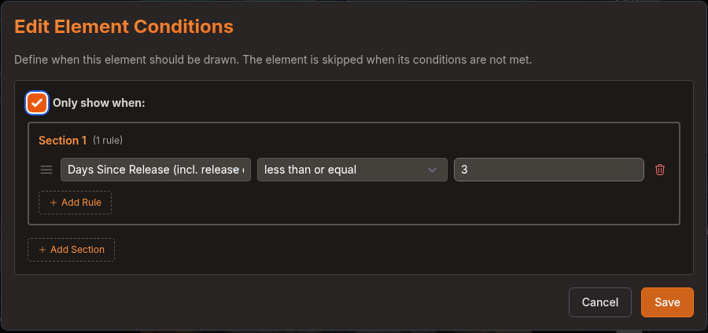
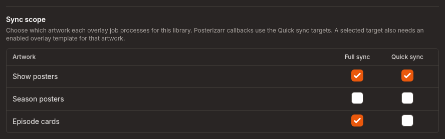
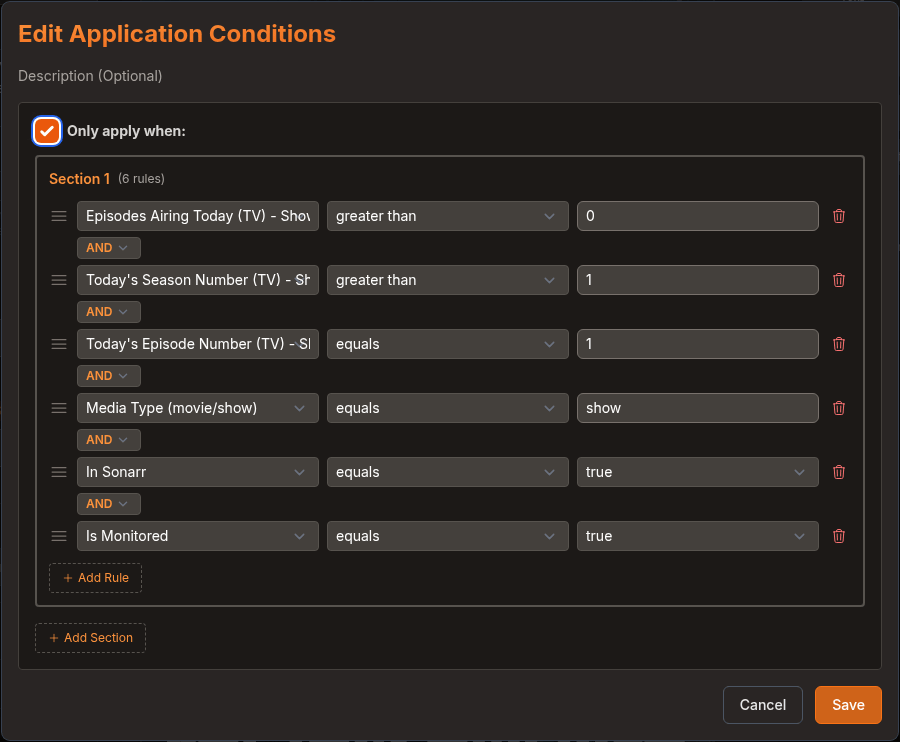

# Overlay Examples

Worked examples combining templates, variables, and [conditions](Overlay-Conditions.md) to do more than a single preset can on its own.

## One banner that changes its wording

A single template can show different text on different items. This example uses one red banner that reads `JUST RELEASED` for the first few days after release, then switches to `RELEASED 4 DAYS AGO`, `RELEASED 5 DAYS AGO`, and so on.

1. Open the **Overlay Templates** tab and **Duplicate** the **Released Days Ago (Monitored)** preset. The copy already has the red banner and the `RELEASED {daysAgo} DAYS AGO` text.
2. Open the copy. Under **Application Condition**, click **Edit Conditions**. In both sections, change `Days Since Release (incl. release day)` `greater than` `1` to `greater than or equal` `0`. That includes release day. Leave the other rules alone.
3. Click **Text** under **Layers** to add a text element, then enter `JUST RELEASED`. Give it the same **X Position**, **Y Position**, **Width**, **Height**, and font settings as the existing `RELEASED {daysAgo} DAYS AGO` element. Both elements should sit in the same spot.
4. Select `JUST RELEASED`, scroll to the bottom of **Properties**, and click **Edit Conditions** next to **Show conditionally**. Tick **Only show when:**, set the rule to `Days Since Release (incl. release day)` `less than or equal` `3`, then click **Save**.
5. Select `RELEASED {daysAgo} DAYS AGO` and repeat the process, this time using `Days Since Release (incl. release day)` `greater than` `3`.
6. Save the template. In **Library Configuration**, switch on your copy. Switch off **Just Released (Monitored)**, **Released Yesterday (Monitored)**, and **Released Days Ago (Monitored)**.

The canvas only shows the element whose condition matches the sample poster, and fades the selected element. Don't worry if one seems to be missing. Use **Test Specific Media** with a recent release to check it.

Items up to 3 days old should show `JUST RELEASED`. From day 4 to day 7, they should show the day count on the same banner. Change the `3` in both conditions to move the switch-over day.

The same setup works for wording that changes as a date gets closer. A ribbon could read `COMING NOV 2026`, then `IN 5 DAYS`, then `RELEASING TODAY`.

**Why not use two templates?** Each template is checked separately. If two templates in the same spot both match an item, both get drawn, one on top of the other. The preset banners use 75% **Fill Opacity**, so text from the lower banner shows through the top one:

If you prefer separate templates, make sure their day ranges don't overlap. Otherwise, set the top banner's **Fill Opacity** to 100.

---

## Episode code on episode cards

This puts the season and episode code, for example `S01E05`, at the bottom right of each episode's title card. It is the same badge Kometa's Episode Info overlay draws.

### With the preset

1. Open the **Overlay Templates** tab and check that **Episode Info - Episode Card** is there. You don't need to change it.
2. Open **Library Configuration**, open your TV library with **Configure Overlays**, and switch on **Episode Info - Episode Card**.
3. In the **Sync scope** table, tick **Episode cards** under **Full sync**, **Quick sync**, or both. Episode cards are off by default, and nothing is drawn on them until you tick this. This is the step people miss.
4. Click **Save Configuration**. Then on the **Library Configuration** tab click **Full Overlays Sync**, then **Confirm Full Sync?**. Or use **Test Specific Media** to try a few episodes first.

Each episode card gets a rounded black badge, about 60% opaque, with the code in white. A season 1 episode 5 shows `S01E05`, and the first Special shows `S00E01`. An episode with no season or episode number from Plex gets no badge.

Every episode in the library gets its own card, and each one is drawn and uploaded to Plex. On a big library the first full sync takes a long time. Try a few episodes with **Test Specific Media** first.

If you use Posterizarr title cards, the badge is drawn over them, the same as the episode rating presets.

### By hand, or in a different spot

Presets can't be edited, so to move the badge or change its look, **Duplicate** **Episode Info - Episode Card**, switch the preset off for the library, and switch your copy on. Or start from a new template:

1. Create a template, tick **Episode card** under **Artwork Targets**, then untick **Main poster**. Tick **Episode card** before you add any elements, so the canvas switches to 1920 x 1080.
2. Add a **Tile** and place it where you want the badge. The preset uses **X Position** 1600, **Y Position** 945, a width of 305 and a height of 105, with a corner radius of 30.
3. Add a **Variable** element. Set **Width** to 305, **Height** to 105, and **X Position** and **Y Position** to match the tile. **Text Align** is already **Center**. Set **Font Size** to 55 and **Font Weight** to **Normal** to match the preset. A new Variable starts with an **IMDb Rating** segment: delete it with its bin icon. Then click **Add Text** and change `TEXT` to `S`, click **Add Variable** and pick **Season Number**, click **Add Text** and type `E`, then click **Add Variable** and pick **Episode Number**.
4. On both variable segments, set **Number Format** to **Pad to 2 digits (05)**. Use **Pad to 3 digits (005)** on **Episode Number** for shows with hundreds of episodes.
5. Turn on **Check Layout** to make sure the code fits inside the badge, then save and switch the template on for the library as above.

With **Number Format** left on **Plain**, the same template shows `S1E5`. See [Number Format](Overlay-Variables.md#number-format).

---

## Badge items with more than one version

This puts a small badge on items that Plex holds in more than one version, for example a movie with both a 1080p and a 4K file, or an episode where an upgrade was kept next to the original. It is the same idea as Kometa's versions overlay.

### With the presets

1. Open the **Overlay Templates** tab and check that **Multiple Versions**, **Multiple Versions - Season Poster** and **Multiple Versions - Episode Card** are there.
2. Open **Library Configuration**, open your library with **Configure Overlays**, and switch on the ones you want. **Multiple Versions** covers movie and show posters.
3. For show and season badges, turn on **Use episode files for quality badges** for the library (see [Episode Scanning](Episode-Scanning.md)). For season posters tick **Season posters** under **Sync scope**, and for episode cards tick **Episode cards**.
4. Click **Save Configuration**, then run a **Full Overlays Sync**.

Each badge is a 60% black rounded tile with a white stacked-pages icon. Items with one version are left alone. A show or season gets the badge when one of its episodes has more than one version, and Specials don't count.

### By hand, with a number

1. Create a template and add a **Tile**. Add a **Variable** element on top of it. A new Variable starts with one **IMDb Rating** segment: change that segment's dropdown to **Versions**.
2. Under **Application Condition**, click **Edit Conditions**, tick **Only apply when:** and set the rule to `Versions` `greater than` `1`.
3. Save, switch the template on for the library and run a sync.

A movie with two files then shows `2`. Use `greater than` `1` or `Has Multiple Versions` `equals` `true` for the rule. `Versions` `not equals` `1` also matches every show and season poster, because those never have a **Versions** value. See [Overlay Conditions](Overlay-Conditions.md#items-with-more-than-one-version).

Only the count and the yes/no fields look at every version. **Resolution**, **HDR** and the other file details still come from the first one Plex lists.

---

## Returning Today, all day

The **Returning Today (Monitored)** preset adds `SEASON 4 TODAY` to a show on the day its new season premieres. It stays there for the rest of the day after the episode airs. Switch it on in **Library Configuration**. **Returning Today (Unmonitored)** does the same for shows Sonarr has but doesn't monitor, and for shows Sonarr doesn't have.

Its condition is:

- `Episodes Airing Today (TV) - Show Poster` `greater than` `0`: an episode is on today's schedule, before or after airtime.
- `Today's Season Number (TV) - Show Poster` `greater than` `1`: excludes brand-new shows. Remove it if you want those as well.
- `Today's Episode Number (TV) - Show Poster` `equals` `1`: today's episode opens a season. Without this, every weekly show gets the banner on each airing day.
- **Media Type**, **In Sonarr** and **Is Monitored**, as used in the other Returning presets.

**Days Until Next Season (TV)** `equals` `0` looks like the obvious rule, but it only holds until the premiere airs. A 13:00 premiere loses the banner on the next run after 13:00. The Unmonitored preset does use it for shows Sonarr doesn't have. TMDB only gives a date without a time, so it holds all day, but it's the network's date and can be a day off outside that country.

The banner uses **Today's Season Number (TV) - Show Poster** instead of **Season Number**. On a show poster, **Season Number** is the next episode's season. It's empty after airtime when a whole season dropped at once.

### Finale countdown

The same fields can count down to a finale. Use a Variable element with **Add Text** `FINALE IN `, **Add Variable** **Days Until Next Finale (TV) - Show Poster**, and **Add Text** ` DAYS`. Set the template condition to `Days Until Next Finale (TV) - Show Poster` `less than or equal` `30` AND `Days Until Next Finale (TV) - Show Poster` `greater than` `1`, so it shows for the last month. The last two days get their own templates: `FINALE TOMORROW` with `Days Until Next Finale (TV) - Show Poster` `equals` `1`, so you never see `FINALE IN 1 DAYS`, and `FINALE TODAY` with `equals` `0`. An element inside the countdown template can't cover them, because that template's condition already rules out `0` and `1`. To leave out mid-season breaks, add `Next Finale Type (TV) - Show Poster` `in` `season, series` to all three.

