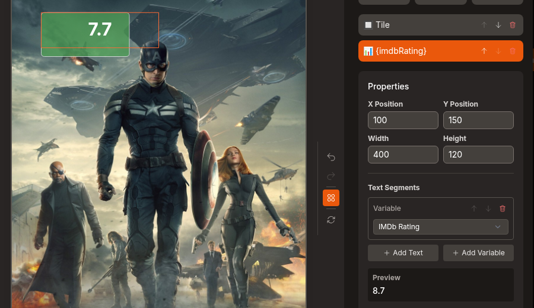

# Overlay Variables

Variables put information from an item onto its overlay, such as a release date or season number. This page covers the variables added by this fork. For the base set, including IMDb and RT ratings, title, and resolution, see the [upstream docs](https://agregarr.org).

## Using a variable

1. Open the overlay editor and add a **Variable** element.
2. Under **Text Segments**, click **Add Variable**.
3. Open **Select a variable...** and pick one. The names below match that list and use the same group headings.

Mix **Add Text** and **Add Variable** segments to build something like `SEASON 3 IN 12 DAYS`.

If an item doesn't have a value for a variable, Agregarr skips the whole template for that item, tiles and icons included. A Variable element whose own condition doesn't match doesn't count, so you can give each version of a text its own condition and only the one that shows needs its data. See [Overlay Conditions](Overlay-Conditions.md).

Most of these variables work in conditions too.

### Date Format

Date variables get a **Date Format** dropdown. It defaults to `MMM DD`, for example `DEC 20`. The dropdown shows each format as an example:

- **Short (No Year):** `DEC 20`, `20 DEC`
- **Short (With Year):** `DEC 20, 2025`, `20 DEC 2025`
- **Full Month Name:** `December 20, 2025`, `20 December 2025`
- **Month and Year:** `DEC 2025`, `December 2025`
- **Numeric:** `2025-12-20`, `2025/12/20`, `12/20/2025`, `20/12/2025`, `20-12-2025`, `20/12`, `5/12`, `12/20`, `12/5`
- **With Weekday:** `MON 20/12`, `MON 5/12`, `MON 12/20`, `MON 12/5`, `MONDAY`, `MON`

Dates and day counts use the server's timezone (the `TZ` setting of the container) and count whole calendar days. The editor previews dates the same way.

---

## Release dates (Coming Soon group)

Movie dates follow the country set in **Watch Provider Region** under **Settings > General**. If that country doesn't have a date of that type, Agregarr uses the earliest date from any country.

| Variable | What it contains | Applies to |
|----------|------------------|------------|
| **Release Date Is Estimated** | `true` when the release date is a guess (theatrical date plus 90 days). `false` when a digital or physical date has been published, or TMDB only has a single release date. Empty when the item has no release date. | Movies |
| **Theatrical Release Date (Movies)** | The theatrical date, for example `OCT 25`. | Movies |
| **Digital Release Date (Movies)** | The digital date, for example `DEC 25`. | Movies |
| **Physical Release Date (Movies)** | The physical date, for example `JAN 14`. | Movies |
| **Days Since Theatrical Release (Movies, negative before the date)** | Whole days since the theatrical date. `61` is two months ago, `-20` is 20 days away, `0` is the day itself. | Movies |
| **Days Since Digital Release (Movies, negative before the date)** | Same, for the digital date. | Movies |
| **Days Since Physical Release (Movies, negative before the date)** | Same, for the physical date. | Movies |
| **Days Since Home Release (Digital or Physical, negative before the date)** | Same, counted from the earlier of the digital and physical dates. | Movies |
| **Release Date Source (digital/physical/estimate)** | Where the release date came from: `digital`, `physical`, `estimate` (theatrical plus 90 days) or `tmdb` (a single date with no release types). | Movies |
| **Days Since Next Season Premiered (TV)** | Days since the most recent season premiere, for example `7`. Specials and seasons that have not aired are ignored. It keeps counting after the show's next episode moves on. The template card can't show a sample for it, so a template that needs it looks empty there. | TV shows |

For a Coming Soon movie, if Radarr has a digital or physical date, Agregarr uses the earlier one as the release date. **Release Date Is Estimated** is then `false`. A date Radarr doesn't have still comes from TMDB, so **Physical Release Date (Movies)** keeps TMDB's physical date when Radarr only knows the digital one.

---

## Seasons and episodes (also in the Coming Soon group)

| Variable | What it contains | Applies to |
|----------|------------------|------------|
| **Total Seasons (TV)** | The number of seasons the show has, for example `5`. | TV shows, and their seasons and episodes |
| **Seasons in Plex (TV)** | The number of seasons Plex holds for the show, for example `2`. A Specials season counts as one. | TV shows |
| **Season Number** | On a season poster, that season's number. On an episode card, the episode's season. On a show poster, the season of the next upcoming episode, for example `5`. | TV |
| **Episode Number** | On an episode card, the episode's number. On a show poster, the next upcoming episode's number, for example `16`. Empty on season posters. | TV |

On a show poster, the next episode comes from Sonarr when Sonarr tracks the show and has one scheduled, otherwise from TMDB. Specials are never treated as a season premiere. When nothing is scheduled, **Season Number** and **Episode Number** are empty on the show poster.

The built-in **Returning Soon** banners use **Season Number** to show `SEASON 3 IN 12 DAYS`.

### On season and episode artwork

Season and episode artwork don't get the release date variables, the TV schedule variables (next episode, next season), **Missing Episode Count (TV)**, or the Radarr and Sonarr status fields. Those stay empty there, so a template that needs them is skipped. **Total Seasons (TV)** and the show's TMDB details carry over from the show.

---

## Other variables

| Variable | Group | What it contains | Applies to |
|----------|-------|------------------|------------|
| **TMDB Rating** | Ratings | TMDB's user score, for example `8.4`. | Movies, shows, seasons, episodes |
| **TMDB Vote Count** | Ratings | How many TMDB votes the score is based on, for example `1250`. | Movies, shows, seasons, episodes |
| **Streaming Provider** | Metadata | The streaming service for the item in your **Watch Provider Region**, for example `Netflix`. | Movies and shows |
| **Audio Profile** | Audio | Plex's audio profile, for example `truehd_atmos`. | Items with a file |
| **Edition** | File Info | The edition, for example `Extended Cut`. It reads the edition set in Plex first, then an `{edition-...}` tag in the file name. | Items with an edition. Not Coming Soon placeholders. |
| **Collection Rank** | Collection | The item's position in a collection, counting from 1, for example `3`. | Movie and show posters |
| **Missing Episode Count (TV)** | Status | Aired, monitored episodes in Sonarr that have no file, added up across all seasons except Specials, for example `3`. `0` when nothing is missing. Empty if the show is not in Sonarr. | TV shows |
| **Days Until Maintainerr Action** | Status | Days until Maintainerr deletes the item. See [Maintainerr Countdown](Maintainerr-Countdown.md). | Movies, shows, seasons |

### Edition

**Edition** works in conditions too, as **Edition** in the **Plex Data** group. You can also use it as the **Source Field** for a **Mapped** element, which picks an icon by edition name. Matching ignores upper and lower case.

### Collection Rank

Pick **Collection Rank** under the **Collection** heading, then choose a collection from **Rank within collection**. The list includes your Agregarr collections and Plex collections, with Plex collections marked **(Plex)**, grouped by library. It doesn't include filtered hubs, Coming Soon collections, or collections that create several Plex collections.

The rank follows the collection's sort order in Plex. Items outside the collection don't get a number. Ranks never appear on season or episode artwork. The editor previews the rank as `3`. Collection Rank isn't offered in conditions; use **Collection** in the **Collections** group to test membership.

### Episode media

These variables are in the **Episode Media** and **Show Raw Values** groups. They only work when **Use episode files for quality badges** is turned on for the library. See [Episode Scanning](Episode-Scanning.md), which explains each one.

| Variable | What it contains | Applies to |
|----------|------------------|------------|
| **Episode Count**, **4K Episode Count**, **4K Episode %**, **HDR Episode Count**, **HDR Episode %**, **DV Episode Count**, **DV Episode %** | Counts and percentages over the episodes Agregarr scanned. | TV shows and seasons |
| **Media Source** | `aggregated` when the poster used the episode roll-up, `show` when it used Plex's show details. | TV shows and seasons |
| **Last Episode Added Date** | The date the newest episode was added to Plex, including Specials. | TV shows |
| **Days Since Last Episode Added** | Days since that date, for example `3`. | TV shows |
| **Show Resolution (Raw)**, **Show HDR (Raw)**, **Show DV (Raw)**, **Show DV Profile (Raw)**, **Show Audio Codec (Raw)**, **Show Audio Channels (Raw)**, **Show Video Codec (Raw)**, **Show Bit Depth (Raw)** | Plex's own show-level values, before the episode roll-up. | TV shows |
