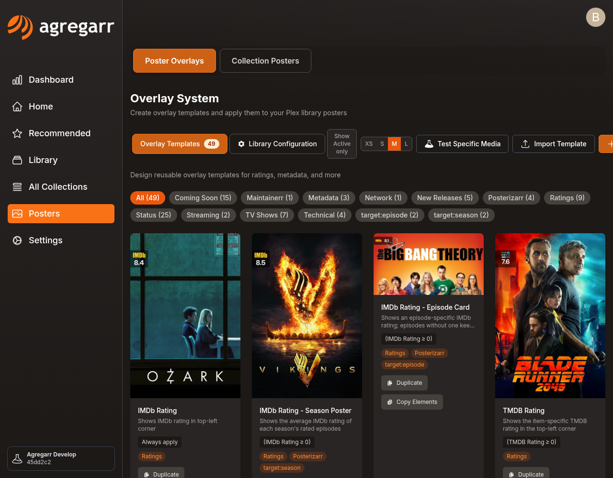

# Overlays

Overlay features this fork adds or changes. For the base overlay concepts, see the [upstream docs](https://agregarr.org).

## Dashboard Sync Progress

The dashboard has an **Overlay Sync** card and a **Collection Sync** card. Each one shows the percentage complete, the item currently being processed, an estimate of the time left, and **Start** / **Stop** buttons. The border colour shows the current state: orange for running, green for done, amber for cancelled, and red for failed.

The **Overlay Sync** card lists each library under **Library progress**. You'll see its state, item counter, and counts for success, errors, unchanged, and filtered. Each library also has separate progress for **Posters**, **Seasons** and **Episodes**, covering each kind of artwork included in the run.

Under **Item results**, the **Success**, **Errors**, **Unchanged** and **Filtered** tiles show their counts. The **Collection Sync** card uses **Collection results** instead, with **Synced**, **Errors**, **Skipped** and **Created** tiles. Click a tile to see the items in that group. The list has a search box.

**Download CSV log** saves the current run to a CSV file. Overlay logs contain Processed At, Library, Outcome, Artwork, Title, File Path, Plex Rating Key, Message and Older Entries Omitted. The log stays in memory, so very long runs drop the oldest entries.

Once the sync finishes, errors remain on the card as expandable lists and appear as icons on collection cards. See [Error Reporting](#error-reporting).

---

## Presets

Presets are ready-made overlay templates on the **Overlay Templates** tab. Switch one on for a library in **Library Configuration**. New libraries start with none enabled. This fork adds or changes these presets:

- **Trailer**: a full-width **TRAILER** banner for Coming Soon placeholder items.
- **Awaiting Download**: a top banner, **AWAITING DOWNLOAD**, for released, monitored items that exist in Radarr or Sonarr but haven't been downloaded yet. TV shows also need **Missing Episode Count (TV)** greater than 0. Custom copies made before this rule was added won't have it. Add **Missing Episode Count (TV)** greater than 0 to both TV sections in the copy's conditions.
- **Audio Codec**: a badge for the best audio track reported by Plex, such as Atmos, DTS:X, or DTS-HD MA. This is for movies only and skips TV shows.
- **Resolution**: a badge showing 4K, 1080, 720, 576, 480, or SD on every item. Switch off the **4K Resolution** preset when using this one, otherwise 4K titles get two badges.
- **Maintainerr Deleting Soon**: see [Maintainerr Countdown](Maintainerr-Countdown.md).

You can't edit or delete preset templates. They stay matched to the built-in versions. To change one, use **Duplicate** to create your own copy, then switch off the preset for that library.

---

## Template Editor

**Canvas Size** is in the editor sidebar, with Width and Height inputs. The default is 1000 x 1500, and the allowed range is 100 to 2000. For landscape templates, use 1500 x 1000.

**Check Layout** is a checkbox in the editor sidebar and is off by default. Switch it on to see the problems it finds, or **No layout issues found** when everything looks right:

- an element extends past the poster edge
- text will be clipped
- text extends beyond its badge
- text overlaps another element, or an overlay selected under **Preview with Other Overlays**

This check is only a guide. It estimates text widths, so it can get things wrong.

**Colour boxes.** The **Fill Color**, **Border Color** and **Text Color** swatches in the editor each have a text box where you can type a colour. Tiles can also change colour based on a rating. See [Color Scale](Color-Scale.md).

**Elements bigger than the poster** are cropped at the poster edge. They aren't shrunk to fit.

**Mapped elements.** When the sample item's value has no mapping, the editor preview shows the first mapping dimmed with a tooltip like `No mapping for "VALUE"`. Nothing is drawn for that item on the finished poster.

---

## Parallel Overlay Processing

Set **Parallel Items** under **Settings > General**. The default is 1, with a range of 1 to 10. Higher values run faster but use more memory.

---

## Per-Library Stop

The **Stop** button on the **Overlay Sync** card stops the scheduled job and every library currently running.

On **Posters > Poster Overlays > Library Configuration**, each running library appears under **Running Jobs** with its own **Stop** button. That one stops just that library, whether the run came from the schedule or from the library's **Sync** button. The library stops after its current items finish. Other libraries keep running.

---

## Active-Only Filter

**Show Active only** on the Overlay Templates tab hides templates that aren't enabled for any library. Once you turn it on, the button reads **Show All**. Your browser remembers the choice.

---

## Removed Libraries

When a library is deleted from Plex, its overlay settings move to **Orphaned Configurations** on the **Library Configuration** tab and are marked **Removed from Plex**. Click **Remove**, then confirm with **Delete configuration?**.

---

## Error Reporting

These were added in v2.9.0:

- **Sync error icons** on collection cards. A red triangle means the last sync failed. Hover over it to see the message, or click it to retry. An orange icon means the sync finished with a warning. Hover over it to see the message.
- **Overlay error details** on the Overlay Sync card. Per-item failures show the title and error, grouped by library. They stay visible after the sync finishes.

---

## See also

- [Overlay Variables](Overlay-Variables.md): variables for release dates, seasons and episodes, editions, and collection ranks
- [Overlay Conditions](Overlay-Conditions.md): show and hide rules for templates and individual elements
- [Color Scale](Color-Scale.md): tile colours that change with a numeric value
- [Maintainerr Countdown](Maintainerr-Countdown.md): deletion countdowns for movies, shows, and seasons
- [Episode Scanning](Episode-Scanning.md): resolution, HDR, Dolby Vision, and audio badges read from episode files
