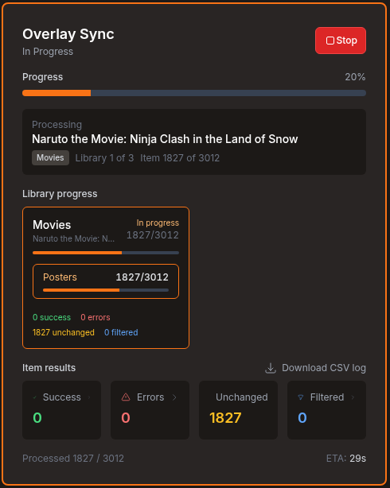
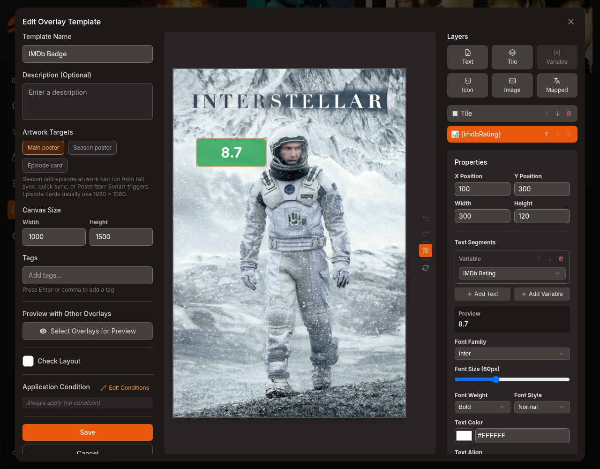
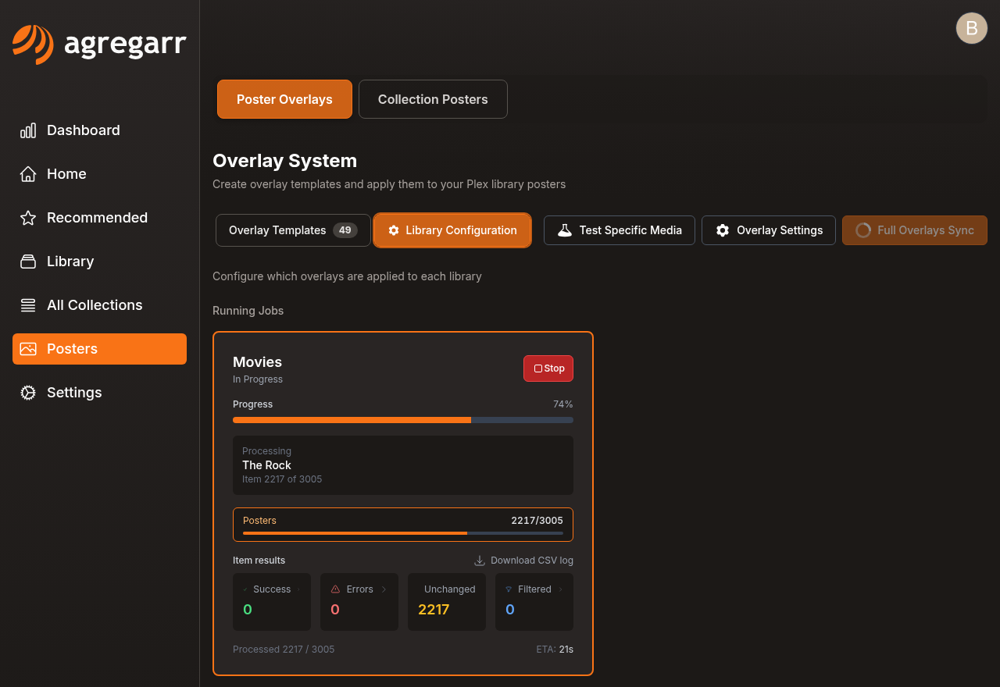

# Overlays

Overlay features this fork adds or changes. For the base overlay concepts, see the [upstream docs](https://agregarr.org).

## Dashboard Sync Progress

The dashboard has an **Overlay Sync** card and a **Collection Sync** card. Each one shows the percentage complete, the item currently being processed, an estimate of the time left, and **Start** / **Stop** buttons. The border colour shows the current state: orange for running, green for done, amber for cancelled, and red for failed.

The **Overlay Sync** card lists each library under **Library progress**. You'll see its state, item counter, and counts for success, errors, unchanged, and filtered. Each library also has separate progress for **Posters**, **Seasons** and **Episodes**, covering each kind of artwork included in the run.

Under **Item results**, the **Success**, **Errors**, **Unchanged** and **Filtered** tiles show their counts. The **Collection Sync** card uses **Collection results** instead, with **Synced**, **Errors**, **Skipped** and **Created** tiles. Click a tile to see the items in that group. The list has a search box.

**Download CSV log** saves the current run to a CSV file. Overlay logs contain Processed At, Library, Outcome, Artwork, Title, File Path, Plex Rating Key, Message and Older Entries Omitted. The log stays in memory, so very long runs drop the oldest entries.

Once the sync finishes, errors remain on the card as expandable lists and appear as icons on collection cards. See [Error Reporting](#error-reporting).

---

## Presets

Presets are ready-made overlay templates on the **Overlay Templates** tab. Switch one on for a library in **Library Configuration**. New libraries start with none enabled. This fork adds or changes these presets:

- **Trailer**: a full-width **TRAILER** banner for placeholder items, from any collection that creates placeholders.
- **Awaiting Download**: a top banner, **AWAITING DOWNLOAD**, for released, monitored items that exist in Radarr or Sonarr but haven't been downloaded yet. TV shows also need **Missing Episode Count (TV)** greater than 0. Custom copies made before this rule was added won't have it. Add **Missing Episode Count (TV)** greater than 0 to both TV sections in the copy's conditions.
- **Audio Codec**: a badge for the best audio track reported by Plex, such as Atmos, DTS:X, or DTS-HD MA. This is for movies only and skips TV shows.
- **Resolution**: a badge showing 4K, 1080, 720, 576, 480, or SD on every item. Switch off the **4K Resolution** preset when using this one, otherwise 4K titles get two badges.
- **Maintainerr Deleting Soon**: see [Maintainerr Countdown](Maintainerr-Countdown.md).

You can't edit or delete preset templates. They stay matched to the built-in versions. To change one, use **Duplicate** to create your own copy, then switch off the preset for that library.

---

## Template Editor

Open the editor from **Posters > Poster Overlays > Overlay Templates**. The sidebar holds the template settings. The canvas in the middle shows a sample poster, and the right panel lists the elements and their **Properties**.

### Template settings

**Canvas Size** has Width and Height inputs. The default is 1000 x 1500, and the allowed range is 100 to 2000. For landscape templates, use 1500 x 1000. On the finished poster the whole template is scaled evenly to fit the poster and centred. A poster that isn't 2:3 gets a small margin on two sides.

**Artwork Targets** picks what the template is drawn on: **Main poster**, **Season poster** or **Episode card**. At least one stays ticked. Ticking **Episode card** on a new, empty template switches the canvas to 1920 x 1080.

**Preview with Other Overlays** draws other templates under this one on the canvas, so you can check they don't collide.

**Check Layout** is a checkbox and is off by default. Switch it on to see the problems it finds, or **No layout issues found** when everything looks right:

- an element extends past the poster edge
- text will be clipped (wider or taller than its box)
- text extends beyond its badge (a visible tile behind the text)
- text overlaps other text, in this template or in an overlay selected under **Preview with Other Overlays**

This check is only a guide. It estimates text widths, so it can get things wrong. It only compares text with text, not with tiles or icons.

The toolbar above the canvas has undo (Ctrl+Z), redo (Ctrl+Shift+Z or Ctrl+Y), a snap-to-guides toggle that is on by default, and **Next Poster** to change the sample item.

**Check the real result on the card.** The image on each template's card on the **Overlay Templates** tab is drawn by the same code that draws your finished posters. If the canvas and the card disagree, the card is right.

### Elements

Add elements with the buttons under **Layers**:

- **Text**: fixed text.
- **Tile**: a coloured box, used as a badge or banner behind text and icons.
- **Variable**: text built from item data, such as a rating or a release date.
- **Icon**: an SVG icon.
- **Image**: a PNG or other picture.
- **Mapped**: an icon picked from the item's data, such as a flag for each audio language.

The list under **Layers** sets the drawing order. The first element in the list is drawn first, so it sits at the bottom. Use the arrows to move an element up or down the list, and the bin to delete it.

Select an element on the canvas or in the list to edit it under **Properties**. Drag it to move it, and drag the handles to resize it. The corner handles keep its shape. Drag the round handle above the box to rotate it. Rotation has no number box. Elements rotate around their centre.

**Elements bigger than the poster** are cropped at the poster edge. They aren't shrunk to fit.

### Position and size

Every element has **X Position** and **Y Position**, in canvas pixels from the top-left corner. Every element except **Mapped** also has **Width** and **Height**, at least 1.

### Text

- **Text**: the words to show. Line breaks are removed, so text is always one line.
- **Font Family**: any font installed in Agregarr. The editor and the finished poster use the same font list.
- **Font Size**: 12 to 150 px.
- **Font Weight**: **Normal** or **Bold**.
- **Font Style**: **Normal** or **Italic**.
- **Text Color**: swatch and text box.
- **Text Align**: **Left**, **Center** or **Right** within the box. Text is always centred top to bottom.
- **Opacity**: 0 to 100%.

Text wider than its box is cut off at the box edge. An empty Text element shows "Sample Text" in the editor so you can find it, and draws nothing on the poster.

### Tile

- **Fill Color** and **Fill Opacity** (0 to 100%).
- **Color Scale**: colour the tile from a rating instead of **Fill Color**. The field list has **IMDb Rating**, **TMDB Rating**, **RT Critic Score** and **RT Audience Score**, and all four colour the tile. See [Color Scale](Color-Scale.md).
- **Border Color** and **Border Width** (0 to 30 px). The border is drawn inside the tile's edge, so the tile doesn't get bigger, and it looks the same on the canvas and on the poster. **Border Color** starts out white. A border wider than half the tile fills the tile with the border colour.
- **Corner Radii**: 0 to 100 px. With the button set to **Locked**, one **Border Radius** slider sets all four corners. Click it to switch to **Unlocked** and set **Top Left**, **Top Right**, **Bottom Left** and **Bottom Right** separately. A radius bigger than half the tile's shorter side is cut down to fit.

**Fill Opacity** fades only the fill. The border stays solid.

### Variable

A Variable element joins **Text Segments** into one line. Click **Add Text** for fixed words and **Add Variable** for item data. Use the arrows to reorder segments. **Preview** shows the result for the sample item.

Date variables have a **Date Format** list, such as `DEC 20`, `20/12/2025` or `MON 20/12`. The default is `DEC 20`. The canvas shows the format you pick.

The font settings are the same as for **Text**: **Font Family**, **Font Size**, **Font Weight**, **Font Style**, **Text Color**, **Text Align** and **Opacity**. Like Text, a Variable draws one line, and anything wider than the box is cut off. The canvas shows it the same way.

If the item has no value for a variable in the element, the whole template is skipped for that item, tiles and icons included. The editor shows an example value instead, so the canvas always has something to show. A template can only have one Variable element that has no condition.

For the list of variables, see [Overlay Variables](Overlay-Variables.md).

### Icon

- **Icon**: pick an SVG from the icon library or upload one. The element resizes to the icon's own size when you pick it.
- **Opacity**: 0 to 100%.
- **Grayscale**: show the icon in shades of grey.

The icon is scaled to fit inside its box without changing its shape, and centred.

### Image

- **Image**: pick a PNG or other picture from the icon library, or upload one.
- **Opacity**: 0 to 100%.

The image is scaled to fit inside its box without changing its shape, and centred.

### Mapped

A Mapped element reads one field from the item and shows an icon for each value it has a mapping for.

- **Source Field**: the field to read, such as **Resolution**, **Audio Languages (All)**, **Network** or **Streaming Provider (ID)**. Changing it loads your saved mappings for that field, or the defaults if you haven't saved any.
- **Rating Country**: shown for **Content Rating**. Picks the country whose rating is used.
- **Icon Mappings**: shows how many mappings the element has. **Edit Mappings** opens the list of values and their icons. Matching ignores upper and lower case.
- **Layout**: **Horizontal**, **Vertical** or **Grid**. **Grid Columns** (2 to 12) appears for Grid.
- **Icon Size**: 16 to 300 px. Each icon fits inside a square of this size and keeps its shape.
- **Spacing X** and **Spacing Y**: -20 to 100 px between icons. Negative values overlap them.
- **Max Icons**: 0 to 50. 0 means unlimited.
- **Opacity**: 0 to 100%.
- **Grayscale**: show the icons in shades of grey.

**Layout**, the spacing sliders and **Max Icons** only appear for fields that can hold more than one value, such as languages. Single-value fields like **Resolution** show one icon.

The element's size comes from **Icon Size**, the layout and the number of icons, so it has no **Width** or **Height** and no resize handles. **Check Layout** estimates its size from the number of mappings.

**Values with no mapping.** If the element has no mapping for a value, Agregarr uses your saved mappings for that field, or the defaults if you haven't saved any. If neither covers it, nothing is drawn for that value. To hide a value, delete its mapping in **Edit Mappings**. If you delete every mapping for a field, the defaults come back. The canvas follows the same rules. When nothing covers the sample item's value, the canvas shows the first mapping dimmed with a tooltip like `No mapping for "VALUE"`, so you can still see where the element sits.

### Colour boxes

The **Fill Color**, **Border Color** and **Text Color** swatches each have a text box where you can type a colour. See [Color Scale](Color-Scale.md#colour-text-box) for the formats.

### Troubleshooting

**Can't select, drag, or resize elements?** Brave Shields randomise canvas data to block fingerprinting. This can stop the editor working out which element you clicked. Try turning Shields off for your Agregarr address using the lion icon in the address bar, then reload the page. Other browsers or extensions that block canvas fingerprinting may cause the same problem.

---

## Parallel Overlay Processing

Set **Parallel Items** under **Settings > General**. The default is 1, with a range of 1 to 10. Higher values run faster but use more memory.

---

## Per-Library Stop

The **Stop** button on the **Overlay Sync** card stops the scheduled job and every library currently running.

On **Posters > Poster Overlays > Library Configuration**, each running library appears under **Running Jobs** with its own **Stop** button. That one stops just that library, whether the run came from the schedule or from the library's **Sync** button. The library stops after its current items finish. Other libraries keep running.

---

## Active-Only Filter

**Show Active only** on the Overlay Templates tab hides templates that aren't enabled for any library. Once you turn it on, the button reads **Show All**. Your browser remembers the choice.

---

## Removed Libraries

When a library is deleted from Plex, its overlay settings move to **Orphaned Configurations** on the **Library Configuration** tab and are marked **Removed from Plex**. Click **Remove**, then confirm with **Delete configuration?**.

---

## Error Reporting

These were added in v2.9.0:

- **Sync error icons** on collection cards. A red triangle means the last sync failed. Hover over it to see the message, or click it to retry. An orange icon means the sync finished with a warning. Hover over it to see the message.
- **Overlay error details** on the Overlay Sync card. Per-item failures show the title and error, grouped by library. They stay visible after the sync finishes.

---

## See also

- [Overlay Variables](Overlay-Variables.md): variables for release dates, seasons and episodes, editions, and collection ranks
- [Overlay Conditions](Overlay-Conditions.md): show and hide rules for templates and individual elements
- [Overlay Examples](Overlay-Examples.md): worked examples, such as one banner whose wording changes with the release date
- [Color Scale](Color-Scale.md): tile colours that change with a numeric value
- [Maintainerr Countdown](Maintainerr-Countdown.md): deletion countdowns for movies, shows, and seasons
- [Episode Scanning](Episode-Scanning.md): resolution, HDR, Dolby Vision, and audio badges read from episode files
