# Rotation

## What a rotation does

A rotation shares a few Home rows across a bigger set of collections and swaps them on a schedule. Say you have 37 collections but only want 5 rows of them on Home: make a rotation with 5 slots, add all 37, and each collection gets its turn.

Every collection stays in your library the whole time. A rotation only changes which ones show on Home and Library Recommended, and where.

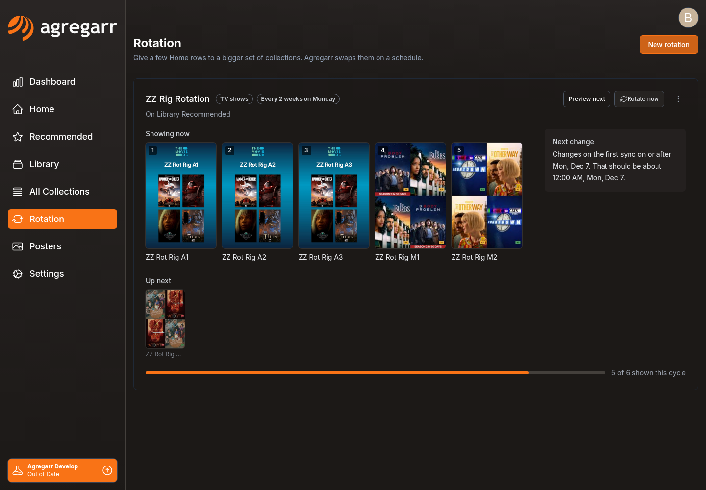

## Rotation or Cycle Lists?

Both keep Home changing, but they start from different places:

- **Cycle Lists**: you have lots of lists (Trakt, Letterboxd, IMDb) and want them to take turns in one row. Only the list that's showing exists as a collection. See [Cycle Lists](Cycle-Lists.md).
- **Rotation**: you already have collections in Plex, whether Agregarr made them, you made them by hand, or another tool did, and you want a few of them on Home at a time.

## Examples

**Five rows, daily, from 37 collections.** Slots 5, **Every day**, tick all 37. Each day the five that have been showing longest step aside for the next five in line.

**One "best of" collection at a time.** Ten best-of-year collections, Slots 1, **Every week**. Home shows one of them each week.

**A big set of lists spread out over weeks.** Put 60 lists into collections, then split them across two rotations, one on **every 2 weeks** and one on **every 3 weeks**, each with a few slots. You get a steady change without building date ranges by hand.

## Before you start

- Collections need to exist in Plex. Collections Agregarr makes can join once they've synced.
- Collections made by hand or by another tool can join once Agregarr has found them. Press **Look for collections in Plex** under the collection list in the editor.
- A rotation works inside one library. To rotate collections from two libraries, make two rotations.

The collection list greys out anything that can't join and says why:

- It creates several collections, but a slot can only hold one.
- It's visible to one user only, which would leave the slot empty for everyone else.
- It marks or replaces a Plex row and doesn't rotate (filtered hubs, for example).
- It has your exclude-from-ordering label, so Agregarr leaves it alone.
- It's in another library.
- It's already in another rotation.

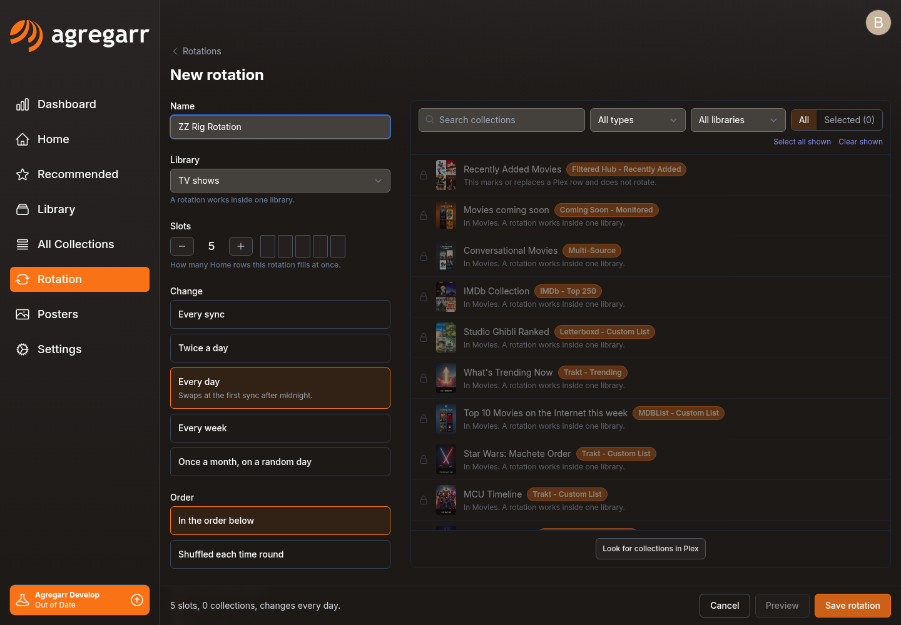

## Create your first rotation

1. Open **Rotation** in the sidebar and press **Create a rotation** (later ones use **New rotation**).
2. **Name**: anything you like, such as Movie night.
3. **Library**: pick one. You can't change it after saving.
4. **Slots**: how many Home rows the rotation fills at once, 1 to 20.
5. **Change**: how often collections swap (see "When does it change?" below). **Every week** opens two dropdowns: how often (**every week**, or **every 2 weeks** up to **every 6 weeks**) and which day. Gaps of 2 weeks or more count from the chosen day in the week you save, so the first swap can come a few days sooner than the full gap. **Next change** on the Rotation page shows the exact date.
6. **Order**: **In the order below** or **Shuffled each time round**.
7. **Where the slots appear**: **Users Home**, **Server Owner Home** and **Library Recommended**. Pick at least one.
8. **Rotation is on**: leave it on to start straight away.
9. Tick the collections you want. **Search collections**, the filters, **Select all shown** and **Clear shown** help with long lists.
10. Press **Preview**. **If you save this** shows what goes on Home straight away, what's next, and which collections will leave Home until their turn or go back to their own settings.
11. Press **Save rotation**. If anything is leaving Home, the button says **Save and start rotating**.

Agregarr starts pinning the first batch as soon as you save. It usually lands in Plex within seconds, and you don't need to wait for a sync.

Names can be up to 60 characters, and a rotation can hold up to 500 collections.

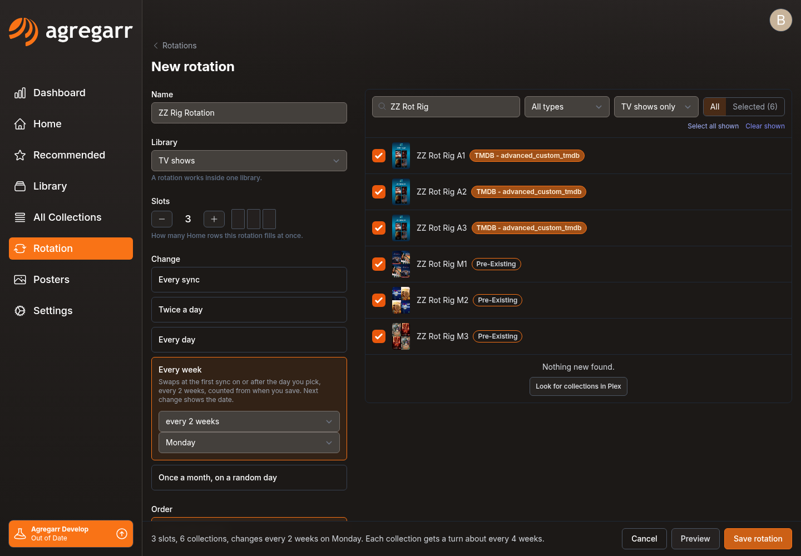

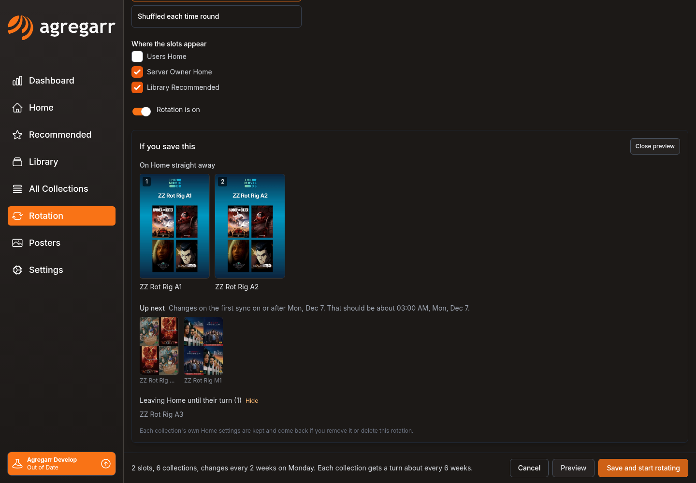

## Reading the Rotation page

- **Showing now**: the collections in the slots right now.
- **Up next**: who's next, plus a count of the rest.
- **Next change**: when the next swap should happen, and when it last changed.
- **Cycle progress**: for example "12 of 37 shown this cycle". Every ready collection gets a turn before any of them repeats.
- **Updating Plex…** or **Plex will catch up on the next sync**: the change is saved and Plex hasn't caught up yet.

Warnings show under the card as full sentences that say what's wrong and what to do. The ones you're most likely to see:

- Not enough ready collections for the slots, so nothing will change. Add collections or use fewer slots.
- A slot is empty because nothing is ready to fill it.
- Some collections are sitting out. Press **Show** to see each one and why: usually it's outside its own schedule, isn't in Plex yet (it joins after its next sync), or its settings changed so it can no longer rotate (remove it).
- A collection is no longer in Plex. Remove it, or leave it and it rejoins if it comes back with the same name. Saving the rotation or turning it off and on keeps it.
- A collection was recreated in Plex and has rejoined. Nothing to do.
- Agregarr no longer has its own Home settings for a collection, so it'll be left off Home when it leaves the rotation.
- Your sync runs less often than the rotation, so it'll change once per sync.
- The saved data is damaged. Delete the rotation and make it again.

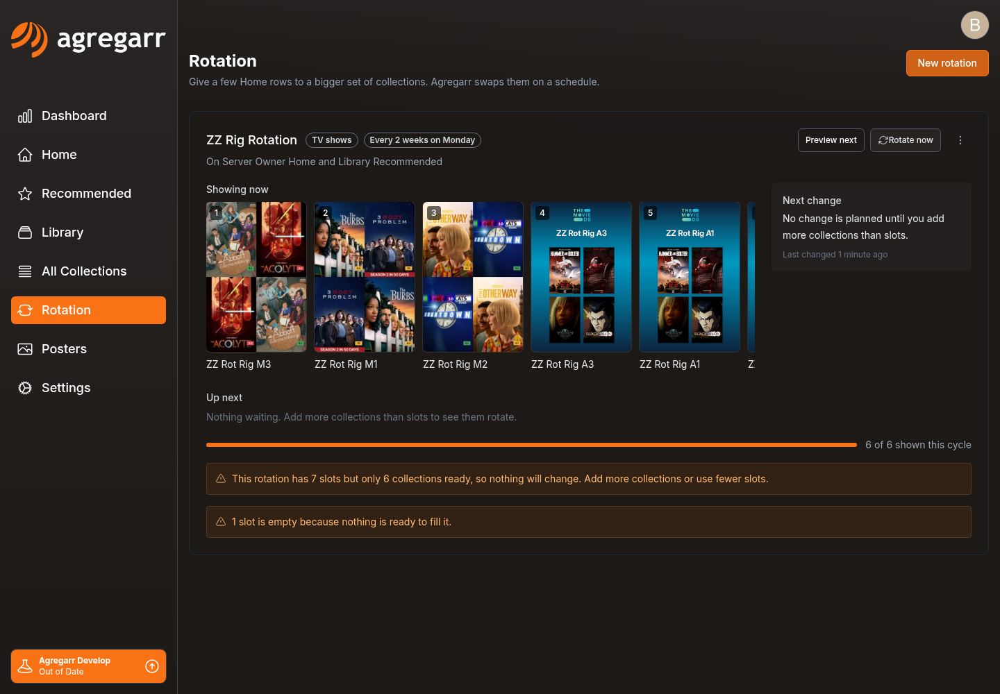

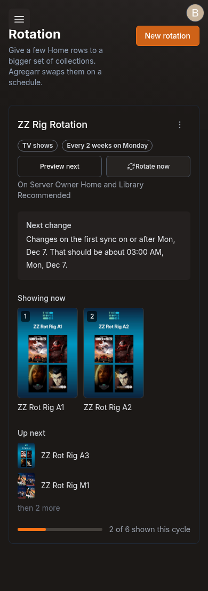

## When does it change?

Swaps happen during a full collections sync, not at an exact time. The first full sync in each new period does the swap; quick syncs don't. Days and midnight follow your server's time zone (the `TZ` setting on the container).

| Change | When it swaps |
| --- | --- |
| Every sync | Every full sync |
| Twice a day | First sync after midnight, and first after midday |
| Every day | First sync after midnight |
| Every week | First sync on or after the day you pick |
| Every 2 to 6 weeks | First sync on or after the day you pick, every 2 to 6 weeks counting from when you saved the schedule |
| Once a month, on a random day | First sync on or after a day Agregarr picks each month |

For a monthly rotation, the month you create it in counts as done.

If your sync runs less often than the rotation, it changes once per sync. **Next change** shows the expected time of the sync that will swap.

### How a swap works

Only as many slots change as there are collections waiting. The ones that have been showing longest step aside first, and the rest keep their rows. With 6 collections in 5 slots, one row changes each time; with 37 collections in 5 slots, all five change.

### Swap now

Press **Rotate now** on the card to swap straight away; Plex should update within seconds. **Preview next** shows the next few swaps before they happen. **Rotate now** is unavailable while a sync is running; **Preview next** still works.

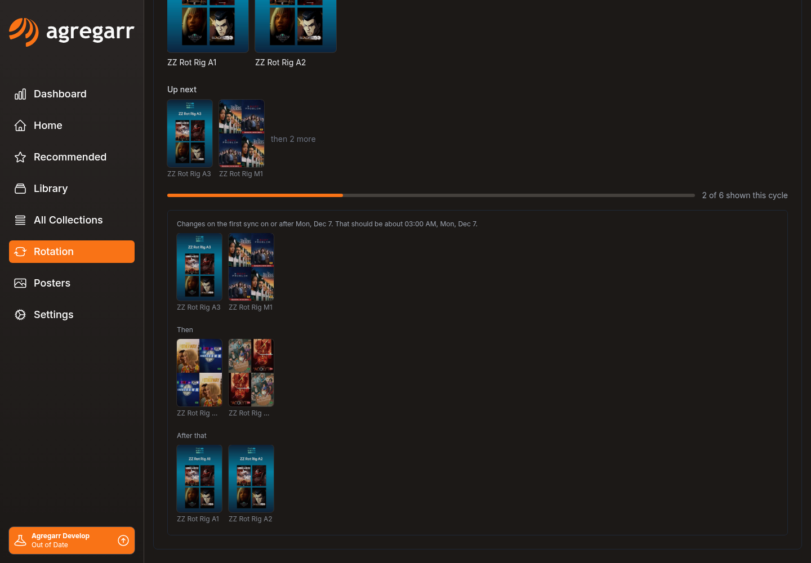

## Your collections' own settings

While a collection is in a rotation, the rotation looks after its Users Home, Server Owner Home, Library Recommended, Home position and **Randomize Home Order**. A collection waiting its turn stays in the library's Collections tab; only its Home pin changes.

A collection in a rotation shows an **In rotation: [rotation name]** badge with **On Home now** or **Waiting its turn**, and its edit form shows a notice. Changes you make to those settings there are kept as the collection's own settings and come back when it leaves the rotation.

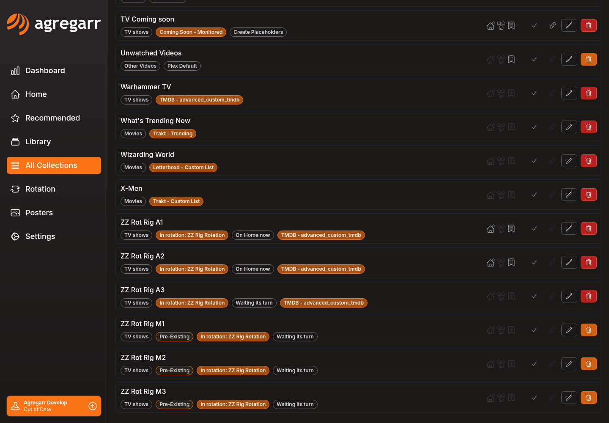

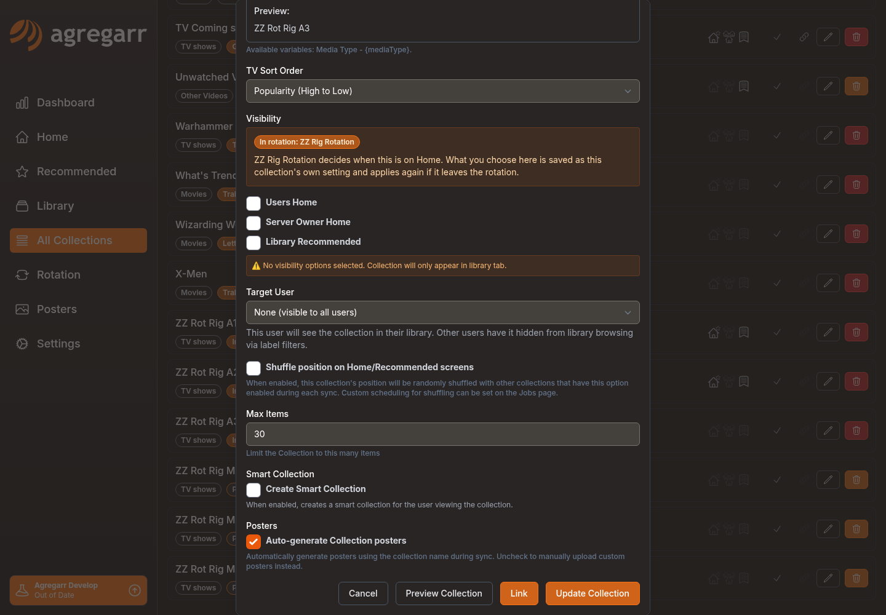

- **Turn off**: every collection goes back to its own Home settings. Turn it on again to restart.
- **Remove a collection**: that collection goes back to its own settings.
- **Delete**: every collection goes back to its own Home settings.
- **Deleted in Plex**: the card shows a warning and the rotation skips it.

When collections leave a rotation, rows that were never in it keep their order. When you turn a rotation off or delete it, collections that were showing keep their place. Any other collection that goes back on Home, including one you remove while it's showing, goes to the bottom of the Home order, where you can drag it.

## Moving a slot on the Home page

In the Home ordering list, each filled slot shows as a slot row named after the rotation, such as "Movie night, slot 1 of 5". Drag the row to move that slot; whichever collection takes the slot next uses the same spot. **Manage rotation** on the row opens the rotation.

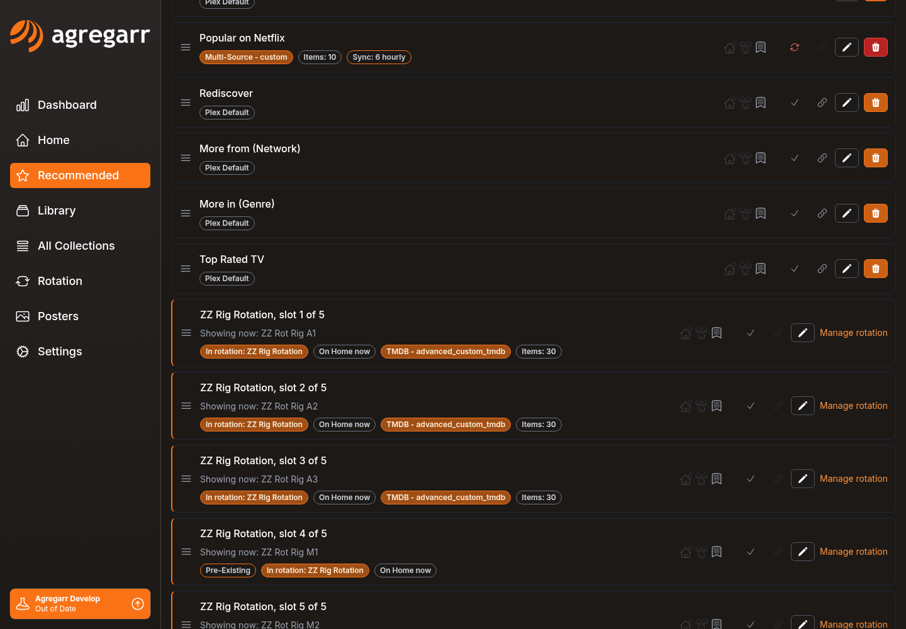

## Tips and limits

- One library per rotation, and a collection can only be in one rotation.
- A collection with its own time restriction sits out while it's outside its schedule, and joins at the next swap once the schedule opens, not straight away. While it's in a rotation, its own "when inactive" Home settings are paused too.
- If you don't have more collections than slots, nothing rotates.
- Collections visible to only one user can't join.
- Everyone on the server sees the same batch. **Users Home** reaches every user the server is shared with.
- Rotations aren't included in collection exports. An exported collection carries its own settings.

## FAQ

**Why did a collection vanish from Home?**

It's waiting its turn. Look for **Waiting its turn** on its badge. It's still in the library.

**Can I choose what shows next?**

Yes. Edit the rotation and press **Show next** beside a waiting collection to move it to the front of the queue. Only use it when no sync is running.

**Does this delete anything from Plex?**

No. A rotation only changes which collections show on Home and Library Recommended, and their Home order.

**I use another tool that recreates my collections.**

If exactly one collection comes back in the same library with the same name (case doesn't matter), it rejoins the rotation and you'll see a notice.

**I pinned a waiting collection in Plex (or Kometa did), and it disappeared again.**

While a collection is in a rotation, Agregarr owns its Home pin and puts it back on the next sync. Unpin rotation collections in Plex and other tools, or take the collection out of the rotation.

**Will it swap at midnight exactly?**

No. It swaps during the first full sync after midnight.

**I made a rotation and nothing changed.**

Check for the "nothing will change" warning. You need more collections than slots.

**Can I pause it?**

Yes. Open **More actions** and choose **Turn off**.

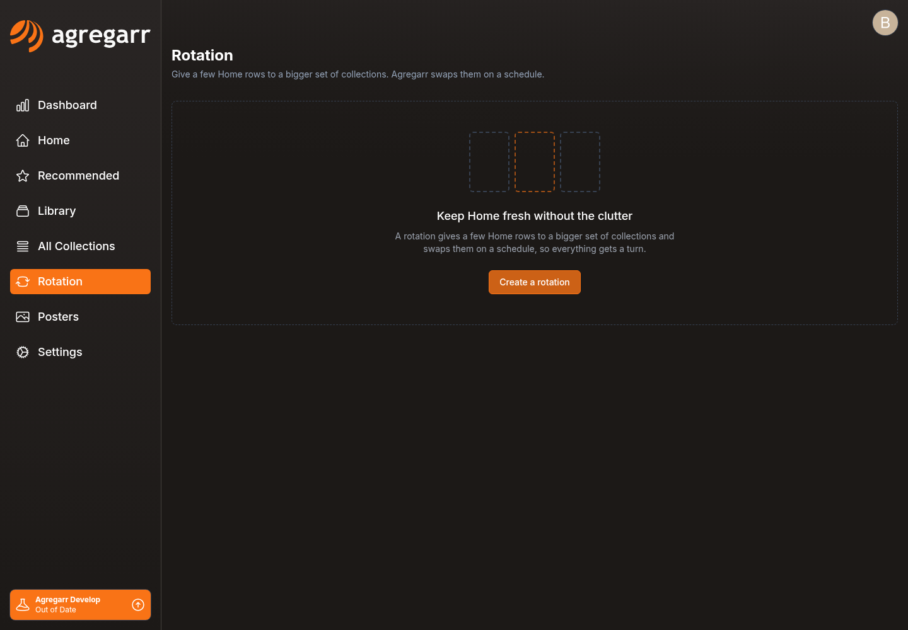
