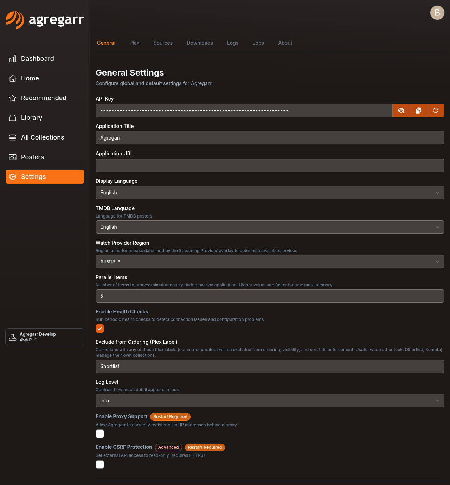
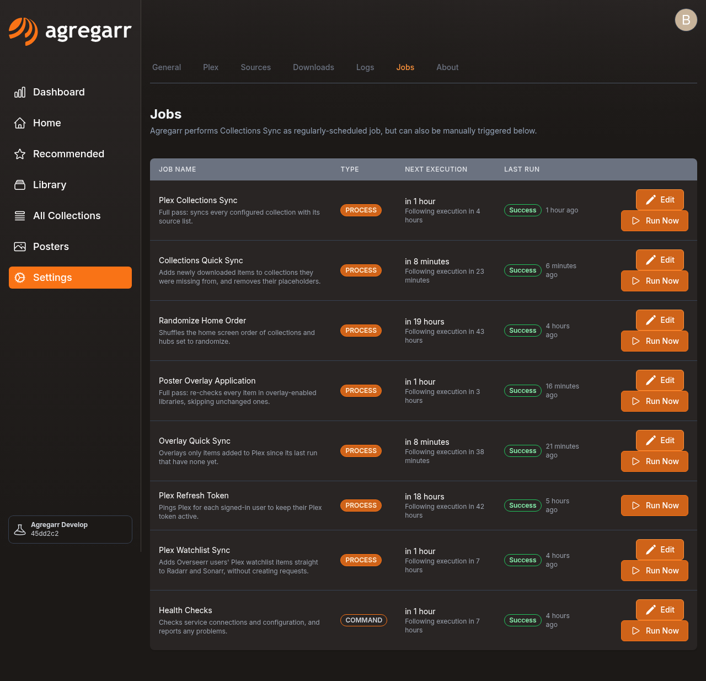

# Settings

Settings added or changed by this fork. For everything else in Settings, including the Plex connection, Radarr and Sonarr servers, Trakt, and other sources, see the [upstream docs](https://agregarr.org).

The Settings screen has seven tabs: **General**, **Plex**, **Sources**, **Downloads**, **Logs**, **Jobs** and **About**.

---

## Container environment variables

Set these in the Docker Compose `environment:` list. Agregarr reads them when the container starts.

| Variable | Default | What it does |
|----------|---------|--------------|
| `PUID` | `99` once either `PUID` or `PGID` is set | The user ID Agregarr runs as. Use the ID of the user who owns your media folders (`id -u`). |
| `PGID` | `100` once either is set | The group ID Agregarr runs as (`id -g`). |
| `UMASK` | `022` | The permission mask for files and folders Agregarr creates. Only applied when `PUID` or `PGID` is set. |
| `TZ` | unset (UTC) | Your timezone, e.g. `Australia/Sydney`. Agregarr uses it to work out calendar days for air dates. See the [timezone check](Health-Checks.md#the-timezone-check). |
| `LOG_LEVEL` | `info` | The starting log level. See [Log Level](#log-level). |

Without `PUID` or `PGID`, Agregarr runs as the container's default user and ignores `UMASK`. Set either one and the container creates the user and group if needed, takes ownership of the config folder (`/app/config`), then runs as that user.

```yaml
environment:
  - TZ=Australia/Sydney
  - PUID=1000
  - PGID=1000
  - UMASK=022
```

Use the `PUID` and `PGID` of the user that owns your media directories. On Unraid, use `PUID=99` and `PGID=100`. Agregarr only changes ownership of the config folder. It doesn't touch your placeholder folders, so the same user needs write access to those too. The **Data Directory** health check reports when Agregarr can't write to the config folder. See [Health Checks](Health-Checks.md).

---

## General

**Settings > General**.



### Log Level

**Log Level** controls how much detail Agregarr writes to the logs. The options are **Error**, **Warning**, **Info** and **Debug**. The default is **Info**. Save the setting and it changes straight away, with no restart needed.

**Debug** writes the lot, including one line per item for things like overlay change checks. Use it while chasing a problem, then turn it back down. **Error** shows only errors, **Warning** adds warnings, **Info** adds routine progress, and **Debug** adds everything.

The `LOG_LEVEL` environment variable only sets the initial value. Once Agregarr has saved its settings, it uses the saved Log Level at startup instead. Change it here rather than in the environment.

Logs go into the `logs` folder inside your config folder. They rotate daily or when they reach 20 MB, get compressed after rotation, and stay around for 7 days. **Settings > Logs** shows them with a severity filter.

### Watch Provider Region

**Watch Provider Region** is a country list. The default is United States (`US`). Its tip reads: "Region used for release dates and by the Streaming Provider overlay to determine available services".

Changing it affects:

- **Streaming provider**: the provider shown for a title comes from that country's list. This applies to the Streaming Provider overlay and the streaming provider variables.
- **Movie release dates**: for each type (cinema, digital, physical), Agregarr uses the earliest date in that country. If the country has no date of that type, it falls back to the earliest date from any country. These dates feed the overlay variables and the release date used for Coming Soon placeholders.

Release dates are cached separately by region, so changing the setting doesn't need a cache clear. Overlays use the new region the next time they run.

### Parallel Items

**Parallel Items** sets how many items Agregarr processes at once while applying overlays. It accepts a number from 1 to 10. The default is 1. Higher values run faster but use more memory. See [Performance](Performance.md#overlays).

### Exclude from Ordering (Plex Label)

**Exclude from Ordering (Plex Label)** takes a comma-separated list of Plex labels. It's empty by default.

Agregarr leaves matching collections alone if it didn't create them. It won't reorder them, enforce their visibility, or manage their sort title. This is useful for collections managed by another tool, such as Shortlist or Kometa.

Labels match exactly or as a prefix followed by an underscore, and case doesn't matter. `Shortlist` matches `Shortlist` and `Shortlist_alex`. Agregarr refreshes the flag whenever it discovers collections, so adding or removing a label takes effect on the next sync.

### Enable Health Checks

**Enable Health Checks** is on by default. Clear it to stop the checks and hide the **Health Checks** section on the About tab. See [Health Checks](Health-Checks.md).

---

## Plex

**Settings > Plex**.

### Collection Sort Format

**Collection Sort Format** controls how Plex treats a leading "The", "A" or "An" when sorting collections. The default is **Off (sort exactly as typed)**.

- **Strip (e.g. "The Accountant" → "Accountant")**: sorts as "Accountant".
- **Move to End (e.g. "The Accountant" → "Accountant, The")**: sorts as "Accountant, The".

This only changes the sort title, never the collection name. Move to End groups titles by article, but it can split up a series: "Matrix Reloaded, The" sorts before "Matrix, The". If another tool such as Kometa also sets sort titles, use the same scheme in both tools or turn one off.

### Auto Empty Trash

**Auto Empty Trash** is on by default and marked as an advanced setting. After cleaning up placeholders, Agregarr may empty the library's Plex trash to remove ghost entries. This also removes unrelated items already sitting in the trash. Turn it off if you don't want that. See [Placeholders](Placeholders.md#direct-plex-deletion).

---

## Downloads

**Settings > Downloads** contains the placeholder folder and trailer settings. The relevant pages cover them in more detail:

- **Placeholder Root Folders** and the folder naming options: [Placeholders](Placeholders.md#placeholder-folders).
- Trailer sources, word lists and **YouTube Cookie Configuration**: [Integrations](services/trailers.md#what-agregarr-uses-trailers-for).
- **Seerr Settings**: [Integrations](services/seerr.md).
- **Plex Webhook**: [Placeholders](Placeholders.md#watch-state).

## Sources

**Settings > Sources** contains the Cloudflare solver list, the Letterboxd option, Tracearr and Maintainerr. See [Integrations](services/index.md).

---

## Jobs

**Settings > Jobs** lists the scheduled jobs. Each row shows a one-line description under the name, a **Last Run** badge, an **Edit** button for changing the frequency, and **Run Now**. **Plex Refresh Token** runs on a fixed schedule, so it has no **Edit** button.



The defaults are:

| Job | Default | What it does |
|-----|---------|--------------|
| Plex Refresh Token | Daily at 05:00 | Pings Plex for each signed-in user to keep their Plex token active. |
| Plex Collections Sync | Every 12 hours | Full pass: syncs every configured collection with its source list. |
| Collections Quick Sync | Every 30 minutes | Adds newly downloaded items to collections they were missing from, and removes their placeholders. |
| Randomize Home Order | Daily at 06:00 | Shuffles the home screen order of collections and hubs set to randomize. |
| Poster Overlay Application | Daily at 03:00 | Full pass: re-checks every item in overlay-enabled libraries, skipping unchanged ones. |
| Overlay Quick Sync | Every 30 minutes | Overlays only items added to Plex since its last run that have none yet. |
| Plex Watchlist Sync | Every 6 hours | Adds Overseerr users' Plex watchlist items straight to Radarr and Sonarr, without creating requests. |
| Health Checks | Every 6 hours | Checks service connections and configuration, and reports any problems. |

The **Last Run** badge and run history are covered in [Health Checks](Health-Checks.md#job-history).
