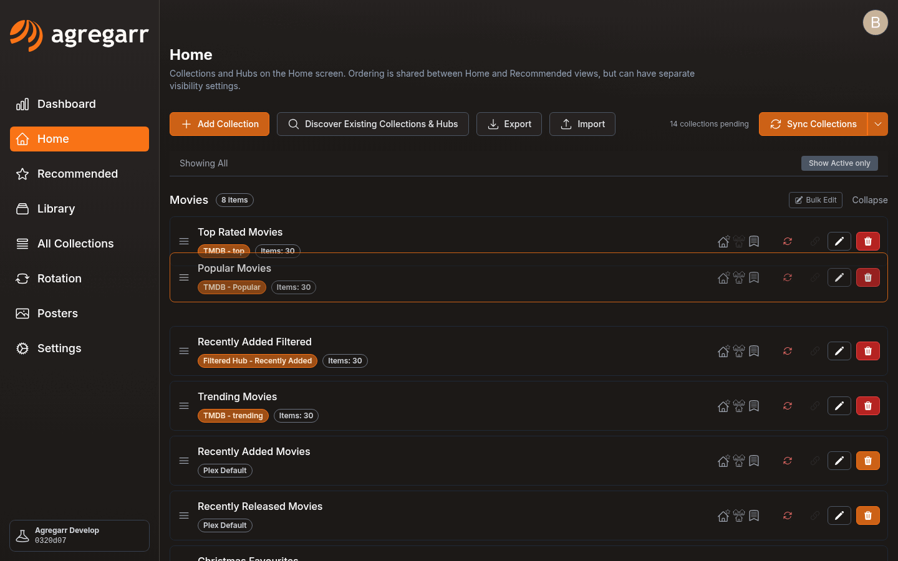
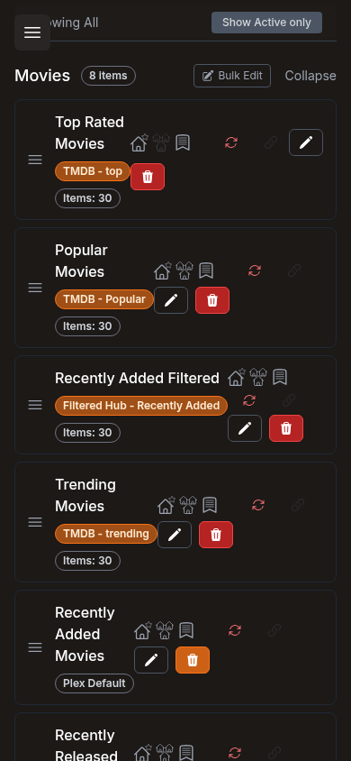

# Order the rows on Plex Home

Set the order of your collections and Plex's own hubs on Plex Home and the Recommended tab. Agregarr saves the row's position when you drop it, then writes the order to Plex on the next sync.

## Before you start

- **Discover Existing Collections & Hubs** has been run. See [Your first collection](../get-started/first-collection.md).
- Each row you want to place has **Users Home**, **Server Owner Home** or **Library Recommended** ticked. A row with none ticked doesn't appear on **Home** or **Recommended**. See [Visibility and time restrictions](../collections/form/visibility.md).
- Know which page each row lives on. **Home** lists rows with **Users Home** or **Server Owner Home** ticked. **Recommended** lists rows with **Library Recommended** ticked. [Home, Recommended and Library explained](home-recommended-library.md) covers why.

## Set it up

1. Click **Home** in the sidebar. Each library has its own group, with its rows underneath.
2. Drag a row using the handle on its left, then drop it in the new position. You can place it between any two rows, including Plex Default hubs and Pre-Existing collections.

    **Check:** a message reads "Mixed collections reordered successfully!" and the row stays where you dropped it after reloading the page.

    === "Desktop"

        

    === "Phone"

        

3. For rows that appear only on **Recommended**, click **Recommended**, choose the library's tab and drag them there. A row that also appears on **Home** is greyed out here with **Ordering controlled in Home tab**. Move it on **Home** instead.
4. Click **Sync Collections**.

    **Check:** after the sync finishes, the status line next to the button reads "Last sync:" with a time from a moment ago. A "Next sync:" line appears underneath. If the status line reads "N collections pending" or "Last sync failed", the sync didn't finish cleanly. Otherwise, the order is now in Plex.

## Check it worked

Open Plex and refresh Home. The rows appear in the order shown on **Home** in Agregarr. Rows from other tools and Plex hubs that Agregarr doesn't manage sit below them. Open a library's Recommended tab to see the same order for rows with **Library Recommended** ticked.

## When Agregarr writes the order to Plex

Dropping a row only saves its position in Agregarr. Plex changes when one of these runs:

- A full collections sync using **Sync Collections** or the **Plex Collections Sync** job under **Settings > Jobs**. It runs every 12 hours by default.
- A sync of a single collection.
- A run of the **Randomize Home Order** job. See [Shuffle the Home order](shuffle-home.md).
- A rotation change. See [Show a different set of collections on Home](rotation.md).

A Collections Quick Sync doesn't write the order.

## Rows you can't drag

A lock replaces the handle when:

- the row is greyed out on **Recommended** because **Home** controls it;
- the row is a Pre-Existing collection excluded from ordering;
- the row is an A-Z row on **Library**.

To exclude a Pre-Existing collection, open **Settings > General** and add one of its Plex labels to **Exclude from Ordering (Plex Label)**. Separate multiple labels with commas. A collection matches when one of its labels exactly matches a listed value or starts with that value followed by an underscore. Case doesn't matter.

The lock appears after the next Discover or full sync. Agregarr then leaves the collection's order, visibility and sort title alone. This setting only applies to Pre-Existing collections. An Agregarr collection or Plex Default hub with the label stays draggable.

### Rotation slots

A rotation shows each filled slot as a row named after the rotation, such as "Movie night, slot 1 of 5". Drag the row to move the slot. See [Moving a slot on the Home page](rotation.md#moving-a-slot-on-the-home-page).

## Variations

??? note "Order the Library tab"
    **Library** has its own order and doesn't move anything on **Home**. See [Promote collections above the A-Z list](promote-library.md).

??? note "Take a row off Home"
    Click the bin icon on a hub or Pre-Existing row and confirm **Hide**. This unticks all three visibility boxes on that row and every linked copy in your other libraries. Nothing is deleted.

## What it doesn't do

- It doesn't reorder the library's Collections tab.
- It doesn't move the row Plex keeps at the top of Home.
- It doesn't keep a shuffled row where you put it. A row with **Shuffle position on Home/Recommended screens** ticked moves again at the next shuffle.

## If it didn't work

- **Plex still shows the old order.** A full sync hasn't run since you dropped the row. Click **Sync Collections**, then refresh Plex.
- **A row has jumped to a new place.** Its shuffle box is ticked. See [Shuffle the Home order](shuffle-home.md).
- **The order is right in Agregarr and wrong for one user.** The row's **Target User** or **Users Home** box hides it from that user. See [Visibility and time restrictions](../collections/form/visibility.md#who-sees-it).

## Related

- [Home, Recommended and Library explained](home-recommended-library.md)
- [Collection pages](../collections/pages.md#reordering)
- [Adopt collections and hubs you already have](../collections/adopt-existing.md)
- [Show a different set of collections on Home](rotation.md)
