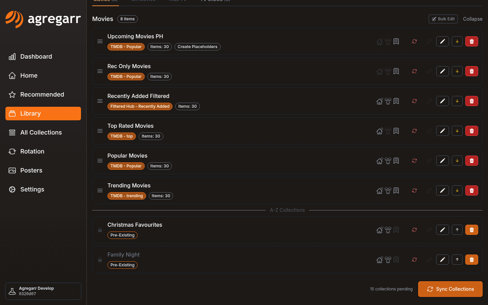
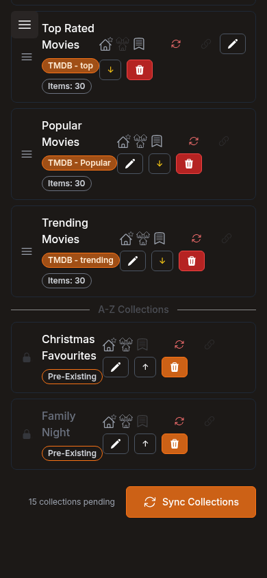

# Promote collections above the A-Z list

Put the collections you care about at the top of a library's **Collections** tab in Plex, in an order you choose, with everything else listed alphabetically underneath.

This doesn't affect your Plex Home screen. Home and **Recommended** use their own order, which you set on [the Home page](../collections/pages.md#home).

## Before you start

- The collections are on the **Library** page in Agregarr. Collections created by hand in Plex or by another tool appear there as **Pre-Existing** after you run **Discover Existing Collections & Hubs**. See [Adopt collections and hubs you already have](../collections/adopt-existing.md).
- Plex's own default hubs never appear on **Library**, so you can't promote them.

New collections created in Agregarr start promoted. Auto Franchise collections are the exception and start in the A-Z section. Collections imported by Discover also start in the A-Z section.

## Set it up

1. Click **Library** in the sidebar, then click your library's tab.

    **Check:** promoted rows sit at the top. A divider labelled **A-Z Collections** separates them from the rest. The divider only appears when both sections contain rows. A-Z rows show a padlock where the drag handle would normally be.

    === "Desktop"

        

    === "Phone"

        

2. Click the up arrow on an A-Z row. Hover over it to read "Promote to top section with custom ordering".

    **Check:** a toast says "Collection promoted to top section successfully!" and the row moves above the divider, at the bottom of the promoted rows. Its sync icon changes to the red **Needs Sync** arrow.

3. Use the handle to drag the row where you want it.

    **Check:** a toast says "Mixed collections reordered successfully!" and the row stays where you dropped it. If the row had a **Sort Title** typed on it, dragging clears that value and a second message says "Sort Title override cleared - the collection now uses its dragged position." Only promoted rows can be dragged and only among other promoted rows. A row can't cross the divider. Use the arrows to move it between sections.

4. Click **Sync Collections**.

    **Check:** the red **Needs Sync** arrow is gone from the row. In Plex, open the library and click its **Collections** tab. Your promoted collections appear first in the order you set. Everything else follows alphabetically.

## What the number in the title means

Plex orders collections by sort title rather than the displayed name. Agregarr builds each promoted collection's sort title from `!`, a three-digit position, an underscore and the collection's name. For example, `!001_Trending Today`. The `!` sorts before letters, keeping promoted collections above the A-Z collections. The number controls their order within the promoted section.

Plex still shows the plain collection name. You only see the sort title in Agregarr's **Sort Title** field. Each library supports positions from 1 to 999.

A-Z collections sort by name. Numbers at the start of a name are read as numbers, so "3 Men" comes before "28 Days". **Settings > Plex > Collection Sort Format** decides what happens to a leading "The", "A" or "An". It can keep the name unchanged (**Off (sort exactly as typed)**), remove the article (**Strip (e.g. "The Accountant" → "Accountant")**) or move it to the end (**Move to End (e.g. "The Accountant" → "Accountant, The")**). It changes only the sort title, never the name you see.

## Variations

??? note "Demote a collection back to the A-Z list"
    Click the down arrow on a promoted row. Hover over it to read "Demote to alphabetical section". A toast says "Collection moved to alphabetical section successfully!" and the row moves below the divider. Any rows below it in the promoted list move up to fill the gap. Click **Sync Collections** to apply the change in Plex.

    The demoted collection goes back to sorting by name. Agregarr doesn't restore a sort title that you set by hand in Plex before promoting it.

??? note "Move a collection by typing its position"
    Click **Edit** on a row on **Library**, **Home** or **Recommended**. The **Sort Title** field shows the collection's current sort title, such as `!003_Trending Today`. Change the number, for example to `!001_`, then click **Update Collection**. The promoted collection moves to that position and the other collections shift to make room. A position beyond the end of the list puts it last. Click **Sync Collections** to apply the change in Plex.

    The field doesn't appear when you open the form from **All Collections** or when editing a standalone separator. It also doesn't appear on a **Recommended** row that also shows on Home, because Home controls that order.

    Clear the field and save to return to automatic positioning. Dragging the row on **Library** after typing a position clears the typed **Sort Title**, and the row uses its dragged position.

??? note "Promote or demote by typing a sort title"
    Type a title starting with `!` on an A-Z collection and a message appears after you save. It reads: The Sort Title for NAME starts with "!", so Plex will show it in the Promoted section on the next sync even though it is marked as A-Z here. Promote it, or keep it in A-Z? Click **Yes, promote it** to promote the collection. If you typed a position, it lands there. Click **Keep in A-Z** and Agregarr discards the title you entered.

    The same prompt works in reverse when a promoted collection's new Sort Title doesn't start with `!`. The buttons are **Yes, demote it** and **Keep Promoted**. The message remains on screen until you click one.

??? note "A collection whose sort title you set in Plex"
    When a sort title was set in Plex and Agregarr didn't write it, a note appears under the **Sort Title** field: Edited in Plex as "VALUE". Changes here will replace it on sync. Agregarr leaves that value alone while the collection remains in the A-Z section, and the **Library** page sorts the row by it.

    Promoting the collection replaces your value with Agregarr's numbered sort title. After changing a sort title in Plex, run **Discover Existing Collections & Hubs** so Agregarr picks up the new value.

??? note "Collections that make many collections"
    Library Essentials, Auto Director, Auto Actor, Auto Franchise and Seerr per-user collections each appear as one entry in Agregarr but create many collections in Plex. Those collections share one position, with each collection's name following the shared prefix. A **Sort Title** entered on one of these becomes the shared base for the whole group, followed by each collection's own name.

## What it doesn't do

- It doesn't change the order on Home or **Recommended**. Both have their own order.
- It doesn't rename collections. Plex displays the collection's name rather than its sort title.
- It doesn't promote Plex's own default hubs. They never appear on **Library**.
- It doesn't change a **Pre-Existing** collection carrying a label from **Exclude from Ordering (Plex Label)**. These rows show a padlock and can't be dragged. Agregarr doesn't write a sort title to them, so promoting one has no effect in Plex.
<!-- OPEN: NEW: Library shows the promote arrow on a Pre-Existing collection excluded from ordering, but sync skips it (HubSyncService.ts:1751), so promoting does nothing in Plex -->

## If it didn't work

- **The row moved in Agregarr but not in Plex.** The change hasn't synced. Check for the red **Needs Sync** arrow on the row, then click **Sync Collections**. Dragging doesn't mark the row, so click **Sync Collections** after reordering.
- **I can't drag a row.** The row is in the A-Z section or carries a label from **Exclude from Ordering (Plex Label)**. Use the up arrow to promote an A-Z row before dragging it.
- **I can't drag a row past the divider.** Rows can't cross the divider. Use the up and down arrows instead.
- **A promoted collection is still in the A-Z part of Plex.** Another tool controlling collection sorting, such as Kometa, is overwriting the sort title. The **Collection Sort Format** hint in **Settings > Plex** says to set both tools to the same scheme or turn one off.
- **A collection I typed a sort title for jumped back.** You clicked **Keep in A-Z** or **Keep Promoted**, which discards the typed title.
- **A hub isn't on the list.** Plex's default hubs never appear on **Library**.

## Related

- [Collection pages: Promoted and A-Z](../collections/pages.md#promoted-and-a-z)
- [Visibility and time restrictions](../collections/form/visibility.md)
- [Adopt collections and hubs you already have](../collections/adopt-existing.md)
- [Replace Plex's Recently Added row](recently-added.md)
- [Settings](../Settings.md)
