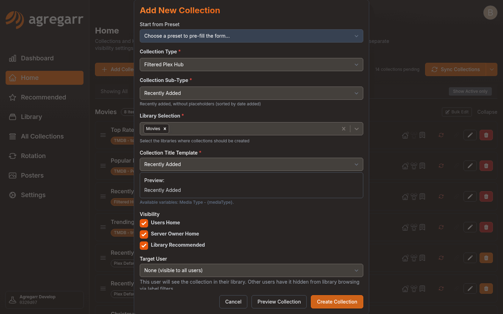
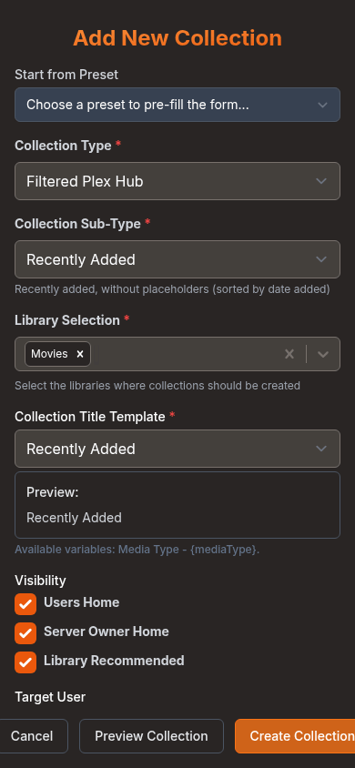
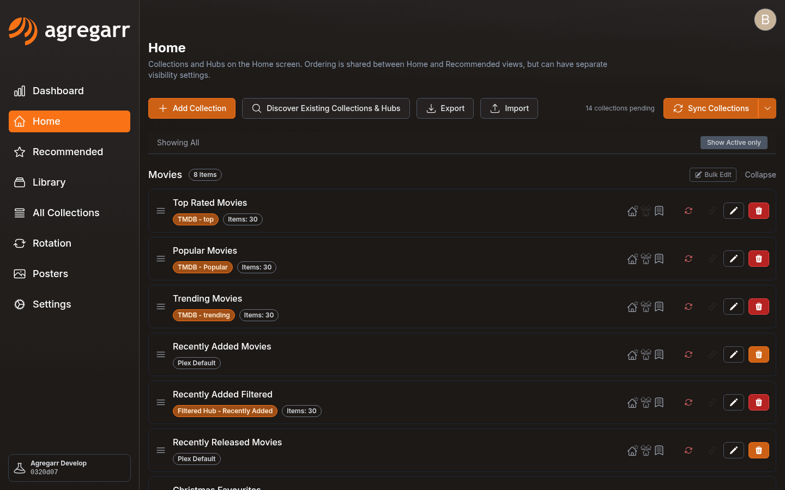
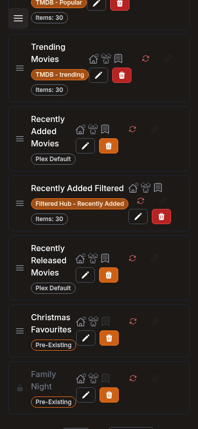
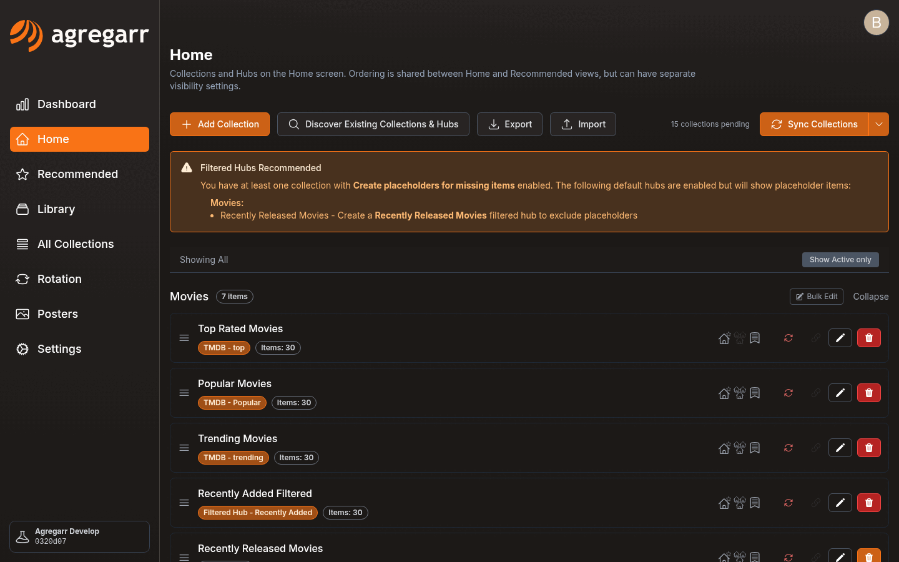
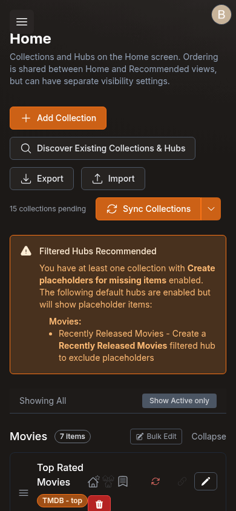

# Replace Plex's Recently Added row without placeholders

Add a Recently Added row to Home that leaves out placeholder items, then switch off Plex's own Recently Added row so you don't get both.

Plex's Recently Added hub includes every item in the library, including placeholders Agregarr creates for titles you don't have yet. A Filtered Plex Hub is a smart collection that skips them.

## Before you start

- Agregarr is connected to Plex and **Discover Existing Collections & Hubs** has run once. Discover brings Plex's own hubs into Agregarr with a grey **Plex Default** badge. See [Your first collection](../get-started/first-collection.md#1-run-discover-first).
- A movie or TV library. Movie and TV libraries need separate hubs because they use different sub-types.

## Set it up

1. Click **Add Collection**. Set **Collection Type** to **Filtered Plex Hub**.
2. Set **Collection Sub-Type**. For a movie library, choose **Recently Added**. For a TV library, choose **Recently Added Episodes**.
3. Under **Library Selection**, choose the library.

    **Check:** **Collection Title Template** reads the sub-type's name and the line starting with **Preview:** shows the name the collection will use in Plex.

    === "Desktop"

        

    === "Phone"

        

4. Set the **Visibility** boxes to match Plex's own row. On **Home**, find the **Plex Default** row for this library (**Recently Added Movies** or **Recently Added TV**) and tick the same boxes on the new collection.
5. Click **Create Collection**, then click **Sync Collections**.

    **Check:** a toast says "Collection created successfully!" and the new row appears on **Home**. After the sync, Plex's Home screen shows the new row alongside its own.

6. Drag the new row on **Home** to the position where Plex's own row sits.
7. On Plex's own row, click the trash icon and confirm with **Hide**. This is the row with the **Plex Default** badge.

    **Check:** a toast says "Hub hidden successfully" and the row leaves **Home** and **Recommended**.

    === "Desktop"

        

    === "Phone"

        

8. Click **Sync Collections** again.

**Check:** Plex's Home screen shows only the new row. The **Filtered Hubs Recommended** warning removes this hub from its list. The warning only goes away when none of that library's checked default hubs is still visible, so in a movie library it stays if **Recently Released Movies** is still on, for example.

## Which sub-type to pick

Each sub-type creates a Plex smart collection that leaves out anything carrying the `trailer-placeholder` label.

- **Recently Added**: items sorted by date added. Use it for movies.
- **Recently Released**: movies sorted by release date. For TV, it lists shows by their latest aired episode and leaves out future air dates.
- **Recently Added Episodes**: shows sorted by their most recently added episode. Use it for TV.
- **Recently Added Episodes (Individual)**: individual episodes sorted by date added.
- **Recently Released Episodes (Individual)**: individual episodes sorted by air date, newest first.

The three episode sub-types are meant for TV libraries. **Collection Sub-Type** on a movie library still lists all five, but an episode sub-type on a movie library fails to sync.
<!-- OPEN: Q17 -->

Use **Recently Added Episodes** instead of **Recently Added** for TV. Plex records the date a show was first added. For a Coming Soon show, that's the date Agregarr created its placeholder. **Recently Added** sorts shows by that date, so a show whose placeholder arrived in January and whose episodes arrived in March stays behind anything added in between. Sorting a TV library by **Date Added** in Plex has the same problem.

**Recently Added Episodes** sorts each show by its newest episode, so the show moves to the front when its episodes arrive.

To replace Plex's other hubs, use these matches:

- **Recently Released Movies**: **Recently Released**.
- **Recently Added TV**: **Recently Added Episodes**.
- **Recently Released Episodes**: **Recently Released Episodes (Individual)**.

## What the Filtered Hubs Recommended warning means

A **Filtered Hubs Recommended** warning appears under the toolbar on **Home**, **Recommended** and **Library** when both of these are true:

- A collection in that library creates placeholders. That's a **Coming Soon** collection or any collection with **Create placeholders for missing items** ticked.
- One of Plex's four default hubs for that library is still enabled in at least one **Visibility** box. Those hubs are **Recently Added Movies**, **Recently Released Movies**, **Recently Added TV** and **Recently Released Episodes**.

The warning lists each library and hub. Beside each hub, it tells you to create a filtered hub of a named type or, if one already exists, disable visibility on the default hub.

It's only a prompt and doesn't change anything itself. It stays hidden until Discover has run.

=== "Desktop"

    

=== "Phone"

    

## Variations

??? note "Hide the default row from its edit form instead"
    Click **Edit** on the **Plex Default** row and untick **Users Home**, **Server Owner Home** and **Library Recommended**, then click **Update Collection**. This does the same thing as **Hide**.

??? note "A hub linked across libraries"
    A default hub that exists in more than one library can be linked. **Hide** hides every linked copy and the toast says how many libraries it hid the hub in.

??? note "Bring Plex's row back"
    Open **All Collections**, which still lists hidden hubs. Click **Edit** on the hub, tick the **Visibility** boxes you want and click **Update Collection**. Then click **Sync Collections**.

## What it doesn't do

- It doesn't remove placeholders from your library. It only keeps them out of this row.
- It doesn't hide Plex's own row when you create the filtered hub. Step 7 does that.
- It doesn't offer **Item Order**, **Label Exclusion**, **Placeholder Creation** or **Auto-Request Settings**. The two **(Individual)** sub-types also hide **Collection Mutual Exclusion** and automatic posters.
- It doesn't work with an episode sub-type on a movie library. That combination fails to sync.

## If it didn't work

- **Placeholders still show on Home.** Plex's own Recently Added row is still on. Hide it as described in step 7, then click **Sync Collections**.
- **Both rows still show in Plex.** The sync hasn't run since you hid the old row. Click **Sync Collections**.
- **The warning is still there after I created the hub.** A default hub still has a **Visibility** box ticked. It's either the hub you replaced or another of the four checked hubs, such as **Recently Released Movies**. Hide it, or create a filtered hub of the type the warning names.
- **The sync fails for the new hub.** The sub-type doesn't match the library type or no sub-type is set. An episode sub-type needs a TV library and the hub needs a sub-type. Edit the collection and choose one.
<!-- OPEN: NEW: Create Collection enables for a Filtered Plex Hub with no sub-type (CollectionConfigForm.tsx:3494), and the sync then fails with Invalid filtered_hub subtype (recentlyadded.ts:186) -->
- **A TV show sits too low in the row.** **Recently Added** is selected for a TV library. Use **Recently Added Episodes**.

## Related

- [Your servers: Filtered Plex Hub](../collections/sources/your-servers.md#filtered-plex-hub)
- [Visibility and time restrictions](../collections/form/visibility.md#filtered-hubs-recommended)
- [Collection pages: Home](../collections/pages.md#home)
- [Placeholders](../Placeholders.md)
- [Promote collections above the A-Z list](promote-library.md)
