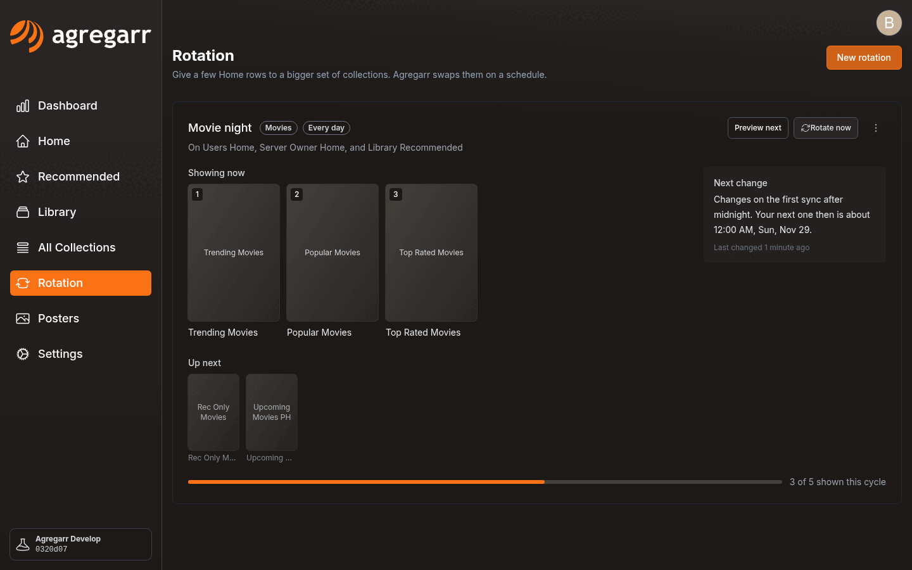
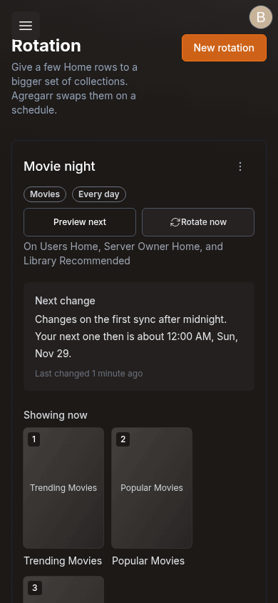
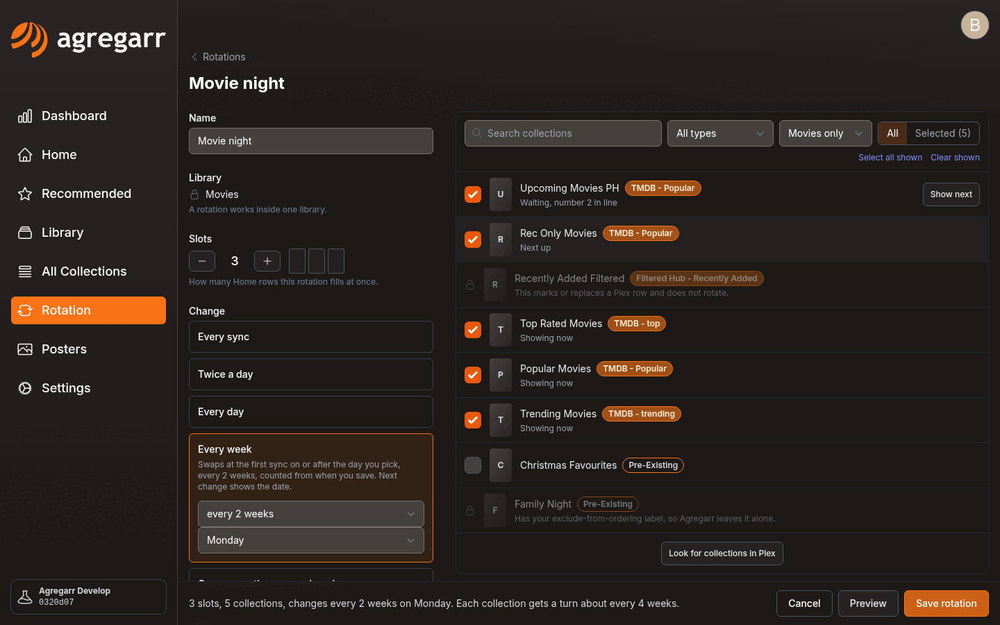
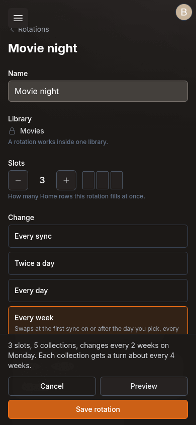

# Rotation reference

This page covers every control, label and warning on the **Rotation** page and in the rotation editor, in the order you'll find them. To set one up, follow [Show a different set of collections on Home](rotation.md).

The **Rotation** item sits in the sidebar between **All Collections** and **Posters**. Like the other pages, it stays greyed out until **Discover Existing Collections & Hubs** finds something.

=== "Desktop"

    

=== "Phone"

    

## The Rotation page

The page title reads **Rotation**, followed by "Give a few Home rows to a bigger set of collections. Agregarr swaps them on a schedule." Each rotation has its own card. The cards stack down the page.

### New rotation

This button appears at the top right once you have at least one rotation. It opens an empty editor.

### Create a rotation

This button appears in the empty state, which reads "Keep Home fresh without the clutter". The text under it explains that a rotation swaps a few Home rows between a bigger set of collections. A second line points to Cycle Lists for lists that take turns in one row. The button opens the same editor as **New rotation**.

### Couldn't load your rotations.

A red message with **Try again**. The page couldn't read the rotation list. **Try again** asks for it again.

## Rotation cards

### Card header

Shows the rotation's name, its library and a badge for the schedule: **Every sync**, **Twice a day**, **Every day**, **Every week**, **Once a month, on a random day** or "Every N weeks on DAY" when the gap is 2 weeks or more. A turned-off rotation is dimmed.

### On Users Home, Server Owner Home and Library Recommended

A line under the header, such as "On Users Home and Server Owner Home". It lists the places ticked under **Where the slots appear**.

### Showing now

One poster tile appears for each slot, numbered from 1. An empty slot reads **Empty**, with "Nothing ready to show" under it. Tiles are empty when there aren't enough ready collections to fill every slot.

### Up next

Shows the collections due to come in at the next swap as poster tiles, or as a list on a phone. If more collections are waiting than will fit, it adds "then N more". When nothing is waiting, it reads "Nothing waiting. Add more collections than slots to see them rotate."

### Next change

Shows when the next swap is due. Once a swap has happened, it also shows **Last changed** with a relative time. The sentence changes with the schedule:

- **Every sync**: "Changes every time Agregarr syncs. Your next sync is about TIME."
- **Twice a day** and **Every day**: "Changes on the first sync after midnight." or "after midday", followed by the time of that sync.
- **Every week** and **Once a month, on a random day**: "Changes on the first sync on or after DATE." followed by the time of that sync.
- Monthly, after it has changed: "Already changed this month. Agregarr picks next month's day on the 1st."
- Turned off: "Turned off. Its collections are back on their own Home settings."
- Not enough collections: "No change is planned until you add more collections than slots."

The time comes from your **Plex Collections Sync** schedule under **Settings > Jobs**. Times follow your browser's format.

### Cycle progress

A bar with the text "N of M shown this cycle". M is the number of ready collections. A cycle ends once every ready collection has had a turn, then the next cycle starts. The bar is hidden when no collection is ready.

### Plex status

A pill beside **Showing now**. It's hidden when Plex matches the rotation.

- **Updating Plex…** appears while Agregarr applies the change or a sync runs.
- **Plex will catch up on the next sync, about TIME.** appears after the change is saved but before Plex has applied it.

## Card actions

### Preview next

Shows the next three swaps as rows of poster tiles. The first row includes the **Next change** sentence, the second reads **Then** and the third reads **After that**. When no swap is planned, it reads "Nothing would change." Click it again to close the panel.

This still works while a sync runs.

### Rotate now

Swaps straight away instead of waiting for the schedule. A **Rotated. Plex is updating now.** message confirms it. If there aren't more ready collections than slots, it reads "Nothing to swap in yet. Add more collections than slots." Nothing changes.

It's greyed out while a sync runs, with a tooltip explaining why. It's also greyed out while the rotation is turned off, with the tooltip "This rotation is turned off."

Rotate now counts as the swap for the current period, so another sync in the same period doesn't swap again. **Every sync** is the exception: the next sync swaps as normal.

### More actions

The three-dot menu on the right of the card. All three items are greyed out while a sync runs, and the menu explains why.

#### Edit

Opens the editor for this rotation.

#### Turn off and Turn on

**Turn off** returns every collection to its own Home settings and stops the rotation. **Turn on** starts it again with the saved settings. Both actions remove collections that can no longer rotate and show how many were removed.

#### Delete

Opens **Delete rotation** with "Delete and put N collections back on their own settings?" and the buttons **Delete** and **Cancel**. **Delete** removes the rotation but doesn't remove anything from Plex. A **Rotation deleted** message follows.

## Warnings

Warnings appear under the card as orange strips. A turned-off rotation hides them, except for the damaged-data warning.

### This rotation has N slots but only N collections ready, so nothing will change.

Fires when the ready collections are no more than the slots. Add collections or use fewer slots.

### N slots are empty because nothing is ready to fill them.

Some slots don't have a collection. Collections that are sitting out aren't counted as ready.

### N collections are sitting out

Click **Show** to open the list and **Hide** to close it. Each collection has one reason:

- "Outside its own schedule right now": the collection has a time restriction that's currently closed.
- "Not in Plex yet. It joins after its next sync."
- "Its settings changed and it can no longer rotate. Remove it from this rotation."

### NAME is no longer in Plex.

The full text is "Remove it, or leave it and it will rejoin if it comes back with the same name." Saving the rotation, or turning it off and on, leaves it in the list. Only collections Agregarr found in Plex can rejoin by name, and only when exactly one match exists in the same library.

### NAME was recreated in Plex and has rejoined this rotation.

Shown for 14 days after the rejoin. Nothing to do.

### Agregarr no longer has NAME's own Home settings.

The rest of the text reads: "It will be left off Home if it leaves this rotation." When the collection leaves, Agregarr turns off its three Home boxes.

### Your sync runs less often than this rotation changes, so it will change once per sync.

Appears when the gap between two **Plex Collections Sync** runs is longer than the rotation schedule: 12 hours for **Twice a day**, a day for **Every day**, 7 days for **Every week** and 28 days for **Once a month, on a random day**.

### This rotation's saved data is damaged. Delete it and create it again.

The card shows only this warning. **Delete** is the way out.

## The editor

The editor opens on its own page, with a **Rotations** link back to the list. A new rotation has the title **New rotation**. An existing rotation shows its name. On a desktop, the settings are in a column on the left and the collection list is on the right. On a phone, they stack. A bar along the bottom holds the summary and buttons.

=== "Desktop"

    

=== "Phone"

    

### Name

Default: empty, with "Movie night" as the grey example.

The rotation's name. It's required and can be up to 60 characters long. Two rotations can't share a name, and capital letters don't count: Agregarr says "A rotation called NAME already exists." If you click **Preview** or **Save rotation** while it's empty, it reads "Give this rotation a name."

### Library

Default: the first library in your list.

The library this rotation works in. It's locked after saving, so an existing rotation shows the library name with a padlock. Under it, it reads "A rotation works inside one library." Changing the library on a new rotation clears the ticked collections.

### Slots

Default: 5.

The number of Home rows the rotation fills at once, from 1 to 20. Use the plus and minus buttons to change it. A row of empty boxes shows the current count.

### Change

Default: **Every day**.

How often the rotation swaps. Click an option to see its description under it. Swaps always happen during a full collections sync. [When does it change?](#when-does-it-change) explains the timing.

#### Every sync

"Swaps every time Agregarr runs a full sync."

#### Twice a day

"Swaps at the first sync after midnight and the first sync after midday."

#### Every day

"Swaps at the first sync after midnight."

#### Every week

"Swaps at the first sync on or after the day you pick." Two dropdowns appear underneath.

- The gap dropdown (no visible label): **every week**, then **every 2 weeks** through to **every 6 weeks**. Default: **every week**. Above 1, the line changes to "Swaps at the first sync on or after the day you pick, every N weeks, counted from when you save. Next change shows the date."
- The day dropdown (no visible label): Monday to Sunday, in that order. Default: Monday.

#### Once a month, on a random day

"Agregarr picks a different day each month and swaps at the first sync on or after it." The month when you create the rotation counts as done.

### Order

Default: **In the order below**.

- **In the order below**: collections take turns in the order shown in the list.
- **Shuffled each time round**: the first round follows the list. Once every collection has had a turn, the waiting collections are shuffled for the next round.

### Where the slots appear

Default: **Users Home** and **Server Owner Home** ticked, **Library Recommended** not ticked.

Controls where the collections in these slots appear. These are the same three boxes found under **Visibility** on the collection form. See [Visibility and time restrictions](../collections/form/visibility.md). Pick at least one or the editor says "Pick at least one place."

### Rotation is on

Default: on.

A switch. When it's off, the rotation saves but does nothing. Every collection keeps its own Home settings. The line underneath explains it: "Collections go back to their own Home settings while this is off."

### Collection list

A box on the right, with a toolbar above the list of every collection that could join.

#### Search collections

Filters the list by name as you type. If nothing matches, it reads "No collections match 'QUERY'."

#### All types

A dropdown. **All types** shows everything. **Already in Plex** shows collections Agregarr found in Plex rather than created. Each source type with at least one collection gets its own entry.

#### LIBRARY only and All libraries

A dropdown. The first option names your library. **All libraries** also shows collections from other libraries, greyed out.

#### All and Selected

Two buttons. **All** shows the full list. **Selected (N)** shows only ticked collections.

#### Select all shown and Clear shown

**Select all shown** ticks every currently listed collection that can join. **Clear shown** unticks every currently listed collection. Both follow the active search and filters.

#### Collection rows

Each row has a tick box, poster, name and source badge. On an existing rotation, a status line under the name reads **Showing now**, **Next up** or "Waiting, number N in line". A collection that can't rotate right now shows the reason instead. If you tick a collection that has become ineligible, the line adds "Will be removed when you save."

If the library has no collections at all, the list reads "No collections found in LIBRARY yet." When a filter or **Selected (N)** returns nothing, it reads "Nothing selected yet."

#### Show next

A button on a row. It only appears in an existing rotation and only for collections marked "Waiting, number 2 in line" or later. It moves that collection to the front of the queue and shows "Moved to the front of the queue." The change saves on its own, so you don't need **Save rotation**. It's greyed out while a sync runs. A turned-off rotation refuses the action with "This rotation is turned off."

#### Look for collections in Plex

A button under the list. It finds collections made by hand or another tool, then reports "Found N new collections" or "Nothing new found." While it's working, the button reads **Looking…**.

It runs the same scan as **Discover Existing Collections & Hubs**. That scan writes to Plex: it promotes hubs, removes hub entries for Agregarr collections with no visibility and rewrites labels. The button is greyed out while a sync runs.

### Why a collection is greyed out

A greyed row has a padlock instead of a tick box, with the reason under the name.

- "Creates several collections; a slot holds one." **Auto Franchise Collections**, Seerr **Individual Users Requests (excl. server owner)** and the Library Essentials genre, decade, resolution, content rating, director and actor collections create several collections from one setup.
- "Only NAME can see this, so the slot would be empty for everyone else." The collection targets one user.
- "This marks or replaces a Plex row and does not rotate." Filtered hubs and separators.
- "Has your exclude-from-ordering label, so Agregarr leaves it alone." A collection Agregarr found in Plex that you've excluded from ordering.
- "In LIBRARY. A rotation works inside one library."
- "Already in ROTATION." A collection can only belong to one rotation.

### Summary and buttons

The bar along the bottom shows a summary such as "5 slots, 37 collections, changes every day. Each collection gets a turn about every 8 days." If there aren't more collections than slots, it drops the last sentence and adds the "nothing will change" warning.

#### Cancel

Returns to the list without saving.

#### Preview

Opens the **If you save this** panel. It's greyed out until at least one collection is ticked. It doesn't save anything.

#### Save rotation

Saves the rotation. It's greyed out while a sync runs. If you haven't opened **Preview** since your last change, and saving would move collections off Home or return them to their own settings, the first click opens the preview without saving. Click again to save. Once the preview shows collections leaving Home, the button reads **Save and start rotating**.

A **Rotation saved** message appears, then Agregarr returns to the list. Errors appear in red above the buttons, for example "Pick at least one collection." or "Pick a library."

### If you save this

The preview panel, with **Close preview** at the top right.

- **On Home straight away**: the collections that will fill the slots now.
- **Up next**: the collections waiting for the first swap, with the **Next change** sentence beside them.
- **Leaving Home until their turn (N)**: collections currently on Home that will wait. Click the heading to show or hide their names.
- **Back to their own settings (N)**: collections removed from the rotation, or every collection if you switched it off.

A line at the bottom says that each collection's own Home settings are kept and return if you remove the collection or delete the rotation.

## When does it change?

Swaps happen during a full collections sync, not at an exact time. The first full sync in each new period performs the swap. Quick syncs don't. Days and midnight use your server's time zone, set by `TZ` on the container.

| Change | When it swaps |
| --- | --- |
| Every sync | Every full sync |
| Twice a day | First sync after midnight and first after midday |
| Every day | First sync after midnight |
| Every week | First sync on or after the day you pick |
| Every 2 to 6 weeks | First sync on or after the day you pick, every 2 to 6 weeks counting from when you saved the schedule |
| Once a month, on a random day | First sync on or after a day Agregarr picks each month |

A full sync is either the scheduled **Plex Collections Sync** job or the **Sync Collections** button. Syncing one collection and the **Collections Quick Sync** job don't trigger a swap.

For weekly gaps, counting starts from the chosen day in the week when you save. The first swap can happen a few days before the full gap has passed. For a monthly rotation, the month when you create it counts as done. Agregarr picks the day during the first sync of each new month.

If your sync runs less often than the rotation schedule, the rotation changes once per sync. **Next change** shows the expected time of the sync that will perform the swap.

Changing the schedule, day or gap on an existing rotation restarts the count from that save.

## How a swap works

A swap only happens when there are more ready collections than slots. "Ready" means the collection is in Plex, can still rotate and is inside its own schedule if it has one.

Only as many slots change as there are waiting collections. The collections that have been showing longest step aside first. The others keep their rows. With 6 collections in 5 slots, one row changes each time. With 37 collections in 5 slots, all five change.

An empty slot fills during the next sync, even if the scheduled change isn't due. If a showing collection stops being ready because its schedule closed or it left Plex, it leaves the slot during the next sync. The next collection in line takes its place.

Every ready collection gets a turn before any collection repeats. **Cycle progress** keeps count.

## Your collections' own settings

While a collection belongs to a rotation, the rotation controls its **Users Home**, **Server Owner Home** and **Library Recommended** boxes, its position on Home and its **Randomize Home Order** setting. A showing collection gets the three boxes selected under **Where the slots appear**. A waiting collection gets none. If the collection has a time restriction, its "when inactive" visibility is also set to hidden. **Randomize Home Order** is switched off.

A waiting collection stays in the library. Only its Home pin changes.

The collection form shows **In rotation: NAME** with this notice: "NAME decides when this is on Home. What you choose here is saved as this collection's own setting and applies again if it leaves the rotation." The same badge appears in **Bulk Edit Collections**, where visibility and **Randomize Home Order** changes are saved the same way. If the save fails, the message reads "Couldn't save this collection's own visibility setting. The rotation keeps using the previous one." See [Collection pages](../collections/pages.md#in-rotation).

When a collection leaves a rotation:

- **Turn off**: every collection returns to its own Home settings. **Turn on** restarts the rotation.
- **Remove a collection** in the editor: that collection returns to its own settings.
- **Delete**: every collection returns to its own Home settings.
- **Delete the collection in Agregarr**: it leaves the rotation and the rotation fills its slot.
- **Deleted in Plex**: the card shows a warning and the rotation skips it.

Rows that were never part of the rotation keep their order. When you turn off or delete a rotation, collections that were showing keep their place. Any other collection returning to Home, including one removed while it was showing, goes to the bottom of the Home order. You can drag it from there.

## Moving slots on Home

Each filled slot appears as a row in the Home ordering list, named "ROTATION, slot N of M", with "Showing now: NAME" underneath. It has a **Manage rotation** link where other rows have a bin. Drag the row to move the slot. The next collection shown in that slot keeps the same position. New slots start at the bottom of the Home order. See [Collection pages](../collections/pages.md#manage-rotation).

## What locks while a sync runs

While a collections sync runs, the following controls are greyed out with the text "A sync is running. This will be available when it finishes." On **Rotate now** and **Save rotation**, it appears as a tooltip. On **Show next**, it's the hover text. On the card menu and under **Look for collections in Plex**, it appears as a line of text:

- **Rotate now**
- **Show next**
- **Edit**, **Turn off**, **Turn on** and **Delete** on the card menu
- **Save rotation** in the editor
- **Look for collections in Plex**

These still work: **Preview next**, **Preview**, opening the editor from a badge link and each collection's own settings.

Agregarr also refuses saves, deletes, **Rotate now** and **Show next** while a sync is waiting to start or while it's applying a rotation change to Plex. The message is the same: "A sync is running. Try again when it finishes."

## Limits

- Name: 1 to 60 characters and unique across rotations (capital letters don't count).
- Slots: 1 to 20.
- Collections: up to 500 in one rotation.
- Weeks: **every week** to **every 6 weeks**.
- One library for each rotation, fixed at save.
- One rotation for each collection.
- At least one of **Users Home**, **Server Owner Home** and **Library Recommended**.
- A rotation needs more collections than slots before it can swap anything.
- Collections for one user, filtered hubs, separators and collections that create many collections can't join.
- A collection with a time restriction sits out while it's outside its schedule. Its own "when inactive" Home settings are paused. See [Collections on a schedule](../collections/timed.md).
- Rotations aren't included in collection exports. An exported collection carries its own settings. See [Move collections between servers](../collections/move-between-servers.md).
- Everyone on the server sees the same batch. **Users Home** reaches every user the server is shared with.

## Related

- [Show a different set of collections on Home](rotation.md)
- [Cycle Lists](../collections/cycle-sources.md)
- [Collection pages](../collections/pages.md)
- [Visibility and time restrictions](../collections/form/visibility.md)
- [Bulk Edit Collections](../collections/bulk-edit.md)
