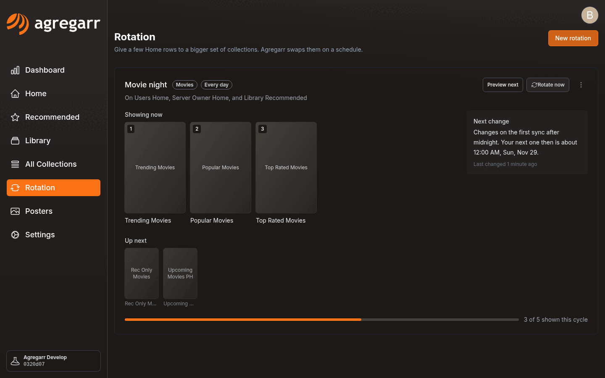
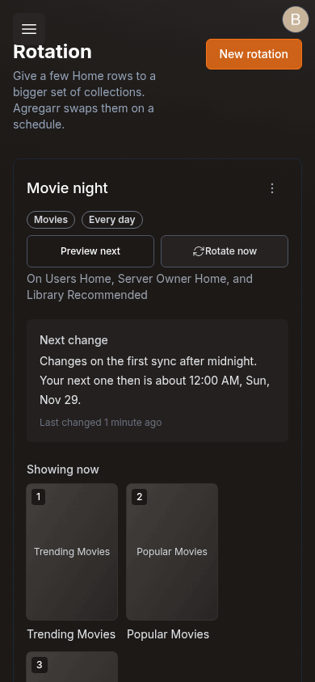
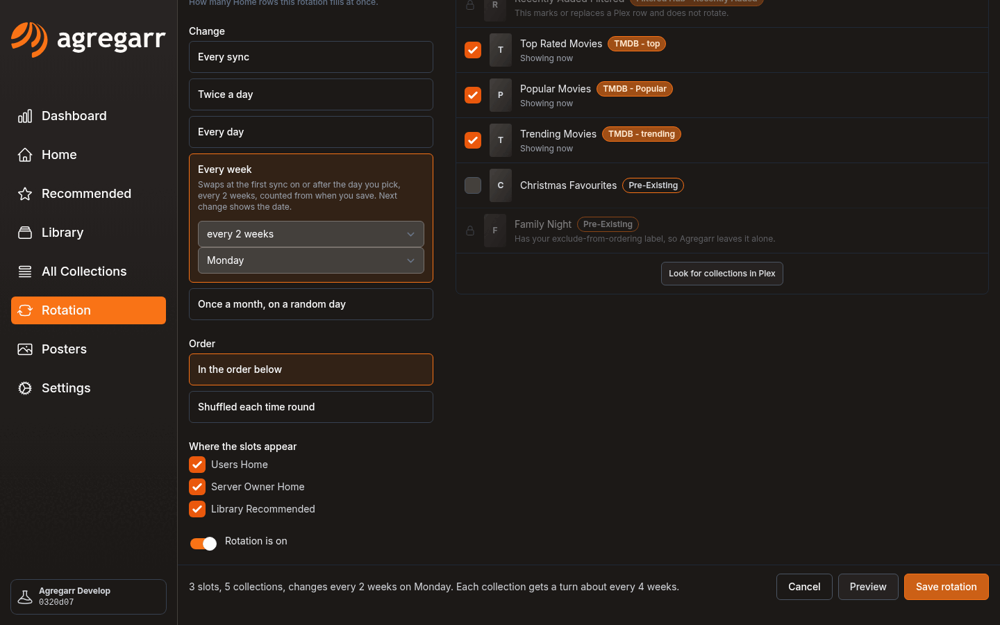
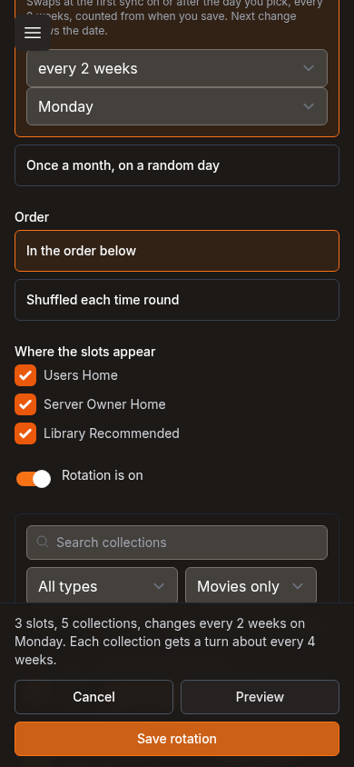
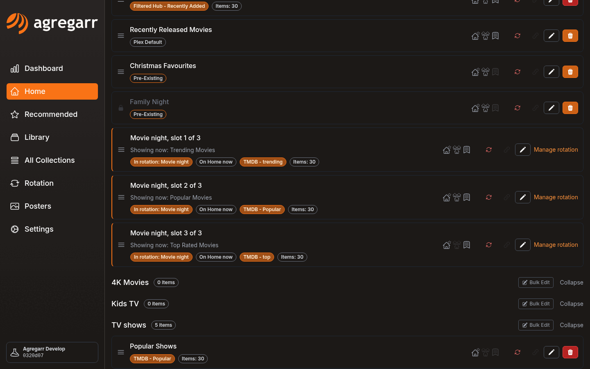
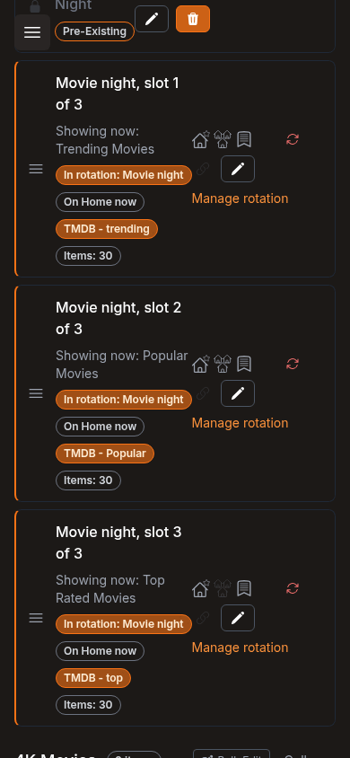

# Show a different set of collections on Home

A rotation shares a few Home rows across a bigger set of collections, swapping them on a schedule. This page covers making one, choosing what shows next and turning it off. The [rotation reference](rotation-reference.md) lists every control and warning.

## What a rotation does

Say you have 37 collections but only want 5 rows on Home. Make a rotation with 5 slots and add all 37. Each collection gets a turn.

The collections stay in your library the whole time. A rotation only changes which ones appear on Home and Library Recommended, and where they appear.

=== "Desktop"

    

=== "Phone"

    

## Rotation or Cycle Lists?

Both keep Home changing, but they work differently:

- **Cycle Lists**: you have lots of lists (Trakt, Letterboxd, IMDb) and want them to take turns in one row. Only the list currently showing exists as a collection. See [Cycle Lists](../collections/cycle-sources.md).
- **Rotation**: you already have collections in Plex, made by Agregarr, by hand or by another tool, and want only a few on Home at once.

## Before you start

- The collections need to exist in Agregarr. Collections Agregarr makes can join before their first sync, but they sit out until they exist in Plex.
- Collections made by hand or another tool can join once Agregarr finds them. Click **Look for collections in Plex** under the collection list in the editor. It runs the same scan as **Discover Existing Collections & Hubs**. That scan writes to Plex: it promotes hubs, removes hub entries for Agregarr collections with no visibility and rewrites labels.
- A rotation works inside one library. To rotate collections from two libraries, make two rotations.
- No collections sync is running. Saving, editing and the swap buttons stay locked until the sync finishes.

The editor greys out collections that can't join and gives the reason. [Why a collection is greyed out](rotation-reference.md#why-a-collection-is-greyed-out) lists each one.

## Set it up

1. Click **Rotation** in the sidebar, then click **Create a rotation**. For later rotations, use **New rotation** at the top right.
2. Enter a **Name**, such as Movie night. It can be up to 60 characters and can't match another rotation's name.
3. Choose the **Library**. You can't change it after saving.
4. Set **Slots** with the plus and minus buttons. This controls how many Home rows the rotation fills at once, from 1 to 20.
5. Under **Change**, choose how often it swaps: **Every sync**, **Twice a day**, **Every day**, **Every week** or **Once a month, on a random day**. **Every week** opens two dropdowns: one for the gap (**every week**, or **every 2 weeks** up to **every 6 weeks**) and one for the day (Monday to Sunday).

    **Check:** the text under the chosen option says when it swaps. [When does it change?](rotation-reference.md#when-does-it-change) has the full list.

6. Choose the **Order**: **In the order below** or **Shuffled each time round**.
7. Under **Where the slots appear**, tick **Users Home**, **Server Owner Home** and **Library Recommended** as needed. Pick at least one.
8. Leave **Rotation is on** switched on to start the rotation when you save.
9. Tick the collections you want from the list on the right. For a long list, use **Search collections**, the filters, **Select all shown** and **Clear shown**.

    **Check:** the line at the bottom reads like "5 slots, 37 collections, changes every day. Each collection gets a turn about every 8 days."

10. Click **Preview**.

    **Check:** the **If you save this** panel shows **On Home straight away**, **Up next** and, when collections will leave Home, **Leaving Home until their turn**.

    === "Desktop"

        

    === "Phone"

        

11. Click **Save rotation**. Because you opened **Preview** in step 10, this click saves the rotation. If the preview showed collections leaving Home, the button reads **Save and start rotating** instead. If you change anything after previewing, or skip **Preview**, and collections would leave Home or return to their own settings, the first click opens the preview without saving. Click the button again to save.

    **Check:** the Rotation page opens, a **Rotation saved** message appears and the new card lists your collections under **Showing now**.

Agregarr starts pinning the first batch when you save. It usually reaches Plex within seconds, without waiting for a sync.

## Check it worked

Open Plex. The slots you chose show the collections listed under **Showing now**. While Plex catches up, the card shows **Updating Plex…** or **Plex will catch up on the next sync**. On the Rotation page, **Next change** shows when the next swap is due.

In Agregarr, every collection in the rotation has an **In rotation: NAME** badge on its row. Beside it is either **On Home now** or **Waiting its turn**. Waiting collections are on **Library** only, because none of their Home options are turned on.

## Examples

**Five rows, daily, from 37 collections.** Set Slots to 5, choose **Every day** and tick all 37. Each day, the five collections that have shown longest step aside for the next five.

**One "best of" collection at a time.** Add ten best-of-year collections, set Slots to 1 and choose **Every week**. Home shows one collection each week.

**A big set of lists spread out over weeks.** Put 60 lists into collections, then split them across two rotations. Run one every 2 weeks and the other every 3 weeks, each with a few slots. The rows keep changing without date ranges built by hand.

## Moving a slot on the Home page

A new rotation's slots start at the bottom of the Home order. To move them, open **Home**. Each filled slot appears as a row named after the rotation, such as "Movie night, slot 1 of 5", with **Showing now: NAME** underneath.

Drag the row to move that slot. The next collection assigned to the slot uses the same position. Click **Manage rotation** on the row to open the rotation.

=== "Desktop"

    

=== "Phone"

    

## Swap now

Click **Rotate now** on the rotation's card to swap straight away. Plex should update within seconds. A **Rotated. Plex is updating now.** message confirms the swap.

**Preview next** shows the next three swaps before they happen. Click it again to close the panel. It also works while a sync runs.

**Check:** the **Showing now** row changes to the collections previously listed under **Up next**.

If the card says there is nothing to swap, the rotation needs more collections than slots. See [If it didn't work](#if-it-didnt-work).

## Choose what shows next

1. Click **More actions** (the three dots) on the card, then click **Edit**.
2. Find a collection marked **Waiting, number 3 in line** or similar. Click **Show next** beside it.

    **Check:** a **Moved to the front of the queue.** message appears and the collection's line reads **Next up**.

3. Click **Rotate now** on the card, or wait for the next swap.

**Show next** only appears beside waiting collections that aren't already next. It changes the queue immediately and doesn't need **Save rotation**.

## Turn a rotation off

Click **More actions**, then click **Turn off**. Every collection returns to its own Home settings and the rotation stops swapping. Click **Turn on** to start it again.

**Check:** the card fades and **Next change** reads "Turned off. Its collections are back on their own Home settings."

Turning a rotation off or on also removes collections that can no longer rotate. A message shows how many were removed.

To remove a rotation for good, click **More actions**, then **Delete**, then confirm in **Delete rotation**. Every collection returns to its own Home settings. Nothing is deleted from Plex.

## Variations

??? note "Shuffle the order"
    Choose **Shuffled each time round** under **Order**. The first round follows the list order. Once every collection has had a turn, Agregarr shuffles the waiting collections for the next round. Collections that just stepped aside stay at the back.

??? note "Change slots, schedule or collections later"
    Open **More actions > Edit**. The **Library** is fixed, but everything else can change. Untick a collection to remove it from the rotation and return it to its own Home settings. If those settings put it on Home, a collection removed while showing moves to the bottom of the Home order, where you can drag it.

??? note "Run two rotations in one library"
    A collection can only belong to one rotation. Collections already in another rotation are greyed out and show which rotation they're in.

??? note "Pause a rotation without losing it"
    Use **Turn off**. Agregarr keeps the collection list and schedule.

## What it doesn't do

- It doesn't delete anything from Plex. A rotation only changes which collections appear on Home and Library Recommended, plus their Home order.
- It doesn't swap at an exact time. The swap runs during the first full collections sync after the change is due.
- It doesn't rotate collections across libraries, collections made for one user or things that aren't collections, such as filtered hubs and separators.
- It doesn't go into a collection export. An exported collection carries its own settings, not the rotation's settings.

## If it didn't work

??? question "Nothing changed after I made a rotation"
    Look for the warning "This rotation has N slots but only N collections ready, so nothing will change." A rotation needs more collections than slots. Add collections or use fewer slots.

??? question "A collection vanished from Home"
    It's waiting for its turn. Look for **Waiting its turn** on the badge. The collection is still in your library.

??? question "Rotate now, Edit, Turn off or Save is greyed out"
    A collections sync is running. The buttons return when it finishes. If only **Rotate now** is greyed out and no sync is running, the rotation is turned off. Its tooltip reads "This rotation is turned off." Click **More actions**, then **Turn on**. Agregarr also refuses these actions for a short time after a change, while it applies the change to Plex, or while a sync waits to start. The buttons stay clickable and the message reads "A sync is running. Try again when it finishes."

??? question "A collection is greyed out in the list"
    The reason appears under its name. [Why a collection is greyed out](rotation-reference.md#why-a-collection-is-greyed-out) covers each one.

??? question "I pinned a waiting collection in Plex (or Kometa did) and it disappeared again"
    Agregarr controls the Home pin while a collection belongs to a rotation and restores it on the next sync. Unpin rotation collections in Plex and other tools, or remove the collection from the rotation.

??? question "Another tool recreates my collections"
    If exactly one collection that Agregarr found in Plex returns in the same library with the same name (capital letters don't matter), it rejoins the rotation and a notice appears. This applies to collections marked **Pre-Existing**. Collections made by Agregarr are tied to their Agregarr settings, not their Plex name.

??? question "It didn't swap at midnight"
    Swaps run during the first full sync after midnight, not at midnight. Check the sync schedule under **Settings > Jobs**. If the sync runs less often than the rotation changes, the card warns "Your sync runs less often than this rotation changes, so it will change once per sync."

??? question "A collection is sitting out"
    Click **Show** on the warning to see the reason. The collection is outside its own schedule, isn't in Plex yet or its settings have changed so it can no longer rotate. [Warnings](rotation-reference.md#warnings) covers each one.

## Related

- [Rotation reference](rotation-reference.md): every control, warning and limit
- [Cycle Lists](../collections/cycle-sources.md): take turns between lists in one row
- [Collection pages](../collections/pages.md): the **Home**, **Recommended** and **Library** pages and their rotation badges
- [Collections on a schedule](../collections/timed.md): time restrictions on a collection in a rotation
