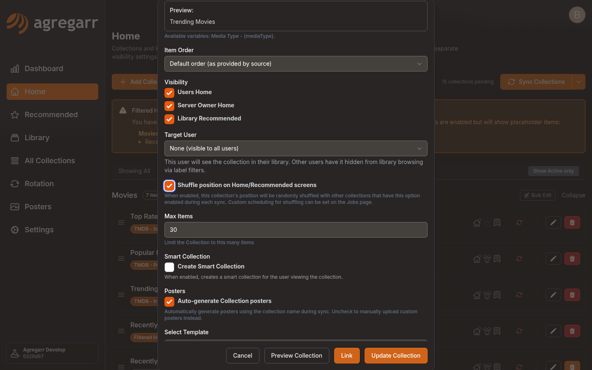
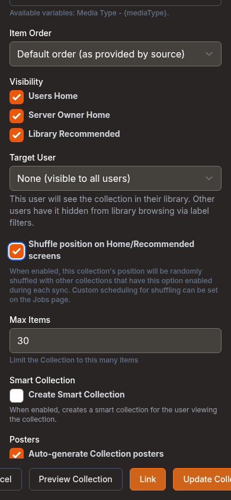
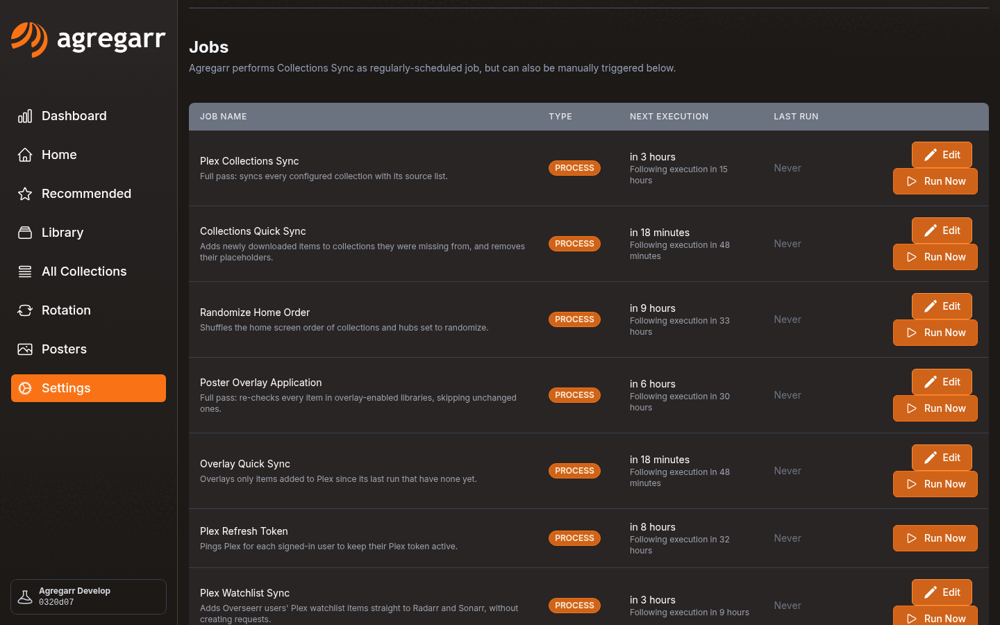
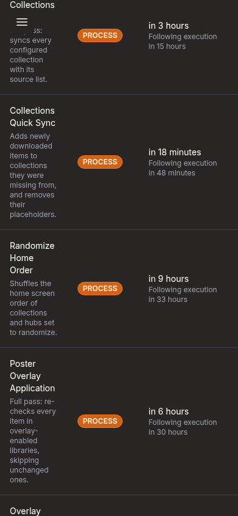

# Shuffle the Home order

Swap selected rows on Plex Home and Recommended on a schedule, so the same collection doesn't always sit at the top.

## Before you start

- **Discover Existing Collections & Hubs** has been run. See [Your first collection](../get-started/first-collection.md).
- At least two rows in the same library that you're happy to swap. Each row needs one of **Users Home**, **Server Owner Home** or **Library Recommended** ticked, which gives it a position on **Home** or **Recommended**.
- Rows you want to stay put stay unticked. They keep their positions while the ticked rows swap among the gaps.

## Set it up

1. Click **Home**, then click **Edit** on a row you want to shuffle.
2. Tick **Shuffle position on Home/Recommended screens**. For a Plex Default hub or a Pre-Existing collection, the field is called **Randomize Home Order**. Click **Update Collection**.

    === "Desktop"

        

    === "Phone"

        

    **Check:** the row's drag handle is a pair of crossed arrows. Hover over it to see "Position will be shuffled with other randomized collections during sync".

3. Repeat this for at least one more row in the same library. To tick several rows at once, use the **Randomize Home Order** column in [Bulk Edit Collections](../collections/pages.md#randomize-home-order).
4. To shuffle straight away, open **Settings > Jobs** and click **Run Now** on **Randomize Home Order**.

    === "Desktop"

        

    === "Phone"

        

    **Check:** the row's **Last Run** column reads **Success**. Reload **Home**. The ticked rows are usually in a new order, though a shuffle can return the same order, especially with only two or three rows. Run it again if nothing moves.

## When it shuffles

- At the end of every full collections sync. That includes **Sync Collections** and the **Plex Collections Sync** job, which runs every 12 hours by default.
- On the **Randomize Home Order** job's own schedule, every day at 6 AM by default.
- A Collections Quick Sync doesn't shuffle.

With the default schedules, it shuffles three times a day. To change the job, click **Edit** on its row under **Settings > Jobs**. **Modify Job** offers **Use Preset Intervals** (every 5, 10, 15, 20 or 30 minutes, then every 60, 120, 180, 240, 300 or 360 minutes) or **Use Custom CRON Expression**. For longer gaps, use a custom expression such as `0 0 */8 * * *` for every 8 hours. Custom expressions have six parts, with seconds first. To keep one shuffle a day at 8 AM, use `0 0 8 * * *`.

Changing this job doesn't change the full sync schedule. Full syncs still shuffle the rows.

If a collections sync is already running, the job skips its turn without moving anything, but **Last Run** still reads **Success**. Run it again after the sync finishes.
<!-- OPEN: NEW: presets above 59 minutes are written into the cron minute field as */N (SettingsJobsCache/index.tsx:391), so 120 to 360 may not run at the interval shown -->
<!-- OPEN: NEW: the Randomize Home Order job records Success, not Skipped, when it skips because a collections sync is running (randomizeHomeOrder.ts:131-139 returns undefined; schedule.ts:192 only records skipped for the string 'skipped') -->

## Which rows it shuffles

- Rows with the shuffle box ticked and a position on **Home** or **Recommended**, handled separately for each library.
- Agregarr collections, Plex Default hubs and Pre-Existing collections together in one pool.
- Not a Pre-Existing collection excluded with **Exclude from Ordering (Plex Label)**.
- Not a collection in a rotation. A rotation switches off shuffle for its members while they're in it. The box returns to its previous setting when the collection leaves. See [Show a different set of collections on Home](rotation.md).

Unticked rows hold their positions. Say a library has rows A, B, C, D and E, with A, C and E ticked. A, C and E trade places among positions 1, 3 and 5. B and D stay at 2 and 4.

## Opt a row out

Edit the row and untick the box, or untick it in Bulk Edit Collections.

**Check:** the handle returns to three bars. The row stays wherever the last shuffle left it.

## What it doesn't do

- It doesn't change the **Library** tab's order.
- It doesn't change which items are in a collection or their order inside it. That is **Item Order**.
- It doesn't change visibility. A row only moves among the positions it already has.
- It doesn't pin a row. Dragging a shuffled row sets its position until the next shuffle.

## If it didn't work

- **Nothing moved.** The shuffle returned the same order, or fewer than two ticked rows have a position in that library. Run it again to rule out the same order. A row with none of the three visibility boxes ticked has no position. A library with one ticked row has nothing to swap with.
- **Rows move more often than the job says.** Full collections syncs shuffle them as well. Lengthen **Plex Collections Sync** under **Settings > Jobs**.
- **A collection in a rotation doesn't shuffle.** The rotation owns its position. Move the rotation's slot row instead. See [Order the rows on Plex Home](order-home.md#rotation-slots).
- **Agregarr shows the new order and Plex doesn't.** Refresh Plex. The job writes the order to Plex straight after shuffling.

## Related

- [Order the rows on Plex Home](order-home.md)
- [Visibility and time restrictions](../collections/form/visibility.md#shuffle-position-on-homerecommended-screens)
- [Collection pages](../collections/pages.md#reordering)
