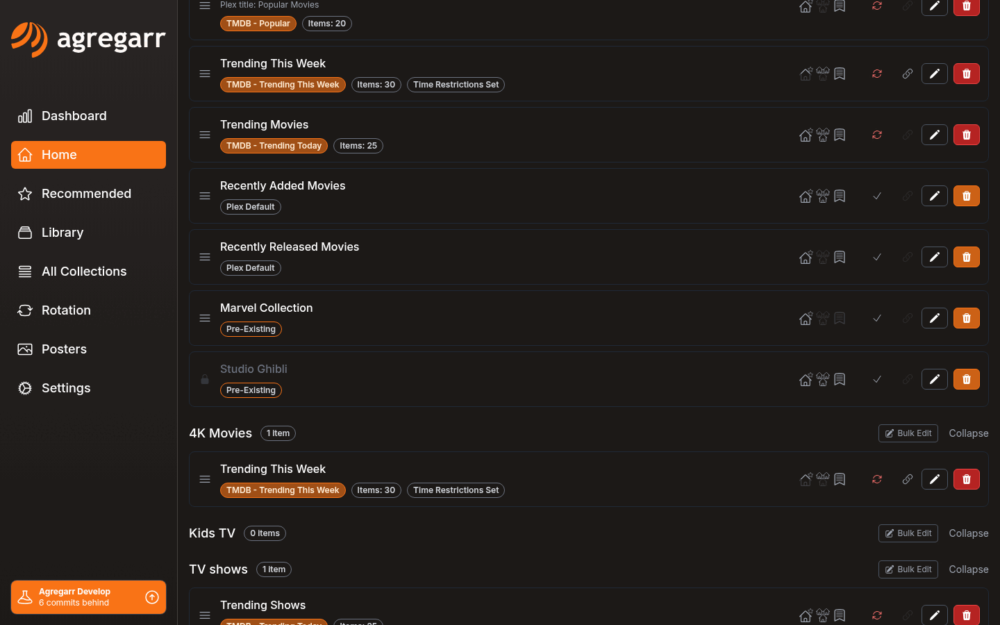
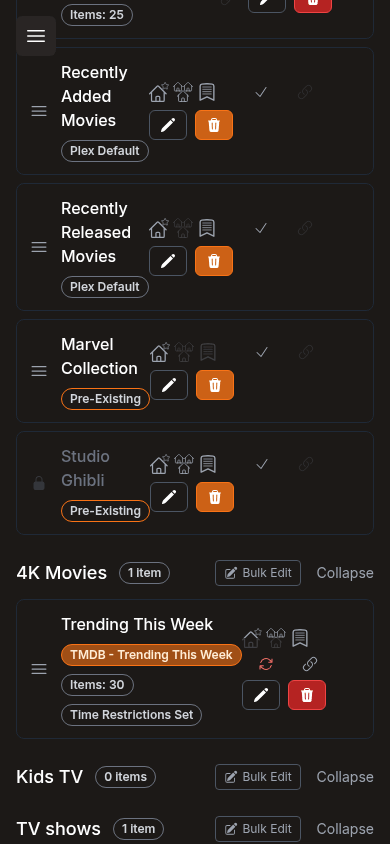

# Adopt collections and hubs you already have

Bring the collections and hubs already in Plex under Agregarr's ordering and visibility without rebuilding them. Agregarr calls these **Pre-Existing** collections and **Plex Default** hubs.

## Before you start

- Agregarr connected to Plex, with the setup wizard finished.
- Your Plex collections already in place. Collections made by other tools, such as Kometa, count.
- The Plex labels used by any other tool that manages its own collection order. You'll tell Agregarr to leave those collections alone in step 1.
- No sync running. Discover won't run during a sync.

## Set it up

1. **Optional:** leave another tool's collections out of Agregarr's ordering. Open **Settings > General**, enter the tool's Plex labels in **Exclude from Ordering (Plex Label)** as a comma-separated list and save.

    **Check:** the field contains your labels. A collection matches when its label is an exact match or starts with one of those labels followed by an underscore. Matching isn't case-sensitive.

2. Go to **Home** and click **Discover Existing Collections & Hubs**.

    **Check:** a message starting "Imported" shows how many new hubs and collections it found. Plex's own hubs have a grey **Plex Default** badge and your own collections have an amber **Pre-Existing** badge.

    === "Desktop"

        

    === "Phone"

        

    A collection has a lock instead of a drag handle when it matches one of the labels from step 1.

3. Click **Edit** on an adopted item.

    **Check:** a grey box at the top reads "Pre-existing Collection" or "Default Plex Hub". The form has fewer options than a normal collection. See [Collection form](form/basics.md#pre-existing-collections-and-default-hubs) for what each one does.

4. Tick or untick **Users Home**, **Server Owner Home** and **Library Recommended**. Adopted items start with their current Plex visibility. A collection that wasn't on any Plex screen starts with all three unticked. Click **Update Collection**.
5. Click **Sync Collections**.

**Check:** the row's sync icon changes from the red **Needs Sync** arrow to a tick. Plex shows the item on the screens you selected.

## Check it worked

Open Plex. The collection or hub appears on the Home and Recommended screens you ticked, in the order shown on **Home** in Agregarr. Its items haven't changed.

## Variations

??? note "Clean up after deleting something in Plex"
    If you delete an adopted collection in Plex, run Discover again. Its row gets a red triangle reading "This collection no longer exists in Plex" and a **Clean Up Missing Collections (N)** button appears. Click it, confirm "Remove N missing collection configurations? This cannot be undone." and Agregarr forgets the item. It also removes any leftover Home or Recommended entry for it in Plex. The collection itself is already gone, so nothing else in Plex changes.

??? note "Rename a Pre-Existing collection"
    **Collection Suffix** adds or removes the word "Collection" at the end of its name in Plex. The next sync renames it. See [Collection form](form/basics.md#collection-suffix).

??? note "How Agregarr tells its own collections from yours"
    A collection counts as Agregarr's own when it has a Plex label starting `Agregarr` in any case or matches one of your Agregarr collections. Everything else is **Pre-Existing**.

## What it doesn't do

- Discover doesn't change which titles are in a collection, but it does write to Plex and to your saved settings. It adds a collection to Plex's Home and Recommended management when its saved visibility says it belongs there. It removes the Plex hub entry for a collection that carries an Agregarr label but no longer matches any of your Agregarr collections, when Plex has it on no Home or Recommended screen. It also updates saved rating keys and labels that have drifted from Plex.
- It doesn't turn a **Pre-Existing** collection into an Agregarr one. There is no source behind it, so it has no **Item Order** or title template.
- It can't delete a **Plex Default** hub or a **Pre-Existing** collection. **Hide** unticks all three visibility boxes and keeps the item.
- A collection only changes name, sort title, poster, wallpaper, theme or summary if you set that option on its form. Its sort title also changes when you drag it into the promoted list.
- It only looks at movie and TV libraries.
    <!-- OPEN: NEW: Discover is not read-only in Plex; it also promotes collections into hub management and removes the hub entry (deleteHubItem) for an Agregarr-managed collection that has no visibility, not the collection -->
- Once adopted, Agregarr's saved visibility wins. A sync writes it back to Plex. Changes made in Plex's own settings to an adopted hub or collection are undone. The one exception is a Pre-Existing collection you excluded with a label in step 1. Plex Default hubs can't be excluded that way.

## If it didn't work

- **The page is still greyed out.** Discover found nothing. Check the connection under **Settings > Plex**.
- **A message says discovery can't start while a sync runs.** Wait for the sync to finish, then click **Discover Existing Collections & Hubs** again.
- **"All N Plex hubs/collections have already been imported!"** Discover found nothing new. Run Discover again for collections added in Plex since the last run.
- **A collection I made by hand doesn't appear.** It's in a library that isn't a movie or TV library, or you made it after the last Discover. Run Discover again.
- **An item shows a lock and won't drag.** Its Plex label matches **Exclude from Ordering (Plex Label)**. Remove the label from the setting and run Discover again.
- **The item came back after I changed it in Plex.** A sync wrote Agregarr's saved settings back to Plex. Change the item in Agregarr instead.

## Related

- [Collection pages](pages.md#discover-existing-collections-hubs)
- [Collection form](form/basics.md#pre-existing-collections-and-default-hubs)
- [Visibility and time restrictions](form/visibility.md#hubs-and-imported-collections)
- [Settings](../Settings.md#exclude-from-ordering-plex-label)
- [Rotation](../appear/rotation.md)
