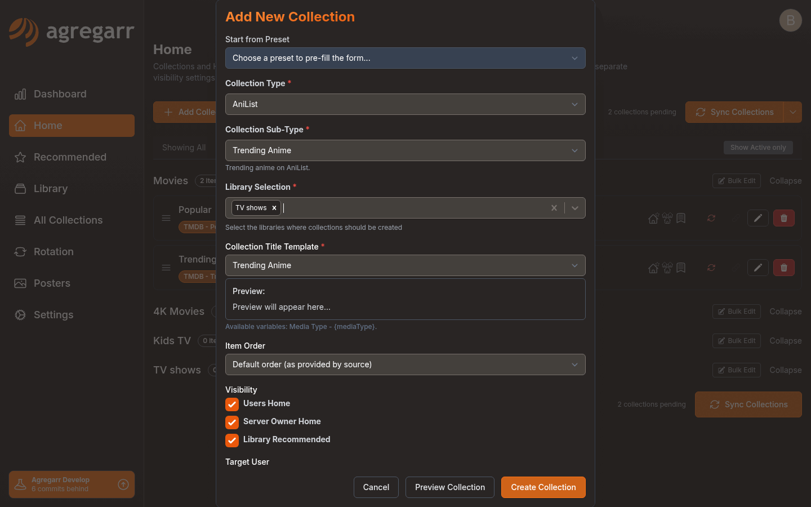
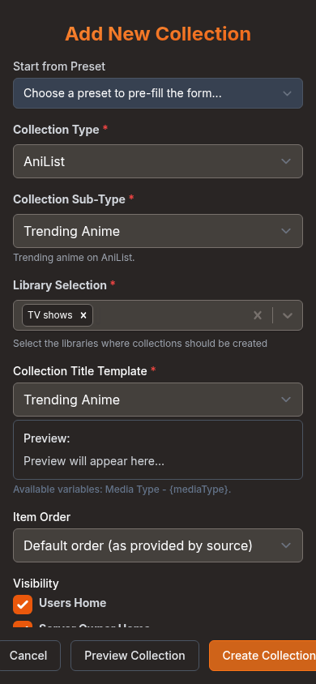

# Add an anime collection from AniList or MyAnimeList

This page builds a Plex row from an anime chart. AniList can also read a member's list or search page. AniList needs no key. MyAnimeList needs a Client ID.

## Before you start

- Agregarr connected to Plex, with **Discover Existing Collections & Hubs** already run. See [Your first collection](../get-started/first-collection.md).
- A Plex library that holds your anime. A movie library gets the movie entries. A TV library gets the shows, OVA and specials.
- For MyAnimeList only: a Client ID. Skip to the **MyAnimeList** variation below.

Agregarr matches anime to your library using a community mapping file downloaded from GitHub. If the file can't map an entry, Agregarr can't match it.

## Set it up

### 1. Start the collection

1. Go to **Home** and click **Add Collection**.
2. Set **Collection Type** to **AniList**.
3. Set **Collection Sub-Type** to **Trending Anime**. **Popular Anime** and **Top Rated Anime** work the same way.

**Check:** the form shows **Collection Sub-Type** and no key warning appears.

### 2. Choose the library

Choose your anime library under **Library Selection**. The rest of the form appears.

Match the library to the chart. A movie chart in a TV library comes back empty, as does a TV chart in a movie library.

=== "Desktop"

    

=== "Phone"

    

**Check:** the **Preview Collection** button lists the chart entries found in your library.

### 3. Create and sync it

Click **Create Collection**, then click **Sync Collections** on **Home**.

**Check:** the card on **Home** shows no error state and the line beside **Sync Collections** reads "Last sync:" with the time.

## Check it worked

In Plex, a row with your chosen title appears on the Home screens ticked under **Visibility** and in the library's **Collections** tab. It holds only the chart entries you own, so it can be shorter than the chart.

## Variations

??? note "A member's list"
    Set **Collection Sub-Type** to **Custom List**. Paste the address into **Custom AniList List URL** in this shape, then click **Validate**:

    `https://anilist.co/user/username/animelist/listname`

    The last part is the list's name on AniList, such as Watching. If the custom list name contains a space, it matches nothing, so use a name without spaces. **Validate** reads the page's name into **Collection Title Template**. The form's example without `/user/` doesn't work. A member list only reads the first 50 entries that suit your library.

    With a movie library, **Library Selection** can say "Detected TV Shows only" after **Validate**. Ignore it. The sync still takes the list's movies.
    <!-- OPEN: NEW: AniList addresses without /user/ pass the form's check and the form's own example, but the sync returns no items -->
    <!-- OPEN: NEW: AniList member lists are cut to 50 entries (slice at perPage) while charts and search pages paginate -->

??? note "An AniList search page"
    Choose **Custom List**, then paste an address from AniList's search page, such as `https://anilist.co/search/anime/this-season`. Click **Validate** so **Collection Title Template** gets a name. Filters set on that page carry across. The shortcuts `trending`, `this-season`, `next-season`, `popular` and `top-100` work after `/search/anime/`.

??? note "MyAnimeList"
    1. Create an API application on MyAnimeList's API page and copy its **Client ID**.
    2. In **Settings > Sources**, open **MyAnimeList Settings** and paste it into **MyAnimeList API Key**. The field says API Key but wants the Client ID. Click **Test Connection**, then **Save Changes**.
    3. Click **Add Collection** and set **Collection Type** to **MyAnimeList**.
    4. Choose a **Collection Sub-Type**, for example **Top Anime Movies** with a movie library, then choose your library.
    5. Click **Create Collection** and sync.
    <!-- OPEN: M7 -->

    **Check:** the sub-type menu lists eight charts and no orange **MyAnimeList required.** warning shows under **Collection Type**.

## What it doesn't do

- It doesn't download anime you don't have. Entries missing from your library follow your **Grab Missing Items** settings. MyAnimeList requests need a TMDB ID in the mapping file.
- It doesn't pick movies or shows for you. Your library determines that, so **Top Anime Movies** in a TV library stays empty.

## If it didn't work

- **The collection is empty.** The chart's type doesn't match your library, or none of its entries are in your library. See [Anime](sources/anime.md).
- **"Invalid AniList URL format".** The address isn't a member list, a search page or an anime page.
- **"Could not fetch AniList list title".** AniList didn't answer the request. Click **Validate** again.
- **"MyAnimeList required." under Collection Type.** No Client ID is saved. See [MyAnimeList](sources/anime.md#myanimelist).
- **An error mentions rate limits.** MyAnimeList asked Agregarr to slow down. Sync again later.

## Related

- [Anime from AniList and MyAnimeList](sources/anime.md): every option and limit
- [Lists from IMDb, Letterboxd, Trakt, MDBList and TVDB](sources/lists.md)
- [Rotate several lists through one row](cycle-sources.md): take turns between several charts in one row
- [Name collections](name-collections.md)
