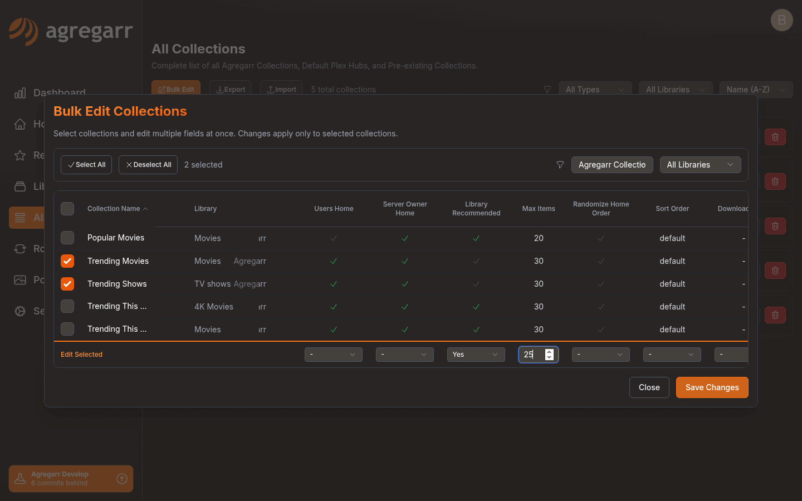
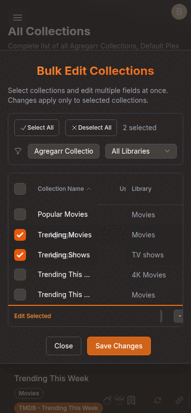

# Change many collections at once

Use **Bulk Edit** to apply the same options to a group of collections without opening each form. It works with Agregarr collections, Plex default hubs and Pre-Existing collections.

## Before you start

- At least two collections you want to change the same way.
- The setting you want to change, and its column name. **Bulk Edit** uses a table and some column names differ from the labels on the collection form. See [Columns with a different name](#columns-with-a-different-name).
- There's no undo. **Save Changes** writes the changes straight away.

## Set it up

1. Click **Bulk Edit** in a library's header on **Home**, **Recommended** or **Library**. You can also use the button at the top of **All Collections**.

    **Check:** a window titled **Bulk Edit Collections** opens with one row per item and one column per setting. Whichever header you use, the button opens the same window with every library in it.

    === "Desktop"

        

    === "Phone"

        

2. Narrow the list. The type list opens on **Agregarr Collections**. Change it to **Plex Hubs** or **Pre-existing Collections** to edit those instead. The library list starts on **All Libraries**.
3. Tick the rows you want to change. Click **Select All** to tick every row currently listed.

    **Check:** a count reads "N selected".

4. Use the **Edit Selected** row at the bottom to set a value under each column you want to change. Leave the other columns on **-** or empty.
5. Click **Save Changes**.

    **Check:** a message says "Successfully updated N collection(s)". The window stays open and the **Edit Selected** row clears.

6. Click **Close**, then **Sync Collections**.

**Check:** each changed row shows the red **Needs Sync** arrow until the sync finishes, then shows a tick.

## Check it worked

Open one of the collections with **Edit**. The option you changed has the value you set. Visibility changes appear in Plex after the sync runs.

## Columns with a different name

The main columns are **Users Home**, **Server Owner Home**, **Library Recommended** and **Max Items**. Those match the collection form. These ones use different names:

- **Sort Order** is **Item Order** on the form.
- **Download Mode** is **Download Method**.
- **Search Missing Movies** and **Search Missing TV** are **Grab Missing Movies** and **Grab Missing TV Shows**.
- **Randomize Home Order** is **Shuffle position on Home/Recommended screens**.
- **Max Position to Process** is **Skip item if position in list is greater than**.
- **Unwatched Only** is the **Create Smart Collection** tick box under **Smart Collection**. It doesn't change **Filter to Unwatched Items Only**.

See [Collection pages](pages.md#bulk-edit-collections) for the full list and the values each column accepts.
<!-- OPEN: M11 -->

## Variations

??? note "Hubs and Pre-Existing collections"
    Only **Users Home**, **Server Owner Home**, **Library Recommended** and **Randomize Home Order** apply to them. Agregarr skips the other columns for these rows.

??? note "Collections in a rotation"
    Visibility and **Randomize Home Order** changes are saved as the collection's own settings. While the collection is in a rotation, the rotation's own Home settings apply instead; its own values come back when it leaves the rotation. See [Rotation](../appear/rotation.md).

??? note "Sort the table"
    Click a column heading to sort by it. Click it again to reverse the order.

## What it doesn't do

- It doesn't change names, sources, libraries, **Sort Title**, posters or time restrictions. Open the collection to change those.
- It doesn't clear a number when you empty the box after typing in it. The old value stays.
<!-- OPEN: NEW: emptying a number box after typing in it sends a clear the server ignores, so the old value stays -->
- It doesn't delete or hide anything.
- It doesn't send changes to Plex. The sync does that.

## If it didn't work

- **Save Changes is greyed out.** No rows are ticked.
- **A message says "Failed to update NAME:" with an error.** That collection didn't save. The others did. Open it with **Edit** and save it there to see the cause.
- **A hub or Pre-Existing collection isn't in the list.** The type list is set to **Agregarr Collections**. Change it.
- **A column does nothing for a row.** The column is faded for that row because the setting doesn't apply to that kind of item.
- **A warning says "Couldn't save this collection's own visibility setting."** The collection is in a rotation and its own setting didn't save, so the old value comes back when it leaves the rotation. Try the change again.

## Related

- [Collection pages](pages.md#bulk-edit-collections)
- [Collection form](form/basics.md)
- [Visibility and time restrictions](form/visibility.md)
- [Rotation](../appear/rotation.md)
