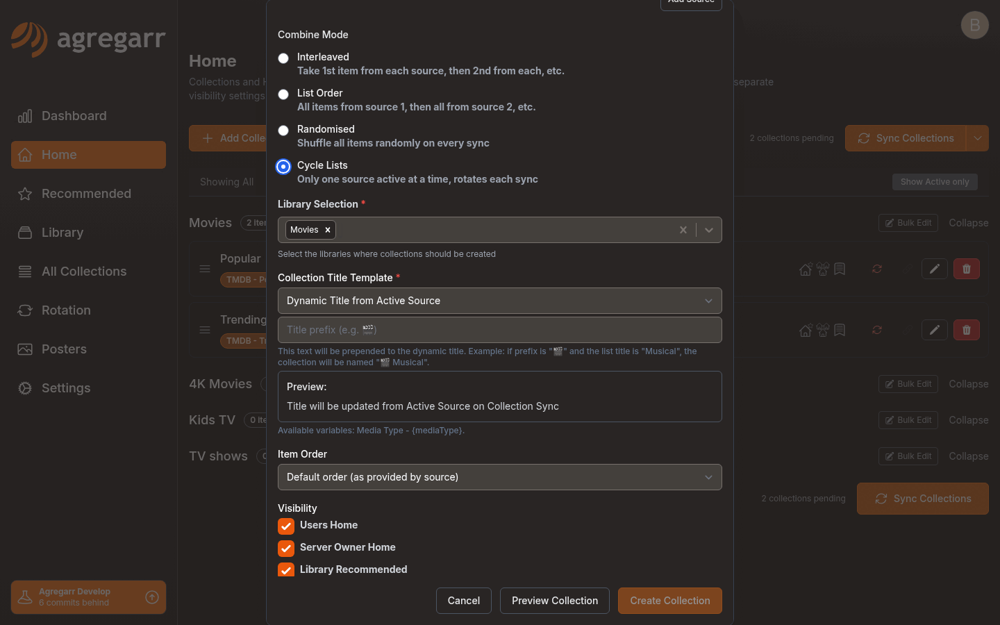
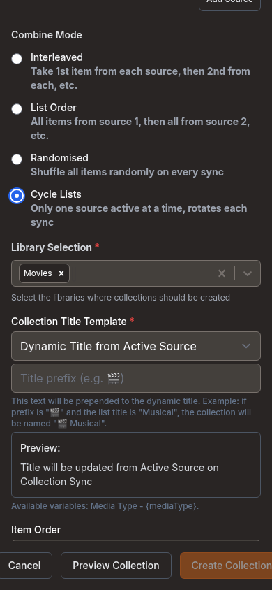

# Rotate several lists through one row

This page puts several lists into one collection and shows them one at a time. Each sync moves to the next list, so the row on Home keeps changing.

## Before you start

- Agregarr connected to Plex, with **Discover Existing Collections & Hubs** already run. See [Your first collection](../get-started/first-collection.md).
- Two or more lists ready. Each source needs the same setup as its standalone type. A Trakt list needs Trakt set up, for example.
- One library chosen. A collection belongs to one library.

## Set it up

1. Click **Add Collection** and set **Collection Type** to **Multiple Sources**.
2. Under **Sources**, click **Add Source**. Choose a **Source Type**, then a **Collection Sub-Type**. For your own list, choose **Custom List** (**Custom Collection** for TMDB), paste the address into **Custom URL** and click **Validate URL**.
3. Add a second source the same way.

    **Check:** **Library Selection** appears below **Combine Mode**. It stays hidden until there are at least two sources.

4. Under **Combine Mode**, below **Add Source**, choose **Cycle Lists**.

    === "Desktop"

        

    === "Phone"

        

5. Choose your library under **Library Selection**. The rest of the form appears.

6. Set **Collection Title Template** to **Dynamic Title from Active Source**. Choosing **Cycle Lists** leaves it on **Custom**, so pick it by hand. Add a **Title prefix** if you want one, such as "Weekly:".

    **Check:** the preview reads "Title will be updated from Active Source on Collection Sync".

7. Set **Max Items** and click **Create Collection**.

To change the list on a timetable, open the collection again. Find **Custom Sync Schedule** under **Time Restrictions**, tick **Enable custom sync timing** and choose a **Schedule** such as **Once weekly**.

## Check it worked

Click **Sync Collections**. If you turned on **Enable custom sync timing**, that skips the collection, so click the red **Needs Sync** arrow on its row instead. The first sync uses the first source. In Plex, the row uses that list's name, with your prefix in front. Each later sync moves to the next source and renames the same collection. After the last source, it starts again at the first.

Only the active list exists as a collection. Agregarr doesn't fetch the others until their turn.

## Variations

??? note "Pick a random list each time"
    Trakt, TMDB, IMDb and Letterboxd sources have a **Random Lists** sub-type. It picks a list from a pool on every sync. Letterboxd and TMDB random lists only work in movie libraries. Edit the pool under `random-lists/` in your config folder. See [Random list pools](sources/lists.md#random-list-pools). Inside **Multiple Sources**, the collection title for a random source falls back to a generic name.
    <!-- OPEN: NEW: dynamic title for Random Lists sources and TMDB Coming Soon falls back to a generic name (Random, Tmdb Anticipated) instead of the list that is showing -->

??? note "Name a single random-list collection after its list"
    Don't use **Multiple Sources**. Choose the **Random Lists** sub-type on the standalone type, then set **Collection Title Template** to **Dynamic Title from Random List**.

??? note "Mix everything into one big list"
    Choose **Interleaved**, **List Order** or **Randomised** under **Combine Mode** instead. These combine every source into one collection and remove duplicates.

??? note "Cycle collections you already have"
    That's a different feature. Rotation groups swap existing collections on and off Home. See [Rotation](../appear/rotation.md).

## What it doesn't do

- It can't reorder sources. **Add Source** adds a source at the end and **Remove** moves later sources up one place.
- It doesn't keep the other lists as collections in your library.
- Removing or adding sources mid-cycle can move the current list to another position.
- If the next list has no items you own, that sync leaves the collection and its title alone. The following sync moves on.
- **Collections Quick Sync** and **Preview Collection** don't move the cycle.

## If it didn't work

- **The rest of the form never appears.** There are fewer than two sources. Click **Add Source** again.
- **Interleaved, List Order and Randomised are greyed out.** A validated list contains episodes alongside movies or shows. Only **Cycle Lists** is available for that combination.
- **The title didn't change.** **Dynamic Title from Active Source** only works with **Cycle Lists**. The title updates only when the new list has items.
- **A source shows no list name.** Click **Validate URL** for that source.
- **It changed too often or not at all.** With a custom schedule, every full sync skips the collection, including one started with **Sync Collections**. It moves only on its own schedule or when you click the red **Needs Sync** arrow on its row.

## Related

- [Multiple Sources](sources/multiple-sources.md)
- [Rotation](../appear/rotation.md)
- [Run a collection only at certain times](timed.md)
