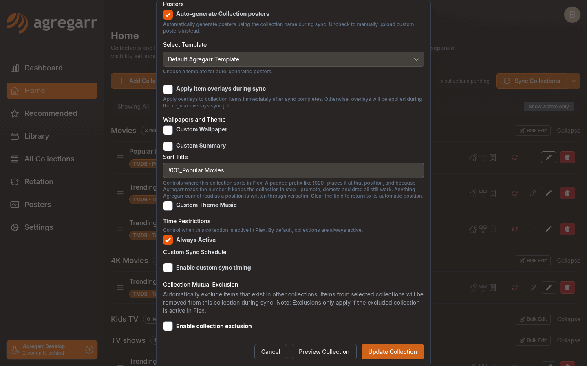
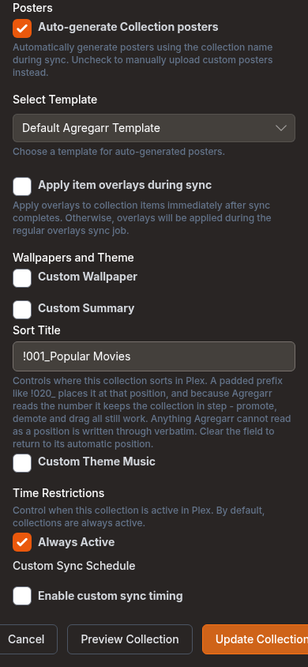
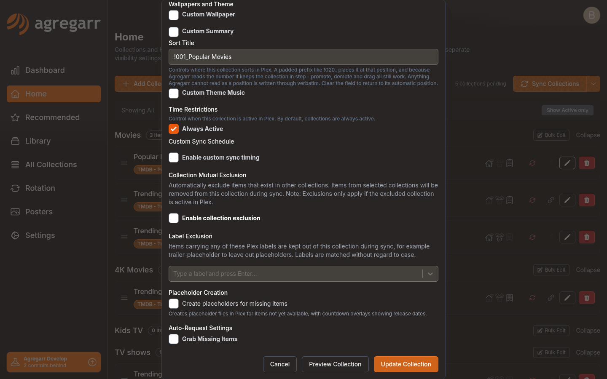
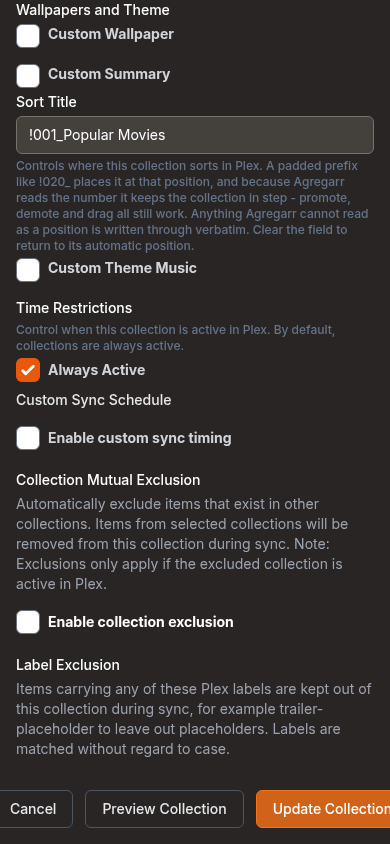

# Artwork and sort title

This page covers the collection form fields that control a collection's poster, wallpaper, summary, theme music and Sort Title. For how-tos, see [Posters, wallpapers and theme music](../posters.md).

You'll find these fields on **Add New Collection** and **Edit Collection Configuration**, opened from **Home**, **Recommended** or **Library**. They're listed here in the same order as the form.

The fields sit under **Posters** and **Wallpapers and Theme**, with **Sort Title** inside the second section. Standalone separators only get **Posters**. Default Plex hubs get neither section. Imported Plex collections get both, with their differences noted under each entry.

=== "Desktop"

    

=== "Phone"

    

## Posters

The **Posters** section appears after you've chosen a library. Poster files, wallpapers and theme music are stored separately for each library, so the form needs the library first.

### Auto-generate Collection posters

**Default:** ticked on a new collection. Unticked on imported Plex collections and on Library Essentials (the Genre, Decade, Resolution and Content Rating sub-types).

Builds a poster from the collection's name and items on every sync, using the template selected below. The hint under the box reads "Automatically generate posters using the collection name during sync. Uncheck to manually upload custom posters instead." Untick it and the form shows a poster slot for each library.

Choosing a Library Essentials sub-type unticks the box. Moving away from Library Essentials by changing the sub-type or **Collection Type** ticks it again. If Plex shows a different poster on the collection while this box is ticked, Agregarr puts its own back during the next sync.

The box isn't available for **Recently Added Episodes (Individual)** or **Recently Released Episodes (Individual)**. Those hubs only show the poster slots.

### When the poster is rebuilt

Agregarr rebuilds a generated poster only when something shown on it changes. These changes trigger a rebuild:

- The template or any change to its design.
- The collection's name.
- The items filling the poster's grid. If the template has no grid, this means the first four items.
- The collection's item count, but only when a template element uses **Show conditionally** with **Item Count**.

Changing a source's colours under **Customize Colors** doesn't trigger a rebuild. The collection keeps its old colours until something in the list above changes.

Reordering items below the grid doesn't trigger a rebuild. Neither does adding items further down the list or getting a new TMDB photo for an actor or director.

### Select Template

**Default:** the template marked **Default** on **Posters > Collection Posters**. Separators start on the built-in **Separator** template.

Appears while **Auto-generate Collection posters** is ticked. The list includes every template and its description. The hint reads "Choose a template for auto-generated posters."

For a new collection, the form saves whichever template it shows. Changing the default template later doesn't move collections that already have a saved template.

An imported Plex collection has no saved template until you choose one. Until then, it follows whichever template is the default during each sync.

### Use TMDB Franchise Poster

**Default:** unticked.

Only available for **TMDB Lists** > **Auto Franchise Collections**. Uses the official TMDB franchise poster instead of a generated one. When TMDB has no poster for a franchise, Agregarr generates one as usual if **Auto-generate Collection posters** is ticked.

### Hide Individual Items in Collection

**Default:** unticked.

Only available for **Auto Franchise Collections** and **Coming Soon**. Sets the Plex collection to hide its items, so the library's **Library** tab shows the collection rather than every item inside it. An item can still appear there if it's also part of another collection.

### Poster slot for each library

When **Auto-generate Collection posters** is unticked, the form shows one dashed box with a **+** for each selected library. Each box is labelled with the library's name.

Click a box to open **Select Poster**. Once a box contains a poster, it shows the image with a pencil for changing it and a cross for removing it when you hover.

The hint reads "Upload custom poster images for each selected library. Posters will be applied to Plex collections during the next sync." Removing a poster stops Agregarr from applying it. Plex's earlier poster isn't restored and the file isn't deleted.
<!-- OPEN: NEW: the toast on removal says "Poster will be removed on next collection sync" (PosterUploadSection.tsx:14) but no code removes the poster from Plex or deletes the file; upstream docs make the same claim -->

### Select Poster

The poster picker for one library is titled "Select Poster for" followed by the library's name. It shows every poster file stored by Agregarr across all collections, four to a row.

Click a poster to use it for this library. Hover over one to show the trash icon, which deletes the file. If Agregarr has no stored posters, the picker says "No posters available".

It has three buttons: **Create New Poster**, **Upload New Poster** and **Add from URL**.

### Create New Poster

Opens the poster editor in **Create Poster** mode, with a preview using this collection's name and type. Saving stores the design under **Saved Posters**. It doesn't create an image or select the design for this library, so the poster slot stays empty.

Use **Upload New Poster** or **Add from URL** to put a poster on the collection. See [Poster editor](../poster-editor.md).
<!-- OPEN: NEW: Create New Poster saves a design record with no image file and never selects it (PosterSelectionPopover.tsx:391-405 reads savedPoster.imagePath, which POST /api/v1/posters/saved never returns; nothing renders a saved design to config/posters) -->

### Upload New Poster

Opens your file picker. It accepts JPEG, PNG and WebP files up to 10 MB. Agregarr crops and scales the image to 1000 by 1500 pixels, then selects it straight away. The toast reads "Poster uploaded successfully. Will be applied on next collection sync."

Images wider or taller than 5000 pixels are refused.

### Add from URL

Shows a box with the placeholder "Enter poster URL" and a **Download Poster** button. The **Add from URL** button changes to **Cancel**. Agregarr downloads the image, stores it the same way as an upload and selects it.

The address must use public http or https. Agregarr doesn't follow redirects. The server must report the file as JPEG, PNG or WebP and it must be 10 MB or smaller. Addresses on your local network are refused. The limit is ten downloads per minute.

### Poster is Currently in Use

This warning appears when you try to delete a poster used by other collections. It lists each collection and its library, with "(Pre-existing)" beside imported Plex collections.

**Cancel** keeps the poster. **Delete Anyway** deletes the file. If nothing uses the poster, Agregarr first asks "Are you sure you want to delete this poster?"

### Apply item overlays during sync

**Default:** unticked. Ticked and greyed out on Coming Soon collections. Not offered on standalone separators.

Applies overlays to this collection's items immediately after the collection syncs instead of waiting for the next overlay run. The hint reads "Apply overlays to collection items immediately after sync completes. Otherwise, overlays will be applied during the regular overlays sync job."

The regular overlay run is **Poster Overlay Application**, scheduled daily at 3 AM by default. New items also receive overlays through **Overlay Quick Sync**, which runs every 30 minutes by default.

This setting only touches items in the collection. It also does nothing until overlays are enabled for that library under **Posters > Poster Overlays**. See [Overlays](../../Overlays.md).

## Wallpapers and Theme

This section has three tick boxes, all unticked by default. Ticking one shows its input. **Sort Title** sits between the second and third. Wallpaper and theme music fields only appear after you've selected a library.

Agregarr applies each enabled option on every sync, but doesn't upload an unchanged file again.

For an imported Plex collection, the order is **Custom Wallpaper**, **Custom Theme Music**, **Custom Summary**, then **Sort Title** and **Collection Suffix**.

=== "Desktop"

    

=== "Phone"

    

### Custom Wallpaper

**Default:** unticked.

Sets the collection's background art in Plex. Ticking it shows a box for each selected library, with the hint "Upload custom wallpaper images for each selected library. Wallpapers will be applied to Plex collections during the next sync."

It accepts JPEG, PNG and WebP files up to 10 MB. Agregarr saves the wallpaper as a JPEG. Anything larger than 1920 by 1080 is shrunk to fit, while smaller images aren't enlarged.

While the box stays ticked, Agregarr puts its wallpaper back if you choose another one in Plex. Unticking the box or removing the file takes Agregarr's wallpaper off the collection during the next sync, but only if Plex still shows the wallpaper Agregarr uploaded. If you've since selected another wallpaper in Plex, that one stays.

### Custom Summary

**Default:** unticked.

Sets the collection's description in Plex. Ticking it shows a text box with the placeholder "Enter a custom description for this collection..." and the hint "Custom description text for the collection. Will be synced to Plex."

Agregarr writes this text during every sync, overwriting description edits made directly in Plex. An empty box writes nothing. Unticking the box stops Agregarr from setting the summary, but the existing text remains in Plex until you clear it there.

### Sort Title

**Default:** the box starts with the sort title the collection already has, which is what Agregarr would write for its current position. Leaving that text alone stores nothing, and the collection keeps its automatic position.

Controls the collection's sorting position in Plex. The placeholder reads "e.g. !020_".

The field appears when you edit a collection from **Library**, **Home** or **Recommended**. It doesn't appear in **All Collections**, on standalone separators or on default Plex hubs. On **Recommended**, it also stays hidden when the collection appears on Home through **Users Home** or **Server Owner Home**, because Home controls the order.

Typing a rank such as `!020_` moves a promoted collection to that position in the promoted list.

If you enter a value beginning with `!` for an A-Z collection, Agregarr asks after saving whether to promote it. The options are **Yes, promote it** and **Keep in A-Z**. A promoted collection with a value that doesn't begin with `!` gets the reverse question, with **Yes, demote it** and **Keep Promoted**. Clear the box to restore automatic positioning.

The rank format, how a config that creates multiple collections handles the text, the "Edited in Plex" line below the box and **Collection Sort Format** under **Settings > Plex** are covered in [Name collections](../name-collections.md#sort-title).

### Custom Theme Music

**Default:** unticked.

Sets the collection's theme music in Plex. Ticking it shows a box for each selected library, with the hint "Upload custom theme music files for each selected library. Themes will be applied to Plex collections during the next sync."

It accepts MP3, WAV, FLAC, OGG, AAC and M4A files up to 10 MB. A selected file has play and pause controls, plus buttons to change or remove it. Agregarr keeps the file in its original format.

It works like **Custom Wallpaper**. Agregarr puts its file back if you choose another in Plex. Unticking the box or removing the file takes it off the collection during the next sync, as long as Plex still has the file Agregarr uploaded.

## Further down the form

The sections below come after the artwork fields. Each has its own page later in this guide.

### Placeholder Creation

Creates placeholder files in Plex for source items you don't have yet, with countdown overlays showing their release dates. See Missing items and placeholders, and [Placeholders](../../Placeholders.md) for now.

### No Overlay Templates Configured

An orange warning shown under **Placeholder Creation** when placeholders are enabled, **Apply item overlays during sync** is ticked (or the collection is Coming Soon) and a selected library has no enabled overlay templates.

It reads "You have enabled placeholder creation and overlay application, but no overlay templates are configured for" followed by the library names. Agregarr still creates the placeholders, but without status overlays. **Configure Overlays** opens **Posters** in a new tab.

### Grab Missing Items (Auto-Request)

Appears under **Auto-Request Settings**. Sends source items missing from Plex to Radarr, Sonarr or Seerr for download. See Missing items and placeholders.

## Related

- [Posters, wallpapers and theme music](../posters.md)
- [Poster editor](../poster-editor.md)
- [Visibility and time restrictions](visibility.md)
- [Your servers](../sources/your-servers.md): Library Essentials and separators
- [Collections](../index.md)
