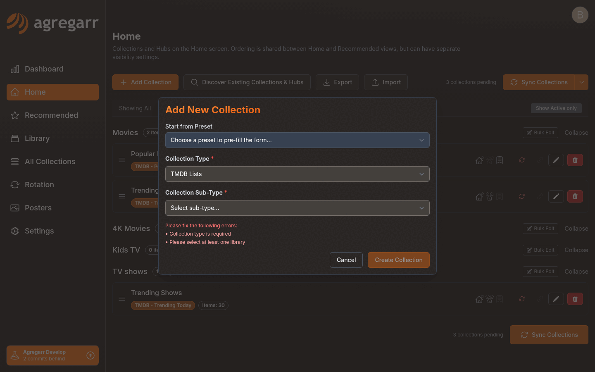
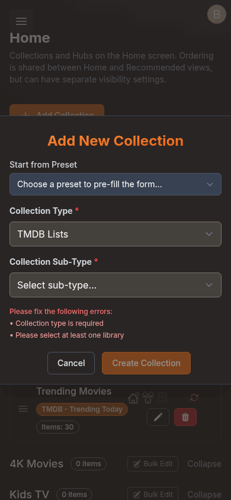
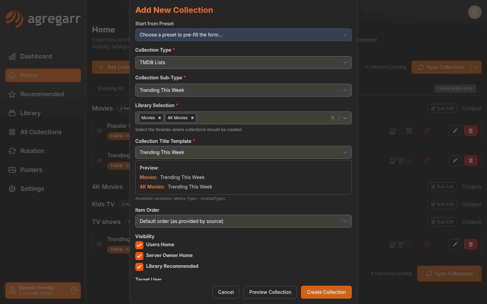
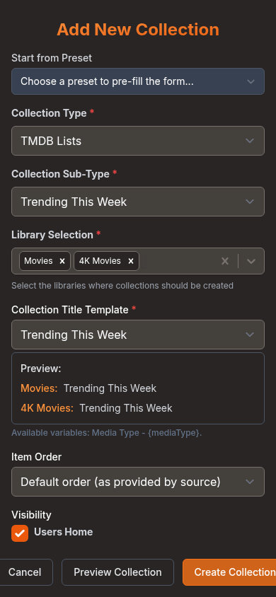

# Add Collection form: the basics

The **Add New Collection** window covers everything from **Start from Preset** through to the options shared by every source. Open it with **Add Collection** on the collections pages. Click the pencil icon beside an existing collection to open the same form as **Edit Collection Configuration**. For a complete walkthrough, see [Your first collection](../../get-started/first-collection.md).

Options tied to one source, such as **Custom URL** or **Combine Mode**, are covered on the [source pages](../index.md#reference). [Name collections](../name-collections.md) goes into more detail on names and sort titles.

=== "Desktop"

    

=== "Phone"

    

Most of the form stays hidden until you've chosen a type, a sub-type and a library. The entries below follow the order they appear in the window. **Default** shows the value a field starts with. Entries also note when a field is hidden for particular sources.

## Start from Preset

### Start from Preset {#start-from-preset}

Default: nothing chosen ("Choose a preset to pre-fill the form..."). Fills the form from one of 12 ready-made collections. It only appears when adding a new collection, not when editing one.

Choosing a preset sets **Collection Type**, **Collection Sub-Type**, **Collection Title Template**, **Max Items** and the three **Visibility** boxes. It also limits **Library Selection** to libraries matching the preset's media type. Libraries you've already chosen stay selected when they match. If none match, every library of that type is selected. You can edit every field afterwards. **Item Order**, posters and **Time Restrictions** stay as they were.

Every preset ticks **Server Owner Home** and **Library Recommended**, while leaving **Users Home** unticked. Coming Soon presets turn **Placeholder Creation** on. Any other preset turns it off.

Each preset fills in these values:

- **Trending Movies Today**: **TMDB Lists**, **Trending Today**. Named Trending Movies Today, **Max Items** 20.
- **Trending TV Today**: **TMDB Lists**, **Trending Today**. Named Trending TV Shows Today, **Max Items** 20.
- **TMDB Top Rated Movies**: **TMDB Lists**, **Top Rated**. Named Top Rated Movies, **Max Items** 50.
- **TMDB Top Rated TV**: **TMDB Lists**, **Top Rated**. Named Top Rated TV Shows, **Max Items** 50.
- **IMDb Top 250**: **IMDb Lists**, **Top 250**. Named IMDb Top 250, **Max Items** 250.
- **IMDb Most Popular Movies**: **IMDb Lists**, **Popular (Meter)**. Named IMDb Popular Movies, **Max Items** 30.
- **IMDb Most Popular TV**: **IMDb Lists**, **Popular (Meter)**. Named IMDb Popular TV Shows, **Max Items** 30.
- **Upcoming Movies**: **Coming Soon**, **TMDB Coming Soon**. Named Upcoming Movies, **Max Items** 30.
- **Upcoming TV**: **Coming Soon**, **TMDB Coming Soon**. Named Upcoming TV Shows, **Max Items** 30.
- **Trakt Trending Movies**: **Trakt Lists**, **Trending Now**. Named Trending Movies, **Max Items** 20.
- **Trakt Trending TV**: **Trakt Lists**, **Trending Now**. Named Trending TV Shows, **Max Items** 20.
- **Netflix Top 10 Movies**: **Networks Top 10**, Netflix, with the country set to global. Named Netflix Top 10 Movies, **Max Items** 10.

The two Trakt presets don't appear until you've saved a Trakt client ID or API key under **Settings > Sources**. See [Networks Top 10](../sources/networks.md#networks-top-10) for the Netflix preset requirements.

## Source and library

### Collection Type {#collection-type}

Default: none ("Select Source..."). Required. Sets where the collection's items come from. Changing it clears **Collection Sub-Type**. The list contains one entry per source in this order:

- **Seerr Requests**: [Seerr Requests](../sources/activity.md#seerr-requests)
- **Tautulli Statistics**: [Tautulli Statistics and Tracearr Statistics](../sources/activity.md#tautulli-statistics-and-tracearr-statistics). The entry reads **Tracearr Statistics** while Tracearr is enabled with a host and API key.
- **Trakt Lists**: [Trakt Lists](../sources/lists.md#trakt-lists)
- **Plex Library**: [Your servers](../sources/your-servers.md) (Library Essentials, Auto Director and Auto Actor, labels, separators)
- **Letterboxd Lists**: [Letterboxd Lists](../sources/lists.md#letterboxd-lists)
- **TMDB Lists**: [TMDB Lists](../sources/tmdb.md)
- **IMDb Lists**: [IMDb Lists](../sources/lists.md#imdb-lists)
- **MDBList Lists**: [MDBList Lists](../sources/lists.md#mdblist-lists)
- **TVDB Lists**: [TVDB Lists](../sources/lists.md#tvdb-lists)
- **Networks Top 10**: [Networks Top 10](../sources/networks.md#networks-top-10)
- **Networks Originals**: [Networks Originals](../sources/networks.md#networks-originals)
- **AniList**: [AniList](../sources/anime.md#anilist)
- **MyAnimeList**: [MyAnimeList](../sources/anime.md#myanimelist)
- **Radarr Tag**: [Radarr Tag and Sonarr Tag](../sources/your-servers.md#radarr-tag-and-sonarr-tag)
- **Sonarr Tag**: [Radarr Tag and Sonarr Tag](../sources/your-servers.md#radarr-tag-and-sonarr-tag)
- **Coming Soon**: [Coming Soon](../sources/coming-soon.md)
- **Filtered Plex Hub**: [Filtered Plex Hub](../sources/your-servers.md#filtered-plex-hub)
- **Multiple Sources**: [Multiple Sources](../sources/multiple-sources.md)

Two notices can appear below the box. **Trakt Lists** shows "Trakt limits free accounts to one connected app. VIP recommended for use alongside other Trakt integrations." **Coming Soon** shows "Coming Soon requires media volume mounts for placeholder creation", with a link to a setup guide.

Choosing **Coming Soon** also ticks **Placeholder Creation** and locks it on.

### Configure Settings {#configure-settings}

Default: hidden. A warning appears below **Collection Type** when the source needs a key or connection that hasn't been saved. It names the service, for example "Trakt required." or "MDBList required." The **Configure Settings** button opens the matching settings page in a new tab. For **Seerr Requests**, the warning reads "Overseerr required." and the button opens **Settings > Sources**, while Seerr is configured under **Settings > Downloads**. See [Seerr Requests](../sources/activity.md#seerr-requests).
<!-- OPEN: Q11 warning says Overseerr, not Seerr -->

<!-- OPEN: C29 -->

### Collection Sub-Type {#collection-sub-type}

Default: none ("Select sub-type..."). Required when the source has sub-types. Available choices depend on the type. Each source page lists its choices. Picking a sub-type fills **Collection Title Template** with its first preset when the box is empty. A grey line below the box describes the highlighted choice.

There is no sub-type box for **Networks Top 10**, **Networks Originals**, **Multiple Sources**, **Radarr Tag** or **Sonarr Tag**. Those sources have their own pickers.

### Library Selection {#library-selection}

Default: none ("Select Libraries"). Required. A multi-select containing your Plex libraries and **All Libraries**, which selects each library separately. The rest of the form, starting with **Collection Title Template**, appears after you've chosen at least one library.

The box appears once the source has the details it needs. That means a sub-type (**Filtered Plex Hub** needs none), a time period for the Trakt played, watched, collected and favorited lists, a validated address for custom lists, a chosen tag for **Radarr Tag** and **Sonarr Tag**, or two or more sources for **Multiple Sources**.

Choose more than one library and Agregarr creates one collection in each. They're linked, so edits apply to all of them. See [Link and Unlink](#link-and-unlink). If you choose movie and TV libraries together, each library type gets its own **Collection Title Template** box when you select **Custom**.

=== "Desktop"

    

=== "Phone"

    

### Detected Movies only {#detected-media-type}

Default: hidden. A line above **Library Selection** describing what the list contains. For a list with one item type, it reads something like "Detected Movies only. TV Shows collections will be empty until matching content is added." For a mixed list, it reads "List contains both Movies and TV Shows." It appears for custom lists, **Radarr Tag** (movies) and **Sonarr Tag** (TV). **Letterboxd Lists**, TMDB **Random Lists** and Trakt **Box Office** are movie-only, so they always show the movies-only line.

The line is advice, not a block. It doesn't remove libraries from the list.

## Name and order

### Collection Title Template {#collection-title-template}

Default: the first preset for the sub-type you picked. Required. Sets the collection's name in Plex. The dropdown contains presets for the source and **Custom**. Choosing **Custom** shows a text box labelled "Movie collection template", "TV show collection template" or both, depending on the library types you've selected. When editing a collection, a saved name that doesn't match a preset opens under **Custom**. Enter your own name and use [title variables](../name-collections.md#title-variables) such as `{mediaType}s`.

Below the box, **Preview:** shows the name the collection will get. If you've selected more than one library, it shows one line per library headed by the library name. It reads "Preview unavailable" when the server can't work out the name. The next line lists the variables supported by the source, for example "Available variables: Media Type - {mediaType}."

Custom list sources only show **Validate URL** and **Custom** until the list address has been validated. Saving while **Validate URL** is selected stops with "Please validate the URL first".

Auto Franchise, Auto Director, Auto Actor and Library Essentials won't save unless the template contains `{franchiseName}`, `{director}`, `{actor}` or `{value}` respectively. The form names the required variable.

Agregarr works out the name again during every sync and renames the Plex collection when it changes. Changing the template renames the existing collection. It doesn't create another one.

### Title prefix {#title-prefix}

Default: empty. A text box ("Title prefix (e.g. 🎬)") shown only when **Collection Title Template** is **Dynamic Title from Random List** or **Dynamic Title from Active Source**. Its text is added before the generated title with a space between them, so don't finish the prefix with a space. With the prefix `🎬` and a list called "Musical", the collection is named "🎬 Musical". Choosing another template clears it.

### Item Order {#item-order}

Default: **Default order (as provided by source)**. Sorts the list before **Max Items** cuts it. Some sources stop fetching after they have enough items, so the order applies to the fetched items rather than the source's full list. Hidden for **Filtered Plex Hub**, where Plex controls the order. For **TMDB Lists** using **Custom Advanced Filters**, the form shows **Movie Sort Order** and **TV Sort Order** instead. See [Sorting](../sources/tmdb-filters.md#sorting).

- **Default order (as provided by source)**: the order returned by the source. For charts, this is the ranking.
- **Reverse order**: the source's order reversed.
- **Random order (shuffled each sync)**: a new shuffle on every sync.
- **IMDb Rating (Highest to Lowest)** and **IMDb Rating (Lowest to Highest)**: sorts by IMDb rating. Titles without a rating sit at the end for Highest to Lowest and at the start for Lowest to Highest.
- **Release Date (Newest to Oldest)** and **Release Date (Oldest to Newest)**: sorts by release date. Titles without a date sit at the end for Newest to Oldest and at the start for Oldest to Newest.
- **Date Added to Plex (Most Recent)** and **Date Added to Plex (Least Recent)**: sorts by the date the item reached your Plex library. Titles without a date sit at the end for Most Recent and at the start for Least Recent.
- **Alphabetical (A-Z)** and **Alphabetical (Z-A)**: sorts by the title as written, ignoring case. A leading "The" counts, so "The Matrix" sorts under T.
- **Trakt ranking**: only available for **Coming Soon** with **Trakt Anticipated**. It keeps Trakt's anticipation order. Changing the sub-type resets the order to **Default order (as provided by source)**.

<!-- OPEN: NEW: Item Order puts titles with no rating, release date or Plex date first, not last, in the ascending options (BaseCollectionSync.ts applyItemOrdering uses -1 and 0 as the missing value) -->

With any non-default order, placeholders for missing items follow the sorted titles. **Max Items** counts titles and placeholders together. In **Multiple Sources**, **Reverse order** reverses each source list separately. Other orders sort the combined list. See [Multiple Sources](../sources/multiple-sources.md#item-order).

## Where it appears

### Visibility {#visibility}

These three boxes control where Plex promotes the collection. Leave all three unticked and the collection appears only in the library's **Collections** tab. Where collections appear (not written yet) covers using them to arrange your Home screens. Every box is listed here.

Default for a new collection: all three ticked. Presets tick **Server Owner Home** and **Library Recommended**. Library Essentials collections start with all three unticked. The hint "This applies to all collections generated by this configuration." appears below the boxes.

<!-- OPEN: M19 -->

For a collection in a rotation, a notice above the boxes reads "{group} decides when this is on Home. What you choose here is saved as this collection's own setting and applies again if it leaves the rotation." See [Rotation](../../Rotation.md).

#### Users Home {#users-home}

Default: ticked for a new collection. The Home screen used by the other people you share your Plex server with.

#### Server Owner Home {#server-owner-home}

Default: ticked for a new collection. Your Plex Home screen.

#### Library Recommended {#library-recommended}

Default: ticked for a new collection. The library's **Recommended** tab.

#### Seerr and library-only restrictions {#visibility-restrictions}

Some sources restrict the available boxes:

- **Seerr Requests** with the server owner sub-type offers only **Server Owner Home** and **Library Recommended**. **Users Home** is cleared and a notice explains why: Plex label restrictions stop other users from seeing the server owner's collection, so **Library Recommended** remains available.
- **Seerr Requests** with the individual users sub-type hides **Server Owner Home**, leaving **Users Home** and **Library Recommended**. The notice explains that each user gets one Plex collection and can only see their own.
- **TMDB Lists** with **Auto Franchise Collections**, and **Plex Library** with Auto Director or Auto Actor, show no boxes. All three are cleared. A notice says these collections are limited to the Library tab so they don't clutter your Home and Recommended screens.

#### No visibility options selected {#no-visibility-options-selected}

Default: hidden. When all three boxes are unticked, a warning reads "No visibility options selected. Collection will only appear in library tab." For a default Plex hub, it reads "No visibility options selected. Hub will be completely hidden." The collection still syncs.

### Target User {#target-user}

Default: **None (visible to all users)**. Makes the collection visible to one Plex user and hides it from everyone else's library browsing. The list shows you first, marked "(Owner)", followed by each user your server is shared with who has an email address on their Plex account. Managed Plex Home users without an email don't appear. A hint below the box reads "This user will see the collection in their library. Other users have it hidden from library browsing via label filters."

When **Users Home** is also ticked, a warning appears: "Plex Media Server versions before 1.43.1 ignore label restrictions on collections promoted to Home, so other users may still see this collection there."

Agregarr labels the collection and adds a "hide this label" filter to the Plex sharing settings of every other shared user, for movies and TV.

!!! note "The server owner always sees every collection"
    Plex only applies these filters to accounts the server is shared with. Your own account has no filter, so browsing as the owner shows every targeted collection. To check what a targeted user sees, sign in to Plex with another account the server is shared with. A managed Plex Home user works if it appears in this list.

Target User isn't shown for **Seerr Requests**, **Auto Franchise Collections** or any **Plex Library** sub-type except **Label**. That excludes Library Essentials, Auto Director, Auto Actor and separators. It also isn't shown on default Plex hubs or pre-existing collections. It works with every other source, including **Multiple Sources** and **Filtered Plex Hub**.

### Shuffle position on Home/Recommended screens {#shuffle-position}

Default: unticked. When ticked, the collection swaps its Home position with other ticked collections in the same library, including default Plex hubs and existing Plex collections. Unticked collections don't move. On default Plex hubs and pre-existing collections, the row is labelled **Randomize Home Order**.

- It only moves collections that already have a Home position.
- At least two collections in a library need to be ticked. Otherwise nothing moves.
- It runs at the end of each full sync and through the **Randomize Home Order** job on the Jobs page, which runs daily at 6 AM by default. The job doesn't run while a sync is in progress.

## Size and smart collections

### Max Items {#max-items}

Default: 30 for a new collection. Limits the collection to between 1 and 9999 titles. Leaving the box blank saves 50. The label reads "Limit the Collection to this many items". For **Filtered Plex Hub**, it adds "(applies to smart collection)" because Agregarr writes the limit into the hub's filter. With other sources, Agregarr orders the list (see [Item Order](#item-order)), removes excluded items and cuts the result to this number. Titles already in Plex and placeholders for missing items count together.

### Create Smart Collection {#create-smart-collection}

Default: unticked. A checkbox below the **Smart Collection** row. Its help text reads "When enabled, creates a smart collection for the user viewing the collection." Ticking it reveals **Filter to Unwatched Items Only** and **Smart Collection Sort Order**. It is hidden for **Filtered Plex Hub**, which is already a smart collection, and for Auto Franchise, Auto Director, Auto Actor and Library Essentials.

### Filter to Unwatched Items Only {#filter-to-unwatched-items-only}

Default: ticked once **Create Smart Collection** is ticked. Restricts the smart collection to titles the viewer hasn't watched. Untick it to include everything.

### Smart Collection Sort Order {#smart-collection-sort-order}

Default: **Release Date (Newest First)**. Appears after **Create Smart Collection** is ticked. There are 31 choices, including **Title (A-Z)**, **Rating (Highest First)**, **Date Added (Newest First)**, **Last Episode Added (Newest First)** and **Random**. The note below the box reads "Choose how items in the smart collection should be sorted. Due to Plex limitations, the original list order cannot be preserved when using smart collections." **Last Episode Added (Newest First)** is intended for TV libraries.

## Posters

The **Posters** section covers **Auto-generate Collection posters**, **Select Template** and per-library uploads. It belongs to Collection posters (not written yet). Two options in the section control the collection itself.

### Use TMDB Franchise Poster {#use-tmdb-franchise-poster}

Default: unticked. Only shown for **TMDB Lists** with **Auto Franchise Collections**. Uses TMDB's official poster for each franchise instead of an auto-generated poster. When TMDB has a poster for the franchise, it overrides **Auto-generate Collection posters**. When it doesn't, Agregarr uses the auto-generated poster.

### Hide Individual Items in Collection {#hide-individual-items-in-collection}

Default: unticked. Only shown for **TMDB Lists** with **Auto Franchise Collections** and for **Coming Soon**. Sets the Plex collection to hide its items, leaving the collection visible in the library without the loose titles inside it. A title can still appear through another collection.

## Wallpapers and Theme

This block contains **Custom Wallpaper**, **Custom Summary**, **Sort Title** and **Custom Theme Music**, in that order. Collection posters (not written yet) covers the wallpaper, summary and theme options. **Sort Title** is included here because it applies to every collection.

### Sort Title {#sort-title}

Default: the sort title Agregarr currently uses for the collection, pre-filled. For example, `!003_Trending Today` on a promoted collection or the plain name on an A-Z collection. It sits between **Custom Summary** and **Custom Theme Music** in **Wallpapers and Theme**. The value controls where the collection sorts in Plex. Entering a rank such as `!020_` moves a promoted collection to that position.

It appears when you edit a collection, or add one, from the **Library**, **Home** or **Recommended** pages. A new collection starts with an empty box. It is hidden on **All Collections**, on standalone separators, on default Plex hubs and on **Recommended** when the collection also appears on Home, because Home controls the order there.

The full rules, the `!NNN_` rank format and the "Edited in Plex" notice are covered in [Name collections](../name-collections.md#sort-title).

## Time Restrictions

The first part of **Time Restrictions** contains **Always Active**, date ranges, days of the week and the behaviour outside the window. That belongs to Where collections appear (not written yet). The second part is the custom sync schedule below.

### Enable custom sync timing {#enable-custom-sync-timing}

Default: unticked. A checkbox below the **Custom Sync Schedule** heading. Gives the collection its own sync schedule instead of using the shared schedule, which runs every 12 hours by default. Hidden for **Filtered Plex Hub**, default Plex hubs and pre-existing collections.

While enabled, a full sync skips the collection's content. It updates only when its own schedule runs.

### Schedule {#schedule}

Default: **Once daily**. Shown once custom sync timing is enabled. Choices: **Every 10 minutes**, **Every 15 minutes**, **Every 30 minutes**, **Every hour**, **Every 2 hours**, **Every 3 hours**, **Every 6 hours**, **Every 12 hours**, **Once daily**, **Every 2 days**, **Every 3 days**, **Once weekly**, **Every 2 weeks**, **Once monthly**, **Every 3 months**, **Every 6 months**, **Once yearly** and **Custom Cron Expression**. The help text reads "Choose from predefined sync intervals, or select "Custom" to specify a cron expression."

### Custom cron expression {#custom-cron-expression}

Default: empty. Shown when **Schedule** is **Custom Cron Expression**. Accepts a five-field cron expression using minute, hour, day of month, month and weekday. The box's example is `0 9 * * MON`, which runs every Monday at 9 AM. It also accepts six fields with seconds first, such as `0 */15 * * * *`. The box doesn't validate the expression. A bad expression only logs an error and leaves the collection without a schedule. Times use the server's clock.

<!-- OPEN: NEW: The box placeholder and help text give a five-field example ("0 9 * * MON") while the Jobs page insists on six fields; the saved expression isn't validated, so a bad one only logs an error and the collection gets no schedule -->

### Start on next sync {#start-on-next-sync}

Default: ticked. Shown for the preset schedules. When ticked, the cycle starts as soon as you save and repeats from that point. Unticking it reveals **Start date** and **Start time**, which let you base the cycle on a specific moment. One example is a "Best Movies This Year" collection that refreshes on 1 January.

Start date and Start time only affect Once daily (time only), Once weekly (always Monday at that time), Once monthly (that day of the month) and Once yearly. Presets shorter than a day ignore them. Every 2 days, Every 3 days, Every 2 weeks, Every 3 months and Every 6 months produce an hour step the scheduler can't run, so leave **Start on next sync** ticked for those. A full sync skips collections with their own schedule. To fill the collection before its schedule runs, save it and click the red **Needs Sync** icon on its row.

### Start date {#start-date}

Default: `01-01`. Shown when **Start on next sync** is unticked. The day and month in DD-MM format.

### Start time {#start-time}

Default: `09:00`. Shown when **Start on next sync** is unticked. The time in 24-hour HH:MM format, for example `09:00` or `23:30`.

<!-- OPEN: NEW: Start date and Start time only take effect for Once daily (time only), Once weekly (Mondays), Once monthly (day of month) and Once yearly; the other presets build an hour step the scheduler can't use (IndividualCollectionScheduler.ts generateCronWithStartDateTime) -->

## Exclusions

### Collection Mutual Exclusion {#collection-mutual-exclusion}

Default: unticked. Keeps anything already in another collection out of this one. Tick **Enable collection exclusion**, then choose from **Select collections to exclude items from**. The list contains other collections from the libraries used by this collection, shown as "Name - Library". Below the list, the box shows "{count} collections selected for exclusion".

During sync, Agregarr reads the current Plex contents of each excluded collection and removes those titles from this one. If an excluded collection isn't found in Plex, Agregarr skips it and continues. Collections sync in list order. If an excluded collection syncs after this one, Agregarr reads its contents from the previous sync. **Filtered Plex Hub** collections always sync last and apply exclusions as a filter using the other collection's Plex title.

The section is hidden for **Seerr Requests** with the individual users sub-type, **Auto Franchise Collections**, Auto Director, Auto Actor, Library Essentials, the two Individual episode hubs and when there are no collections to choose from. Collections that create many collections from one setup don't appear in the list either. This includes Seerr individual users, Auto Franchise, Auto Director, Auto Actor and Library Essentials. Exclusions only apply while the excluded collection is active in Plex.

### Label Exclusion {#label-exclusion}

Default: empty. Keeps titles carrying any listed Plex label out of the collection during sync. Enter a label and press Enter. For example, use `trailer-placeholder` to leave placeholders out. Label matching ignores case. If the labels exclude every title, Agregarr empties the existing Plex collection.

Hidden for **Filtered Plex Hub**, Auto Director and Auto Actor.

## Missing items

These two sections appear at the bottom of the form for sources that can contain titles missing from your library. Both are hidden for **Seerr Requests**, **Tautulli Statistics**, **Filtered Plex Hub**, Auto Director, Auto Actor and Library Essentials. **Coming Soon** with **Monitored in Radarr/Sonarr** adds **Monitored Source Settings** and **Include mid-season episodes (TV)** above them. See [Coming Soon](../sources/coming-soon.md).

### Placeholder Creation {#placeholder-creation}

Default: unticked, and locked on for **Coming Soon**. The checkbox **Create placeholders for missing items** creates a placeholder for every missing title, allowing it to appear in Plex with a countdown overlay until the real file arrives. Its filters and release windows are covered under Missing items and placeholders.

### Auto-Request Settings {#auto-request-settings}

Default: **Grab Missing Items** is off. Sends missing titles from the collection to Radarr and Sonarr, or to Seerr as requests, with filters for year, rating and seasons. Missing items and placeholders covers the full option list.

## Pre-existing collections and default hubs

Collections found by Agregarr in Plex but not created by Agregarr, along with Plex's own hubs, use a shorter form. A grey box at the top reads "Pre-existing Collection" with "This is an existing collection detected in Plex. Limited configuration options are available to preserve existing content.", or "Default Plex Hub" with "This is a built-in Plex hub. Limited configuration options are available - the content is managed by Plex."

These forms have no **Start from Preset**, source, title template or **Item Order**. They include **Visibility**, **Randomize Home Order** and **Time Restrictions**. Pre-existing collections also include **Posters**, **Wallpapers and Theme**, **Sort Title** and **Collection Suffix**.

### Collection Suffix {#collection-suffix}

Default: **Leave As Is**. Pre-existing collections only. Adds or removes the word "Collection" at the end of the collection's Plex name. Choices are **Leave As Is**, **Remove " Collection"** and **Add " Collection"**. The next sync renames the collection in Plex. The heading at the top of the form shows the resulting name.

If another collection in the same library already uses that name, Agregarr skips the rename and logs a warning. If Plex refuses the rename with a conflict, empty the library's trash in Plex. The rename then applies during the next sync.

## Buttons

### Create Collection {#create-collection}

Reads **Update Collection** while editing and "Saving…" while saving. It is greyed out when the form contains an error. Saving a new collection doesn't change Plex. The next sync does.

### Cancel {#cancel}

Closes the window without saving.

### Preview Collection {#preview-collection}

Opens a preview of the titles returned by the source for your selected libraries before saving. It appears after choosing a type and library, and only for Agregarr collections. It is hidden for **Seerr Requests** (individual users), **Auto Franchise Collections**, Auto Director, Auto Actor and Library Essentials because each setup creates multiple collections.

### Link and Unlink {#link-and-unlink}

Default: hidden. Choosing multiple libraries creates one linked collection per library. Open any linked collection and the footer reads "Changes will apply to all linked libraries". Saving updates every linked collection. Adding or removing a library here adds or removes that library's collection. Deleting one deletes all of them.

**Unlink** separates the collections so you can edit each one on its own. The first click changes the button to **Confirm Unlink**, and a tooltip lists the collections that will be unlinked.

**Link** only appears on a collection split from the same multi-library save. It keeps the link ID from that save and must have the same **Collection Type** and **Collection Sub-Type**. Collections created separately can't be linked. The first click changes the button to **Confirm Link**. The collection you link from becomes the master. Its settings overwrite the others except for library-specific values. Link and Unlink aren't shown for pre-existing collections. Default Plex hubs link the same way.

## Related

- [Your first collection](../../get-started/first-collection.md)
- [Name collections](../name-collections.md)
- [Source pages](../index.md#reference)
- [Rotation](../../Rotation.md)
