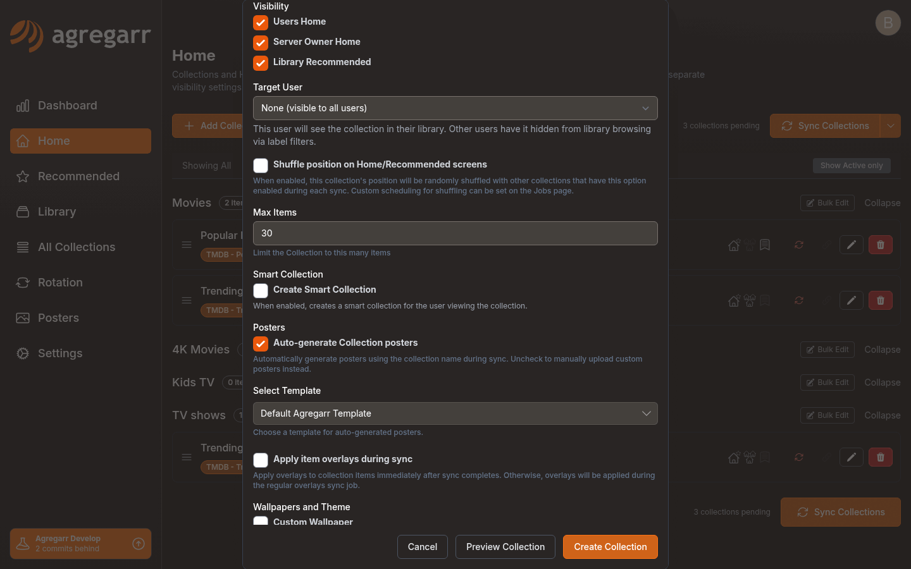
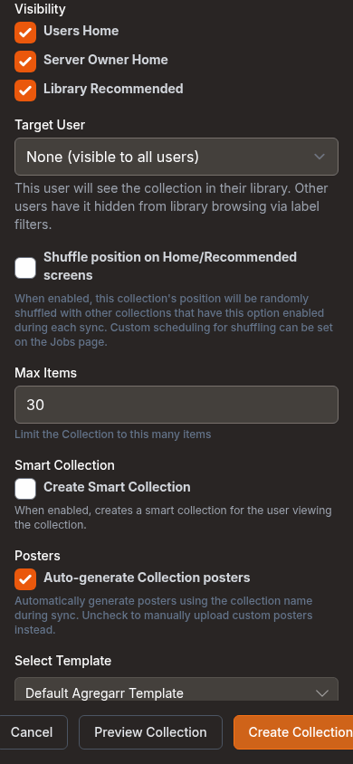
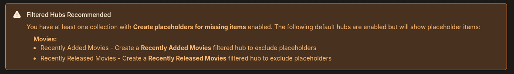
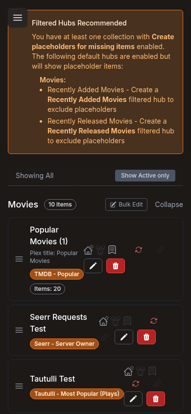
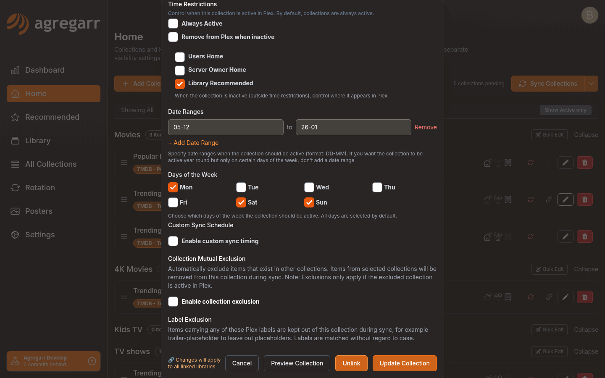
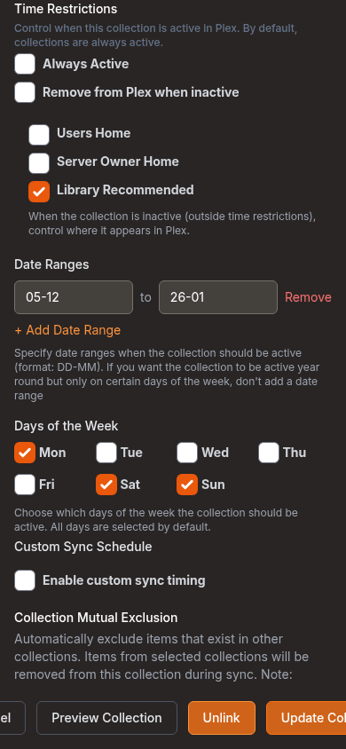

# Visibility and time restrictions

This page covers the collection form fields that control where a collection appears in Plex, who sees it and when it's active. For how-tos, see Where collections appear.

You'll find these fields on **Add New Collection** and **Edit Collection Configuration**, opened from **Home**, **Recommended** or **Library**. They're listed here in the same order as the form. Hubs and imported Plex collections use a shorter form. Those differences are noted under each entry.

=== "Desktop"

    

=== "Phone"

    

## Visibility

Three boxes control where Plex promotes the collection. Every collection also appears on the library's **Collections** tab, regardless of what you tick.

New collections start with all three ticked. Choosing a **Library Essentials** sub-type unticks all three. Moving off Library Essentials, by choosing another sub-type or **Collection Type**, ticks all three again. A preset ticks only **Server Owner Home** and **Library Recommended**, leaving **Users Home** unticked.

### Users Home

**Default:** ticked.

Promotes the collection on the Home screen for people you share your server with.

### Server Owner Home

**Default:** ticked.

Promotes the collection on your own Home screen as the server owner.

### Library Recommended

**Default:** ticked.

Promotes the collection on the library's **Recommended** tab.

### No visibility options selected

With all three unticked, the form warns: "No visibility options selected. Collection will only appear in library tab." The collection still exists and keeps syncing. On a hub, the warning reads: "No visibility options selected. Hub will be completely hidden."

### Seerr Requests: Individual Users Requests (excl. server owner)

Agregarr creates one collection per user. Each user sees only their own. **Server Owner Home** isn't offered and is cleared because the server owner always sees every per-user collection. **Users Home** and **Library Recommended** remain available.

The form shows: "Individual user request collections create one Plex collection per user. Server Owner Home is not available — each user sees only their own collection via Plex restrictions."

### Seerr Requests: Server Owner requests

**Users Home** isn't offered and is cleared. **Server Owner Home** and **Library Recommended** remain available.

The form shows: "Server owner request collections are restricted from Users Home. Library Recommended is available — Plex label restrictions prevent other users from seeing the server owner's collection."

### Auto Franchise, Auto Director and Auto Actor

Applies to **TMDB Lists** > **Auto Franchise Collections** and **Plex Library** > **Auto Director Collections** and **Auto Actor Collections**. All three boxes are hidden and unticked, so these collections appear only on the **Collections** tab.

The form shows: "TMDB Franchise Collections and Plex Library Auto Director/Actor Collections are restricted to Library Tab Only visibility to avoid cluttering your home/recommended screens."

Switching to a different type afterwards doesn't tick the boxes again. Tick them yourself.
<!-- OPEN: NEW: visibility isn't restored after leaving a library-only or Seerr-restricted type (only Library Essentials restores it) -->

### Library Recommended on user collections

On the **Home** and **Recommended** lists, a Seerr Individual Users collection with **Library Recommended** ticked shows this warning unless it's last in the list: "Library Recommended is enabled. This will show one collection per user on the Recommended screen. To avoid blocking other content, place this at the bottom of the list, or use Users Home only."

### Library Essentials hint

Library Essentials sub-types show this under the boxes: "This applies to all collections generated by this configuration." The boxes apply to every collection created by that configuration.

### Filtered Hubs Recommended

This warning appears on the **Collections** pages rather than in the form, but it points to a visibility change. It appears when a collection creates placeholders and one of Plex's default hubs for that library still has a visibility box ticked. Those placeholders would appear in the hub.

The warning names the library, then lists each hub. Beside each hub, it offers "Create a **Recently Added Movies** filtered hub to exclude placeholders" when no filtered hub of the right type exists. If one does exist, it offers "Disable visibility on this default hub (you have a **[your filtered hub's name]** filtered hub)". The bold text is either the suggested hub type or the name of your existing filtered hub.

Agregarr checks four default hubs: Recently Added Movies, Recently Released Movies, Recently Added TV and Recently Released Episodes.

The warning stays hidden until **Discover Existing Collections & Hubs** has run. To act on it, see [Filtered Plex Hub](../sources/your-servers.md#filtered-plex-hub).

=== "Desktop"

    

=== "Phone"

    

### Hubs and imported collections

Default Plex hubs and imported Plex collections show the same three boxes without type restrictions. Standalone separator collections get the same unrestricted boxes.

Hide on a hub or imported collection unticks all three. It also unticks them on every linked copy in your other libraries. Nothing is deleted.

## Who sees it

### Target User

**Default:** None (visible to all users).

Limits the collection to one person. The list shows you first, marked "(Owner)", followed by each Plex user your server is shared with who has an email address. Label filters hide the collection from library browsing for other users.

The server owner always sees every collection because Plex can't restrict the owner's own account. To check what a targeted user sees, use a second Plex account the server is shared with. A managed Plex Home user works too if it appears in the **Target User** list.

If **Users Home** is also ticked, the form warns that Plex Media Server versions before 1.43.1 ignore label restrictions on Home, so other users can still see it there.

Not offered for Seerr Requests, Auto Franchise or Plex Library sub-types other than Label. Not offered on hubs or imported collections.

### Shuffle position on Home/Recommended screens

**Default:** unticked.

During each shuffle, this collection's Home position moves among the other ticked items in the same library. Unticked items keep their positions.

On hubs and imported collections, the field is called **Randomize Home Order** and uses the same tick box. It only moves items that already have a Home position. Nothing moves unless at least two items in the library are ticked.

The shuffle runs at the end of each full sync. It also runs from the **Randomize Home Order** job on the Jobs page, scheduled for 6 AM daily by default. The scheduled job skips itself while a collections sync is running.

## Time restrictions

Time Restrictions sit further down the form after **Posters** and **Wallpapers and Theme**. They're also available on hubs, imported collections and separators. The help text reads: "Control when this collection is active in Plex. By default, collections are always active."

Agregarr checks these restrictions when the collection syncs. A collection can switch on or off up to one sync interval late. The check uses the server's clock.

=== "Desktop"

    

=== "Phone"

    

### Always Active

**Default:** ticked.

While ticked, the other time fields stay hidden and the collection isn't restricted. Untick it to show **Date Ranges**, **Days of the Week**, **Remove from Plex when inactive** and the inactive visibility boxes.

If you untick it without changing anything else, the collection remains active every day because all seven day boxes start ticked.

### Date Ranges

**Default:** none.

Click **+ Add Date Range** and fill both boxes in DD-MM format, for example `05-12` to `26-01`. Both end days count. Ranges can cross the new year. Agregarr also accepts days without a leading zero, such as `5-12`.

Click **Remove** to delete a row. Empty rows are dropped when you save.

A row with only one end filled, or a value outside DD-MM format, shows "Each date range needs a start and end date in DD-MM format" and stops the form saving. With no date range, only the selected days apply.

### Days of the Week

**Default:** all seven ticked (Mon to Sun).

Limits the collection to the days left ticked. At least one must remain ticked. Otherwise, the form shows "Select at least one day of the week" and won't save.

When both date ranges and days are set, today must match both.

### Remove from Plex when inactive

**Default:** unticked.

Outside the active window, Agregarr deletes the collection from Plex but keeps its settings in Agregarr.

This option only appears while **Always Active** is unticked. It isn't offered on default Plex hubs or imported Plex collections because those can only change visibility.

### Inactive visibility

**Default:** **Library Recommended** only. **Users Home** and **Server Owner Home** unticked.

These three boxes control where the collection appears outside its active window. They only show while **Always Active** is unticked and **Remove from Plex when inactive** is unticked.

All three options remain available regardless of the collection type. The help text reads: "When the collection is inactive (outside time restrictions), control where it appears in Plex."

### Time Restrictions Set

A badge shown on the collection's row in the lists. It appears when **Always Active** is unticked.

## Custom Sync Schedule

Sits at the bottom of the Time Restrictions row. It isn't shown for Filtered Plex Hubs, hubs or imported collections. For how a collection with its own schedule behaves in a cycle, see [Cycle Lists](../cycle-sources.md).

### Enable custom sync timing

**Default:** unticked.

Gives the collection its own schedule instead of using the full sync schedule. The fields below only appear when it's ticked.

### Schedule

**Default:** Once daily.

Offers 17 presets from **Every 10 minutes** to **Once yearly**, plus **Custom Cron Expression**.

### Custom cron expression

Shown when **Custom Cron Expression** is selected in **Schedule**. Uses standard cron format, for example `0 9 * * MON` for every Monday at 9 AM.

### Start on next sync

**Default:** ticked.

Shown for presets. Untick it to base the schedule on a date and time you choose, such as a "Best Movies This Year" collection that updates on 1 January.

**Sync Collections** skips collections with their own schedule, so it won't fill this collection early. To fill it before the scheduled time, save the collection and click the red **Needs Sync** icon on its row.

### Start date

**Default:** `01-01`.

DD-MM with a leading zero on both parts. Shown when **Start on next sync** is unticked.

### Start time

**Default:** `09:00`.

HH:MM in 24-hour time, for example `09:00` or `23:30`. Shown when **Start on next sync** is unticked.

## Missing items sections

Two form sections appear after Time Restrictions and the exclusion fields. They're covered in Missing items and placeholders.

### Placeholder Creation

Creates placeholder files in Plex for source items you don't have yet, with countdown overlays showing their release dates.

The section has one tick box, **Create placeholders for missing items**, followed by options that appear when it's ticked. It isn't shown for Seerr Requests, Tautulli Statistics, Filtered Plex Hub, Auto Director, Auto Actor or Library Essentials. See Missing items and placeholders and [Placeholders](../../Placeholders.md) for now.

### Grab Missing Items (Auto-Request)

Sits under **Auto-Request Settings**. The **Grab Missing Items** tick box sends source items missing from Plex to Radarr, Sonarr or Seerr for download. It's hidden for the same types as **Placeholder Creation**. See Missing items and placeholders.

## Related

- [Your servers](../sources/your-servers.md): Plex Library, Library Essentials and Filtered Plex Hub
- [Activity sources](../sources/activity.md#seerr-requests): Seerr Requests
- [Collections](../index.md)
- [Cycle Lists](../cycle-sources.md)
