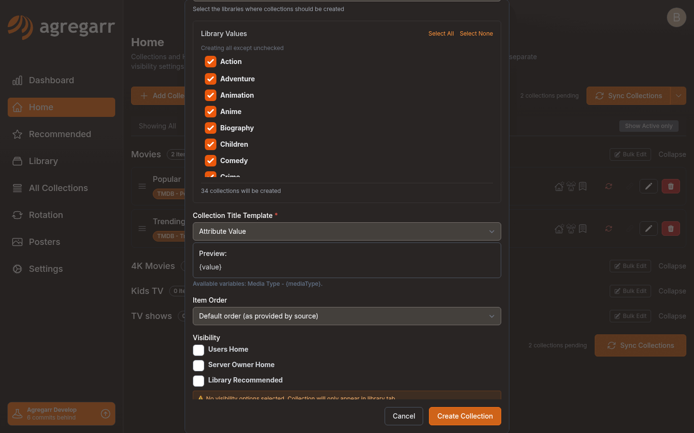
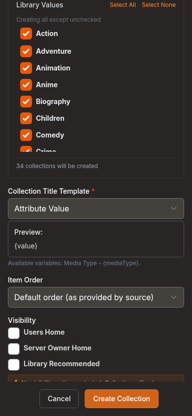

# Make collections from what's already in your library

Use what Plex already knows about your library to make collections: one per genre, franchise, label or tag. These collections don't read from an outside list.

## Before you start

- Agregarr connected to Plex, with **Discover Existing Collections & Hubs** already run. See [Your first collection](../get-started/first-collection.md).
- A Plex library. Select one library if you want to choose which values become collections. If you select several, every value gets a collection in each library.
- For the tag recipe: a Radarr or Sonarr server added under **Settings > Downloads**.

## Set it up

These steps create one collection per genre. The other recipes work the same way with a different type. They're listed under Variations.

### 1. Pick the type

1. Click **Add Collection**.
2. Set **Collection Type** to **Plex Library**.
3. Set **Collection Sub-Type** to **Auto Genre Collections**.
4. Choose one library under **Library Selection**.

**Check:** the **Library Values** panel appears with every genre ticked and the heading **Creating all except unchecked**.

### 2. Choose which values you want

Untick any genre you don't want as a collection. If you only want a few, click **Select None** and tick the ones you want.

=== "Desktop"

    

=== "Phone"

    

**Check:** the panel ends with a line such as "12 collections will be created".

### 3. Name them and set the look

1. Keep `{value}` in **Collection Title Template**. The form won't save without it.
2. Tick **Use Separator** if you want a divider before the group, then fill in **Separator Title**.

**Check:** **Collection Title Template** reads `{value}` and **Separator Title** appears if you ticked **Use Separator**.

### 4. Create and sync

Click **Create Collection**, then click **Sync Collections** on **Home**.

**Check:** the card on **Home** shows no error state.

## Check it worked

Open Plex and go to the library's **Collections** tab. Each genre has a collection named after it.

They don't appear on Home or Recommended, because Library Essentials starts with all three **Visibility** boxes off.

## Variations

??? note "Decade, resolution or content rating"
    Pick **Auto Decade Collections**, **Auto Resolution Collections** or **Auto Content Rating Collections** in step 1. Everything else stays the same.

??? note "Label collection"
    Set **Collection Type** to **Plex Library** and **Collection Sub-Type** to **Label**. Choose a library, then choose a **Plex Label**. The collection holds every item in that library carrying the label. You get one label for each configuration.

??? note "Separator collection"
    Set **Collection Sub-Type** to **Separator**, enter a **Separator Title** and choose a library. This creates an empty collection with a title card poster, useful for breaking up a long row of collections.

??? note "One collection per franchise"
    Set **Collection Type** to **TMDB Lists** and **Collection Sub-Type** to **Auto Franchise Collections**. Choose a movie library. Set **Minimum movies in library**, which starts at 2, and keep `{franchiseName}` in the title. Movies without a TMDB ID in Plex aren't counted. See [TMDB lists](sources/tmdb.md#auto-franchise-collections).

??? note "One collection per director or actor"
    Set **Collection Type** to **Plex Library** and **Collection Sub-Type** to **Auto Director Collections** or **Auto Actor Collections**. Enter **Minimum Items**, with a value of at least 2, and keep `{director}` or `{actor}` in the title. Actor collections can pile up quickly, so start with a higher number.

??? note "Everything with a Radarr or Sonarr tag"
    Set **Collection Type** to **Radarr Tag** or **Sonarr Tag**. Choose the **Radarr Instance** or **Sonarr Instance**, then the tag and a library of the matching type. **Preview Collection** lists the tagged titles found in Plex.

## What it doesn't do

- Genre, decade, resolution, content rating, director and actor collections are deleted on the next sync when their value leaves the library or falls below the minimum. A Label collection stays as it is when its label no longer has any items.
- Items with the `trailer-placeholder` label are left out of Library Essentials, Label, Director and Actor collections.
- Director, actor and franchise collections only appear on the library's **Collections** tab. The form hides their **Visibility** boxes and shows a note that they're restricted to the library tab.

## If it didn't work

- **The Library Values panel doesn't show.** More than one library is selected. Pick one.
- **A collection I unticked is still in Plex.** Agregarr removes it on the next sync, not when you save.
- **Nothing was created for directors or actors.** The current **Minimum Items** leaves nobody eligible. Lower it.
- **The Plex Label list is empty.** That library doesn't have any labelled items yet.
- **A tag collection is empty.** None of the tagged titles are in Plex yet. See [Your servers](sources/your-servers.md#radarr-tag-and-sonarr-tag).

## Related

- [Your servers](sources/your-servers.md): every option for these sources
- [TMDB lists](sources/tmdb.md#auto-franchise-collections)
- [Name collections](name-collections.md)
- [Collection visibility](form/visibility.md)
