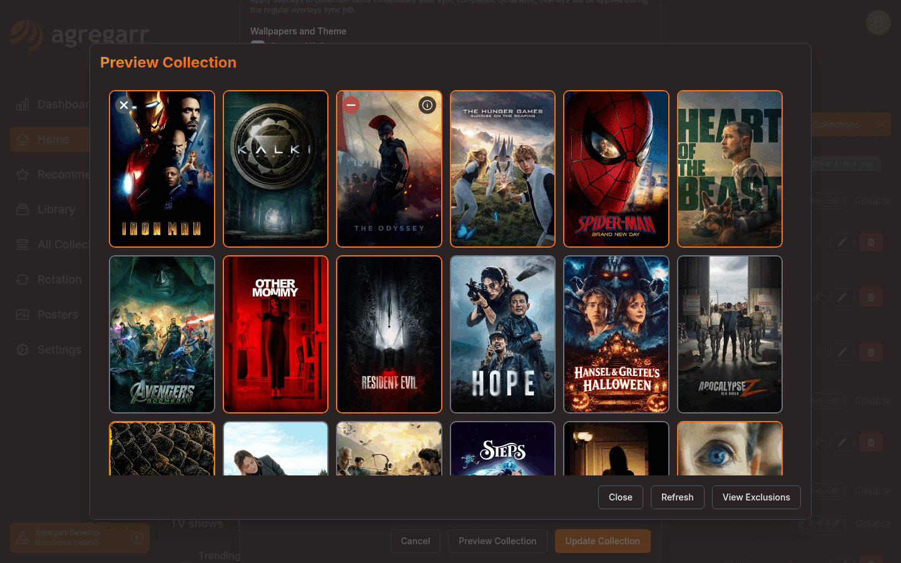
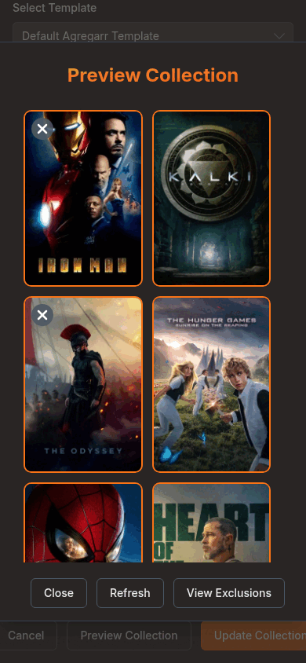

# Keep items out of a collection

Keep a title out of one collection or every collection. Agregarr gives you three ways to do it: **Global Exclusions** applies to every collection, **Label Exclusion** uses labels you add in Plex and **Collection Mutual Exclusion** removes titles already held by another collection.

## Before you start

- A collection form open, with a type and library chosen. The **Preview Collection** button only appears after both are selected. [Collection pages](pages.md#preview-collection) lists the types without a preview.
- An Agregarr collection, for **Label Exclusion** and **Collection Mutual Exclusion**. Imported Plex collections and Plex default hubs don't have either box.

## Set it up

### Keep one title out of every collection

1. Open the collection with **Edit**, or start one with **Add Collection**, then click **Preview Collection**.
2. Hover over the poster you want to exclude. A red minus appears at the top left.
3. Click the minus.

    **Check:** a message says "Item excluded from all collections" and a grey cross replaces the minus.

4. Click **Sync Collections**.

=== "Desktop"

    

=== "Phone"

    

Click **View Exclusions** in the preview to see or undo your choices. Click the red cross beside a title to remove it. A message says "Item removed from exclusions" and the title can return on the next sync.

### Keep titles with a Plex label out of one collection

1. In Plex, add the same label to every title you want to keep out, for example `no-collections`.
2. In Agregarr, click **Edit** on the collection and find **Label Exclusion**.
3. Type the label and press Enter.
4. Click **Update Collection**, then **Sync Collections**.

**Check:** the label appears as a chip in the box and the title is no longer in the Plex collection once the sync finishes.

### Keep titles out that another collection already holds

1. Click **Edit** on the collection that should lose the titles.
2. Under **Collection Mutual Exclusion**, tick **Enable collection exclusion**. If the section isn't on the form, the library has no other collection available to choose, or the collection creates multiple collections from one setup (Seerr individual users, Auto Franchise, Auto Director, Auto Actor or Library Essentials).
3. Choose the other collection from **Select collections to exclude items from**.
4. Click **Update Collection**, then **Sync Collections**.

**Check:** the box under the list reads "1 collection selected for exclusion". After the sync, titles from the other collection don't appear in this one.

The other collection must already exist in Plex and have completed a sync.

## Check it worked

Open the collection in Plex. The excluded titles are no longer there. If the collection has a **Max Items** limit, the next titles from the source list take their places. Excluded titles remain in your library and in every other collection that doesn't exclude them.

## Variations

??? note "Keep placeholders out"
    Type `trailer-placeholder` into **Label Exclusion**. Agregarr puts that label on its placeholders.

??? note "Other tools' collections"
    **Exclude from Ordering (Plex Label)** is a different setting. It stops Agregarr reordering another tool's collections and doesn't exclude any titles. See [Adopt collections you already have](adopt-existing.md).

## What it doesn't do

- It doesn't remove a title from your Plex library or from Radarr or Sonarr.
- **Global Exclusions** also stop Agregarr asking for the title or creating a placeholder for it.
- It doesn't apply to Seerr Requests, Filtered Plex Hubs, Library Essentials, Auto Director or Auto Actor collections. For Seerr Requests, use **Label Exclusion**. The other four have no working way to exclude one title.
<!-- OPEN: NEW: Global Exclusions are skipped by Seerr Requests, Filtered Plex Hub, Library Essentials, Auto Director and Auto Actor; pages.md says every collection -->
- **Preview Collection** applies **Label Exclusion** but not **Collection Mutual Exclusion**, so the preview can include titles that the sync later drops.
- You can only add titles to **Global Exclusions** from a preview. There is no page for it in the sidebar.

## If it didn't work

- **The title is still in the collection.** The collection hasn't synced since the exclusion changed. Click **Sync Collections**.
- **A globally excluded title is still there after a sync.** The collection's type is one **Global Exclusions** doesn't reach (see above). For a Seerr Requests collection, add a label in Plex and use **Label Exclusion**. Filtered Plex Hubs, Auto Director and Auto Actor don't have that box. Library Essentials ignores it.
- **The collection is empty after a sync.** The labels match every title, so Agregarr empties the Plex collection. Remove a label.
- **Label Exclusion has no effect.** Check that the label is on each title rather than the collection and that the spelling matches. If Agregarr can't reach Plex, the sync keeps every title and logs "Error applying label exclusions".
- **Collection Mutual Exclusion has no effect.** The other collection isn't in Plex yet or isn't active. Sync it first. Letterboxd and Seerr Requests collections show the box but don't apply it.
- **No Preview Collection button.** Choose a type and library first.

## Related

- [Collection pages](pages.md#global-exclusions)
- [Collection form: Exclusions](form/basics.md#exclusions)
- [Adopt collections you already have](adopt-existing.md)
- [Collections](index.md)
