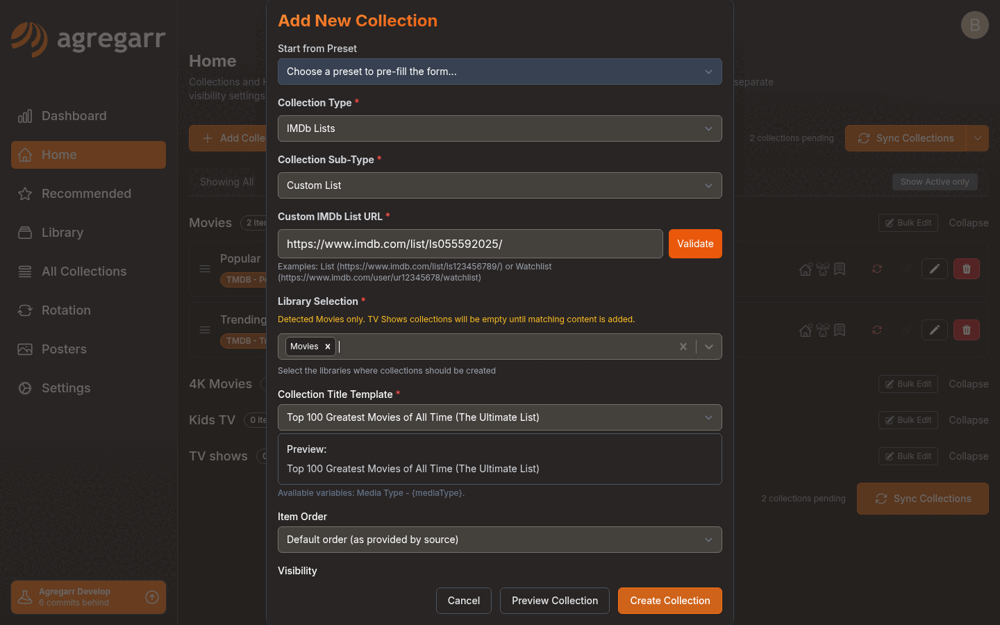
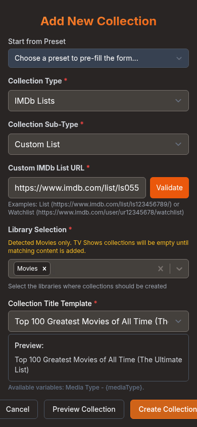

# Turn a list into a collection

This page turns a list from Trakt, IMDb, Letterboxd or MDBList into a Plex collection. Agregarr reads the list on every sync and keeps the titles you own.

## Before you start

- Agregarr connected to Plex, with **Discover Existing Collections & Hubs** already run. See [Your first collection](../get-started/first-collection.md).
- The list's address, copied from your browser. It must start with `https://`.
- The source's requirements:
    - IMDb needs nothing. The list or watchlist must open without signing in.
    - Letterboxd needs nothing in most setups. It only works with movie libraries.
    - Trakt needs a **Trakt Client ID** under **Settings > Sources**. See [Connect Trakt](sources/lists.md#connect-trakt).
    - MDBList needs an **MDBList API Key** under **Settings > Sources**.

## Set it up

1. Click **Add Collection**.
2. Set **Collection Type** to the list's service, such as **IMDb Lists**.

    **Check:** no orange warning appears under **Collection Type**. If the warning names a missing key, click **Configure Settings** and add it first.

3. Set **Collection Sub-Type** to **Custom List**.
4. Paste the address into the field that appears, such as **Custom IMDb List URL**, then click **Validate**.

    **Check:** **Library Selection** appears below the address field. It stays hidden until **Validate** succeeds.

5. Under **Library Selection**, choose your library.

    **Check:** a line below the field describes what the list holds, such as "Detected Movies only. TV Shows collections will be empty until matching content is added." The rest of the form appears.

6. Choose the list's name under **Collection Title Template**, or choose **Custom** to write your own.
7. Click **Create Collection**, then click **Sync Collections**.

**Check:** a toast says "Collection created successfully!" (or "2 linked collections created successfully!" if you chose two libraries) and the sync line changes to **Last sync: Just now**.

=== "Desktop"

    

=== "Phone"

    

## Check it worked

Open Plex. The collection appears under the name you chose, on the screens ticked under **Visibility** and in the library's **Collections** tab. It contains the list's titles that you own.

## Variations

??? note "Watchlists"
    Letterboxd has a **Watchlist** sub-type with its own **Letterboxd Watchlist URL** field. IMDb accepts a watchlist address in **Custom IMDb List URL**. Trakt has a **Watchlist** sub-type for your own account, which needs the OAuth connection. Click **Validate** after pasting a Letterboxd or IMDb address.

??? note "Private Trakt lists"
    Open **Settings > Sources**, expand **Advanced OAuth Setup (Optional)**, paste your Trakt application's secret into **Trakt Client Secret**, then click **Connect with Trakt**. See [Connect Trakt](sources/lists.md#connect-trakt). **Recommendations** and **Watchlist** need this connection.

??? note "Your own MDBList lists"
    **Validate** first tries the address as another member's public list, then falls back to your own lists.

??? note "Letterboxd is blocked"
    Cloudflare blocks Letterboxd on some servers. Turn on **Use Cloudflare Solver for Letterboxd** under **Fetching Settings** in **Settings > Sources**. See [The Cloudflare solver option](sources/lists.md#the-cloudflare-solver-option).

??? note "TVDB lists"
    **TVDB Lists** uses the same **Custom List** steps and needs no key. See [TVDB Lists](sources/lists.md#tvdb-lists).

## What it doesn't do

- It doesn't read private IMDb or Letterboxd lists. Open the address in a private browser window to test it.
- It doesn't add titles you don't own. **Grab Missing Items** and **Placeholder Creation** decide what happens to them.
- It doesn't mix movies and shows in one Plex collection. If a list contains both, choose a movie library and a TV library under **Select Libraries**. Agregarr creates a linked collection in each.

## If it didn't work

- **Saving says "Please validate the URL first".** **Collection Title Template** is still **Validate URL**. Click **Validate**.
- **"Invalid IMDb URL format", "Invalid Letterboxd URL format" or "Invalid Trakt list URL or list not accessible".** The address isn't a list the service can return. Copy it again from the list's own page.
- **"Trakt is not configured" or "MDBList API key not configured".** The Trakt connection or MDBList key isn't saved. Add it under **Settings > Sources**.
- **The collection is empty.** None of the list's titles are in your library, or you've chosen the wrong kind of library. Check it with **Preview Collection**.
- **A Letterboxd fetch fails.** See the solver variation above.

## Related

- [Lists from IMDb, Letterboxd, Trakt, MDBList and TVDB](sources/lists.md): every option and limit
- [Rotate several lists through one row](cycle-sources.md): take turns between many lists in one row
- [Choose a source](choose-a-source.md)
- [Name collections](name-collections.md)
