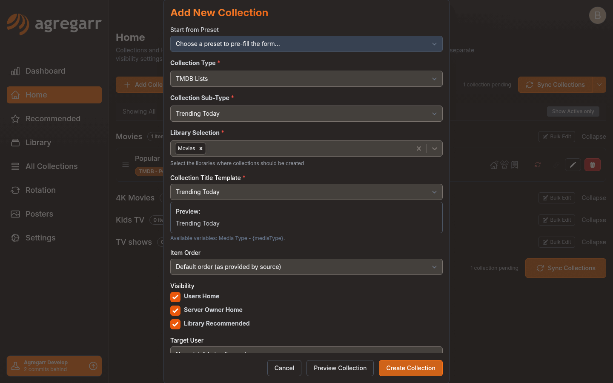
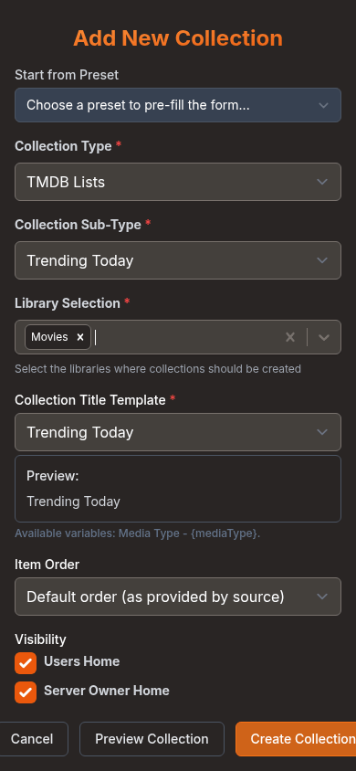

# Add a Trending or Popular row

This page adds a Plex row that follows a trending or popularity chart, then refreshes it on every sync. TMDB is the main route because it needs no account. Trakt and IMDb work the same way.

## Before you start

- Agregarr connected to Plex, with **Discover Existing Collections & Hubs** already run. See [Your first collection](../get-started/first-collection.md).
- A Plex movie or TV library. The library you choose decides whether the row contains movies or shows.
- Nothing else for TMDB.

## Set it up

1. Click **Add Collection**.
2. Set **Collection Type** to **TMDB Lists**.
3. Set **Collection Sub-Type** to **Trending Today**. **Trending This Week** moves more slowly. **Popular** ranks titles by TMDB's popularity score.
4. Under **Library Selection**, choose your library from **Select Libraries**.

    **Check:** the rest of the form appears and **Collection Title Template** has a name filled in. The line starting with **Preview:** shows the name the collection gets in Plex.

5. Leave **Item Order** on **Default order (as provided by source)** to keep the chart's ranking. Change **Max Items** if you want a shorter or longer row.
6. Click **Preview Collection**.

    **Check:** a grid of posters shows the chart's titles. An orange ring marks the titles in your library. Close it to return to the form.

7. Click **Create Collection**.

    **Check:** a toast says "Collection created successfully!" and a card for the collection appears on **Home**. Plex doesn't change yet.

8. Click **Sync Collections**.

**Check:** when the sync finishes, the line beside the button reads **Last sync: Just now**. While it runs, the line shows the current stage and a **View on Dashboard** link.

=== "Desktop"

    

=== "Phone"

    

## Check it worked

Open Plex. The row appears under the name from **Collection Title Template**, on the screens ticked under **Visibility** and in the library's **Collections** tab. It only contains chart titles you own, so the row can have fewer than **Max Items**. If it isn't there, refresh Plex or reopen the app.

## Variations

??? note "Start from Preset"
    **Start from Preset** at the top of **Add New Collection** fills in the type, sub-type, name, **Max Items** and **Visibility**. **Trending Movies Today** and **Trending TV Today** set up TMDB's **Trending Today** with **Max Items** at 20. **TMDB Top Rated Movies** and **TMDB Top Rated TV** set up **Top Rated**. Agregarr picks libraries of the right type, and you can edit every field afterwards. The full list is in [Start from Preset](form/basics.md#start-from-preset).

??? note "Trakt instead of TMDB"
    Save a **Trakt Client ID** under **Settings > Sources** first. See [Connect Trakt](sources/lists.md#connect-trakt). Then set **Collection Type** to **Trakt Lists** and **Collection Sub-Type** to **Trending Now** or **Popular**. The **Trakt Trending Movies** and **Trakt Trending TV** presets appear once the ID is saved.

??? note "IMDb Most Popular"
    Set **Collection Type** to **IMDb Lists** and **Collection Sub-Type** to **Popular (Meter)**. It needs no key. A movie library gets the movie ranking, while a TV library gets the TV ranking. The **IMDb Most Popular Movies** and **IMDb Most Popular TV** presets set this up.

??? note "Narrow the row by genre, year or service"
    **Custom Advanced Filters** builds a popularity row filtered by genre, year or streaming service. See [TMDB filters](sources/tmdb-filters.md).

## What it doesn't do

- It doesn't add titles you don't own. Missing titles follow your **Grab Missing Items** and **Placeholder Creation** settings.
- It doesn't refresh between syncs. **Plex Collections Sync** runs every 12 hours by default, or click **Sync Collections**.
- It doesn't use a regional chart for TMDB. **Trending Today**, **Trending This Week**, **Popular** and **Top Rated** use TMDB's worldwide ranking.

## If it didn't work

- **Add Collection is greyed out.** Agregarr has no collections or hubs yet. Run Discover, or create one another way. See [Your first collection](../get-started/first-collection.md).
- **The form stops after Collection Sub-Type.** Choose a library under **Library Selection**. The rest of the form stays hidden until you do.
- **The row isn't in Plex.** Creating the collection only saves its settings. Click **Sync Collections**, then refresh Plex.
- **The row is empty.** None of the chart titles match titles in your library. **Preview Collection** shows what the chart returned.
- **"TMDB API is not accessible".** Agregarr can't reach TMDB. Check the internet connection and DNS where Agregarr runs.
- **"Trakt is not configured".** **Trakt Client ID** hasn't been saved. See [Trakt Lists](sources/lists.md#trakt-lists).

## Related

- [TMDB Lists](sources/tmdb.md): every option and limit
- [Lists from IMDb, Letterboxd, Trakt, MDBList and TVDB](sources/lists.md)
- [Choose a source](choose-a-source.md)
- [Name collections](name-collections.md)
