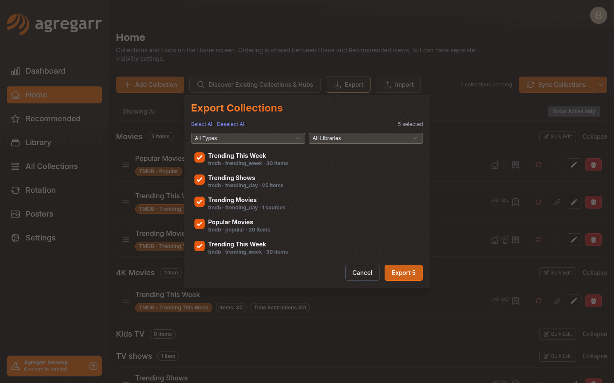
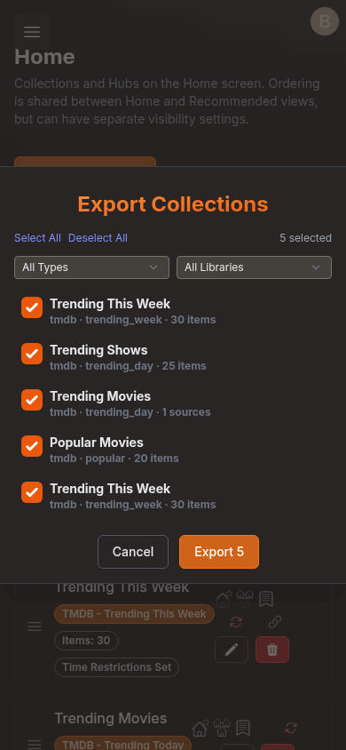
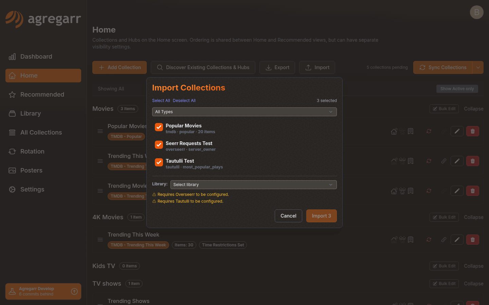
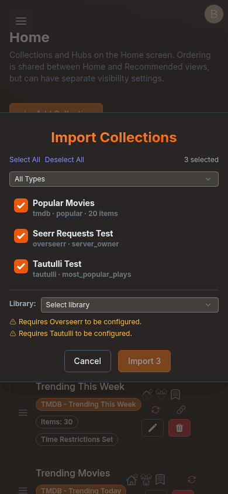

# Move collections between servers

Export saves your collection settings to a JSON file. Import reads that file and creates new collections in the library you choose. Use it to copy collections to another Agregarr, reuse a setup in another library or share a config.

## Before you start

- The Agregarr you're importing into is connected to Plex. On a new install, run **Discover Existing Collections & Hubs** first. **Add Collection** and **Sync Collections** stay greyed out until Agregarr has at least one collection or hub. An import counts, so you can import into a new install before running Discover.
- The target Plex library matches the collections: movie collections go into a movie library and TV collections go into a TV library. Import doesn't check this.
- Have your Radarr, Sonarr, Seerr and Tautulli connections ready if the collections use them. The file doesn't carry those connections.

## Set it up

### Export

1. Open **Home**, **Recommended**, **Library** or **All Collections**. All four have the button.
2. Click **Export**. It's greyed out when you have no Agregarr collections.
3. In the **Export Collections** window, tick the collections you want. They're all ticked to begin with.
4. Click **Export N**, where N is the number ticked.

=== "Desktop"

    

=== "Phone"

    

Your browser downloads one JSON file and a message says "N collection(s) exported." For one collection, the file is `agregarr-collection-NAME.json`. The name is lower case. Runs of anything other than a-z and 0-9, including accented letters, become one hyphen and the name is cut to 60 characters. For several collections, the file is `agregarr-collections-export.json`.

**Check:** the file is in your downloads folder. Open it in a text editor and you'll find your collection names inside it.

### Choosing what to export

- **Select All** and **Deselect All** only affect the collections shown by the current filters.
- The first filter starts on **All Types**. If your collections are in more than one library, you also get **All Libraries**.
- Each row shows the name, followed by the source type, sub-type and either the number of sources or the item limit. A collection saved once through the form can read "1 sources" even though it isn't Multiple Sources. For example, `tmdb · trending_day · 30 items`. Types use their internal names, such as `tmdb` and `overseerr`.
    <!-- OPEN: Q2 form-saved single-source collection exports with a one-entry sources array -->

Only Agregarr collections are listed. Plex hubs and imported Plex collections aren't exported. Collections linked across libraries are listed once for each library and export as separate collections. Import doesn't link them again.

### Import

1. On the Agregarr you're moving to, click **Import**, next to **Export**, then choose a `.json` file of 1 MB or less.
2. In the **Import Collections** window, tick the collections you want. They're all ticked to begin with.
3. Choose the library from the **Library:** list. It reads **Select library** until you pick one. **Import N** stays greyed out until you do.
4. Read any notices under the list, then click **Import N**.

=== "Desktop"

    

=== "Phone"

    

A message says "N collection(s) imported." and the collections appear in your lists.

**Check:** the new collections show a red **Needs Sync** arrow and the status line reads "N collections pending". Import only saves the settings. Nothing is in Plex yet.

### Choosing which sources to import

Multiple Sources collections have an arrow beside their name. Expand one to see its numbered sources. Each source shows its list title or URL, with its type underneath. A source with neither shows as "Source N".

Untick any source you don't want. The row then reads "N of M sources". Unticking every source also unticks the collection.
<!-- OPEN: NEW: Select All after unticking every source of a collection ticks it again with no sources -->

### Notices

Amber notices below the library list warn about what the file needs. They're built from the whole file, including collections you've unticked.

- Seerr requests: "Requires Overseerr to be configured." for a Seerr collection and "Uses Overseerr for requests. Configure after import." for any other collection that requests through it.
- "Requires Tautulli to be configured." for Tautulli statistics collections.
- "Requires Radarr to be configured (tag-based)." and the Sonarr equivalent for Radarr Tag and Sonarr Tag collections.
- "Uses FlixPatrol scraping." for Networks collections.
- "Requires MDBList API key." for Networks Originals collections.
- A notice that placeholders need Radarr and Sonarr set up for download status for collections that create placeholders.
- A notice to configure servers after import for collections that filter by Radarr or Sonarr tags.
- "Uses direct download. Configure Radarr/Sonarr after import." for collections that download through Radarr or Sonarr.

### Names and libraries

- If the target library already has an Agregarr collection with the same name, the imported one is renamed. For example, "Trending Movies (1)". Two collections with the same name in one file are renamed the same way. Existing collections are never replaced. A name used only by a Plex hub or an imported Plex collection isn't checked.
- Every collection in an import goes into the one library you chose. Import doesn't check whether the library type matches, so use a movie library for movie collections and a TV library for TV collections.
- Imported collections get new IDs and their sort positions start at 0.
- A collection with a time restriction starts active or inactive according to that restriction at the time of import.

### After you import

1. Open each imported collection that uses Radarr, Sonarr or Seerr and choose its servers again.
2. Click **Sync Collections**, or wait for the next scheduled sync.

**Check:** once the sync finishes, the collections show a tick and appear in Plex.

## What travels with an export

The file records the settings that define the collection. That includes:

- Name, type, sub-type and the title template, including custom templates and the dynamic title prefix.
- Visibility settings, whether the collection is promoted in the library and **Shuffle position on Home/Recommended screens**.
- List URLs for Trakt, IMDb, Letterboxd, MDBList, TVDB, AniList and TMDB, plus TMDB advanced filters and the TMDB movie and TV sort orders.
- Source options such as time period, custom days, minimum play count, network and region.
- Item limits, minimum year, minimum IMDb rating and votes, Rotten Tomatoes minimums and **Item Order**.
- Smart collection settings, **Plex Label** and the Library Essentials include and exclude choices.
- The minimum-items settings for Auto Director, Auto Actor and Auto Franchise.
- Separator settings and the **Sort Title** with its full-title marker.
- **Label Exclusion** labels.
- Placeholder settings, including the date window, **Skip items with an estimated release date** and **Include mid-season episodes (TV)**.
- Grab Missing Items settings and filters, direct download options apart from server selections, time restrictions and custom sync schedules.
- Multi-source settings: combine mode and the sources. Each source keeps its type, sub-type, list URL, time period, priority, custom days, minimum plays, networks country, TMDB advanced filters (**Custom Advanced Filters**) and resolved title.
- **Auto-generate Collection posters** and **Apply item overlays during sync**.
- Whether custom wallpaper, summary and theme are enabled, plus the summary text.

Source IDs are renumbered from 1 in the file. The file also stores format version 1.0 and the export time. A collection in a [rotation](../appear/rotation.md) exports with its own saved visibility and shuffle setting, not the settings the rotation applies at that moment.

## What does not travel

Anything tied to a specific instance or a file on disk stays behind:

- The collection's ID, library, Plex collection keys and any link to sibling collections.
- **Target User**.
- Radarr, Sonarr and Seerr server, profile, root folder and tag selections, including the Coming Soon server, tag and root folder choices. You'll need to set these again after import.
- Uploaded posters, wallpaper and theme files and the poster template choice.
- The **Collection Mutual Exclusion** settings.
- Rotation groups.
- Sync history, errors, warnings and the changed and missing flags.

## Older exports

Import only reads the fields written by the current export. Anything else in the file is ignored. Those settings use their defaults when the collection is created.

Two older field names matter here. Older versions stored the placeholder date window as `comingSoonDays` and `comingSoonReleasedDays`. Export converts these to the current names, **Days Ahead** and **Only include items released within**, so files written by a current version are fine. Import doesn't convert the old names. If your file still uses them, set **Days Ahead** and **Only include items released within** on the imported collection yourself.

Import also drops the old genre, country and language exclusion fields. Current versions store those under the filter settings, which do travel.

Sort titles from older files don't have a full-title marker, so they keep their original meaning after import: the typed text is placed before the collection name. A sort title written in the current **Sort Title** field is treated as the full title.

Files with a format version other than 1.0 are refused. Files without a version are accepted. Every collection in the file needs a name and a type. If either is missing, the whole import is refused.

## Limits

- The browser refuses import files larger than 1 MB. The server refuses any request larger than 2 MB.
- You need to be signed in to export or import.
- Export and Import cover Agregarr collections only. Hubs and imported Plex collections stay where they are.

## If it didn't work

- **"File too large (max 1 MB)."** The file is over the browser limit. Export fewer collections at a time.
- **"Invalid JSON file."** The file isn't valid JSON. Editing it or saving it in the wrong format can cause this. Export it again.
- **"Unsupported export version: X. This version supports 1.0."** The file uses a different export format. Re-export it from a current Agregarr.
- **"No collections found in file."** The `"collections"` list is missing or empty.
- **"Invalid collection data: each must have name and type."** At least one collection in the file has no name or no type, so nothing is imported. Check the file in a text editor.
- **Import N is greyed out.** You haven't chosen a library, or nothing is ticked.
- **"Library not found: ..."** The library you chose is no longer in Agregarr's list. Run **Discover Existing Collections & Hubs**, then import again.
- **The collections imported but nothing is in Plex.** They need a sync. Click **Sync Collections**. If a collection uses Radarr, Sonarr or Seerr, check that its servers are chosen.
- **Placeholder dates are wrong or missing.** Check whether the file was written by an older version. See [Older exports](#older-exports).

## Related

- [Collection pages](pages.md#toolbar) for the **Export** and **Import** buttons and the sync status
- [Your first collection](../get-started/first-collection.md)
- [Collections](index.md)
