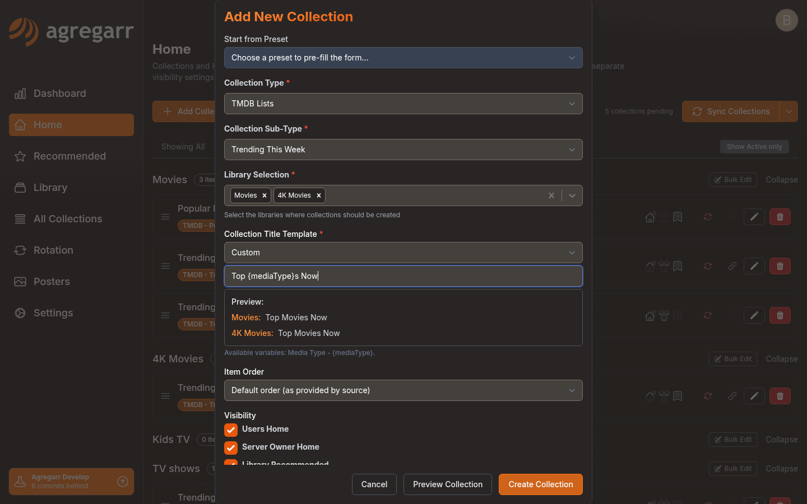
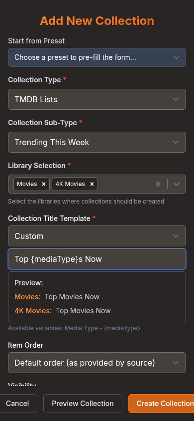

# Name collections

Set the name a collection gets in Plex and where Plex sorts it. **Collection Title Template** controls the title and supports variables that Agregarr fills in on each sync. **Sort Title** controls its position.

=== "Desktop"

    

=== "Phone"

    

## Before you start

- The title box appears after you've picked a **Collection Type**, a **Collection Sub-Type** and at least one library. See [Add Collection form: the basics](form/basics.md#library-selection).
- Name changes reach Plex on the next sync. Saving the form doesn't touch Plex.

## Set it up

### Give a collection a title

1. Click **Add Collection**, or click the pencil icon beside an existing collection.
2. Choose the source and library. **Collection Title Template** then appears.
3. Open the dropdown and pick a preset. Choosing a sub-type selects the first preset automatically.
4. For your own name, pick **Custom** and type it in the box that appears. Put variables in braces, such as `{mediaType}s`, wherever Agregarr should fill in a value. If you choose both movie and TV libraries, you get a separate box for each type.
5. Check **Preview:** under the box.

    **Check:** **Preview:** shows the name Plex receives. With more than one library selected, it shows one line per library, headed by the library name. If it reads "Preview unavailable", the server couldn't work out the name. Check your variables against [the list below](#title-variables).

6. Click **Create Collection** or **Update Collection**, then run **Sync Collections**.

**Check:** the collection appears in Plex under the new name. For an existing collection, Agregarr renames the Plex collection rather than creating another one.

### Move a collection in the promoted list

Collections promoted on the **Library** page sit above the A-Z section in numbered order. Type that number into **Sort Title** to change the collection's position.

1. Go to **Library**, find the collection and click the pencil icon.
2. In **Sort Title**, change the number in the prefix. A collection at position 3 shows `!003_Trending Today`. Change it to `!001_` to put it first.
3. Click **Update Collection**.

**Check:** the collection moves to that position in the **Library** list and the collections already there shift down. Plex gets the new sort title on the next sync.

If the collection is in the A-Z section and you type a value starting with `!`, saving shows this message: "The Sort Title for {name} starts with "!", so Plex will show it in the Promoted section on the next sync even though it is marked as A-Z here. Promote it, or keep it in A-Z? Keeping it discards the typed Sort Title." Click **Yes, promote it** to promote the collection at that rank. Click **Keep in A-Z** to discard what you typed.

To return to automatic placement, clear the **Sort Title** box and save.

## Variations

- **Dynamic names.** **Dynamic Title from Random List** and **Dynamic Title from Active Source** name the collection after the list currently showing. See [Cycle Lists](cycle-sources.md) and [Multiple Sources](sources/multiple-sources.md#how-cycle-lists-works). A **Title prefix** box adds text before that name.
- **Lists you paste in.** Custom list sources show **Validate URL** until you've clicked **Validate** beside the address. The dropdown then offers the list's own name.
- **Several collections from one setup.** Library Essentials, Auto Director, Auto Actor and Auto Franchise create one collection per value or person. Their titles need a variable that identifies each one.

## What it doesn't do

- It doesn't rename a collection until a sync runs.
- It doesn't change the items inside the collection.
- It doesn't set the order on Plex Home. For that, see Where collections appear (not written yet).
- Collection Sort Format changes the sort key only. The visible collection name stays as written.

## If it didn't work

- **My title shows `{something}` in Plex.** Agregarr leaves a variable unchanged when the source doesn't supply it. Check the **Applies to** line for that variable below.
- **The form won't save and says "Template must include ...".** Auto Franchise needs `{franchiseName}`, Auto Actor `{actor}`, Auto Director `{director}` and Library Essentials `{value}`.
- **Saving says "Please validate the URL first".** The template is still **Validate URL**. Click **Validate** next to the address.
- **The collection kept its old name.** Name changes reach Plex on the next sync. Click **Sync Collections** to start one.
- **The sort title is different in Plex.** See [Sort Title edited in Plex](#sort-title-edited-in-plex).

## Titles

### Collection Title Template {#collection-title-template}

The dropdown contains presets for the source plus **Custom**. It starts on the first preset for the selected sub-type. A title is required and Agregarr sends it again on every sync.

When a saved name doesn't match a preset, editing the collection opens it under **Custom**. Full field notes are on [the form page](form/basics.md#collection-title-template).

### Custom {#custom}

Choosing **Custom** shows "Movie collection template" for movie libraries, "TV show collection template" for TV libraries or both. Each library gets the name from the box matching its type.

### Preview: {#preview}

The name each library gets, worked out by the server from the template and its variables. It reads "Preview unavailable" when the server can't work out the name.

### Title prefix {#title-prefix}

Text placed before a dynamic title, with a space added between them. Only available for **Dynamic Title from Random List** and **Dynamic Title from Active Source**. Details are on [the form page](form/basics.md#title-prefix).

## Sort titles

### Sort Title {#sort-title}

Default: the sort title Agregarr currently uses, pre-filled. Shown when you edit a collection, or add a new one, from **Library**, **Home** or **Recommended**. Not shown from **All Collections**, on standalone separators, on default Plex hubs or on **Recommended** when the collection also appears on Home, where Home controls the order.

What you can type:

- **A rank**, such as `!020_`. On a promoted collection it moves the collection to that position in the promoted list. If the list is shorter, the collection goes to the end. Agregarr rewrites the sort title to match afterwards so promoting, demoting and dragging still work.
- **A complete sort title**, such as `Z Last`. Agregarr writes it to Plex exactly as typed.
- **A prefix ending in an underscore**, such as `Kometa_`. Agregarr adds the collection's name after it.
- **Nothing.** Clearing the box returns the collection to automatic placement.

An A-Z collection that Agregarr hasn't promoted sorts by name. A leading "The", "A" or "An" is handled by [Collection Sort Format](#collection-sort-format). Promoted collections sort by rank.

### Sort title format {#sort-title-format}

Promoted collections get a sort title made from `!`, a three-digit rank with leading zeros, an underscore and the name. For example, `!001_Trending Today`.

The `!` sorts before letters, putting promoted collections first. Three digits match the `!010_` and `!020_` style used by other tools, so an Agregarr collection can sit between theirs. The highest rank is 999. After that, collections share the same prefix and sort by name within it.

### Sort title for groups {#sort-title-for-groups}

Default: empty until you promote, demote or drag the group. After that, a demoted group's collections sort together under the group's name.

This applies to Library Essentials, Auto Director, Auto Actor, Auto Franchise and Seerr individual users, which create multiple collections from one setup. What you type becomes the shared base for all of them. Agregarr adds each collection's name after it.

A separator gets the base exactly as typed, so it sorts directly before its collections. The note under the box says the same thing. Clearing the box removes the shared base and each collection sorts under its own name again.

### Sort Title edited in Plex {#sort-title-edited-in-plex}

Default: hidden. An orange line under **Sort Title** that reads `Edited in Plex as "{value}". Changes here will replace it on sync.`

It appears when someone sets a sort title in Plex that differs from the one Agregarr would write. The box shows Plex's value. Leave it unchanged and an A-Z collection keeps the value set in Plex. Type a new one and Agregarr writes it on the next sync. A promoted collection gets its positional sort title written back on the next sync.

### Collection Sort Format {#collection-sort-format}

Default: **Off (sort exactly as typed)**. Under **Settings > Plex**. Controls how Plex sorts collection names beginning with "The", "A" or "An":

- **Off (sort exactly as typed)**: the name is the sort key.
- **Strip (e.g. "The Accountant" → "Accountant")**: the article is dropped from the sort key.
- **Move to End (e.g. "The Accountant" → "Accountant, The")**: the article goes after the name.

Both **Strip** and **Move to End** also remove leading punctuation, matching Plex's behaviour. They change only the sort title, never the collection name.

**Move to End** groups titles by article but changes sequence order within a series. "Matrix Reloaded, The" sorts before "Matrix, The". Other tools that control collection sorting, such as Kometa, can conflict with this setting. Use the same scheme in both tools or switch one off.

## Title variables

These are the variables you can put in a title, written in braces. They only work in collection titles. Overlay text uses a different set. See the [Field reference](../overlays/fields/index.md).

How to read an entry:

- **Variable:** what to type, including the braces.
- **Applies to:** the sources that supply a value. For other sources it stays as typed, except `{username}`, `{nickname}`, `{displayName}`, `{servername}`, `{domain}` and `{appTitle}`. Agregarr fills those from your saved owner details and settings everywhere. If owner details haven't been saved, `{username}`, `{nickname}` and `{displayName}` become the plain words username, nickname and displayname.
- A line on what it holds.
- **Example:** a made-up value, not one from your library.

### Media type

#### Media type {#mediatype}

- Variable: `{mediaType}`
- Applies to: every source
- Movie for a movie library, TV Show for a TV library. Where one collection covers both, each library gets its own.
- Example: `Trending {mediaType}` → `Trending Movie`

#### Media type, plural {#mediatype-plural}

- Variable: `{mediaType}s`
- Applies to: every source
- Movies or TV Shows. It's replaced before `{mediaType}`, so `{mediaType}s` always becomes the plural.
- Example: `Top Rated {mediaType}s` → `Top Rated TV Shows`

### Server and Seerr

#### Plex server name {#servername}

- Variable: `{servername}`
- Applies to: Tautulli Statistics
- The name of your Plex server. Falls back to "Plex Server" when the name hasn't been saved. The form only lists it for Tautulli, but list sources, Coming Soon, Radarr Tag and Sonarr Tag fill it too.
- Example: `Most Popular on {servername}` → `Most Popular on Home Server`

#### Username {#username}

- Variable: `{username}`
- Applies to: Seerr Requests, and every other source with your saved owner details
- The requesting person's username. In a Seerr Requests title it differs for each person. Everywhere else it contains the server owner's Plex username, or the plain word username when none is saved.
- Example: `Requested by {username}` → `Requested by sam`

#### Nickname {#nickname}

- Variable: `{nickname}`
- Applies to: Seerr Requests
- The person's Plex display name. For the server owner's collection, it's the display name Agregarr saved from your Plex account or "Admin" when none is saved.
- Example: `{nickname}'s {mediaType} requests` → `Sam's Movie requests`

#### Display name {#displayname}

- Variable: `{displayName}`
- Applies to: Seerr Requests
- The person's Seerr display name, falling back to their username.
- Example: `{displayName}'s {mediaType}s` → `Sam's Movies`

#### User {#user}

- Variable: `{user}`
- Applies to: Seerr Requests
- Another name for the person: their display name, Plex username, Seerr username, email address or "User" followed by their number. The form doesn't list it, but it works.
- Example: `Requests from {user}` → `Requests from Sam`

#### Domain {#domain}

- Variable: `{domain}`
- Applies to: Seerr Requests
- The host name from your Seerr address, without `https://` or a path.
- Example: `{domain} requests by Everyone` → `requests.example.com requests by Everyone`

#### Application title {#apptitle}

- Variable: `{appTitle}`
- Applies to: Seerr Requests
- The title set in Seerr, or "Overseerr" when Agregarr can't read one.
- Example: `{appTitle} - All Requests` → `Home Requests - All Requests`

### Statistics

#### Number of days {#customdays}

- Variable: `{customdays}`
- Applies to: Tautulli Statistics
- The value of **Number of Days** on the form, from 1 to 365.
- Example: `Most Popular in the last {customdays} Days` → `Most Popular in the last 30 Days`

#### Days {#days}

- Variable: `{days}`
- Applies to: Tautulli Statistics
- The same number as `{customdays}`. No built-in title uses it.
- Example: `Top of the last {days} days` → `Top of the last 30 days`

#### Statistic type {#stattype}

- Variable: `{statType}`
- Applies to: Tautulli Statistics
- The statistic's ranking method. In the form's Preview it reads Play Count or Watch Duration. In a synced Tautulli Statistics title it uses the raw value, either plays or duration.
- Example: `Top by {statType}` → `Top by Play Count` in the Preview

<!-- OPEN: NEW: In a synced title {statType} and {subtype} come out as the raw values (plays, most_popular_plays) for Tautulli Statistics and as raw sub-type codes for Coming Soon, while the preview shows readable names (TemplateEngine.ts createTautulliContext vs tautulli.ts createTemplateContext) -->

#### Sub-type {#subtype}

- Variable: `{subtype}`
- Applies to: list sources, Tautulli Statistics and Coming Soon
- The collection's sub-type. List sources supply a readable name, such as Trending Today or Top Rated. In a synced Tautulli Statistics title it uses the raw sub-type code, for example most_popular_plays, although the Preview shows the readable name. Coming Soon also uses raw sub-type codes. No built-in title uses it.
- Example: `{subtype} {mediaType}s` → `Trending Today Movies`

### Date

Agregarr recognises `{currentDate}`, `{currentMonth}`, `{currentYear}`, `{currentDay}` and `{isWeekend}`, but no source fills them yet. They appear in Plex exactly as typed, so don't use them for now.

<!-- OPEN: NEW: {currentDate}, {currentMonth}, {currentYear}, {currentDay} and {isWeekend} are defined in TemplateEngine.ts but no source ever supplies them (enhanceContextWithTime has no callers), so they stay as typed -->

### Franchises, people and values

#### Franchise name {#franchisename}

- Variable: `{franchiseName}`
- Applies to: TMDB Lists with Auto Franchise Collections
- The franchise name from TMDB, with a trailing "Collection" removed. The title must include it.
- Example: `{franchiseName} Collection` → `Die Hard Collection`

#### Actor {#actor}

- Variable: `{actor}`
- Applies to: Plex Library with Auto Actor Collections
- The actor's name. The title must include it.
- Example: `Movies with {actor}` → `Movies with Alex Smith`

#### Director {#director}

- Variable: `{director}`
- Applies to: Plex Library with Auto Director Collections
- The director's name. The title must include it.
- Example: `Movies by {director}` → `Movies by Alex Smith`

#### Value {#value}

- Variable: `{value}`
- Applies to: Plex Library with Auto Genre, Decade, Resolution and Content Rating Collections
- The genre, decade, resolution or content rating represented by the collection. The title must include it.
- Example: `{value}` → `Comedy`

## Related

- [Add Collection form: the basics](form/basics.md)
- [Your first collection](../get-started/first-collection.md)
- [Library Essentials and Auto Director and Auto Actor](sources/your-servers.md)
- [Cycle Lists](cycle-sources.md)
