# Collection pages

**Home**, **Recommended** and **Library** show the same collections in three different ways, with one shared toolbar. **All Collections** puts everything in a flat list. This page covers every control on those pages and the windows they open: **Preview Collection**, **Global Exclusions** and **Bulk Edit Collections**.

To build your first collection, start with [Your first collection](../get-started/first-collection.md). For the form opened by **Edit**, see [Add Collection form: the basics](form/basics.md).

=== "Desktop"

    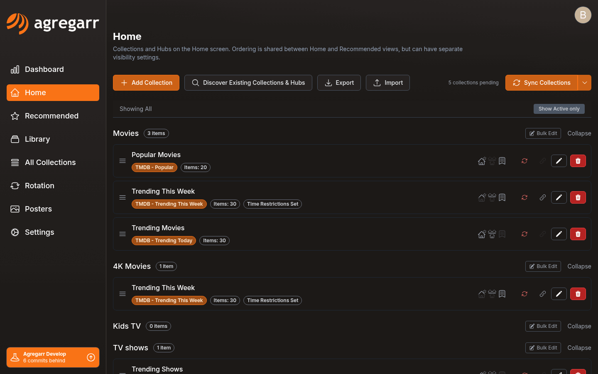

=== "Phone"

    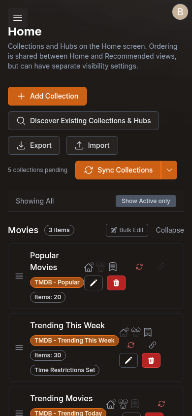

## The four pages

All four pages are in the sidebar. Every item except **Settings** stays greyed out until **Discover Existing Collections & Hubs** finds something. [Finding your way around](../get-started/finding-your-way.md) covers that first run.

### Home

Shows the collections and hubs on your Plex Home screen, in the same order Plex shows them. Home and **Recommended** share an order, but each has separate visibility settings.

Each library has its own group, stacked down the page. An item appears when **Users Home** or **Server Owner Home** is on. Drag a row by its handle to reorder it. The new order is also used by **Recommended**.

### Recommended

Shows items with **Library Recommended** on, one library at a time. See [Library tabs](#library-tabs) for switching between libraries.

A row that also appears on **Home** is greyed out and labelled **Ordering controlled in Home tab**. You can't drag it here. Reorder it on **Home** instead. Rows that appear only on **Recommended** can be dragged normally.

### Library

Shows every collection and imported Plex collection in the library, regardless of visibility. Plex's own default hubs, marked with the **Plex Default** badge, aren't listed here. Its ordering is separate from **Home** and **Recommended**.

Promoted collections sit in a top section where you can drag them into order. The rest sit below an **A-Z Collections** divider and sort alphabetically by the title Plex uses. Leading numbers are read as numbers. See [Promoted and A-Z](#promoted-and-a-z).

### All Collections

A flat list of every Agregarr collection, Plex default hub and imported Plex collection. It has filters and sorting, but no ordering. Only the admin can open it. See [The All Collections page](#the-all-collections-page) below.

## Library tabs

**Recommended** and **Library** show one library at a time. The tab strip under the toolbar has one tab per Plex library, with the number of rows that page lists in brackets. For example, **Movies (12)**.

A library with nothing to show is greyed out and can't be clicked. The first available library opens first.

**Home** has no tabs. It shows every library as a group.

## Toolbar

The same buttons run across the top of **Home**, **Recommended** and **Library**. **All Collections** has a smaller set, described [below](#the-all-collections-page).

=== "Desktop"

    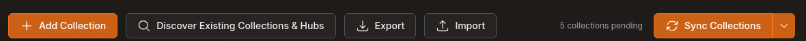

=== "Phone"

    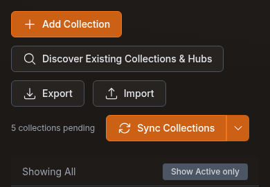

### Add Collection

Opens the **Add New Collection** window. It stays greyed out until Agregarr has at least one collection or hub. On a fresh install that means running Discover, or importing collections with **Import**, which isn't locked.

### Discover Existing Collections & Hubs

Imports from your Plex libraries anything Agregarr doesn't already know about, adding it to the lists. Plex's own hubs arrive as **Plex Default** rows. Collections that weren't made by Agregarr arrive as **Pre-Existing** rows.

Agregarr treats a collection as its own when it has a Plex label starting with `Agregarr` in any case, or when it matches one of your Agregarr collections.

Discover also checks every collection, hub and imported collection Agregarr already tracks. Anything that no longer exists in Plex is flagged, which makes **Clean Up Missing Collections** appear. Discover also writes to Plex. It promotes a collection into Plex's hub management when its visibility says it should show. It removes the hub entry for any Agregarr-labelled collection with no visibility box ticked. It saves new rating keys for collections whose keys have changed in Plex, and rewrites the Agregarr label on each matching Plex collection. The button reads **Discovering...** while this runs.

Once it finishes, a message gives the result:

- "Imported N new hubs/collections!" with a count of each and the totals.
- "All N Plex hubs/collections have already been imported!" when there was nothing new.
- "No Plex hubs found to import." when Plex has no hubs and Agregarr tracks none.
- "Validation complete: N missing collections detected" as a warning when anything is flagged missing.

On a new install, the button pulses orange until Discover has run. Run it again whenever you add collections directly in Plex.

To stop Agregarr managing another tool's collection order, visibility or sort title, add that tool's Plex labels under **Settings > General > Exclude from Ordering (Plex Label)** as a comma-separated list. A collection is excluded when one of its labels matches a listed value exactly, or starts with that value followed by an underscore. Matching ignores case.

The change applies on the next Discover. Excluded collections show a lock icon instead of the drag handle. See [Pre-Existing](#pre-existing).

### Clean Up Missing Collections

**Only when:** at least one collection, hub or imported collection is flagged as missing. The label includes the count across every library and all three kinds, for example **Clean Up Missing Collections (2)**.

Click it and the browser asks "Remove N missing collection configurations? This cannot be undone." Confirming removes Agregarr's saved settings for those items and any matching entries from Plex's hub management. It doesn't delete anything from Plex because those items are already gone. See [Missing indicator](#missing-indicator).

### Export

Saves the collections you tick to a JSON file. It is greyed out when you have no Agregarr collections. Hubs and imported collections can't be exported. See [Move collections between servers](move-between-servers.md).

### Import

Opens a file picker for a `.json` file created by **Export**, then asks which collections to import and which library should receive them. See [Move collections between servers](move-between-servers.md).

### Sync Collections

Runs the full collection sync immediately. This is the same pass as the **Plex Collections Sync** job under **Settings > Jobs**. A message says "Collections sync started successfully!" The label reads **Syncing...** only while Agregarr handles the click. Ongoing progress appears in [Sync status](#sync-status).

If a sync is already running, the message reads "A collections sync is already running; another will start when it finishes." One extra run is queued.

The button appears once at least one collection or hub exists. A second copy sits at the bottom of the page beside the sync status.

### Change Schedule

The arrow on the right side of **Sync Collections** opens a menu containing **Change Schedule**. It takes you to **Settings > Jobs**, where you can change how often **Plex Collections Sync** runs.

### Sync status

A line of text to the left of **Sync Collections**, repeated at the bottom of the page. It shows the first matching state below:

- **Starting sync...** briefly after you click.
- The current stage and progress, such as "(3/12)", with a **View on Dashboard** link while a sync is running.
- **Last sync failed**. Hover over it to read the error.
- "N collections pending" for collections waiting to sync after a change. It reads "1 collection pending" for one. After an Import the number can lag until you reload the page.
<!-- OPEN: Q8 status line stays on the old pending count right after Import and updates after a reload -->
- **Last sync:** followed by how long ago it ran, such as "Just now", "5 minutes ago", "2 hours ago" or "1 day ago". A green tick shows the number synced, a red warning shows the number of errors, an amber arrow shows the number skipped and the run time appears in brackets. Hover over the red number to see which collections failed and why. A second line reads **Next sync:** followed by "in 40 minutes", "in 2 hours", "in 1 day", "Soon" or "Overdue".
- **No sync yet**, with the **Next sync:** line when a run is scheduled.

**Last sync** and **Next sync** are hidden while anything is pending or after the last sync fails. The whole line is hidden when the page has no collections or hubs.

### Filtered Hubs Recommended

A warning shown under the toolbar when a library has a collection that creates placeholders and one of Plex's default recently added or recently released hubs is still visible. That default hub would list the placeholders.

Each affected hub is listed under its library with one of two instructions: "Disable visibility on this default hub (you have a **X** filtered hub)" or "Create a **X** filtered hub to exclude placeholders".

The warning is text only. Make the change from **Add Collection** or the hub's **Edit** form. It stays hidden on a fresh install. See [Visibility and time restrictions](form/visibility.md) for the field.

### Show Active only

**Default:** **Showing All**.

A bar below the toolbar shows the current status on the left and a button on the right. It appears once you have any collections. Click **Show Active only** and the status changes to **Showing Active only**. The button changes to **Show All**.

An inactive collection is one whose time restriction puts it outside its window right now. With **Showing All**, it appears wherever its normal visibility puts it. With **Showing Active only**, it appears only where its inactive visibility settings put it. Collections set to be removed from Plex while inactive are hidden completely.

On **Library**, only removed collections are hidden. An inactive Plex default hub that isn't removed also appears there, even though default hubs are normally left off **Library**.

If you create a time-restricted collection while **Showing Active only** is on and the collection is inactive, a pulsing hint reading "Click here to see inactive Collections" points at the button for 10 seconds.
<!-- OPEN: NEW: Show Active only still lists inactive collections where their inactive visibility is on, so the name promises more than it does -->

## Library groups

Each library appears as a group with a header and rows beneath it. On **Home**, the groups are stacked. On **Recommended** and **Library**, only the library selected in the active tab appears.

The empty states read:

- **Loading Plex libraries...** while the library list loads.
- "Failed to load Plex libraries. Please check your Plex connection." when it can't load.
- "No Collections found. Click Discover to get started!" when the page has nothing to list.
- "No recommended collections found for this library." on **Recommended**, or "No collections found for this library." on **Library**.

### Library header

Shows the library name, followed by a grey badge with the row count, such as "12 items" or "1 item". It counts everything listed for that library on the current page, so the count changes with **Show Active only**.

### Bulk Edit

Opens [Bulk Edit Collections](#bulk-edit-collections). The button appears in every library header, but each one opens the same window with every library available. Use the **All Libraries** list to narrow it.

### Collapse

Hides the rows in that group. The link then reads **Expand**. This state is remembered only until you leave the page.

### Reordering

Each row has a handle on the left. Drag it to move the row. A message says "Mixed collections reordered successfully!" The order is saved immediately and reaches Plex on the next sync.

Hubs, collections and imported collections share one list for each library, so you can place a collection between two hubs. Dragging a row with a **Sort Title** clears that title and shows "Sort Title override cleared - the collection now uses its dragged position."

The handle is replaced by a lock and the row can't be dragged when:

- it is greyed out on **Recommended** because **Home** controls it;
- it is an imported collection carrying one of your **Exclude from Ordering (Plex Label)** labels;
- it is an A-Z row on **Library**.

A row with **Shuffle position on Home/Recommended screens** ticked uses a crossed-arrows icon as its drag handle. You can still drag the row with it. Hover over the icon for "Position will be shuffled with other randomized collections during sync". See [Visibility and time restrictions](form/visibility.md#shuffle-position-on-homerecommended-screens).

### Promoted and A-Z

**Only on:** **Library**.

Promoted rows appear first and can be dragged into order. They can't be dragged beyond the **A-Z Collections** divider. The divider appears only when both sections contain rows.

Rows below it sort by their effective title. This is the **Sort Title** when set. For an imported collection without one, Agregarr uses the sort title already stored in Plex. Otherwise, it uses the collection name with **Collection Sort Format** under **Settings > Plex** applied.

Each collection and imported collection has one extra button:

- **Promote to top section with custom ordering** (an up arrow) on an A-Z row.
- **Demote to alphabetical section** (a down arrow) on a promoted row.

Hubs have neither. The confirmation messages are "Collection promoted to top section successfully!" and "Collection moved to alphabetical section successfully!"

If you edit a collection and enter a **Sort Title** that conflicts with its section, a prompt appears after saving. For a title starting with `!` on an A-Z collection, the prompt says Plex will show it in the Promoted section after the next sync. It asks whether to promote it or keep it in A-Z. The buttons are **Yes, promote it** and **Keep in A-Z**.

For a title without `!` on a promoted collection, the buttons are **Yes, demote it** and **Keep Promoted**. Keeping the current section discards the title you entered.

## Collection rows

Each row shows a name, a line of badges and a set of icons and buttons on the right.

=== "Desktop"

    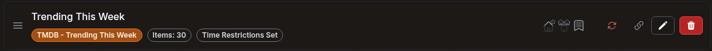

=== "Phone"

    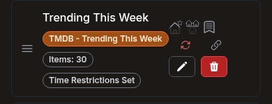

### Name line

Shows the collection's name. These variants replace a plain name:

- *Title will be updated on Collection Sync* in italics for a collection whose title is chosen at random during each sync.
- **Auto Franchise Collections**, **Auto Actor Collections** or **Auto Director Collections** for a single config that creates multiple collections.
- "{group}, slot N of M", with "Showing now: NAME" below it, for the collection currently shown by a rotation. See [Rotation](../Rotation.md).
- The name with " Collection" added or removed for an imported collection whose **Collection Suffix** change hasn't synced yet.

A row generated by Agregarr from an Auto Franchise, Auto Actor, Auto Director or Library Essentials config has an **Auto-generated** badge beside its name.
<!-- OPEN: NEW: Auto-generated badge never renders, nothing sets isExpandedConfig -->

When the title template differs from the name above, a "Plex title: TEMPLATE" line shows the template the collection will use in Plex. It doesn't appear when the names match or when the title is chosen at random during each sync.

### Plex Default

A grey badge on Plex's own hubs, such as **Recently Added Movies**. You can change their visibility, order and time restrictions, or hide them. You can't delete them.

### Pre-Existing

An amber badge on a collection that wasn't made by Agregarr and was found by Discover. You can change where it appears, along with its posters, wallpaper, theme, sort title, suffix and time restrictions. You can hide it but not delete it.

An imported collection with a lock icon has one of your **Exclude from Ordering (Plex Label)** labels. Agregarr leaves its order, visibility and sort title alone.

### Source and subtype badge

A blue badge naming the source and subtype, for example "Trakt - Trending" or "TMDB - Trending Today". The source part can read **Plex Library**, **Multi-Source**, **Coming Soon**, **Filtered Hub**, **Seerr**, **Radarr Tag**, **Sonarr Tag** and so on. Hubs and imported collections don't have this badge.

### Items: N

Shows the collection's **Max Items**, for example **Items: 30**.

### Grab Missing Items

Appears when **Grab Missing Movies** or **Grab Missing TV Shows** is on. See Missing items and placeholders.

### Create Placeholders

Appears when **Create placeholders for missing items** is on. See Missing items and placeholders.

### Target User

Reads **Target User: NAME** when the collection is limited to one person. See [Visibility and time restrictions](form/visibility.md#target-user).

### Time Restrictions Set

Appears when **Always Active** is unticked. See [Visibility and time restrictions](form/visibility.md#time-restrictions).

### Custom sync schedule

A badge starting with **Sync:** when a collection has its own sync timing. Examples include **Sync: 2 hourly**, **Sync: 1 daily** and **Sync: Custom**. See [Visibility and time restrictions](form/visibility.md#custom-sync-schedule).

### Unwatched

Appears when the collection is a smart collection filtered to unwatched items.

### Rename failed

An amber badge on an imported collection whose **Collection Suffix** rename didn't go through in Plex. Hover over it for the reason: the new name is already used in that library or Plex refused the rename. The logs have the details.

### In rotation

A blue **In rotation: NAME** badge on a collection belonging to a rotation. Beside it is **On Home now** or **Waiting its turn**. Click the blue badge to open the rotation. See [Rotation](../Rotation.md).

### Visibility icons

Three icons, always in this order: **Server Owner Home** (a house with a star), **Users Home** (three houses) and **Library Recommended** (a bookmark). A lit icon means that visibility setting is on. Hover over one for "Server Owner Home - On".

When a collection has a time restriction, each icon is split. The top half shows its setting while the collection is active. The bottom half shows its setting while inactive. A very faint icon means the collection is removed from Plex while inactive. See [Visibility and time restrictions](form/visibility.md).

### Sync status icon

One icon on the right side of each row shows the collection's current state. Hover over it for details. Agregarr checks the states in this order:

- A spinning yellow arrow: **Syncing...**
- A red triangle: the last sync failed. The hover text shows how long ago it failed and the error.
- An orange circle: synced with a warning. The hover text shows the warning.
- A red arrow: **Needs Sync**. You've changed it and it hasn't synced.
- A grey arrow: **Never synced**.
- A tick: **Synced and Active**, with the time of the last sync.
- A cross: **Inactive**, because a time restriction has switched it off.

### Retry sync

**Only on:** **Home**, **Recommended** and **Library**, for Agregarr collections and imported collections. Not on **All Collections**, and not on hubs.

When a row shows the red triangle or red **Needs Sync** arrow, the icon is also a button. Click it to sync only that collection. A message says "Sync started" for an Agregarr collection or "Collection synced" for an imported collection.

If an imported collection's **Collection Suffix** rename doesn't go through, the message instead reads "Collection synced, but the title was not renamed. Check the logs for details." If the sync fails, a message says "Sync failed:" followed by the error. It's refused while a full sync is running.

The grey **Never synced** arrow isn't clickable by itself. A new collection normally shows **Needs Sync** until its first sync.

### Link icon

Shows whether a collection is linked to the same collection in other libraries. Hover over it for one of these states:

- **Linked Collection - applies to all compatible libraries**: changing one changes all of them. Deleting or hiding one removes all of them.
- **Unlinked Collection - was deliberately unlinked from group**: the collection was linked and you split it off.
- **Collection not linked to other libraries**: shown with a faint icon.

Link or unlink from the footer of **Edit**. Click **Link** or **Unlink**, then **Confirm Link** or **Confirm Unlink**. A linked collection's form says "Changes will apply to all linked libraries".

### Missing indicator

A red warning triangle with the hover text "This collection no longer exists in Plex", or the matching wording for a "hub" or "pre-existing collection". Discover sets it when the item can't be found in Plex.

Click **Clean Up Missing Collections** to remove the saved entry. You can also recreate the item in Plex and run Discover again.

### Edit

A pencil. Opens the form for the collection, hub or imported collection. Hubs and imported collections use a shorter form.

### Delete

A bin on Agregarr collections. Click it once and it changes to **Delete**. Click it again to confirm. Click anywhere else to cancel.

Deleting removes the collection from Agregarr and clears labels it added to items for a smart collection. It immediately deletes Plex collections created by Library Essentials, Auto Director and Auto Actor. For every other collection, check Plex afterwards and delete the Plex collection there if it remains listed. Deleting a linked collection deletes every collection in that link.
<!-- OPEN: NEW: Delete leaves the Plex collection of every type except Library Essentials, Auto Director and Auto Actor in Plex -->

On **Home**, **Recommended** and **Library**, deleting your last collection also runs a cleanup sync and shows "Last collection deleted - final cleanup completed."

### Hide

The same bin appears on hubs and imported collections, with **Hide** as the confirmation. It turns all three visibility boxes off and keeps the item.

A hidden item disappears from **Home** and **Recommended**. Find it again on **All Collections**, or on **Library** for an imported collection, then turn the visibility boxes back on from **Edit**. Hiding a linked item hides every item in the link.

### Manage rotation

A link that replaces the bin while a collection is the member currently showing from a rotation. It opens the rotation. Other members keep their normal **Delete** button. See [Rotation](../Rotation.md).

### Library Recommended is enabled warning

An amber box below a **Seerr** **Individual Users** collection when **Library Recommended** is on. It appears on **Home** and **Recommended** when the collection isn't the last row in its library.

It reads "Library Recommended is enabled. This will show one collection per user on the Recommended screen. To avoid blocking other content, place this at the bottom of the list, or use Users Home only."

## The All Collections page

Lists every Agregarr collection, Plex default hub and imported collection across all libraries. Only the admin can open it.

=== "Desktop"

    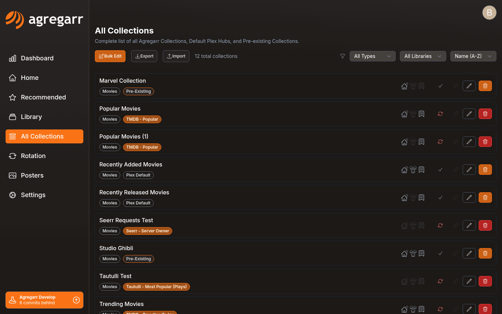

=== "Phone"

    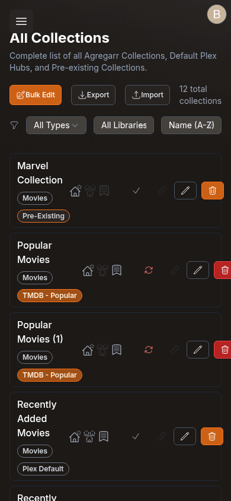

### Header buttons

**Bulk Edit**, **Export** and **Import** work the same way as on the other pages. **Export** is greyed out when there are no Agregarr collections.

There is no **Add Collection**, **Discover**, **Sync Collections** or **Clean Up Missing Collections** here.

### Total count

Reads "N total collections". When filters hide some items, it reads "N total collections of M".

### All Types

**Default:** **All Types**.

Narrows the page by kind: **All Types**, **Agregarr Collections**, **Plex Hubs** or **Pre-existing Collections**.

### All Libraries

**Default:** **All Libraries**.

Narrows the page to one named library. It only lists libraries with something to show.

### Sort

**Default:** **Name (A-Z)**.

Sorts by **Name (A-Z)**, **Name (Z-A)**, **Type** or **Library**. **Type** puts Agregarr collections first, followed by Plex hubs and imported collections. Each group is sorted by name. **Library** groups rows by library name.

### Rows

Each row has a **Library** badge before its other badges, followed by the same visibility icons, sync icon and link icon used on the other pages. It has **Edit**, then **Delete** for Agregarr collections or **Hide** for hubs and imported collections.

Rows have no drag handle, **Plex title** line, **Items: N** badge, promote or demote button or **Retry sync**. The sync icon is read-only here. Sync the collection from another page.

Deleting your last collection here doesn't run the cleanup sync used by the other pages.

If no rows match the filters, the page says "No collections found."

## Preview Collection

Shows what a collection will list before you save it. It opens from the **Preview Collection** button in the collection form footer, so this is the collection's own preview rather than part of these pages.

The button appears after you've chosen a type and at least one library. It isn't available for hubs, imported collections, Seerr **Individual Users**, Auto Franchise, Auto Director, Auto Actor or Library Essentials.

=== "Desktop"

    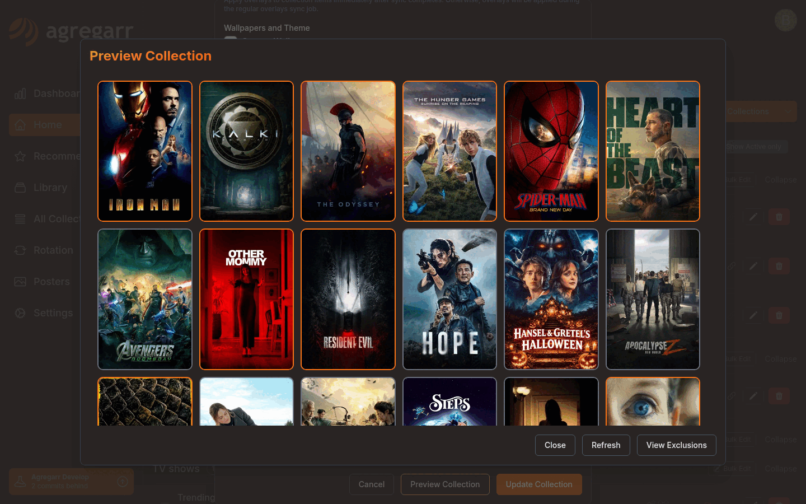

=== "Phone"

    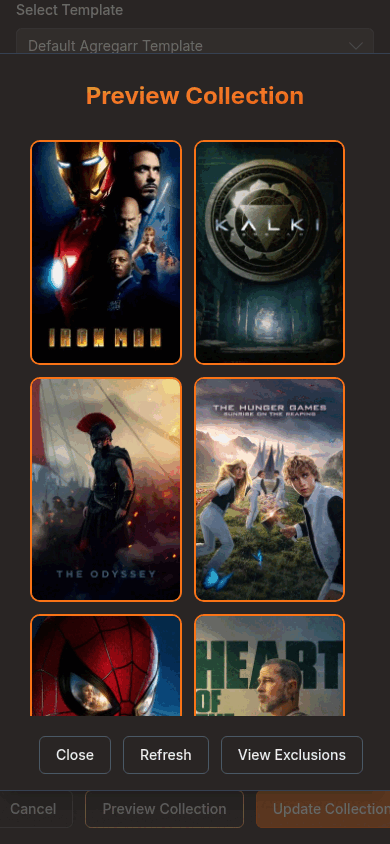

When it opens, a progress bar and stage text appear while Agregarr fetches the list. The poster grid follows. If the collection covers more than one library, each library gets a tab. A spinner on a tab means that library is still loading.

If one source in a multi-source collection fails, an amber line above the grid names the source and gives the reason. "No items found" appears for an empty list. If the preview can't run, it shows "Failed to load preview:" followed by the reason.

### Ring colours

Each poster has a ring:

- **Orange**: the item is in your Plex library.
- **Yellow**: the item is a placeholder. A **Placeholder** badge also appears along the bottom. Yellow rings only appear once Radarr or Sonarr and placeholder root folders are set up and the collection creates placeholders.
- **Grey**: the item isn't in your library.

### Show info

An information icon appears at the top right of a poster when you hover over it. It opens a panel showing the title and year, the overview or "No overview available", the TMDB score as a percentage, the IMDb rating out of 10 and the Rotten Tomatoes critics score with a fresh or rotten icon. A score of 60 or higher is fresh.

Ratings load when you open the panel, with **Loading ratings...** shown first. **View on IMDb** opens the title's IMDb page.

### Exclude from all collections

A red minus appears at the top left of a poster when you hover over it. Click it to add the title to the global exclusions list. A grey cross replaces the minus and a message says "Item excluded from all collections". See [Global Exclusions](#global-exclusions).

### Download buttons

Icons appear along the bottom of a poster when you hover over it. They are available for items that aren't in your library and placeholders that aren't monitored yet.

- **Download via Radarr** on movies opens [Radarr Download Options](#radarr-download-options).
- **Download via Sonarr** on TV shows opens [Sonarr Download Options](#sonarr-download-options).
- **Request via Seerr** sends movie requests immediately. For TV shows, it opens [Select Seasons](#select-seasons).

Movies without a TMDB id have no buttons. TV shows without a TMDB id have only the Sonarr button.

After a request succeeds, the icon gets a green tick. These ticks are stored in your browser, so they don't appear on another device. A message says "Download request sent successfully" or "Failed to send download request".

### Refresh

Fetches the list again from its source. A box first asks "This will fetch fresh data from the external source and may take some time. Continue?"

On a Multiple Sources collection set to cycle lists, **Refresh** moves to the next source without asking. See [Cycle lists](cycle-sources.md).

### View Exclusions

Opens [Global Exclusions](#global-exclusions).

### Close

Closes the window.

## Radarr Download Options

Opens when you click **Download via Radarr**. The movie's name appears below the title.

### Select Server

**Only when:** you have more than one Radarr server.

Chooses the server that receives the movie. The list only appears when more than one server is available, with the default server selected. With one server, that server is selected and the list stays hidden.

Each server shows its name, with **(Default)** beside the default.

### Select Quality Profile

Defaults to the first profile on the selected server. It stays greyed out until a server is chosen, with "Select a server first".

### Select Root Folder

Defaults to the first root folder on the selected server.

### Download

Sends the movie. It stays greyed out until a server, profile and root folder are chosen. **Cancel** closes the window.

## Sonarr Download Options

Opens when you click **Download via Sonarr**. It has the same **Select Server**, **Select Quality Profile** and **Select Root Folder** fields as Radarr, followed by the season table from [Select Seasons](#select-seasons).

**Download** needs a server, profile, root folder and at least one season.

## Select Seasons

Opens when you click **Request via Seerr** on a TV show. A table lists each season as **Season N**, with **# of Episodes** beside it. Specials aren't listed.

All seasons start ticked. The switch in the header ticks or unticks every season. **Download** is greyed out when none are ticked.

Seerr requests use Seerr's own server settings, so there is no server list here.

## Global Exclusions

A list of titles Agregarr leaves out of every collection. It opens only from **View Exclusions** in **Preview Collection**. Titles can only be added with the minus button on a poster in the preview.

=== "Desktop"

    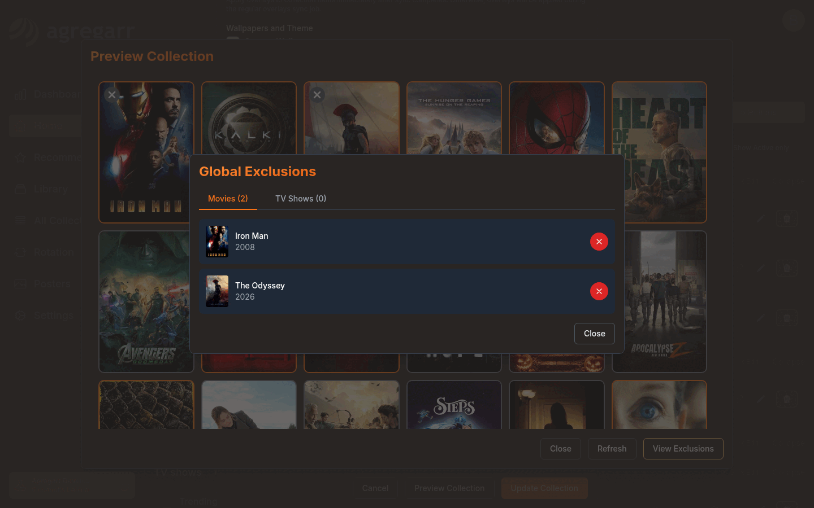

=== "Phone"

    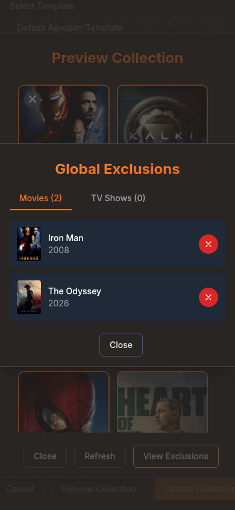

There are two tabs: **Movies (N)** and **TV Shows (N)**, with counts in brackets. Each row shows the poster, title and year. An empty tab reads "No excluded movies" or "No excluded TV shows".

### Remove from exclusions

A red cross on each row. Click it to remove the title from the list immediately, with no confirmation. A message says "Item removed from exclusions".

The list applies during every sync. Movies are excluded by TMDB id. TV shows are excluded by the TMDB or TVDB id used when you added them. The title drops out of every collection on that sync and stays out until you remove it here.

## Bulk Edit Collections

Changes the same settings across multiple collections at once. It opens from **Bulk Edit** in a library header or from **All Collections**.

=== "Desktop"

    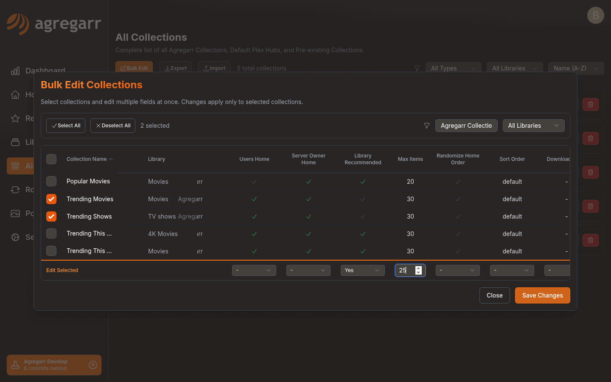

=== "Phone"

    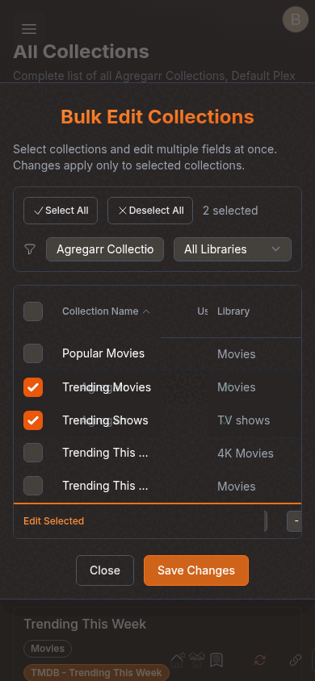

The window has one row for each collection, hub and imported collection, with one column for each setting. Tick the rows you want to change. In the **Edit Selected** row at the bottom, set a value in any column and click **Save Changes**.

Only the columns you change are applied, and only to the ticked rows. A value of **-** or an empty box leaves each collection unchanged. After saving, the window stays open and the **Edit Selected** row clears.
<!-- OPEN: NEW: emptying a number box after typing in it sends a clear the server ignores, so the old value stays -->

The tick box, **Collection Name** and **Library** remain visible while you scroll sideways. Clicking outside the window doesn't close it.

### Select All

Ticks every row currently listed. The tick box in the table header does the same. When every row is ticked, it unticks them all.

### Deselect All

Unticks every row.

### Selected count

Reads "N selected".

### Type filter

**Default:** **Agregarr Collections**.

Narrows the rows to **All Types**, **Agregarr Collections**, **Plex Hubs** or **Pre-existing Collections**. It opens on **Agregarr Collections**, so change it before editing a hub.

### Library filter

**Default:** **All Libraries**.

Narrows the rows to one library.

### Save Changes

Applies the **Edit Selected** row to every ticked row. It is greyed out when no rows are ticked.

Each row saves separately. A successful save says "Successfully updated N collection(s)". A failure names the collection: "Failed to update NAME: error". **Close** leaves the window.

Click a column heading to sort by it. Click it again to reverse the order. Each row's value appears as a tick, number or text. Settings that don't apply to a row are faded.

Hubs and imported collections only support **Users Home**, **Server Owner Home**, **Library Recommended** and **Randomize Home Order**. Other columns apply only to Agregarr collections and are skipped for the rest.

For collections in a rotation, changes to visibility or **Randomize Home Order** are saved as the collection's own settings. The rotation uses them the next time that collection is on show. An **In rotation** badge appears below the name.

If the save fails, a warning says "Couldn't save this collection's own visibility setting. The rotation keeps using the previous one." See [Rotation](../Rotation.md).

The column names below match the window. Several use different labels from the collection form, so each entry also names the corresponding form setting.

### Collection Name

The name, with the **In rotation** badge below it when it belongs to one. Sorts A-Z.

### Library

The library name.

### Type

**Agregarr**, **Plex Hub** or **Pre-existing**.

### Users Home

Picks **Yes**, **No** or **-**. Same as **Users Home** on the form. All three kinds.

### Server Owner Home

Picks **Yes**, **No** or **-**. Same as **Server Owner Home** on the form. All three kinds.

### Library Recommended

Picks **Yes**, **No** or **-**. Same as **Library Recommended** on the form. All three kinds.

### Max Items

A number, 1 or more. Same as **Max Items** on the form. Collections only.

### Randomize Home Order

Picks **Yes**, **No** or **-**. On the form it is **Shuffle position on Home/Recommended screens** (**Randomize Home Order** for hubs and imported collections). All three kinds.

### Sort Order

Picks **Default**, **Reverse**, **Random**, **IMDb ↓** or **IMDb ↑**. On the form it is **Item Order**, which has more choices with longer names. Collections only.

### Download Mode

Picks **Seerr** or **Direct**. On the form it is **Download Method**, with **Request via Seerr** and **Download via Radarr/Sonarr**. Collections only.

### Search Missing Movies

Picks **Yes**, **No** or **-**. On the form it is **Grab Missing Movies**. Collections only.

### Search Missing TV

Picks **Yes**, **No** or **-**. On the form it is **Grab Missing TV Shows**. Collections only.

### Auto Approve Movies

Picks **Yes**, **No** or **-**. On the form it is **Auto-approve movie requests**. Collections only.

### Auto Approve TV

Picks **Yes**, **No** or **-**. On the form it is **Auto-approve TV show requests**. Collections only.

### Max Seasons to Request

A number, 0 or more. On the form it is **Skip TV shows with more than this many seasons**, where 0 means no limit. Collections only.

### Seasons Per Show Limit

A number, 0 or more. On the form it is **Seasons per TV show to download/request**, where 0 means all seasons. Collections only.

### Season Grab Order

Picks **First**, **Latest** or **Airing**. On the form it is **Season grab order**, with **First seasons**, **Latest seasons (including unreleased)** and **Most recently aired seasons**. Collections only.

### Max Position to Process

A number, 0 or more. On the form it is **Skip item if position in list is greater than**, where 0 means no limit. Collections only.

### Minimum Year

A year from 1900 to 2100. On the form it is **Minimum release year** under **Grab Missing Items**. Collections only.

### Minimum IMDb Rating

A number from 0 to 10, in steps of 0.1. On the form it is **Minimum IMDb rating** under **Grab Missing Items**. Collections only.

### Minimum RT Rating

A number from 0 to 100. On the form it is **Minimum Rotten Tomatoes rating** under **Grab Missing Items**. Collections only.

### Minimum RT Audience Rating

A number from 0 to 100. On the form it is **Minimum Rotten Tomatoes audience rating** under **Grab Missing Items**. Collections only.

### Unwatched Only

Picks **Yes**, **No** or **-**. It turns the **Smart Collection** switch on or off. It doesn't change **Filter to Unwatched Items Only**. Collections only.

### Create Placeholders

Picks **Yes**, **No** or **-**. On the form it is **Create placeholders for missing items**. Collections only.

## Related

- [Your first collection](../get-started/first-collection.md)
- [Finding your way around](../get-started/finding-your-way.md)
- [Move collections between servers](move-between-servers.md)
- [Visibility and time restrictions](form/visibility.md)
- [Collections](index.md)
- [Rotation](../Rotation.md)
