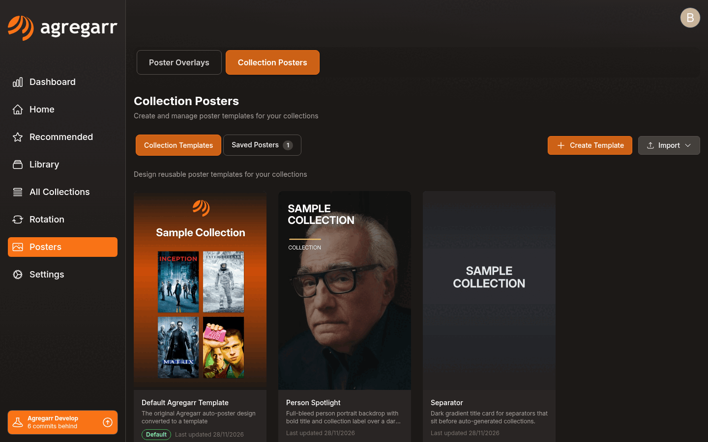
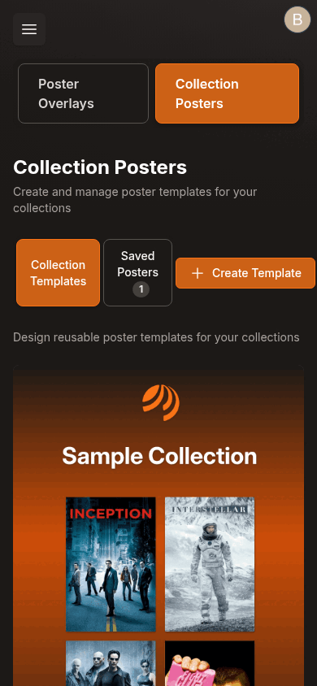
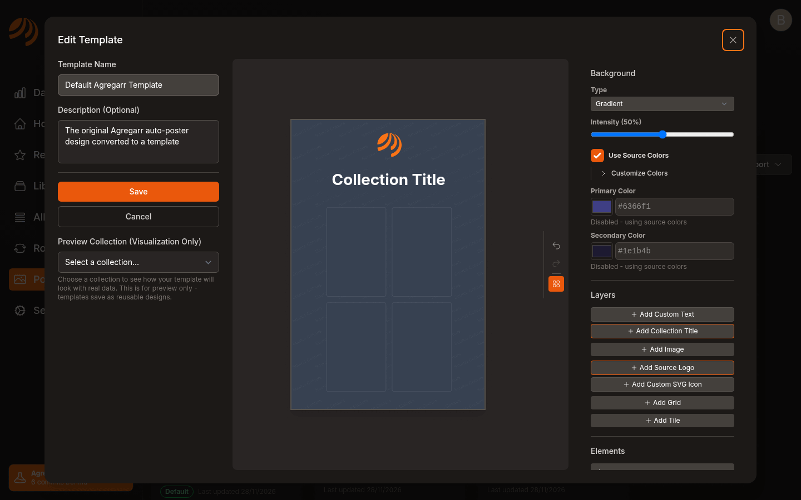
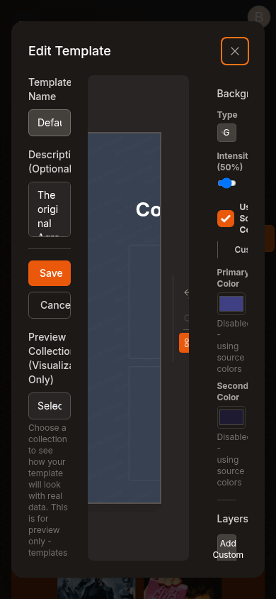

# Poster editor

This page covers the **Collection Posters** tab on the **Posters** page and the editor used to design templates and posters. For step-by-step guides, see [Posters, wallpapers and theme music](posters.md).

The **Posters** sidebar item has two tabs: **Poster Overlays** and **Collection Posters**. Opening **Posters** takes you to **Poster Overlays**, covered under [Overlays](../Overlays.md). Everything on this page is under **Collection Posters**.

=== "Desktop"

    

=== "Phone"

    

## Collection Posters tab

The page title is **Collection Posters**, followed by "Create and manage poster templates for your collections". It has two sub-tabs.

### Collection Templates

Reusable designs that collections choose from **Select Template**. The line under the tabs reads "Design reusable poster templates for your collections". An empty grid says "No templates found" and "Create your first template to get started".

Agregarr starts with three templates: **Default Agregarr Template**, **Person Spotlight** and **Separator**.

### Saved Posters

Finished posters and designs you've saved. The number beside the tab name shows how many there are. The line under the tabs reads "View and manage your saved collection posters". An empty grid says "No saved posters found".

### Create Template

Opens the editor in **Create Template** mode with a blank 1000 by 1500 pixel template. It's only shown on **Collection Templates**.

### Import

A menu with three entries, only shown on **Collection Templates**. **Import Template** and **Import Source Colors** open the same file picker. Agregarr decides what to import from the file ending: `.zip` for a template and `.json` for source colours. Any other file gets "Unsupported file type. Please upload a ZIP file for templates or JSON file for source colors."

### Import Template

Loads a template ZIP created by **Export**. The ZIP can contain up to 100 files and be up to 50 MB once unpacked. If a template has the same name as an existing one, Agregarr imports it as "Name (1)". It arrives as a new template and doesn't become the default.

Pictures and icons in the ZIP are copied to the server. The imported template doesn't link to them correctly, so those elements are empty. Open the editor and choose each picture or icon again after importing.
<!-- OPEN: NEW: importing a template with its own pictures or icons maps their paths to icon ids instead of the /api/v1/posters/icons/user/FILE paths the renderer reads (uploads.ts:315-340, 367-385; posterGeneration.ts:1280), so those elements render empty -->

### Import Source Colors

Loads a `source_colors.json` file and replaces the colours for every source included in it. See [Change the colours a source uses](posters.md#change-the-colours-a-source-uses).

### Export Source Colors

Intended to download every source's colours as `source_colors.json`. Right now, the downloaded file contains only the default colour scheme. **Import Source Colors** rejects that file even though the toast reads "Source colors exported successfully".
<!-- OPEN: NEW: Export Source Colors downloads one default colour scheme instead of the export file, because GET /source-colors/:sourceType is registered before GET /source-colors/export (sourceColors.ts:36 and :141) -->

## Template cards

Each card shows a preview, the template's name, its description, a **Default** badge when it's the default and "Last updated" with a date. The preview uses a collection called "Sample Collection" with the type `multi-source`. Elements set to **Show conditionally** for another type don't appear in that preview.

### Edit

Opens the editor in **Edit Template** mode. **Save** updates the template. When the design changes, every collection using it rebuilds its poster during the next sync.

### Duplicate

Opens the editor in **Create Template** mode with a copy of the design and the same name. Agregarr doesn't create anything until you click **Save**, so change the name first.

### Export

Downloads a ZIP named after the template and ending in `_template.zip`. It contains `template.json` and any pictures or icons uploaded into the design. The toast reads "Template exported successfully".

### Set Default

Makes this the starting template for new collections. It's also used by any collection that hasn't saved a template. Collections that have already saved a template keep it. The current default card has no **Set Default** button and shows a **Default** badge instead.

### Delete

Shows **Delete Template** with the question "Are you sure you want to delete this template?" and **Delete** and **Cancel** buttons. Agregarr doesn't check whether any collections use the template. Those collections can't build a poster until you choose another template for them.

The default template can't be deleted, but its card still shows **Delete**. Clicking **Delete** in the confirmation does nothing.
<!-- OPEN: NEW: the default template shows a Delete button, the server answers 403 "Cannot delete default template" and the card gives no message (PosterTemplateGrid.tsx:107-111, posters.ts:222-227) -->

Agregarr restores **Person Spotlight** and **Separator** when it starts. Delete either one and it returns after a restart. Renaming one also restores the original, leaving the renamed copy in place. Their descriptions are reset as well. **Separator** loses **Set Default** when Agregarr restarts, so make a copy if you want to use a separator design as the default.

## Saved Posters grid

### Poster tile

Each tile shows a preview and a name. Tiles come from designs saved in the editor and every image file in the `posters` folder, including uploads and downloads from **Add from URL**. Image files without a design have an orange **File** tag. You can delete them, but you can't edit or duplicate them.

Hover over a tile to show a tick box in the corner and the **Edit**, **Duplicate** and **Delete** buttons. **Edit** and **Duplicate** open the editor in **Edit Poster** and **Create Poster** mode.

### Delete

A trash button. The first click changes it to a **Delete** button. Click it again to delete the poster. Press Escape or click away to cancel.

### Select All, Deselect All, Delete Selected (N)

Ticking a tile shows a bar with **Select All**, **Deselect All**, a "{N} selected" count and **Delete Selected (N)**. The first click on **Delete Selected (N)** changes the button to "Are you sure you want to delete {N} selected poster(s)?". Click it again to delete them. Posters that nothing uses are deleted straight away.

### Poster is Currently in Use

Shown when you delete one poster used by collections. It says "This poster is currently being used by the following collections:" and lists each collection and its library. **Delete Anyway** deletes the poster. **Cancel** keeps it.

### Some Posters Are in Use

Shown when a bulk delete includes posters used by collections. It says "The following posters are currently in use. Do you want to delete them anyway?" If some posters weren't in use, it also says "{N} unused posters have already been deleted." **Delete Unused Only** closes the window and keeps the posters that are in use. **Delete All Anyway** deletes those posters too, with a progress count shown on the button. **Cancel** closes the window.
<!-- OPEN: NEW: deleting an editor-made poster that collections use can't be forced from Saved Posters: the server's usage check compares collection posters with the design's numeric id rather than its file name, answers 409 without a usedBy list, and ignores force=true (posters.ts:626-700, SavedPosterGrid.tsx:164-177) -->

## The editor window

The editor opens in a large window titled **Create Template**, **Edit Template**, **Create Poster** or **Edit Poster**. The left column contains the name and preview settings. The canvas and its toolbar sit in the middle. The right column contains **Background**, **Layers**, **Elements** and **Properties**.

=== "Desktop"

    

=== "Phone"

    

The canvas is 1000 by 1500 pixels and shrinks to fit your screen. Click an element to select it, then drag it to move it. Drag a corner handle to resize it or use the round handle to turn it. Resizing preserves the element's shape except for tiles. Elements can't be smaller than 10 pixels. The editor is cramped on a phone, so use a tablet or desktop for real editing.
<!-- OPEN: Q10 editor does not lay out at 390px width -->

### Template Name

Called **Poster Name** when you're editing a poster. It's required, so **Save** stays greyed out until you enter a name. The placeholder reads "Enter a name".

### Description (Optional)

A line of text shown on the template's card and beside it in **Select Template**. The placeholder reads "Enter a description".

### Save

Saves your changes and closes the window. Shows **Saving...** while it works.

### Cancel

Closes the window without saving.

### Preview Collection (Visualization Only)

**Default:** "Select a collection...", meaning no collection is selected.

Draws the canvas using one of your real collections, grouped by library. Entries look like "Trending Movies (tmdb)", while imported Plex collections end in "(Pre-existing)". Choosing one fills the **Content Grid** with the collection's first 12 posters. The collection must already be in Plex. If it hasn't synced yet, the grid tiles keep showing loading dots. It also shows the collection name in text elements, uses the source's colours when **Use Source Colors** is on and hides elements whose **Show conditionally** rules don't match.
<!-- OPEN: Q9 preview collection that has not synced answers 404 and the tiles load forever with no message -->

This only changes the preview. The hint reads "Choose a collection to see how your template will look with real data. This is for preview only - templates save as reusable designs." With no collection selected, every element appears.

When you open the editor from **Create New Poster** on a collection's form, the preview starts with that collection selected.

### Preview Value

Appears under **Preview Collection (Visualization Only)** when you select a Library Essentials collection (Genre, Decade, Resolution or Content Rating). Choose which generated collection to preview, such as one genre. It starts with the first value.

### Undo (Ctrl+Z), Redo (Ctrl+Shift+Z)

Two buttons beside the canvas. They move backwards and forwards through your last 50 changes. Ctrl+Y also redoes a change. Undo and redo clear the current selection.

### Snap: ON, Snap: OFF

**Default:** on.

Makes a dragged element click into place when it comes within 8 pixels of the poster edges, centre lines or another element's edges and centres. Click the button to turn it off.

## Background

The first block in the panel.

### Type

**Default:** **Radial Gradient** on a blank template. Choices are **Color**, **Gradient** and **Radial Gradient**.

**Color** uses one flat colour. **Gradient** runs from top to bottom, placing **Secondary Color** at the top and bottom edges and **Primary Color** in the middle. **Radial Gradient** runs from **Primary Color** in the centre to **Secondary Color** at the edge.

### Intensity

**Default:** 50%. Only shown for **Gradient** and **Radial Gradient**.

For a **Radial Gradient**, a higher number spreads the primary colour further towards the edges. For a plain **Gradient**, it widens the middle band in the editor preview. The finished poster ignores it for that type.
<!-- OPEN: NEW: Intensity changes the editor preview of a linear Gradient but the server renders that type with fixed stops and ignores it (Background.tsx:80-95 vs posterGeneration.ts:988-1004) -->

### Use Source Colors

**Default:** unticked on a new template. This is only available for templates, so it doesn't appear when you edit a poster. The built-in **Default Agregarr Template** has it ticked.

Uses the background colours assigned to the collection's source. One template can then look different for Trakt, TMDB and every other source. While it's ticked, **Primary Color** and **Secondary Color** are greyed out and read "Disabled - using source colors". With no preview collection selected, the canvas background becomes a grey panel with "Source Colours" repeated across it.

### Customize Colors

Appears under **Use Source Colors** and starts collapsed. It contains **Source Type**, **Background Colors** with **Primary** and **Secondary**, **Text Color** and **Save Colors**. **Source Type** lists every source with its own colours and starts on Trakt. **Save Colors** saves the colours set for every source in the list, not just the one currently shown. A message under the button reads "Colors Saved!".

Source colours are stored separately from templates, so they apply to every template using source colours. See [Change the colours a source uses](posters.md#change-the-colours-a-source-uses).

### Primary Color

**Default:** `#6366f1` if no value is set. A colour box where you can enter a hex value or click to choose one.

### Secondary Color

**Default:** `#1e1b4b` if no value is set. Only shown for **Gradient** and **Radial Gradient**.

## Layers

The block of buttons used to add elements. A new element appears near the middle of the poster, sits above the existing elements and is selected so its properties are shown.

### Add Custom Text

Adds a 200 by 50 pixel text box reading "New Text". It starts at 24 px with white, centred text. This is the only text button available when you're editing a poster.

### Add Collection Title

Templates only. Adds a text box that displays the collection's name when Agregarr builds the poster, letting one template work across different collections. You can't edit the text. Resize the box to control how much room long names have.

### Add Image

Adds a 100 by 100 pixel picture box. Choosing a picture resizes the box to the picture's own size.

### Add Source Logo

Adds a 50 by 50 pixel logo that changes with the collection's source: Trakt's logo for a Trakt collection, TMDB's for a TMDB collection, Netflix's for a Netflix collection and so on. Multiple Sources and Coming Soon collections use the Agregarr logo. A source without a logo gets a faint circle containing the first letter of its name.

### Add Custom SVG Icon

Adds a 50 by 50 pixel icon box. Choosing an icon resizes the box to the icon's own size.

### Add Grid

Adds a **Content Grid**, which is a block of posters from the collection's first items. It starts with 2 columns, 2 rows and 16 pixels between posters.

### Add Tile

Adds a filled rectangle that is 300 by 100 pixels, black at 60% opacity and has rounded corners. Use it to put a darker panel behind text.

### Person Image

There's no button for this element. The built-in **Person Spotlight** template contains a portrait element that Agregarr fills with an actor or director photo for Auto Actor and Auto Director collections. It appears in **Elements** as **Person Image**.

## Elements

Lists every element with the top element first. It reads "No elements added yet" when empty. Click a row to select that element.

### Move Up

The up arrow on a row. Swaps the element with the one above it.

### Move Down

The down arrow on a row. Swaps the element with the one below it.

### Delete Element

The bin on a row. Removes the element.

## Properties

Shows the settings for the selected element. With nothing selected, it reads "Select an element to edit its properties".

### Text elements

Both **Add Custom Text** and **Add Collection Title** create text elements. Their settings appear in this order:

- **Use Source Text Colors** (templates only): ticking it greys out **Text Color**, which then reads "Disabled - using source text colors", and shows **Source Type for Text**. The finished poster ignores both settings and uses **Text Color**, which is white unless you changed it.
- **Text**: the words shown. Custom text only. A collection title element shows "This text will automatically display the collection's name when used." instead.
- **Font Size**: 8 to 200 px. Starts at 24.
- **Font Family**: any font in the list, see [Fonts](#fonts).
- **Text Color**: starts at white.
- **Font Weight**: **Normal** or **Bold**.
- **Font Style**: **Normal** or **Italic**.
- **Text Transform**: **None**, **Uppercase**, **Lowercase** or **Capitalize**.
- **Max Lines**: 1 to 5 lines. Starts at 2.

Text wraps inside its box. When it doesn't fit, Agregarr shrinks it by 5% at a time until it fits or reaches 8 px. There's no alignment control. Text is centred.
<!-- OPEN: NEW: Use Source Text Colors and Source Type for Text are saved but ignored when the poster is built, which uses Text Color (posterGeneration.ts:1783-1797) -->

### Image elements

**Add Image** creates these.

- **Select Image**: opens a picker containing the pictures shipped with Agregarr and any you've uploaded. Uploaded pictures are stored in the `icons` folder. **Upload Image** accepts a JPEG, PNG or WebP up to 10 MB. The button reads "Select an image..." until you choose one. An empty list says "No images found".
- **Lock aspect ratio**: ticked by default. Keeps the width and height in step.
- **Width** and **Height**: 10 to 400 px.

### Icon elements

**Add Custom SVG Icon** creates these. A source logo element has the same **Lock aspect ratio**, **Width** and **Height** settings. Instead of **Select Icon**, it shows the note "This logo will automatically change based on the collection's source when used."

- **Select Icon**: opens the same picker for SVG files. **Upload Icon** accepts an SVG up to 10 MB. Agregarr rejects SVG files containing scripts or event handlers. The button reads "Select an icon..." until you choose one. An empty list says "No icons found".
- **Lock aspect ratio**, **Width** and **Height**: as for images.

### Content Grid

**Add Grid** creates these. The grid shows posters for the collection's first items, one in each cell. A 3 by 2 grid shows six posters.

- **Columns**: 1 to 10.
- **Rows**: 1 to 10.
- **Spacing**: 0 to 50 px between posters.
- **Corner Radius**: 0 to 20, rounding each poster.
- **Width**: 50 to 800 px.
- **Height**: calculated from the width and cell shape, then shown as "Locked to poster aspect ratio (2:3)".

Changing the columns or rows resizes the grid to keep each poster at 2:3.

### Tile

**Add Tile** creates these.

- **Fill Color**: starts black.
- **Opacity**: 0 to 100%. Starts at 60%.
- **Corner Radius**: 0 to 200 px. Starts at 12.
- **Border Width**: 0 to 30 px. Starts at 0.
- **Border Color**: only shown when **Border Width** is above 0. Starts white.

### Person Image

One setting, **Opacity**, from 0 to 100%. It controls the strength of a dark tint over the portrait, not the transparency of the portrait itself. A finished poster uses 55% when no value has been set, even though the slider reads 100%.
<!-- OPEN: NEW: Person Image Opacity slider shows 100% when unset (LayerPanel.tsx overlayOpacity ?? 1) but the renderer's default is 0.55 (posterGeneration.ts:1723) -->

### Show conditionally

Shown for every element. Ticking it reveals the rules that decide whether the element appears on a poster.

- **Collection Type**, **Subtype**, **Media Type**, **Name** and **Item Count**: the field to test. **Name** is the collection name shown in Plex. **Item Count** is the number of items in the collection.
- The operator: **=**, **≠** and **contains** for text. **Item Count** provides **=**, **≠**, **>**, **≥**, **<** and **≤**, starting on **≥** 0.
- The value to compare. The box suggests `plex` for **Collection Type**, `genre` for **Subtype** and `movie` for **Media Type**. A media type is `movie` or `tv`.
- The bin beside a rule removes it. Removing the final rule turns the condition off.
- **Add rule** adds another rule. Rules are joined with AND, so all of them must match.

Comparisons ignore capital letters. Enter a value before saving. A rule with an empty value doesn't match.

A new condition starts on **Subtype** with an empty comparison value. You can use conditions to show a **Content Grid** only for collections with enough items or a source logo only for TMDB collections.

## Fonts

### Font Family

The **Font Family** list for a text element includes every font installed in the Agregarr image. That covers system fonts, poster fonts such as Bebas Neue, Anton, Inter, Oswald and Playfair Display and anything added to the `fonts` folder. If the list doesn't load, the editor falls back to Inter, Arial, Georgia and Courier New.

### Custom fonts folder

Put `.ttf` or `.otf` files in the `fonts` folder inside your config folder. Agregarr adds them to **Font Family**. Fonts are listed by family name. The editor only offers **Normal** and **Bold** weights. For the folder location, see [Where the files live](posters.md#where-the-files-live).

## Related

- [Posters, wallpapers and theme music](posters.md)
- [Artwork and sort title](form/artwork.md): the collection form fields that use these templates
- [Overlays](../Overlays.md): the other tab on **Posters**
