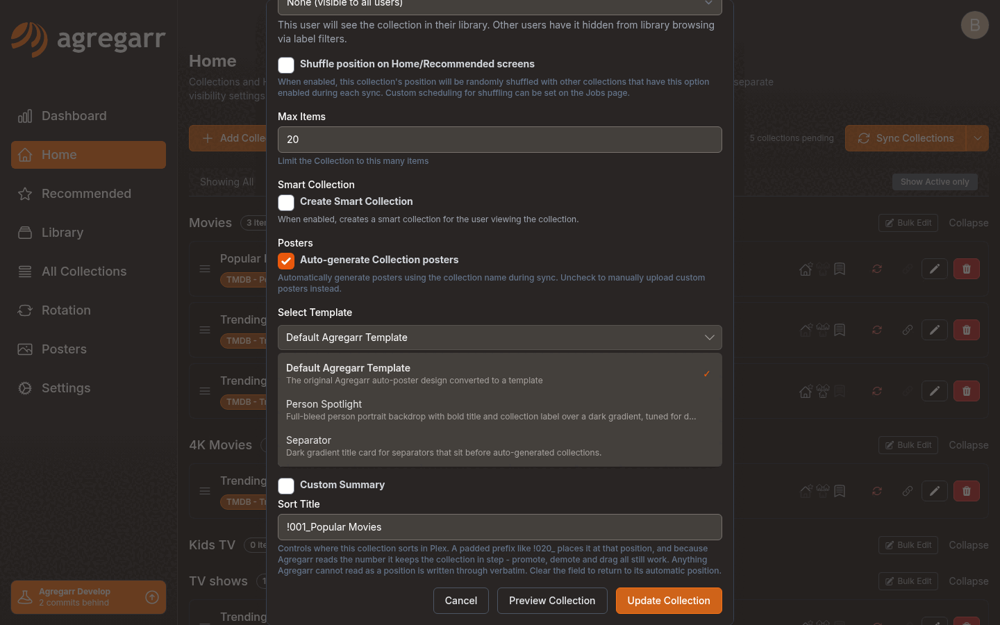
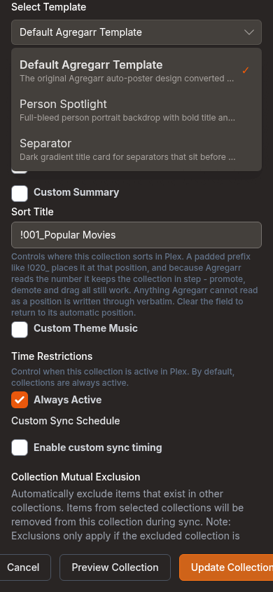
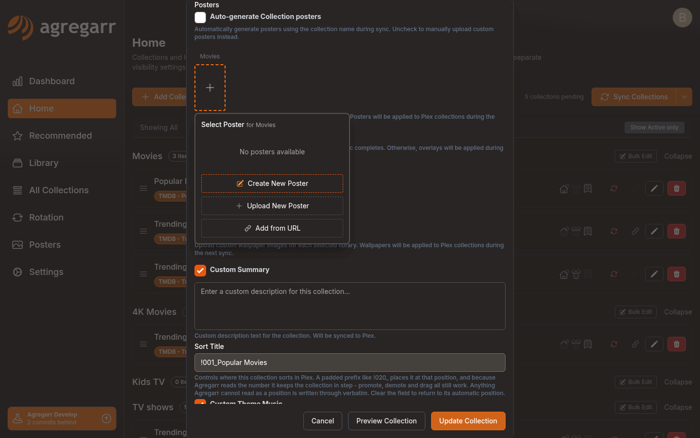
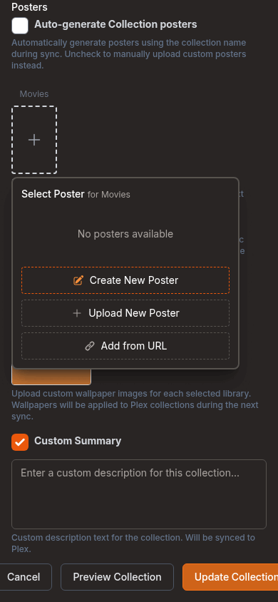
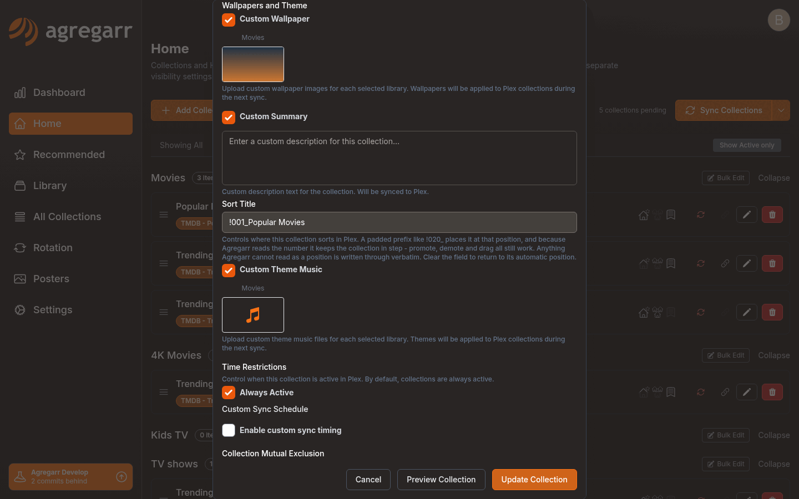
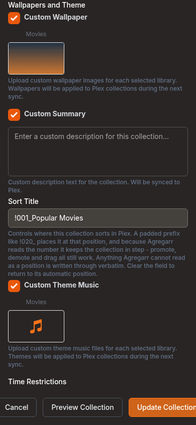
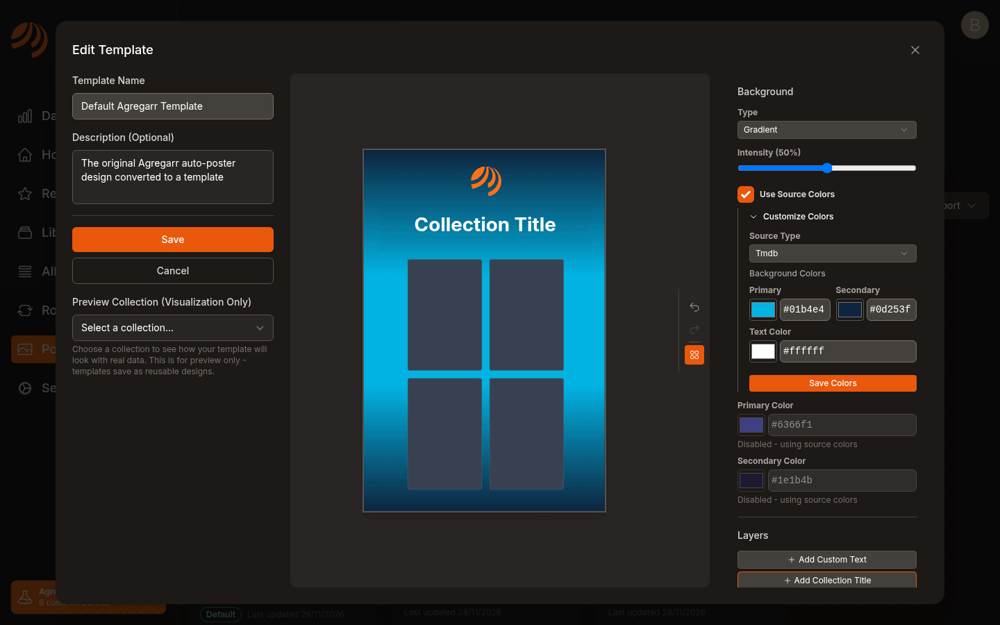
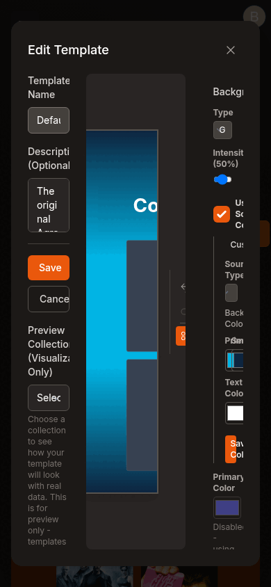

# Posters, wallpapers and theme music

This page covers artwork on the collection itself: a generated poster from a template, your own poster, a wallpaper, a summary and theme music. It also covers the colours generated posters use for each source and where Agregarr keeps the files.

These settings change the collection in Plex, not the posters for the items inside it. Overlays handle item posters. See [Overlays](../Overlays.md).

## Before you start

- You need a collection to edit, or the **Add New Collection** window open with a library chosen. Each library gets its own poster, wallpaper and theme music.
- Every field mentioned here is listed in [Artwork and sort title](form/artwork.md).

## Generate a poster from a template

A generated poster uses a template with a background, the collection's name and, if the template includes one, a grid of posters from the collection's top items. Agregarr builds it during a sync when one is needed, then uploads it to Plex.

1. Open the collection's form and find **Posters**.
2. Tick **Auto-generate Collection posters**. It's already ticked on a new collection.
3. Under **Select Template**, choose a template. A new collection starts on the template marked **Default**.
4. Click **Create Collection** or **Update Collection**, then sync the collection.

=== "Desktop"

    

=== "Phone"

    

**Check:** after the sync, the collection's poster in Plex shows the template's design with the collection's name on it.

Agregarr only rebuilds a poster when something shown on it changes. A collection that hasn't changed keeps the same poster between syncs. If you choose a different poster in Plex, Agregarr puts its own poster back during the next sync.

To create or change a template, see [Poster editor](poster-editor.md). To use a different template as the default for new collections, click **Set Default** on its card under **Posters > Collection Posters**.

## Use your own poster

1. Open the collection's form and find **Posters**.
2. Untick **Auto-generate Collection posters**. A box with a **+** appears for each library you selected.
3. Click the **+** under the library you want. **Select Poster** opens.
4. Choose a poster:
    - Click **Upload New Poster** and pick a JPEG, PNG or WebP file up to 10 MB.
    - Click **Add from URL**, paste the address of a picture, then click **Download Poster**.
    - Click a poster already in the list to reuse it.
5. Save the collection, then sync it.

=== "Desktop"

    

=== "Phone"

    

**Check:** the box for that library shows a small copy of the poster. After the sync, Plex shows it on the collection.

Agregarr crops uploaded posters to fill a 1000 by 1500 pixel poster. A 2:3 picture loses nothing. Other shapes have their edges trimmed.

**Create New Poster** opens the editor, but a design saved there is only kept under **Posters > Collection Posters > Saved Posters**. Agregarr doesn't turn it into an image or put it on the collection.
<!-- OPEN: NEW: Create New Poster saves a design with no rendered image and doesn't select it (see form/artwork.md) -->

??? note "Add from URL limits"

    The address has to be public and start with `http` or `https`. Agregarr doesn't follow redirects, so use a direct link to the image file. The server has to send the file as JPEG, PNG or WebP at 10 MB or smaller. Addresses on your own network are refused. You can download ten pictures a minute.

## Add a wallpaper, summary or theme music

You'll find these under **Wallpapers and Theme** on the collection's form. Each one has its own tick box. All three start unticked.

1. Tick **Custom Wallpaper**, **Custom Summary** or **Custom Theme Music**.
2. For a wallpaper or theme music, click the **+** under each library and choose a file. Wallpapers can be JPEG, PNG or WebP. Theme music can be MP3, WAV, FLAC, OGG, AAC or M4A. Both can be up to 10 MB.
3. For a summary, type the description into the box.
4. Save the collection, then sync it.

=== "Desktop"

    

=== "Phone"

    

**Check:** in Plex, the collection uses the wallpaper as its background art and your text as its description. The theme music is also set on the collection.

Agregarr saves wallpapers as JPEG. Anything larger than 1920 by 1080 pixels is shrunk to fit, while a smaller picture isn't enlarged.

To remove one, untick its box or use the cross on its preview to remove the file, then save and sync. Agregarr removes the wallpaper or theme music from the Plex collection only while Plex still shows the file Agregarr uploaded. If you've since chosen another one in Plex, Agregarr leaves it alone.

Summaries work differently. Unticking **Custom Summary** stops Agregarr from setting the text, but the existing text stays in Plex until you clear it there.

While a wallpaper, summary or theme music is ticked, Agregarr applies it during every sync. If you change it in Plex, the next sync puts Agregarr's version back.

## Change the colours a source uses

Templates can take their colours from the collection's source. A Trakt collection and a TMDB collection using the same template come out in different colours.

Each source has a **Primary**, **Secondary** and **Text Color**, but only **Primary** and **Secondary** reach the finished poster. Poster text always uses the text element's own **Text Color**. Source colours are shared by every template that uses them.

Saving new colours doesn't rebuild a poster by itself. The poster only changes when something else triggers a rebuild, such as saving the template.

1. Go to **Posters > Collection Posters** and click **Edit** on a template.
2. Under **Background**, tick **Use Source Colors**.
3. Click **Customize Colors** and choose the source under **Source Type**.
4. Change **Primary** and **Secondary**. The preview shows that source's colours as you go.
5. Click **Save Colors**. A message under the button reads "Colors Saved!".
6. Click **Save** on the template if you also want every collection that uses it to rebuild on the next sync.

=== "Desktop"

    

=== "Phone"

    

**Check:** a collection from that source gets a poster in the new colours the next time its poster is rebuilt. Saving the template in step 6 triggers that rebuild.

**Source Type** lists each source by its internal name with the first letter capitalised, for example Trakt, Tmdb, Imdb, Mdblist, Radarrtag, Sonarrtag, Comingsoon, Multi-source, Hub, Netflix, Amazon-prime and **Default**, which is used for anything without its own colours.

<!-- OPEN: NEW: Use Source Text Colors and the Text Color saved for a source are stored but never applied when a poster is rendered (posterGeneration.ts:1795 uses the text element's own color) -->

### Move source colours to another server

The **Import** menu on **Posters > Collection Posters** has two source colour entries.

**Export Source Colors** doesn't work at the moment. The downloaded file contains one default colour scheme instead of your colours. Importing it gives "Invalid JSON file format. Please select a valid source colors JSON file." Until that's fixed, set the colours on the other server by hand under **Customize Colors**.

Once export is fixed, export from one server with **Import > Export Source Colors**. On the other server, choose **Import > Import Source Colors** and select the file.

Import replaces the colours for every source included in the file. Sources that aren't in the file are left alone. Both **Import Template** and **Import Source Colors** open the same file picker. Agregarr tells them apart by the file ending: `.zip` for a template and `.json` for source colours.
<!-- OPEN: NEW: Export Source Colors downloads one default colour scheme instead of the export file, because GET /source-colors/:sourceType is registered before GET /source-colors/export (sourceColors.ts:36 and :141) -->

## Where the files live

Agregarr keeps these files in folders inside its config folder, which is the folder you mount at `/app/config`. For example, if your config folder is `/mnt/user/appdata/agregarr`, wallpapers are stored in `/mnt/user/appdata/agregarr/wallpapers`.
<!-- OPEN: M6 -->

- **`posters`**: posters you upload, download or save. JPEG, PNG and WebP, up to 10 MB, saved at 1000 by 1500 pixels. Images more than 5000 pixels wide or tall are refused.
- **`wallpapers`**: collection wallpapers. JPEG, PNG and WebP up to 10 MB, saved as JPEG at up to 1920 by 1080.
- **`themes`**: collection theme music. MP3, WAV, FLAC, OGG, AAC and M4A, up to 10 MB, saved as uploaded.
- **`icons`**: pictures and icons used inside poster templates, uploaded in the poster editor. JPEG, PNG, WebP and SVG up to 10 MB. Pictures are saved as PNG at up to 750 pixels.
- **`fonts`**: fonts you add yourself. Put `.ttf` or `.otf` files in the folder and they appear under **Font Family** in the poster editor alongside the fonts that come with Agregarr.

Agregarr doesn't keep the posters it generates. It builds each poster, uploads it to Plex and throws away the local copy.

Wallpaper and theme files aren't deleted by Agregarr. Removing one from a collection only stops Agregarr applying it, so the file stays in its folder. Once no collection uses it, delete it there yourself if you want the space back.

Posters are different. You can delete them from **Select Poster** or **Saved Posters**.

## What it doesn't do

- It doesn't change the posters of the movies and shows inside a collection. That's overlays.
- Removing your own poster, or unticking **Auto-generate Collection posters**, doesn't restore Plex's earlier poster. Choose another poster in Plex.
- It doesn't check whether a collection still uses a template before you delete the template.

## If it didn't work

- **The poster didn't change in Plex.** Posters only change when a sync rebuilds them. Sync the collection, then check the log for "Poster unchanged, skipping regeneration and reapplication". That line means nothing on the poster has changed since its last build.
- **The poster didn't change after I deleted a template.** The collection still points to the deleted template, so it can't build a new poster and the old one stays. Open the collection's form and choose another under **Select Template**.
- **An upload says "Failed to process and save poster file".** Check that the file is a valid JPEG, PNG or WebP and no more than 5000 pixels wide or tall. Shrink it and try again.
- **Add from URL says it failed.** Check that the address is public, doesn't redirect, serves the file as an image and points to a file no larger than 10 MB. Right-click the picture on its page, copy the image address and use that.
- **A wallpaper or theme music upload is refused.** Check the file type and size against the list above.
- **My font isn't in the list.** Agregarr only picks up `.ttf` and `.otf` files. Reload the poster editor after adding the file.

## Related

- [Artwork and sort title](form/artwork.md): every field, in form order
- [Poster editor](poster-editor.md): templates, saved posters and every element you can add
- [Visibility and time restrictions](form/visibility.md)
- [Overlays](../Overlays.md)
- [Collection Export/Import](move-between-servers.md): move whole collections between servers
