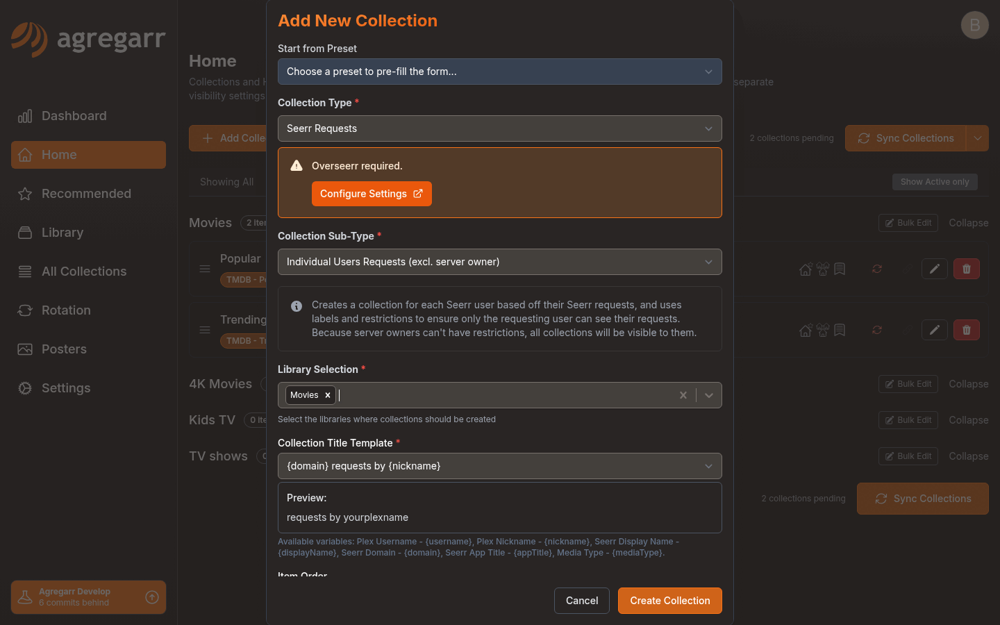
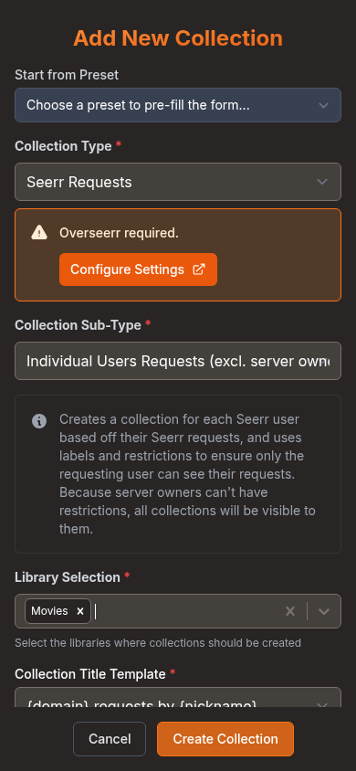

# Show what people request and watch

This page sets up collections from your server's activity: what people requested in Seerr and what they watched most. Agregarr fills each collection from your own library, so it stays current without a list to maintain.

## Before you start

- The setup wizard finished and **Discover Existing Collections & Hubs** run once. See [Your first collection](../get-started/first-collection.md).
- For requests: a Seerr connection added under **Settings > Downloads** using **Add Seerr Connection**.
- For watching: Tautulli set up under **Settings > Sources**. Tracearr works instead if you set it up there and tick **Use Tracearr for statistics**.
- For per-user request collections: a Seerr account linked to each person's Plex account.

## Set it up

1. Click **Add Collection**.
2. Set **Collection Type** to **Seerr Requests** for requests or **Tautulli Statistics** for watching. Once Tracearr is enabled with a hostname and API key, the second option reads **Tracearr Statistics**.
3. Choose a **Collection Sub-Type**.
    - For **Seerr Requests**, pick **All Requests** to put everyone's requests in one row. Pick **Individual Users Requests (excl. server owner)** to give each person their own row.
    - For statistics, pick **Most Popular (by Play Count)** to rank titles by how many different people watched them. Pick **Most Watched (by Play Count)** to rank them by total plays.
4. For statistics, check **Number of Days**. It starts at 30 and accepts 1 to 365. **Library Selection** shows either way, but the rest of the form needs a library and a value here.
5. Under **Library Selection**, choose one library from **Select Libraries**. The rest of the form appears.

    === "Desktop"

        

    === "Phone"

        

6. Check **Visibility** and click **Create Collection**.

**Check:** the collection appears in the list for that library. A statistics collection contains titles people watched in the last **Number of Days**. A requests collection contains requested titles already in the library, with the newest request first.

Click **Sync Collections** for the first fill rather than waiting for the next scheduled sync.

## Check it worked

In Plex, open the library's **Collections** tab. The new collection appears with its **Collection Title Template** name. It also appears on Home and Library Recommended wherever you left **Visibility** ticked.

With **Individual Users Requests (excl. server owner)**, sign in to Plex as one of the people you share with. They see their own collection and nobody else's. You see every collection because Plex can't restrict the server owner.

## Variations

??? note "Show only your own requests"
    Choose **Server Owner requests**. The collection contains requests from the Seerr admin account. **Users Home** is hidden and cleared, so only you see the collection on Home.

??? note "Give each person a row on their Home screen"
    Choose **Individual Users Requests (excl. server owner)**. **Server Owner Home** is hidden and cleared because you'd otherwise see every person's row. **Users Home** stays available. Keep **Library Recommended** unticked unless you want one row per person on the Recommended screen.

??? note "Make a Most Popular row less strict"
    **Minimum Play Count** (3 on a new collection) only appears for **Most Popular** sub-types. It controls how many different people must have watched a title. Lower it if the collection is empty.

??? note "Take turns between several of these"
    Use the same sources inside **Multiple Sources**. See [Rotate several lists through one row](cycle-sources.md). Seerr Requests in **Multiple Sources** merges every requester's titles into one list.

## What it doesn't do

- It only lists titles already in your library. It doesn't create placeholders for missing requests or request anything for you.
- It holds one media type. For movies and TV, make one collection per library.
- Approval and download status don't matter. If a requested title is in Plex, it's included.
- **Preview Collection** isn't offered for per-user collections because one setup makes several.

## If it didn't work

- **The warning under Collection Type sends you to Settings > Sources.** Set up Seerr under **Settings > Downloads** using **Add Seerr Connection**.
- **A person has no collection.** Their Seerr account isn't linked to Plex or they have no requests in this library. See [Activity sources](sources/activity.md#if-it-didnt-work).
- **The statistics collection is empty.** Lower **Minimum Play Count**, raise **Number of Days** or check that you picked the library people watch.
- **The form stops after Library Selection.** **Number of Days** is empty or no library is chosen.
- **Someone sees collections that aren't theirs.** The server owner always sees everything. For everyone else, run **Sync Collections** so Agregarr writes the restrictions to Plex, then check again.
- **Tracearr shows when you expected Tautulli.** **Use Tracearr for statistics** is ticked under **Settings > Sources**.

## Related

- [Activity sources](sources/activity.md)
- [Visibility and time restrictions](form/visibility.md)
- [Rotate several lists through one row](cycle-sources.md)
