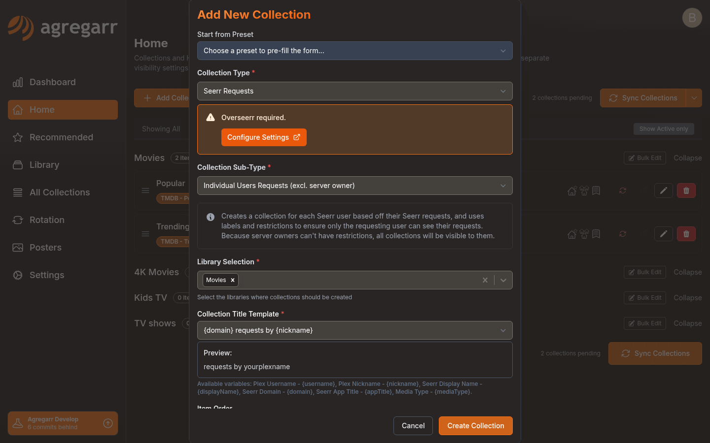
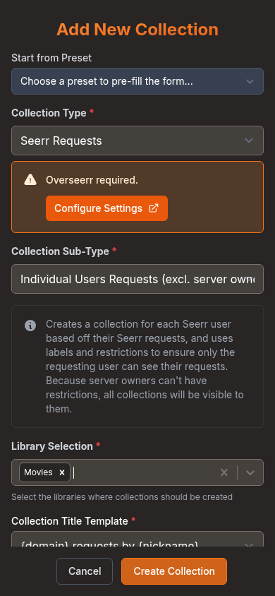
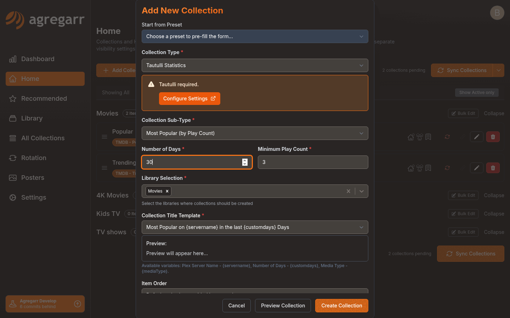
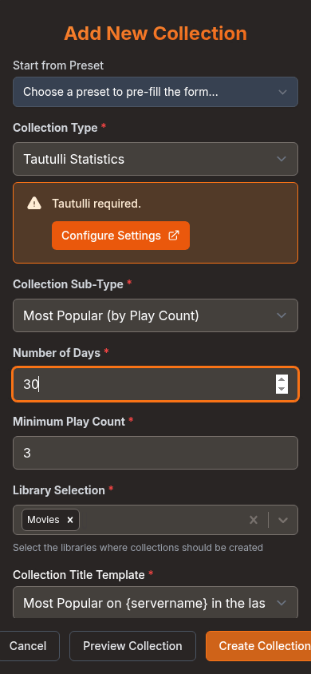

# Activity sources

Activity sources build collections from what people on your server request and watch. The available sources are **Seerr Requests**, **Tautulli Statistics** and **Tracearr Statistics**.

## Seerr Requests

Builds collections from titles your Seerr users requested, newest first, once those titles are in your Plex library.

**Needs:** a Seerr connection with an API key. Add it under **Settings > Downloads** using **Add Seerr Connection**. No solver needed. Individual Users Requests also needs each person's Seerr account linked to their Plex account.

**Works with:** movie and TV libraries. Use one library type per collection.

### Use it

1. Click **Add Collection**.
2. Set **Collection Type** to **Seerr Requests**.
3. Choose a **Collection Sub-Type** (below).
4. Under **Library Selection**, choose your library from **Select Libraries**. The rest of the form appears after that.
5. Set **Visibility**, then save.

**Check:** the new collection appears in **Library**. After the next sync, requests already in Plex appear in it, with the newest request first.

=== "Desktop"

    

=== "Phone"

    

### Options

#### Collection Sub-Type

Required. Pick whose requests to include.

##### Individual Users Requests (excl. server owner)

Default: none. Makes one collection for each Seerr user with requests in your library. Each collection is named from the **Collection Title Template**. Only people whose Seerr account is linked to a Plex account get a collection, and the server owner's requests are left out.

Agregarr limits who can see each personal collection. It labels the collection in Plex, then adds a label exclusion to every other shared user's movie and TV restrictions. Each person sees only their own collection. Plex can't restrict the server owner, so the owner sees every personal collection in the library.

For this sub-type, **Server Owner Home** is hidden and unticked because the owner would see every user's row. **Users Home** and **Library Recommended** remain available. **Preview Collection** isn't offered because one setup creates multiple collections.

##### Server Owner requests

Default: none. Makes one collection from requests submitted by the Seerr admin account, using the **Collection Title Template**.

Only the owner is meant to see it. **Users Home** is hidden and unticked, while **Server Owner Home** and **Library Recommended** remain available. Agregarr also adds a label exclusion to every other shared user's restrictions.

##### All Requests

Default: none. Makes one collection of every request from every user. It's the only Seerr sub-type with the full visibility choice: **Users Home**, **Server Owner Home** and **Library Recommended** are all available. Nothing is hidden from anyone.

#### Collection Title Template

Default: the first preset for the sub-type. The presets for Individual Users Requests and Server Owner requests include the requester's name in the title, for example "Requested by" followed by their username. All Requests includes presets such as "Everyone" titles. Choose **Custom** to write your own.

#### Max Items

Default: 30 on a new collection. For Individual Users Requests, the limit applies separately to each person's collection.

### How it refreshes and limits

- Seerr Requests refreshes with every **Plex Collections Sync** (every 12 hours by default) and when you click **Sync Collections**.
- Agregarr reads up to the 5000 most recent requests from Seerr, sorts them newest first and keeps only titles found in the library you picked. Approval and download status don't matter. If a requested title is in Plex, it's included in the collection.
- Requested titles that aren't in Plex yet are passed on as missing items. **Create placeholders for missing items** isn't offered for Seerr collections.
- **Target User** isn't offered either. Seerr collections manage their own labels.
- Each collection holds one media type. To include movies and TV from the same people, make one collection for each library.

### If it didn't work

- **A user has no collection.** Check that the person has requests for titles already in this library, and that their Seerr account is linked to Plex. People without a Plex link are skipped.
- **Nothing appears at all.** Check the Seerr connection under **Settings > Downloads**, then run a sync. The warning under **Collection Type** reads "Overseerr required." and links to **Settings > Sources**, but Seerr is set up under **Settings > Downloads**.
<!-- OPEN: Q11 warning says Overseerr, not Seerr -->
- **Someone sees collections that aren't theirs.** The server owner always sees everything. Everyone else is limited by label exclusions that Agregarr writes to their Plex sharing restrictions during a sync. Run **Sync Collections**, then check again.

## Tautulli Statistics and Tracearr Statistics

Builds collections from the most popular or most watched titles on your server over a recent number of days. The statistics come from Tautulli or Tracearr.

**Needs:** Tautulli set up under **Settings > Sources** with its hostname and API key, or Tracearr set up there with its hostname and API key and **Use Tracearr for statistics** ticked. No solver needed.

**Works with:** movie and TV libraries.

Both sources use the same collection type. When Tracearr is enabled with a hostname and API key, **Collection Type** reads **Tracearr Statistics**. Every statistics collection then reads from Tracearr, including collections originally made as Tautulli collections. Otherwise, it reads **Tautulli Statistics**.

### Use it

1. Click **Add Collection**.
2. Set **Collection Type** to **Tautulli Statistics** (or **Tracearr Statistics**).
3. Choose a **Collection Sub-Type**.
4. Check **Number of Days**, and **Minimum Play Count** if the form shows it.
5. Under **Library Selection**, choose your library. Library Selection shows as soon as you pick a sub-type. The rest of the form appears once a library is chosen and **Number of Days** has a value. A new collection starts on 30.
    <!-- OPEN: QA saw the title template and Item Order stay visible after Number of Days was cleared; the form code hides them when it is empty -->
6. Save.

**Check:** after the next sync, the collection holds titles from your chosen library that people watched during the last **Number of Days**.

=== "Desktop"

    

=== "Phone"

    

### Options

#### Collection Sub-Type

Required. The words before the brackets pick the list. The brackets pick what gets counted.

##### Most Popular (by Play Count)

Default: none. Ranks titles by the number of different people who watched them during the window. Plays break a tie.

##### Most Popular (by Watch Duration)

Default: none. Uses the same ranking by different viewers, with total watch time breaking a tie.

##### Most Watched (by Play Count)

Default: none. Ranks titles by total plays, regardless of who played them.

##### Most Watched (by Watch Duration)

Default: none. Ranks titles by total watch time.

<!-- OPEN: NEW: Most Popular (by Play Count) and (by Watch Duration) both rank by unique viewers first; only the tiebreak differs, so the labels promise more than the code does -->

#### Number of Days

Default: 30. Required, from 1 to 365. Sets how far back to look. Tracearr reports at most 365 days.

#### Minimum Play Count

Default: 3. From 1 to 100. Only shown for the two **Most Popular** sub-types. A title needs at least this many different viewers to be included. A title played ten times by one person doesn't qualify when this is set to 3. The **Most Watched** sub-types don't have a minimum.

<!-- OPEN: NEW: Minimum Play Count compares against unique viewers, not plays, in both Tautulli and Tracearr -->

### Tracearr settings

Tracearr has its own **Tracearr Settings** box under **Settings > Sources**. It includes **Use Tracearr for statistics**, **Hostname or IP Address**, **Port**, **Use SSL**, **URL Base** and **API Key**. After **Test Connection**, use **Server** to count plays from one server, or leave it on **All servers** to count every server Tracearr tracks. The dashboard reads from Tracearr while it's enabled.

### How it refreshes and limits

- Statistics refresh with every **Plex Collections Sync** (every 12 hours by default) and when you click **Sync Collections**. The window covers the rolling last N days, so the list changes as people watch.
- Titles are matched to Plex by rating key or TMDB id. If Agregarr can't find a title in the library you picked, it skips it.
- Only titles already in your library are listed. Nothing is requested or created for gaps, and **Create placeholders for missing items** isn't offered.
- Each collection holds one media type. Make one collection per library.
- For lists that take turns, use these statistics as sources in [Multiple Sources](multiple-sources.md). **Number of Days** and **Minimum Play Count** are set separately for each source.

### If it didn't work

- **The form stops after Library Selection.** **Number of Days** is empty. Enter a number from 1 to 365.
- **The collection is empty.** Lower **Minimum Play Count**, raise **Number of Days** or check you picked the library people actually watch.
- **Tracearr shows when you expected Tautulli.** **Use Tracearr for statistics** is ticked, with a hostname and API key set. Untick it under **Settings > Sources**.

## Related

- [Multiple Sources](multiple-sources.md)
- [Collections](../index.md)
- [Rotation](../../Rotation.md)
