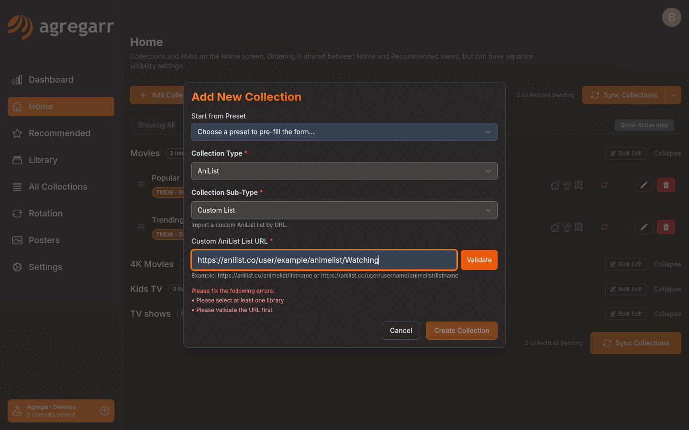
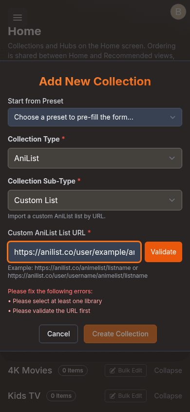

# Anime from AniList and MyAnimeList

These sources build collections from anime charts. AniList can also read members' lists and search pages.

Neither service gives Agregarr Plex-ready IDs. Agregarr downloads a community-maintained mapping file from GitHub that links anime entries to TMDB and TVDB, then refreshes it every 12 hours. If the file can't map an entry, Agregarr can't match it to your library.

Anything on a chart that you don't own counts as a missing item. What happens next depends on the collection's **Grab Missing Items** settings. MyAnimeList requests need a TMDB ID in the mapping file. AniList requests can use either a TMDB or TVDB ID.

## AniList

**What it gives you:** a collection built from an AniList chart, a member's anime list or any AniList search page.

**Needs:** nothing. There's no key to enter or solver to run.

**Works with:** movies and TV. Movie libraries get AniList's movie entries. TV libraries get TV, TV short, ONA, OVA and special entries.

### Use it

1. Click **Add Collection** and set **Collection Type** to **AniList**.
2. Choose a **Collection Sub-Type**.
3. For **Custom List**, paste the address into **Custom AniList List URL** and click **Validate**.
4. Choose your library under **Library Selection**, finish the form and save.

**Check:** for a custom list, **Collection Title Template** offers a name from the AniList page instead of **Validate URL**. Charts don't need this step.

=== "Desktop"

    

=== "Phone"

    

### Trending Anime

Default: none, you choose a sub-type. Anime trending on AniList right now. Adult titles are left out.

### Popular Anime

Default: none. AniList's most popular anime. Adult titles are left out.

### Top Rated Anime

Default: none. AniList's highest rated anime. Adult titles are left out.

### Custom List

Default: none. Builds the collection from an AniList member's list or a search page. You then fill in **Custom AniList List URL**.

### Custom AniList List URL

Default: empty, and required. It accepts two kinds of address.

**A member's list.** Use `https://anilist.co/user/username/animelist/listname`. The last part is the list's name on AniList, such as a custom list you made or a status list like Watching.
<!-- OPEN: NEW: AniList addresses without /user/ (https://anilist.co/animelist/listname, /list/name, /anime/ID) pass the form's check and the form's own example, but the sync returns no items -->

**A search page.** Copy the address from AniList's search page. For example, `https://anilist.co/search/anime/this-season`. These shortcuts work after `/search/anime/`:

- `trending`
- `this-season`
- `next-season`
- `popular`
- `top-100`

Filters set on AniList's search page carry across in the address. Agregarr reads genres, tags, season, season year, year, sort, format, airing status, streaming on, country of origin, source material, year range, episodes and duration. A filter in the address overrides anything implied by the shortcut. If the address has no sort, results come back by trending.

Addresses must start with `https://`. For search pages, Agregarr still chooses movies or shows based on your library unless the address sets a format.

### Validate

Click it after pasting an address. Agregarr reads the page's name and uses it to fill **Collection Title Template**. For a search page, it looks up the page without the filters from the address.
<!-- OPEN: NEW: AniList Validate guesses movies or shows from the page text and reports TV for almost every address, so Library Selection can warn "Detected TV Shows only" for lists the sync reads fine in a movie library -->

**How it refreshes and limits:**

- Charts and search pages are read 50 entries at a time, up to 10,000 entries. Agregarr stops early once enough results match your library to fill **Max Items**.
- A member's list is capped at the first 50 entries that suit your library.
<!-- OPEN: NEW: AniList member lists are cut to 50 entries (slice at perPage) while charts and search pages paginate -->
- The mapping file loads during the first sync after a restart, then refreshes every 12 hours. If AniList can't be reached, the sync shows an error.

**If it didn't work:**

- "Invalid AniList URL format" means the address isn't a member list, a `/list/` address, a search page or an anime page.
- "Could not fetch AniList list title" means AniList didn't answer. Click **Validate** again.
- If Agregarr can't read an address, it creates an empty collection rather than showing an error.
- A list containing only shows stays empty in a movie library. A list containing only movies stays empty in a TV library. Pick the matching library.

## MyAnimeList

**What it gives you:** a collection built from one of MyAnimeList's top anime charts.

**Needs:** a MyAnimeList Client ID. Open **Settings > Sources**, find **MyAnimeList Settings** and paste the ID into **MyAnimeList API Key**. The field says API Key, but it expects your application's Client ID. Click **Test Connection**, then **Save Changes**.

Create an API application on MyAnimeList's API page to get one. The tip under the field lists the settings to use, including **Web** as the app type, `http://localhost/` as the redirect address, and the **Non-Commercial** and **Hobbyist** choices. Copy the **Client ID** from the application.
<!-- OPEN: M7 -->

**Works with:** movies and TV. Movie libraries get MyAnimeList's movie entries. TV libraries get TV, OVA, ONA and special entries. Music entries are dropped.

### Use it

1. Save your Client ID first (above).
2. Click **Add Collection** and set **Collection Type** to **MyAnimeList**.
3. Choose a **Collection Sub-Type**.
4. Choose your library under **Library Selection**, finish the form and save.

**Check:** the sub-type menu shows eight charts, with no orange "MyAnimeList required." warning under **Collection Type**.

### Top Anime Series

Default: none, you choose a sub-type. MyAnimeList's highest rated anime overall. Your chosen library then filters the chart to movies or shows.

### Top Airing Anime

Default: none. The highest rated anime currently airing.

### Top Anime TV Series

Default: none. The highest rated TV series. Choose a TV library.

### Top Anime Movies

Default: none. The highest rated anime movies. Choose a movie library. A TV library gets nothing from this chart.

### Top OVA Series

Default: none. The highest rated original video animation. Choose a TV library.

### Top Anime Specials

Default: none. The highest rated specials. Choose a TV library.

### Most Popular Anime

Default: none. Anime ranked by member count.

### Most Favorited Anime

Default: none. Anime ranked by the number of members who favourited it.

You can also use MyAnimeList as a source in **Multiple Sources**. Only six of the eight charts are offered there. **Most Popular Anime** and **Most Favorited Anime** are missing.
<!-- OPEN: M9 -->

**How it refreshes and limits:**

- Agregarr asks MyAnimeList for 500 entries at a time, up to 20 requests. It stops early once enough results match your library to fill **Max Items**.
- Each sync fetches the chart again and applies your library's movie or show filter afterwards. That can leave the collection with fewer entries than you expect.

**If it didn't work:**

- "MyAnimeList required." under **Collection Type** means no Client ID is saved.
- An error mentioning rate limits means MyAnimeList asked Agregarr to slow down. Run the sync again later.
- An empty collection from **Top Anime Movies** with a TV library, or from **Top Anime TV Series** with a movie library, is expected. Switch libraries.

## Related

- [Lists from IMDb, Letterboxd, Trakt, MDBList and TVDB](lists.md)
- [Cycle Lists](../cycle-sources.md): take turns between many lists in one row.
- [Your first collection](../../get-started/first-collection.md)
