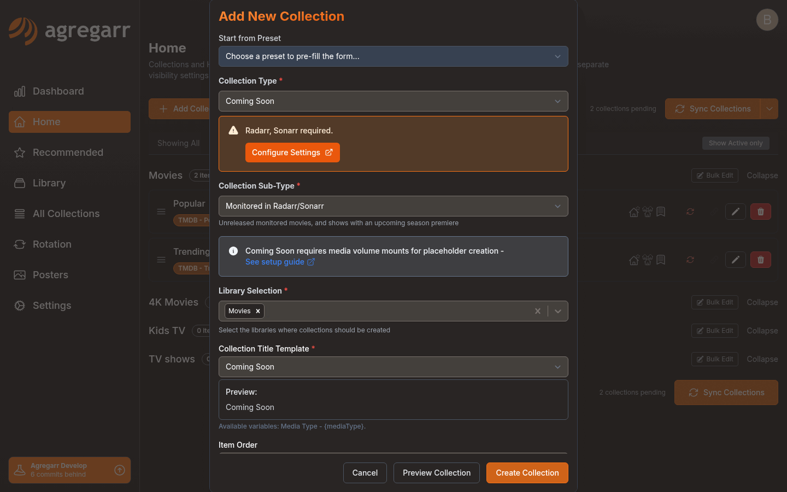
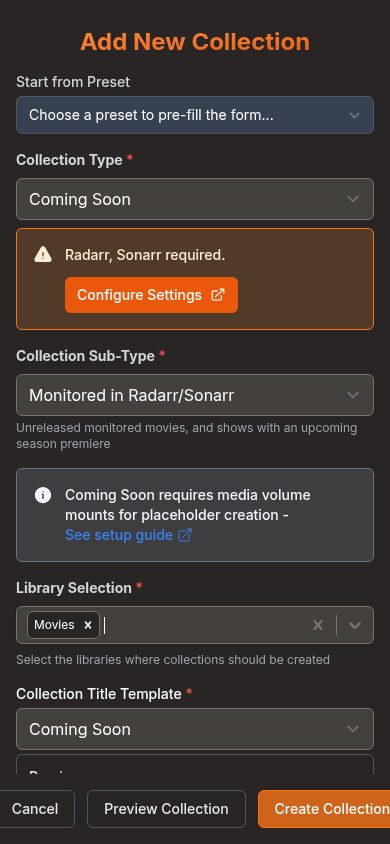

# Coming Soon

A collection of releases that haven't arrived yet. Agregarr creates a placeholder for each one so it can appear in Plex before the file exists.

**Needs:** depends on the sub-type.

- **Monitored in Radarr/Sonarr**: Radarr for movies or Sonarr for TV, set up under **Settings > Downloads**.
- **Trakt Anticipated**: Trakt, set up under **Settings > Sources**.
- **TMDB Coming Soon**: nothing extra. TMDB works without an account or key.
- Placeholders need a placeholder root folder for the library under **Settings > Downloads**. See [Placeholders](../../Placeholders.md).

No solver for any of them.

**Works with:** movie and TV libraries. A collection can only hold one media type, so create one for each library.

## Use it

1. Click **Add Collection**.
2. Set **Collection Type** to **Coming Soon**.
3. Choose a **Collection Sub-Type**.
4. Under **Library Selection**, choose your library from **Select Libraries**. The rest of the form appears once you've picked one.
5. Check **Days Ahead** under **Placeholder Creation**, then save.

**Check:** under **Placeholder Creation**, **Create placeholders for missing items** is already ticked and greyed out. After the next sync, upcoming titles appear in the collection, with placeholders for files that don't exist yet.

=== "Desktop"

    

=== "Phone"

    

Choosing **Coming Soon** as the **Collection Type** ticks **Create placeholders for missing items** and locks it. Agregarr treats Coming Soon collections as placeholder-enabled regardless of what the box says. A notice under **Collection Type** reads "Coming Soon requires media volume mounts for placeholder creation", with a **See setup guide** link.

## Options

### Collection Sub-Type

Required. Sets where the upcoming titles come from.

#### Monitored in Radarr/Sonarr

Default: none. Includes unreleased movies that are monitored in Radarr and have no file, plus TV shows with an upcoming season premiere in Sonarr. Movies must fall inside **Days Ahead**. If a movie only has a cinema date, Agregarr estimates its release as the cinema date plus 90 days until TMDB lists a digital or physical release.

#### Trakt Anticipated

Default: none. Uses Trakt's most anticipated upcoming releases. Agregarr looks up their release dates on TMDB, then keeps only titles inside the window. Items already monitored by Radarr or Sonarr are marked as monitored.

#### TMDB Coming Soon

Default: none. Uses upcoming releases from TMDB. For movies, that means titles with a digital or physical release inside **Days Ahead**, ordered most popular first. For TV, it means new and returning shows.

### Item Order

Default: **Default order (as provided by source)**. **Trakt ranking** only appears for **Trakt Anticipated** and keeps Trakt's own anticipation order. When **Max Items** trims the list, Monitored and TMDB collections keep the soonest releases first.

### Monitored Source Settings

Shown only for **Monitored in Radarr/Sonarr**. These options let you point the collection at one server or one part of a library.

#### Radarr Server (Movies) and Sonarr Server (TV Shows)

Default: **All Servers**. Shown only when you have two or more servers of that kind. With one server, Agregarr selects it for you.

#### Radarr Root Folder (Movies) and Sonarr Root Folder (TV Shows)

Default: **All Root Folders**. With two or more Radarr or Sonarr servers, the root folder and tag options stay hidden while **Radarr Server (Movies)** / **Sonarr Server (TV Shows)** is set to **All Servers**. Pick a server first. The options then appear if that server has root folders or tags.

Shown when the server has root folders. Keeps only items stored under the folder you choose, which is useful when one server feeds several Plex libraries.

#### Filter by Tags

Default: off. Shown when the server has tags. When enabled, **Tag Filter Mode** switches between **Include** (only items with at least one selected tag) and **Exclude** (leave out items with any selected tag). Choose the tags under **Radarr Tags** and **Sonarr Tags**.

### Include mid-season episodes (TV)

Default: off. Shown for **Monitored in Radarr/Sonarr**. Also includes shows whose next episode airs inside the **Days Ahead** window, rather than only season premieres. These shows only appear if they're already in Plex, and Agregarr doesn't create placeholders for them.

### Create placeholders for missing items

Default: ticked and locked for Coming Soon. If the library has no placeholder root folder, a **Placeholder Root Folders Required** warning names the library and points to **Settings > Downloads**.

### Days Ahead

Default: 90. Whole days, 1 or more. Sets how far into the future a release can be and still count. If you leave the box empty, Agregarr saves 90. Every sub-type uses it for fetching titles and creating placeholders.

<!-- OPEN: NEW: Days Ahead has no upper limit in the form; the 1 to 730 validation is attached to the old comingSoonDays field the form no longer writes -->

### Skip items with an estimated release date

Default: off. Leaves out movies that only have a cinema date so far. For those movies, Agregarr estimates the date as the cinema release plus 90 days until TMDB lists a digital or physical release.

### Released Items

Controls how long an already-released item remains eligible for a placeholder.

#### Include all released items

Default for new collections. For Coming Soon, this doesn't widen the list. Coming Soon sources still drop items released more than 14 days ago, or the number set under **Only include items released within**, when fetching titles.

#### Only include items released within

Default: 14 days when selected with the number left empty. Items released longer ago than that number of days are left out.

## How it refreshes and limits

- It refreshes during every **Plex Collections Sync** (every 12 hours by default) and when you click **Sync Collections**.
- **Max Items** counts titles already in Plex and placeholders together. Trakt Anticipated and TMDB Coming Soon fetch 50 titles when **Max Items** is unset.
- Release dates come from Radarr or Sonarr where available, with TMDB filling the gaps. Movies that still have no date are dropped.
- Items already in Plex appear as normal collection members. Only missing items get placeholders.
- This page doesn't cover when placeholders are removed or replaced. See [Placeholders](../../Placeholders.md).
- In [Multiple Sources](multiple-sources.md), a Coming Soon source uses the collection's own **Days Ahead**. That option only appears after you tick **Create placeholders for missing items** under **Placeholder Creation**. If left unticked, Coming Soon sources look 90 days ahead. **Skip items with an estimated release date** also appears once placeholders are ticked, and in Multiple Sources it only affects Coming Soon sources. **Monitored Source Settings** and **Include mid-season episodes (TV)** aren't available there.

## If it didn't work

- **The collection is empty.** Check the service required by the sub-type: Radarr or Sonarr for Monitored, or Trakt for Trakt Anticipated. The warning under **Collection Type** names what's missing and links to the right page. Also check that **Days Ahead** reaches the titles you're expecting.
- **Titles show but have no placeholder.** Check the library has a placeholder root folder under **Settings > Downloads**, and that Agregarr can see the same media volumes you mounted for it.
- **A movie you expected is missing.** It may have no release date yet, or only an estimated one while **Skip items with an estimated release date** is on.
- **A show is missing.** For Monitored, only upcoming season premieres count unless **Include mid-season episodes (TV)** is on. With that option enabled, the show must already be in Plex.

## Related

- [Placeholders](../../Placeholders.md)
- [Multiple Sources](multiple-sources.md)
- [Collections](../index.md)
