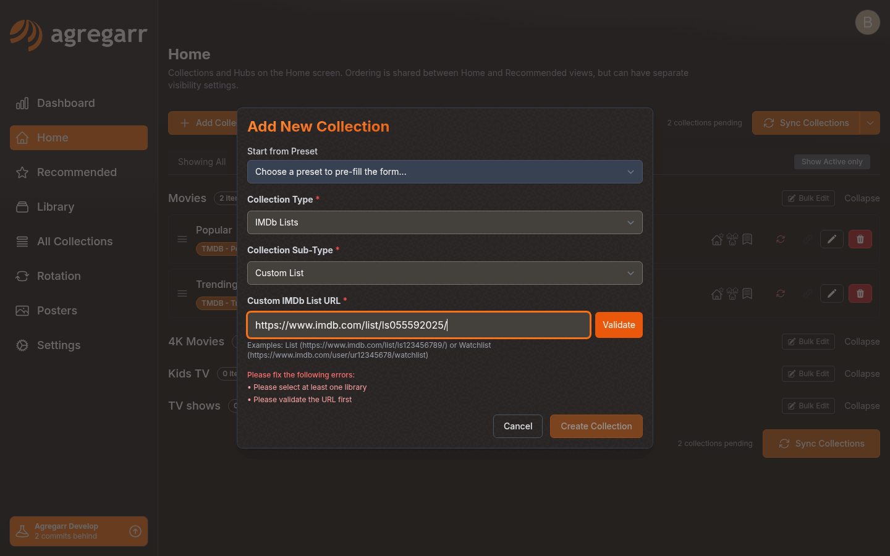
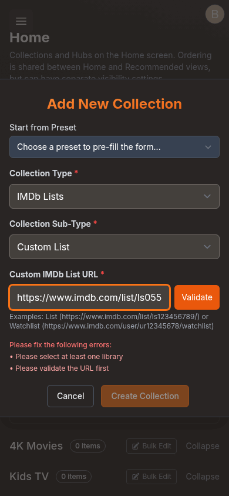

# Lists from IMDb, Letterboxd, Trakt, MDBList and TVDB

These sources build a collection from a chart or a list maintained by someone else. Agregarr reads the list on every sync, then matches each entry against your Plex library.

Anything on the list that isn't in your library counts as a missing item. The collection's **Grab Missing Items** settings decide what happens to it.

## How these sources work

Every source on this page uses the same basic setup.

- **Your library decides movies or shows.** Choose a movie library to get the list's movies, or a TV library to get its shows. Charts such as **Top 250** switch to the TV version when you choose a TV library.
- **Custom lists need a Validate click.** Paste the address, then click **Validate**. Until you do, **Collection Title Template** only offers **Validate URL** and **Custom**, and saving stops with "Please validate the URL first".
- **Validate names the collection and checks the contents.** The list's own name appears under **Collection Title Template**. A line under **Library Selection** tells you whether the list contains movies, shows or both. For a list containing one kind, it reads, for example, "Detected Movies only. TV Shows collections will be empty until matching content is added."
- **Sources that need a key warn you.** When a key is missing, an orange warning with a **Configure Settings** button appears under **Collection Type**.
- **Syncs.** Collections sync through the **Plex Collections Sync** job, which runs every 12 hours by default, or on their own schedule under **Time Restrictions**. **Max Items** supports up to 9999.

=== "Desktop"

    

=== "Phone"

    

## IMDb Lists

**What it gives you:** a collection built from an IMDb chart, public IMDb list or public IMDb watchlist.

**Needs:** nothing. There's no key to enter or solver to run. For custom lists, Agregarr uses its built-in browser to clear IMDb's bot check, so the first request can take 10 to 20 seconds.

**Works with:** movies and TV. **Top 250** and **Popular (Meter)** follow the selected library. **Top 250 English**, **Bottom 100** and **Box Office** only work with movies.

### Use it

1. Click **Add Collection**, then set **Collection Type** to **IMDb Lists**.
2. Choose a **Collection Sub-Type**.
3. For **Custom List**, paste the address into **Custom IMDb List URL**, then click **Validate**.
4. Choose your library under **Library Selection**, finish the rest of the form and save.

**Check:** for a custom list, **Collection Title Template** offers the list's name instead of **Validate URL**.

### Top 250

Default: none, you choose a sub-type. IMDb's highest rated titles. A movie library gets the Top 250 movies chart, while a TV library gets the Top 250 TV chart.

### Top 250 English

Default: none. IMDb's highest rated English-language movies. Movies only, so choose a movie library.

### Bottom 100

Default: none. IMDb's 100 lowest rated movies. Movies only, so choose a movie library.

### Popular (Meter)

Default: none. IMDb's popularity ranking based on page views. A movie library gets the movie meter, while a TV library gets the TV meter. It returns up to 250 titles.

### Box Office

Default: none. IMDb's weekend box office chart, containing ten movies. Movies only, so choose a movie library.

### Custom List

Default: none. Builds the collection from any IMDb list or watchlist that you can open without signing in. You then fill in **Custom IMDb List URL**.

### Custom IMDb List URL

Default: empty, and required. Paste an address such as `https://www.imdb.com/list/ls123456789/` for a list or `https://www.imdb.com/user/ur12345678/watchlist` for a watchlist. Addresses must start with `https://`.

### Validate

Click it after pasting an address. Agregarr fetches the list's name and checks whether it contains movies, shows or both.

### Random Lists

Default: none. Chooses a different list from a pool on every sync. See [Random list pools](#random-list-pools).

**How it refreshes and limits:**

- Charts come from IMDb's public chart data. If IMDb returns fewer entries than the chart should contain, the sync stops with an error instead of using the shorter list. **Box Office** is the exception because its list is always short.
- Custom lists are read one page at a time, up to 9,999 titles.

**If it didn't work:**

- "Invalid IMDb URL format" means the address doesn't point to a list (`/list/ls…`) or watchlist (`/user/ur…/watchlist`).
- "Could not fetch IMDb list title. Please verify the URL is correct and the list is publicly accessible." means IMDb didn't return the page. Check that you can open the address in a private browser window without signing in.
- "Request timed out while fetching IMDb list" usually means IMDb was slow. Try **Validate** again.

## Letterboxd Lists

**What it gives you:** a collection built from a public Letterboxd list or a member's watchlist.

**Needs:** nothing in most setups. If Cloudflare blocks Letterboxd requests from your server, which is common with VPS and VPN addresses, turn on **Use Cloudflare Solver for Letterboxd**. See [The Cloudflare solver option](#the-cloudflare-solver-option).

**Works with:** movies only. Letterboxd lists contain films, so choose a movie library.

### Use it

1. Click **Add Collection**, then set **Collection Type** to **Letterboxd Lists**.
2. Set **Collection Sub-Type** to **Custom List** or **Watchlist**.
3. Paste the address into **Custom Letterboxd List URL** or **Letterboxd Watchlist URL**, then click **Validate**.
4. Choose a movie library under **Library Selection**, finish the rest of the form and save.

**Check:** for a custom list, **Collection Title Template** offers the list's name. For a watchlist, it offers **Letterboxd Collection** and **Custom**.
<!-- OPEN: the title lookup builds "Username's Watchlist" for watchlist addresses, but the form only uses the fetched title for Custom List, so the watchlist template never offers it -->

### Custom List

Default: none. Any public Letterboxd list. You then fill in **Custom Letterboxd List URL**.

### Custom Letterboxd List URL

Default: empty, and required. Paste an address such as `https://letterboxd.com/username/list/listname/`. Film pages such as `https://letterboxd.com/username/films/rated/4.5-5/` are accepted too. Addresses must start with `https://`.

### Validate

Click it after pasting an address. Agregarr reads the list's name and always reports its contents as movies.

### Watchlist

Default: none. Imports a member's watchlist by address. You then fill in **Letterboxd Watchlist URL**.

### Letterboxd Watchlist URL

Default: empty, and required. Paste an address such as `https://letterboxd.com/username/watchlist/`. The form's help line reads "Enter the full URL to your Letterboxd watchlist." Click **Validate** here as well.

### Random Lists

Default: none. Movie libraries only. See [Random list pools](#random-list-pools).

### The Cloudflare solver option

**Use Cloudflare Solver for Letterboxd** is under **Fetching Settings** in **Settings > Sources**. It's off by default, so Agregarr fetches Letterboxd over plain HTTP, which is the fastest route.

Only turn it on if Letterboxd is blocking requests from your server. Page fetches will then use the solvers under **Cloudflare Solvers**, in the order shown. If you haven't configured a solver, Agregarr falls back to its built-in browser. This setting also applies to **Validate** and the pool of lists that Random Lists finds for itself.

After a block, the **Letterboxd Cloudflare** health check shows a warning for 8 hours and tells you to turn the setting on. To add a solver, see [Integrations](../../Integrations.md#cloudflare-solver) and [Health Checks](../../Health-Checks.md).

**How it refreshes and limits:**

- Each sync reads up to 15 pages from the list. Over plain HTTP, Agregarr retries a block or 503 twice before stopping the sync.
- Letterboxd provides titles and years rather than IDs. Agregarr searches TMDB for a matching title and remembers the result, so later syncs don't need to repeat the search. When a match looks doubtful, it checks the film's own Letterboxd page. See [Performance](../../Performance.md#letterboxd-matches) for how long these matches are kept.

**If it didn't work:**

- "Invalid Letterboxd URL format" means the address doesn't point to a list, watchlist or films page.
- A fetch error or empty collection alongside the health check warning means Cloudflare is blocking the request. Turn on **Use Cloudflare Solver for Letterboxd**.
- Private watchlists can't be read. Check that you can open the address while signed out.

## Trakt Lists

**What it gives you:** a collection built from a Trakt chart, your recommendations or watchlist, or any public Trakt list.

**Needs:** a Trakt Client ID. **Recommendations** and **Watchlist** also need Agregarr connected to your Trakt account through OAuth. See [Connect Trakt](#connect-trakt).

**Works with:** movies and TV. **Box Office** is movies only.

### Use it

1. Connect Trakt first using the steps below.
2. Click **Add Collection**, then set **Collection Type** to **Trakt Lists**. An info banner notes that Trakt limits free accounts to one connected app.
3. Choose a **Collection Sub-Type**. For **Most Played**, **Most Watched**, **Most Collected** or **Most Favorited**, choose a **Time Period** as well.
4. For **Custom List**, paste the address into **Custom Trakt List URL**, then click **Validate**. Choose your library under **Library Selection**, finish the rest of the form and save.

**Check:** if a key or connection is missing, the orange warning under **Collection Type** names it. For example, "Trakt (OAuth required for Watchlist) required."

### Connect Trakt

1. Open **Settings > Sources** and find **Trakt Settings**. Create an application at Trakt using `urn:ietf:wg:oauth:2.0:oob` as the redirect URI. Paste its Client ID into **Trakt Client ID**, then save.
2. For **Recommendations** and **Watchlist**, scroll to **Advanced OAuth Setup (Optional)**. Paste the application's secret into **Trakt Client Secret**, then click **Connect with Trakt**.
3. Approve access in the Trakt window. Copy the code Trakt provides, paste it into the **Enter Trakt Code** window and click **Exchange Code**.

**Check:** the section shows a **Connected** badge with **Reconnect** and **Disconnect** buttons. Agregarr saves and refreshes the tokens itself.

### Trending Now

Default: none. Movies or shows currently being watched on Trakt.

### Popular

Default: none. Trakt's most popular titles, based on ratings and votes.

### Recommendations

Default: none. Personalised Trakt recommendations for the connected account. This needs OAuth. Agregarr fetches 100 recommendations, either movies or shows depending on the selected library.

### Watchlist

Default: none. The connected account's watchlist, either movies or shows depending on the selected library. This needs OAuth.

### Most Played

Default: none. The most played titles. Choose a **Time Period**.

### Most Watched

Default: none. Titles watched by the most unique users. Choose a **Time Period**.

### Most Collected

Default: none. Titles collected by the most unique users. Choose a **Time Period**.

### Most Favorited

Default: none. The most favourited titles. Choose a **Time Period**.

### Time Period

Default: none, and required for the four "Most" sub-types above. Choose **Daily**, **Weekly**, **Monthly** or **All Time**. This field only appears for those sub-types.

### Box Office

Default: none. Trakt's top 10 grossing movies from the previous weekend. Movies only, so choose a movie library. A TV library gets nothing from it.

### Custom List

Default: none. Any Trakt list. You then fill in **Custom Trakt List URL**.

### Custom Trakt List URL

Default: empty, and required. Paste an address such as `https://trakt.tv/users/username/lists/listname`. The `app.trakt.tv` form also works, as do Trakt's own lists, such as `https://trakt.tv/lists/official/listname`. Addresses must start with `https://`.

### Validate

Click it after pasting an address. Agregarr fetches the list's name and checks the first 100 entries to work out whether it contains movies, shows or a mix.

### Random Lists

Default: none. See [Random list pools](#random-list-pools).

**How it refreshes and limits:**

- Charts and lists are fetched again on every sync.
- In a custom list, an episode or season counts as its show. Entries of the other kind are dropped for the selected library.
- Custom list entries without a TMDB ID on Trakt are dropped.

**If it didn't work:**

- "Trakt is not configured" means **Trakt Client ID** hasn't been set.
- "Invalid Trakt list URL or list not accessible" means the address isn't a user or official list, or Trakt didn't return it.
- "Trakt access token is required" means **Recommendations** or **Watchlist** is selected but Agregarr isn't connected. Click **Connect with Trakt**.

## MDBList Lists

**What it gives you:** a collection built from any list on MDBList.

**Needs:** an MDBList API key. Open **Settings > Sources**, find **MDBList Settings** and paste the key into **MDBList API Key**. The field's tip links to your MDBList preferences page. Click **Test Connection**, then **Save Changes**.

**Works with:** movies and TV. A movie library gets the list's movies, while a TV library gets its shows.

### Use it

1. Click **Add Collection**, then set **Collection Type** to **MDBList Lists**.
2. Set **Collection Sub-Type** to **Custom List**.
3. Paste the address into **Custom MDBList List URL**, then click **Validate**.
4. Choose your library under **Library Selection**, finish the rest of the form and save.

**Check:** **Collection Title Template** offers the list's name.

### Custom List

Default: none, and it's the only sub-type. You then fill in **Custom MDBList List URL**.

### Custom MDBList List URL

Default: empty, and required. Paste an address such as `https://mdblist.com/lists/username/list-name`. Addresses must start with `https://`.
<!-- OPEN: NEW: MDBList Validate rejects numeric list addresses (/lists/123456) that the sync accepts -->

### Validate

Click it after pasting an address. Agregarr reads the list's name and checks whether it contains movies, shows or both. It first treats the address as another member's public list, then falls back to your own lists.

**How it refreshes and limits:**

- The sync asks MDBList for up to 9,999 entries in one request. Any query string on the address is dropped.
- The same key is also used by the Networks Originals source.

**If it didn't work:**

- "MDBList required." under **Collection Type**, or "MDBList API key not configured" from **Validate**, means no key has been saved.
- "Invalid MDBList list URL format" means the address doesn't match `mdblist.com/lists/username/list-name`.
- "Invalid MDBList list URL or list not accessible" means MDBList didn't return the list. Check the list name and API key.

## TVDB Lists

**What it gives you:** a collection built from a list on TheTVDB.

**Needs:** nothing. Agregarr uses a built-in TVDB key, so there's nothing to configure.

**Works with:** movies and TV. A movie library gets the list's movies, while a TV library gets its series. Lists containing both need one collection for each library.

### Use it

1. Click **Add Collection**, then set **Collection Type** to **TVDB Lists**.
2. Set **Collection Sub-Type** to **Custom List**.
3. Paste the address into **Custom TVDB List URL**, then click **Validate**.
4. Choose your library under **Library Selection**, finish the rest of the form and save.

**Check:** **Collection Title Template** offers the list's name.

### Custom List

Default: none, and it's the only sub-type. You then fill in **Custom TVDB List URL**.

### Custom TVDB List URL

Default: empty, and required. TVDB's official lists use a name, such as `https://thetvdb.com/lists/matrix`. Member lists use a number, such as `https://thetvdb.com/lists/7149`. Addresses must start with `https://`.

### Validate

Click it after pasting an address. Agregarr fetches the list's name and checks whether it contains movies, shows or both.

**How it refreshes and limits:**

- Items keep their order from the TVDB list.
- TVDB Lists can also be used as a source under **Multiple Sources**.
- Entries removed from TVDB are skipped. Entries without a TMDB match on TVDB are skipped as well.
- If TVDB can't look up any entry, the sync stops with an error and leaves the existing collection as it was.

**If it didn't work:**

- "Invalid TVDB list URL format" means the address isn't `thetvdb.com/lists/` followed by a name or number.
- "Failed to fetch data from TVDB API" appears in the sync result when TVDB couldn't be reached or one of the lookups failed. Run the sync again.

## Random list pools

Trakt, IMDb and Letterboxd each have a **Random Lists** sub-type. TMDB has one as well, covered under [TMDB Lists](tmdb.md#random-lists). On every sync, the collection chooses a different list from a pool. It can also rename itself after the chosen list.

**How a list is chosen:**

- If you've configured your own pool, Agregarr uses that. Otherwise, it looks for lists itself. If that fails, built-in lists are used for IMDb, Letterboxd and TMDB, in movie libraries only.
- For Trakt, IMDb and Letterboxd, a list needs at least 4 titles that exist in your library before it can be picked.
- A collection won't pick the list used by its previous sync unless that's the only list left.
- Separate random-list collections avoid choosing the same list during one sync while unused lists remain.
- **Random Lists** for Letterboxd and TMDB only work with movie libraries. Trakt and IMDb work with either.

**Your own pool.** The `random-lists` folder inside the Agregarr config folder contains `trakt.txt`, `tmdb.txt`, `imdb.txt` and `letterboxd.txt`. These files are created on first start. In a standard Docker setup, the folder is `/app/config/random-lists/`.

1. Open the file for the source.
2. Change `enabled=false` to `enabled=true`.
3. Add one address per line. The file starts with example addresses, and they'll count once the file is enabled, so delete any you don't want.
4. To exclude a list from rotation, add a line such as `exclude=https://www.imdb.com/list/ls123456789/`.

**Check:** after a minute or so, the next sync picks from your list. Agregarr rereads the file at most once per minute, so there's no need to restart it. Exclusions still work when `enabled` is `false`, and also apply to lists Agregarr finds itself.

**Finding lists itself.** When no pool is enabled, Agregarr looks for popular and curated lists on the service and keeps the results for 30 days. If the search fails, it tries again after 4 hours.

**Naming the collection.** Set **Collection Title Template** to **Dynamic Title from Random List** to rename the collection after the chosen list on every sync. A text box with the hint "Title prefix" appears, where you can add text before the list name. Agregarr inserts the space between the prefix and title, so don't leave a space at the end of the prefix. The box is cleared if you choose another template.

## Related

- [Cycle Lists](../cycle-sources.md): take turns between many lists in one row.
- [AniList and MyAnimeList](anime.md): anime charts and lists.
- [TMDB Lists](tmdb.md): TMDB charts, collections and filters.
- [Integrations](../../Integrations.md): Cloudflare solver setup.
- [Your first collection](../../get-started/first-collection.md)
