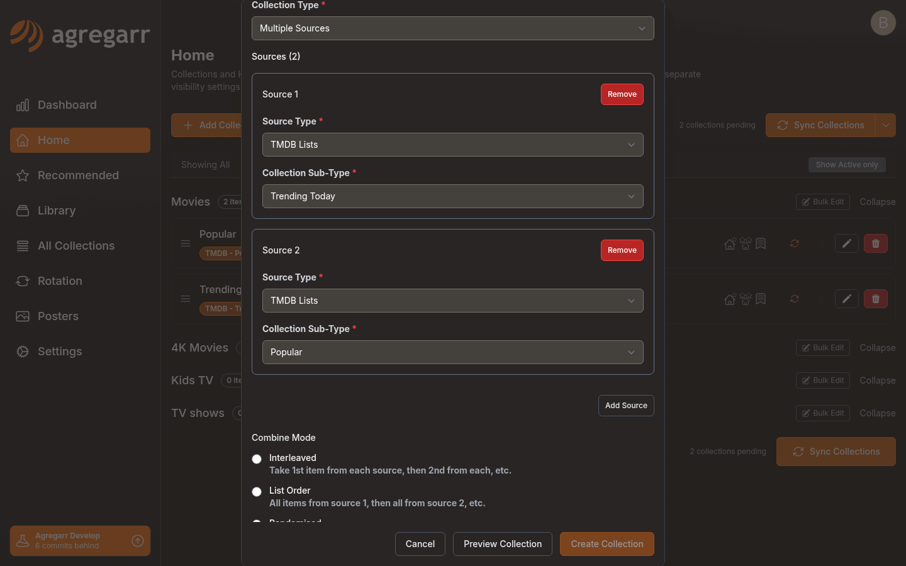
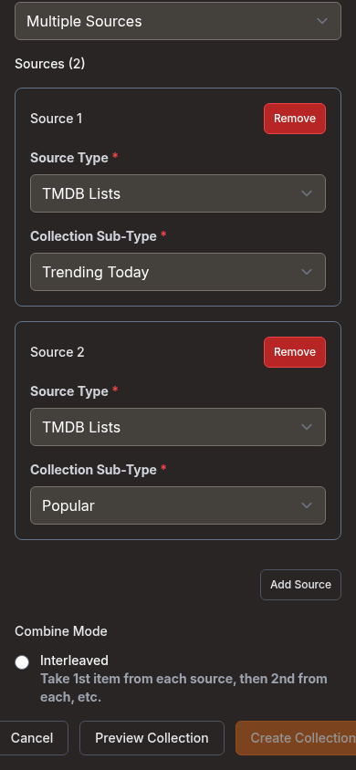
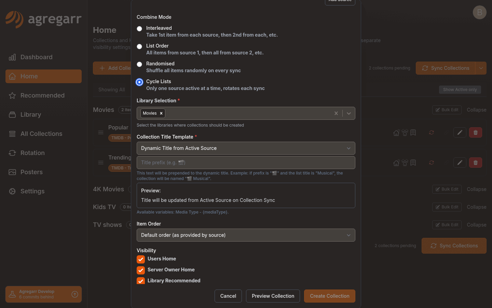
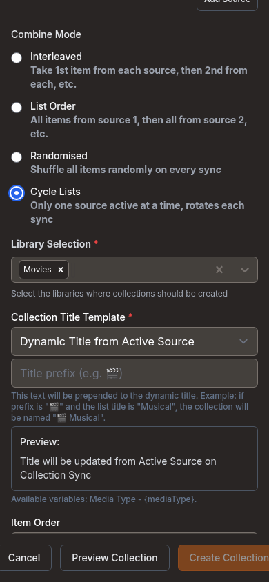

# Multiple Sources

Combines several lists into one collection. You can show them all together or cycle through one list at a time.

**Needs:** whatever each source needs. If a service isn't set up, its source shows the same warning as the standalone type.

**Works with:** movie and TV libraries. You can mix source types freely. **Library Selection** appears after you've added at least two sources.

## Use it

1. Open the collections page and click **Add Collection**.
2. Set **Collection Type** to **Multiple Sources**.
3. Under **Sources**, click **Add Source** and fill in each source. Add as many as you need. Once you've added at least two, **Library Selection** appears below them. Choose a library and the rest of the form appears.
4. Under **Combine Mode**, choose how Agregarr merges the lists (see below).
5. If you chose **Cycle Lists**, set **Collection Title Template** to **Dynamic Title from Active Source** to name the collection after the list currently showing. Choosing **Cycle Lists** leaves the template on **Custom**, so pick the dynamic option yourself.
6. Change **Max Items** and **Item Order** if needed, then save.

**Check:** after the next sync, the collection contains items from your sources, combined according to **Combine Mode**.

=== "Desktop"

    

=== "Phone"

    

## Options

### Sources

The heading includes the number of sources, for example "Sources (2)". Each source has a card headed "Source 1", or "1. My Favourite Films" after a custom list has been validated.

#### Add Source

Adds an empty source at the end. Sources can't be reordered, so add them in the order you want to use them.

#### Remove

Removes a source. This appears once there's more than one source. Every source after it moves up one place.

#### Source Type

Required. Sets the kind of source. Some labels differ slightly from the standalone **Collection Type** list:

- **Seerr Requests**
- **Tautulli Statistics** (**Tracearr Statistics** when Tracearr is set up)
- **Trakt Lists**
- **Letterboxd Lists**
- **TMDB Lists**
- **IMDb Lists**
- **MDBList Lists**
- **TVDB Lists**
- **Networks**
- **Streaming Originals**
- **Radarr Tags**
- **Sonarr Tags**
- **AniList**
- **MyAnimeList**
- **Coming Soon**

**Plex Library** and **Filtered Plex Hub** aren't available as sources. Neither is **Multiple Sources** itself. Sources are lists and the types above, not existing Plex collections.

#### Collection Sub-Type

Required for source types with sub-types. For your own lists, choose **Custom List** (**Custom Collection** for TMDB), then paste the address into **Custom URL**. To build a source with TMDB filters, choose **TMDB Lists** and **Custom Advanced Filters** (see [TMDB Custom Advanced Filters](tmdb-filters.md)).

#### Custom URL

Shown for **Custom List**. Paste the list address here.

#### Validate URL

Checks the address. **Valid** shows the list name and what it contains (movies, shows or episodes). **Invalid** means Agregarr couldn't read it. Once validated, the source heading shows the list name.

### Per-source options

These only appear for source types that use them. Other collection settings, including **Max Items**, **Item Order**, visibility and placeholders, apply to the whole collection.

#### Time Period

Shown for Trakt **Most Played**, **Most Watched**, **Most Collected** and **Most Favorited**. Choose **Daily**, **Weekly**, **Monthly** or **All Time**.

#### Number of Days

Default: 30 when left empty. Accepts 1 to 365. Shown for **Tautulli Statistics** and **Tracearr Statistics** sources. See [Activity sources](activity.md).

#### Minimum Play Count

Default: 3 when left empty. Accepts 1 to 100. Shown only for the two **Most Popular** sub-types.

#### Country/Region and Streaming Platform

Shown for **Networks**. **Country/Region** starts with **Global**, followed by the available countries. Choose a country, then select a **Streaming Platform**.

#### Radarr Instance, Radarr Tag, Sonarr Instance and Sonarr Tag

Shown for **Radarr Tags** and **Sonarr Tags**. Choose the instance first, then select one of its tags. Changing the instance clears the selected tag.

#### Advanced Filters

Shown for **TMDB Lists** with **Custom Advanced Filters**. This is the same filter builder used by the standalone type. See [TMDB Custom Advanced Filters](tmdb-filters.md).

### How a source differs from the standalone type

- **Seerr Requests** creates one list of matching requests. It doesn't create a separate collection for each user or apply the per-user visibility restrictions used by standalone **Individual Users Requests**.
<!-- OPEN: NEW: Seerr Requests with Individual Users in Multiple Sources merges every requester into one list and applies no per-user restrictions -->
- **Coming Soon** doesn't have **Monitored Source Settings** or **Include mid-season episodes (TV)**. It uses the collection's **Days Ahead**, which only appears after you tick **Create placeholders for missing items** under **Placeholder Creation**. If you leave it unticked, Coming Soon sources look 90 days ahead. **Skip items with an estimated release date** also appears under **Placeholder Creation** once placeholders are ticked. In Multiple Sources, it only affects Coming Soon sources. See [Coming Soon](coming-soon.md).
- **TMDB Lists** doesn't have **Auto Franchise Collections**, and its custom option is named **Custom Collection**.
- **MyAnimeList** doesn't include **Most Popular Anime** or **Most Favorited Anime**.
<!-- OPEN: M9 -->
- **Number of Days** isn't marked required because leaving it empty uses 30.
- Every source uses the collection's **Max Items**, which defaults to 30 on a new collection.

### Combine Mode

Default: **List Order**. Sets how Agregarr combines the sources. The modes are shown as radio buttons.

=== "Desktop"

    

=== "Phone"

    

#### Interleaved

Takes the 1st item from each source, then the 2nd item from each, and continues in that order.

#### List Order

Takes every item from source 1, followed by every item from source 2, and so on.

#### Randomised

Shuffles all items on every sync.

#### Cycle Lists

Keeps one source active at a time, then moves to the next source on each sync. See [How Cycle Lists works](#how-cycle-lists-works).

#### Release Date

Shown instead of **Interleaved** and **List Order** when every source is **Coming Soon**. It sorts all items by release date, with the closest first. With **Cycle Lists**, each Coming Soon source is sorted by release date. If only some sources are Coming Soon, those sources are sorted by release date before Agregarr combines them.

The first three modes merge every source into one large collection. **Cycle Lists** is the only mode that shows one list at a time. Every mode removes duplicates.

### Collection Title Template

Default: **Custom**, for every mode including **Cycle Lists**. Switching to **Cycle Lists** doesn't change it. When every source is **Coming Soon** and **Combine Mode** isn't **Cycle Lists**, **Coming Soon** is also available. See [Dynamic Title from Active Source](#dynamic-title-from-active-source).

### Item Order

Default: **Default order (as provided by source)**. Item Order applies to each source list before **Max Items** cuts it. Unless the setting is **Default order (as provided by source)** or **Reverse order**, Agregarr orders the combined list again and cuts it to **Max Items**. **Reverse order** only affects each individual source list.

## How Cycle Lists works

Cycle Lists lets several lists share one row on your Plex Home. You create one collection with multiple sources, then each sync swaps in the next source. The collection can also take the active list's name.

For example, forty Letterboxd and Trakt lists can share one row, with a different list shown on each sync. On a weekly schedule, the row changes once a week.

Agregarr only fetches the list currently showing. The other lists wait for their turn and don't exist as collections in your library in the meantime.

### Rotation or Cycle Lists?

Rotation handles a similar job for collections that already exist. The right choice depends on what you're starting with:

- **Cycle Lists**: you have lots of lists (Trakt, Letterboxd, IMDb) and want them to take turns in one row. Only the list currently showing exists as a collection.
- **Rotation**: you already have collections in Plex, created by Agregarr, by hand or by another tool, and want a few of them on Home at a time. Every collection stays in your library. Rotation changes whether each collection appears on Home and Library Recommended, and where it appears. See [Rotation](../../Rotation.md).

### Dynamic Title from Active Source

With **Cycle Lists** selected, **Collection Title Template** offers **Dynamic Title from Active Source** and **Custom**. **Custom** keeps a fixed collection name. With **Dynamic Title from Active Source**, the preview reads "Title will be updated from Active Source on Collection Sync". Each sync renames the same Plex collection to match the list currently showing.

#### Title prefix

A text box appears below the menu. Anything entered here goes before the list title, with a space between them. A prefix of "Weekly:" and a list named "Musical" produces "Weekly: Musical". Don't add a space to the end of the prefix. Switching to another template clears it.

The source decides the title:

- **Custom List** sources use the list title from the source website. This works with Trakt, TMDB (collection or list addresses), IMDb, Letterboxd, AniList, TVDB and MDBList lists. Trakt and MDBList lists need those services configured. If the page loads without a title, Agregarr uses a generic name such as "IMDb List" or "Letterboxd List".
- Built-in lists use fixed names, such as "Trending Now" for Trakt trending or "Top Rated" for TMDB top rated. If a sub-type doesn't have a fixed name, Agregarr uses its sub-type name with capital letters.
- Statistics sources use the sub-type and window, for example "Most Popular (by Play Count) - 30 Days".

If Agregarr can't work out a title, which can happen when the list site is unreachable or Trakt credentials are missing, the collection keeps its existing name for that sync.

<!-- OPEN: NEW: dynamic title for Random Lists sources and TMDB Coming Soon falls back to a generic name (Random, Tmdb Anticipated) instead of the list that is showing -->

### When Cycle Lists moves to the next list

The collection has its own sync counter. Each sync advances it by one.

- **Default**: the counter advances during every full collections sync. This includes the **Plex Collections Sync** job, which runs every 12 hours by default, and the **Sync Collections** button.
- **Custom schedule**: when you enable the collection's own schedule, the full sync skips it. The collection advances only on its own schedule or during a manual sync. Open the collection and find **Custom Sync Schedule** under **Time Restrictions**. Tick **Enable custom sync timing** and choose a **Schedule**:

    - **Every 10 minutes**, **Every 15 minutes**, **Every 30 minutes**
    - **Every hour**, **Every 2 hours**, **Every 3 hours**, **Every 6 hours**, **Every 12 hours**
    - **Once daily**, **Every 2 days**, **Every 3 days**
    - **Once weekly**, **Every 2 weeks**
    - **Once monthly** (every 30 days), **Every 3 months**, **Every 6 months**, **Once yearly**
    - **Custom Cron Expression**

    You can also set a custom cron. Choose **Custom Cron Expression** and enter it under **Custom cron expression**. The example in the field is `0 9 * * MON`, which runs every Monday at 9 AM.

    For preset schedules, **Start on next sync** is ticked by default. If the preset is an hour or longer and the box stays ticked, the cycle starts counting from the time you save. Saving a newly enabled schedule also runs a sync straight away, moving the collection to the next list immediately.

Other actions can move the cycle, while some leave it alone:

- Manually syncing that collection moves it forward like any other sync. Use the collection's status icon, which you can click when the collection has a sync error or needs syncing.
- **Collections Quick Sync** doesn't move it.
- **Preview Collection** doesn't move it. In the preview, **Refresh** steps through the sources from the first one. This is separate from the live position.
- Editing the collection doesn't reset its position. Restarting the app doesn't reset it either because the counter is saved with the collection.

### The order

Lists follow the order shown under **Sources**. After the last source, the cycle wraps back to the start. The first sync after creating the collection shows the first source. Each sync after that moves to the next one.

You can't move a source up or down. **Add Source** adds it at the end, while **Remove** takes one out. Changing the number of sources during a cycle can make the current list jump to another position. Removing a source also moves every later source up one place. Add new sources when you don't mind where the cycle lands.

If the next list has no items you own, the sync leaves the Plex collection and its title unchanged. The following sync moves on to the next list. If a list can't load, the collection shows a sync error.

### Mixing shows, episodes and movies

When you validate custom lists, Agregarr checks what each one contains. If one list contains episodes and any source, including that list, contains movies or TV shows, the following warning appears under **Combine Mode**, along with a "Detected content types" line:

> Warning: Conflicting episodes/TV show lists detected across sources. Only "Cycle Lists" mode is available to prevent collection type conflicts.

The other three modes are greyed out and marked "(Disabled - mixed content detected)". If the collection was using one of those modes, Agregarr switches it to **Cycle Lists**. Showing one list at a time means Plex doesn't have to mix those content types in one collection. Preset sources count as movies and shows, so this check only triggers when a validated custom list contains episodes.

### Poster, item limit and sort order

- **Poster**: with **Auto-generate Collection posters** ticked, Agregarr rebuilds the poster on each sync using the type of the list currently showing. A Trakt list gets a Trakt poster, while a Netflix Top 10 gets a Netflix one. Other combine modes use a generic multi-source poster. Untick the option if you want to upload your own posters.
- **Max Items** applies to the list currently showing. A new collection starts at 30.
- **Item Order** applies to the list currently showing. Choose **Default order (as provided by source)** to keep the source's own order.
- Missing-item handling also applies only to the list currently showing because the other lists aren't fetched.

## Random Lists

Trakt, TMDB, IMDb and Letterboxd sources each include a **Random Lists** sub-type. On every sync, Agregarr picks one list from a pool and uses it. Letterboxd and TMDB random lists only work with movie libraries.

Agregarr builds the pool in the following order and uses the first one that has lists:

1. Your own file. Edit `random-lists/trakt.txt`, `random-lists/tmdb.txt`, `random-lists/imdb.txt` or `random-lists/letterboxd.txt` in your Agregarr config folder. Set `enabled=true` and add one URL per line. The files include example URLs that become active once enabled, so remove any you don't want.
2. Lists Agregarr finds by itself. These refresh every 30 days, with a failed search retried after 4 hours. For TMDB in a movie library, Agregarr instead picks from TMDB collections containing films in your library. That pool is rebuilt every 7 days.
3. A short built-in set of movie lists. Agregarr only uses this when the search returns nothing.

To leave a list out of the rotation, add an `exclude=URL` line to the file. This works even when `enabled` is false and applies to every pool above.

A collection won't pick the same list it used last time while other lists are available. During one sync, separate random-list collections also avoid choosing the same list while unused lists remain.

In a standalone collection, **Dynamic Title from Random List** names the collection after the selected list. Multiple Sources doesn't offer this option. See [Collections](../index.md).

## How it refreshes and limits

- Multiple Sources refreshes during every **Plex Collections Sync** (every 12 hours by default) and when you use **Sync Collections**, unless the collection has its own **Custom Sync Schedule**.
- If a source can't load, the collection reports a sync error such as "1/3 source(s) failed". Sources that did load still update the collection. With **Cycle Lists**, a failed active source leaves the collection unchanged.
- It's one collection, so it fills one row.
- Lists not currently showing in **Cycle Lists** don't exist as collections in your library.
- Sources are lists and the other source types above, not existing Plex collections.
- **Preview Collection** shows the first source in **Cycle Lists**, then moves through the sources with **Refresh**.

## If it didn't work

- **The rest of the form never appears.** **Library Selection** only appears after you've added at least two sources. Click **Add Source** again.
- **Interleaved, List Order and Randomised are greyed out.** A validated custom list contains episodes alongside movies or shows. Use **Cycle Lists** or split the sources into two collections.
- **The collection didn't change after a sync.** With **Cycle Lists**, the next list may not contain any items in your library. If so, the sync leaves the collection unchanged and the next sync moves on.
- **The title didn't change.** **Dynamic Title from Active Source** only works with **Cycle Lists**. The title only updates when the new list contains items.
- **A source's list name isn't shown.** Click **Validate URL** for that source.

## Related

- [Activity sources](activity.md)
- [Coming Soon](coming-soon.md)
- [Rotation](../../Rotation.md)
- [TMDB Custom Advanced Filters](tmdb-filters.md)
- [Collections](../index.md)
