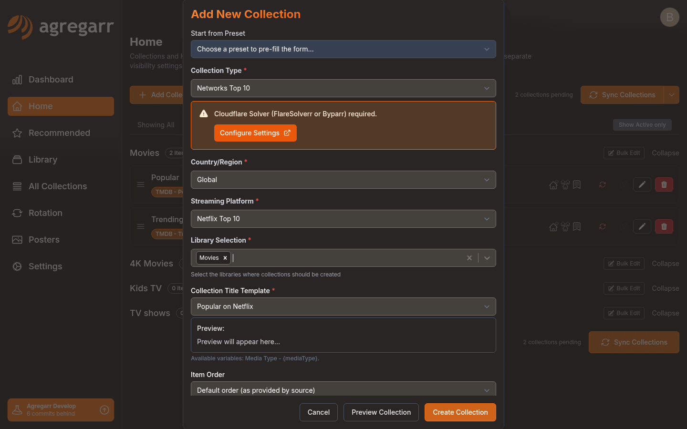
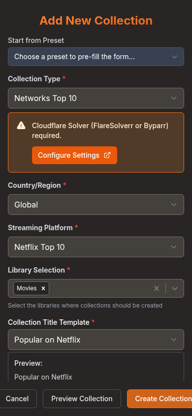
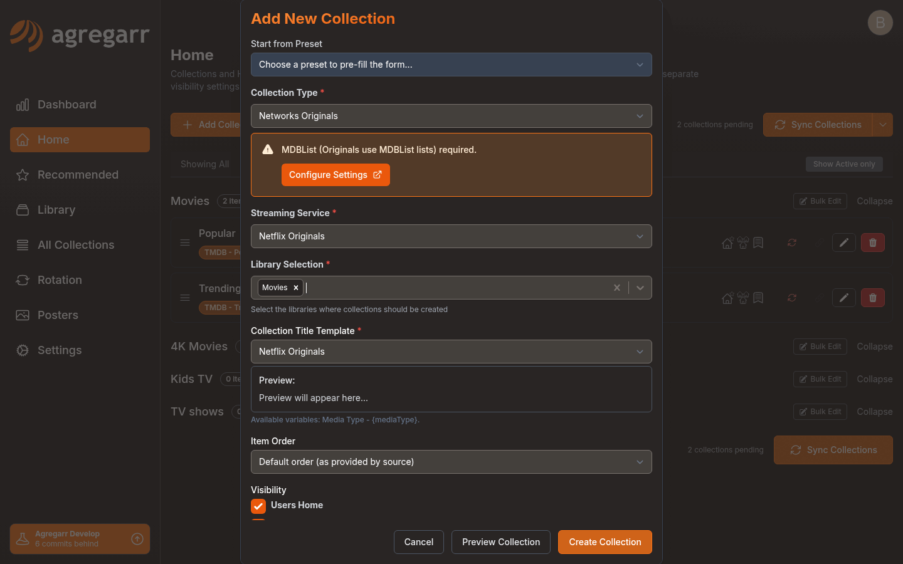
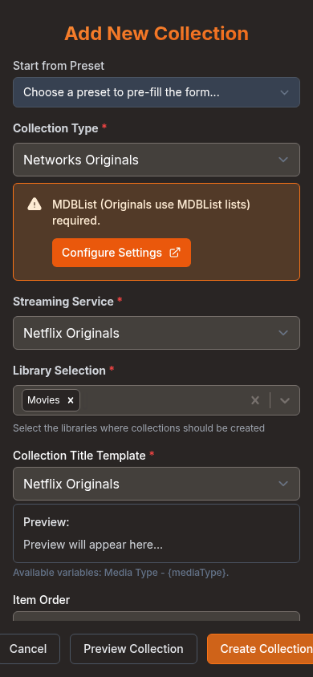

# Networks

Two sources follow streaming services. **Networks Top 10** builds a row from a service's daily chart. **Networks Originals** builds one from a curated list of the service's own productions. Both match the titles they find against your Plex library.

## Networks Top 10

Builds a collection from one streaming service's Top 10 chart for a country, or worldwide, using titles already in your Plex library.

**Needs:** a Cloudflare solver. The charts come from FlixPatrol, which sits behind Cloudflare. Add FlareSolverr, Byparr or Trawl under **Settings > Sources** (see [Cloudflare Solver](../../services/cloudflare-solvers.md)). You don't need an API key.

**Works with:** movie and TV libraries. Your chosen library decides which half of the chart Agregarr uses. Titles of the other type are dropped.

### Use it

1. Click **Add Collection** and set **Collection Type** to **Networks Top 10**. If a **Cloudflare Solver (FlareSolverr or Byparr) required.** warning appears underneath, add a solver first. The warning includes a **Configure Settings** link.
2. Choose a **Country/Region**.
3. Choose a **Streaming Platform**.
4. Choose your library under **Library Selection**. The rest of the form appears.
5. Click **Create Collection**.

=== "Desktop"

    

=== "Phone"

    

**Check:** after the next sync, the collection appears in Plex with the name from your **Collection Title Template**. The **Netflix Top 10 Movies** preset under **Start from Preset** fills in a movie version.

### Country/Region

**Default:** none. Required.

**Global** sits at the top of the list and follows the worldwide chart. Countries follow it. Choose a country for what people near you are watching, or when a local service doesn't have a worldwide chart. Changing the country clears the platform you previously chose.

### Streaming Platform

**Default:** none. Required. It appears after you've chosen a country.

For **Global**, the list is fixed: **Netflix Top 10**, **HBO Top 10**, **Disney+ Top 10**, **Amazon Prime Top 10**, **Apple TV+ Top 10**, **Paramount+ Top 10**, **Peacock Top 10**, **Crunchyroll Top 10**, **Discovery+ Top 10** and **Hulu Top 10**. For a country, Agregarr reads the platforms that FlixPatrol has charts for in that country, so the list varies. Where FlixPatrol has a separate kids chart, you'll also get a **... Top 10 Kids** entry.

Choosing a platform sets **Max Items** to 10 if you haven't already changed it. Some FlixPatrol tables have more than ten rows, so increase it if you want more.

**How it refreshes and limits:**

- Every collections sync fetches the chart again. Agregarr keeps a fetched FlixPatrol page for 5 minutes and the platform list for a country for 24 hours.
- For a country, Agregarr requests today's chart and falls back to yesterday's if today's hasn't been published yet. The worldwide chart doesn't have a date.
- If FlixPatrol's overview page doesn't include a section for a platform, Agregarr reads the platform's own page. Peacock and Hulu don't publish worldwide charts, so Agregarr uses their United States pages instead.
- FlixPatrol lists titles without a year. Agregarr searches TMDB by title. When two titles have the same name, it reads the year from the FlixPatrol title page to choose between them. Unusual titles can still match the wrong film, so check the collection the first time.
- Some platforms publish one overall chart rather than separate movie and TV tables. Agregarr uses that chart and drops titles that don't match your library type, which can leave the row with fewer than ten items.
- Chart titles that aren't in your library count as missing. **Placeholder Creation** and **Auto-Request Settings** apply to them like any other source. See [Placeholders](../../Placeholders.md).

**If it didn't work:**

- **The Streaming Platform list is empty, or says "Failed to load platforms. Please try again."** Agregarr couldn't reach FlixPatrol. Check that a solver is configured and responding. The [Cloudflare Solver health check](../../Health-Checks.md#the-cloudflare-solver-check) shows which one.
- **The collection is empty after a sync.** FlixPatrol refused the solver, or none of the chart titles are in your library and placeholders are off. The collections log says which. If the solver can reach FlixPatrol but still gets refused, Cloudflare may be challenging your server's IP address. Running the solver through a VPN is the usual fix.
- **A title is wrong.** FlixPatrol doesn't provide a year, so TMDB matching starts with the title. Click **Preview Collection** before saving to check which titles the chart resolves to.
<!-- OPEN: NEW: Settings > Sources says FlixPatrol "always requires a Cloudflare solver" (SettingsSources.tsx:167-168) but the code falls back to the built-in browser when none is configured (CloudflareSolver.ts:139-143). Page follows the UI text and Health Checks. -->

## Networks Originals

Builds a collection from a curated MDBList list of one streaming service's own productions.

**Needs:** an MDBList API key under **Settings > Sources**, in the **MDBList Settings** box (field **MDBList API Key**). Create the key from your MDBList preferences page. If the key is missing, the form shows **MDBList (Originals use MDBList lists) required.** with a **Configure Settings** link. This source doesn't use a solver.

**Works with:** movie and TV libraries. The lists contain both movies and shows. Your chosen library decides which ones Agregarr uses.

### Use it

1. Click **Add Collection** and set **Collection Type** to **Networks Originals**.
2. Choose a **Streaming Service**.
3. Choose your library under **Library Selection**. The rest of the form appears.
4. Click **Create Collection**.

=== "Desktop"

    

=== "Phone"

    

**Check:** after the next sync, the collection appears in Plex. Its poster includes the service's logo while **Auto-generate Collection posters** is ticked.

### Streaming Service

**Default:** none. Required.

The choices are **Netflix Originals**, **Amazon Originals**, **Disney+ Originals**, **HBO Max Originals**, **Paramount+ Originals**, **Hulu Originals**, **Peacock Originals**, **Apple TV+ Originals** and **Discovery+ Movies**. The last option is a list of Discovery+ films rather than Discovery+ originals, which is why its name differs from the others. Inside **Multiple Sources**, this source type is called **Streaming Originals**.

**How it refreshes and limits:**

- Every collections sync reads the list from MDBList using your key. Agregarr requests the newest releases first and pages through the whole list, so it reads long lists in full.
- Agregarr keeps the list order, with the newest releases first, while **Item Order** remains on **Default order (as provided by source)**.
- MDBList maintains these lists, not Agregarr. Titles appear or disappear when the MDBList list changes.
- Titles that aren't in your library count as missing. **Placeholder Creation** and **Auto-Request Settings** apply to them like any other source.

**If it didn't work:**

- **A sync error says "MDBList API key not configured (required for Originals collections)".** Add the key under **Settings > Sources**, then sync again.
- **The collection is empty.** None of the list's titles are in your library, and placeholders are off.

## Related

- [Cloudflare Solver](../../services/cloudflare-solvers.md) and the [Cloudflare Solver health check](../../Health-Checks.md#the-cloudflare-solver-check)
- [Your servers](your-servers.md), for sources that read from Plex, Radarr and Sonarr
- [Cycle Lists](../cycle-sources.md), to rotate several of these through one row
- [Collections](../form/basics.md#add-collection-form-the-basics), for the options every source shares
