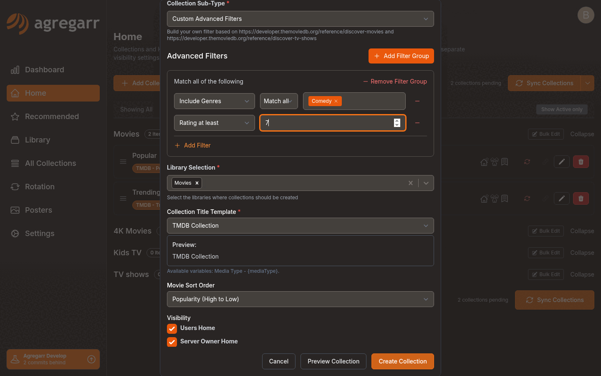
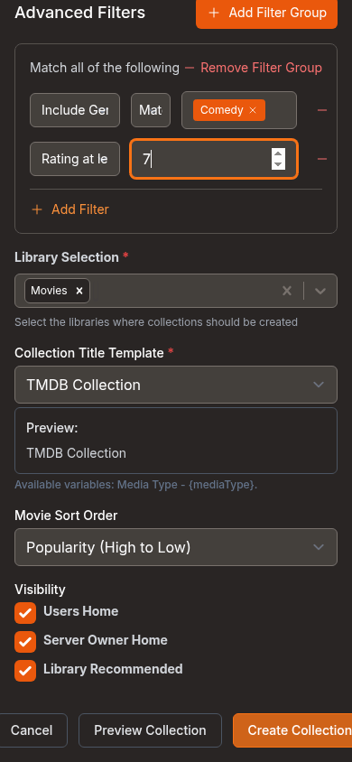

# TMDB filters

This reference covers every field available in a **Custom Advanced Filters** collection, including how filter groups combine. Use it while building a collection, or when the results aren't what you expected.

Custom Advanced Filters uses TMDB's Discover search. Pick filters such as genre, rating, streaming service or release date, and Agregarr asks TMDB for matching movies or shows. It then keeps the titles found in your library, the same as any other list. To build one from scratch, start at [TMDB Lists](tmdb.md#custom-advanced-filters).

Movie libraries search TMDB movies. TV libraries search TMDB shows. The library you choose controls this, not the filters.

## Build a filter

1. Click **Add Collection** and set **Collection Type** to **TMDB Lists**.
2. Set **Collection Sub-Type** to **Custom Advanced Filters**. The **Advanced Filters** section appears.
3. Click **Add Filter Group**.
4. In the group, open **Select field...**, choose a field, then set its value.
5. Click **Add Filter** to add fields to the same group, or **Add Filter Group** to create another group.
6. Choose a library under **Library Selection**. The rest of the form appears.
7. Set **Collection Title Template**, **Movie Sort Order** or **TV Sort Order** and **Max Items**, then save.

You can save without adding any filters. Agregarr then fetches TMDB's full Discover list for that library type, meaning every movie or show sorted by popularity.

=== "Desktop"

    

=== "Phone"

    

**Check:** click **Preview Collection** before saving to see what your filters return from your library.

The builder has a few rules:

- A field can appear only once in each group. Once used, it disappears from that group's field dropdown. Put the field in another group if you need it twice.
- **Remove Filter** is greyed out when a group has only one filter. **Add Filter** is greyed out when every field is already in use.
- Using **Remove Filter Group** on the first group promotes the next group to first. Its **AND**, **OR** or **NOT** setting is reset.
- Changing the field on a row clears that row's value.
- Fields that work with only one library type have "(Movie)" or "(TV)" after their name in the field dropdown.

## How groups and filters combine

Filters live inside groups. One collection can have several groups, with several filters in each.

### Inside a group

Every filter in a group must match. The group header says "Match all of the following", and Agregarr sends the full group to TMDB as one search.

Some fields accept several values. These get a second dropdown:

- **Match all:** an item must have every value you picked.
- **Match any:** an item needs at least one of the values you picked.

That dropdown appears for **Include Genres**, **Cast**, **Crew**, **People**, **Companies**, **Keywords**, **Release Type**, **Streaming Service**, **Watch Monetization Types**, **Networks (TMDB IDs)** and **Origin Country**.

Some fields accept several values without showing the dropdown:

- **Status**, **Show Type** and **Certification** always match any selected value. A show has one status and one type, and a movie has one certification, so requiring all selected values couldn't return anything.
- **Exclude Genres** and **Exclude Keywords** remove anything with any selected value.

### Between groups

Starting with the second group, a dropdown at the top controls how that group joins the groups above it:

- **AND:** keep only items found by both.
- **OR:** add this group's items to the results.
- **NOT:** remove this group's items from the results. The header changes to "Exclude results matching the following".

The first group doesn't have a dropdown. It's always the starting set.

Agregarr runs each group as a separate TMDB search, then joins the results from top to bottom. Each search stops at the item limit described under [How many results](#how-many-results). That limit matters for **AND** and **NOT**:

- **AND** keeps only items that appeared in the fetched results for both groups. Two broad groups may have very little overlap. For "drama and rated 7 or higher", put both filters in the same group.
- **NOT** removes only the items fetched by its own group.

Agregarr skips any group after the first if it contains only empty filters, or only filters that don't apply to the selected library type. An empty first group starts with every movie or show. That means an empty first group followed by a **NOT** group gives you "everything except".

## In Multiple Sources

1. Set **Collection Type** to **Multiple Sources**.
2. Under **Sources**, click **Add Source**.
3. Set **Source Type** to **TMDB Lists** and **Collection Sub-Type** to **Custom Advanced Filters**.
4. The **Advanced Filters** section appears inside that source. Build the filters the same way you would for a standalone collection.

Each source keeps its own filters. Two Custom Advanced Filters sources in the same collection fetch separately. See [Cycle Lists](../cycle-sources.md) for combine modes and the rest of the **Multiple Sources** form.

Changing a source's **Collection Sub-Type** to something else clears its filters.

## The fields

The fields below follow the order used by the field dropdown. Agregarr skips movie-only fields in TV libraries without a warning. It does the same with TV-only fields in movie libraries.

There are two exceptions. In a TV library, **Release Year** is sent as **First Air Year**. **Released after** and **Released before** are sent as **First Aired after** and **First Aired before**.

Each entry shows the supported library types, the expected value and the TMDB parameter Agregarr sends. The parameter name is handy when checking the field against TMDB's Discover documentation.

## Streaming

### Region/Country

- **Applies to:** movies and TV
- **Value:** one country, from a list of TMDB's countries
- **Sends:** `watch_region`

Sets the country used by the streaming availability filters. On its own, it doesn't filter anything.

**Example:** Australia, with **Streaming Service** set to a service available there.

A group with **Streaming Service** but no **Region/Country** uses the first **Region/Country** found in any group. If no group sets one, Agregarr sends the US. The **Streaming Service** list uses that same first region. Set a **Region/Country** whenever you use **Watch Monetization Types**, because that field doesn't fall back to the US.
<!-- OPEN: NEW: Watch Monetization Types without Region/Country sends no watch_region (the US fallback only fires when Streaming Service is set), tmdb.ts hasAdvancedWatchProviders -->

### Streaming Service

- **Applies to:** movies and TV
- **Value:** pick one or more services
- **Several values:** **Match all** or **Match any**
- **Sends:** `with_watch_providers`

Keeps titles available through the selected services in the country set by **Region/Country**. The list shows the services in that region for movies and TV together, ordered by TMDB's display priority.

**Example:** two services under **Match any**, to get "on either".

## Genres

### Include Genres

- **Applies to:** movies and TV
- **Value:** pick one or more genres
- **Several values:** **Match all** or **Match any**
- **Sends:** `with_genres`

Keeps titles with the selected genres. The list combines movie and TV genres. Genres available for only one type are marked "(Movie)" or "(TV)". A genre marked "(TV)" matches nothing in a movie library. A genre marked "(Movie)" matches nothing in a TV library. This applies whether the genre is on its own or used under **Match all**.

**Example:** Comedy and Family under **Match all**.

### Exclude Genres

- **Applies to:** movies and TV
- **Value:** pick one or more genres
- **Sends:** `without_genres`

Removes any title with any selected genre.

**Example:** Horror, to take it out of a "Popular" list.

## People, companies and keywords

The search fields in this section say "Search or enter ID...". Type a name and select a result. Pressing Enter chooses the first result. You can also type a TMDB ID, then press Enter or click **Add**. Agregarr saves the ID.

### Cast

- **Applies to:** movies
- **Value:** search people
- **Several values:** **Match all** or **Match any**
- **Sends:** `with_cast`

Keeps movies with the selected people in the cast.

**Example:** two actors under **Match all**, for films they made together.

### Crew

- **Applies to:** movies
- **Value:** search people
- **Several values:** **Match all** or **Match any**
- **Sends:** `with_crew`

Keeps movies with the selected people in the crew, whether they worked as director, writer or in another role.

**Example:** a director.

### People

- **Applies to:** movies
- **Value:** search people
- **Several values:** **Match all** or **Match any**
- **Sends:** `with_people`

Keeps movies where the selected people appear in the cast or crew.

**Example:** one person who both acts and directs.

### Companies

- **Applies to:** movies and TV
- **Value:** search companies
- **Several values:** **Match all** or **Match any**
- **Sends:** `with_companies`

Keeps titles made by the selected production companies.

**Example:** a single studio.

### Keywords

- **Applies to:** movies and TV
- **Value:** search keywords
- **Several values:** **Match all** or **Match any**
- **Sends:** `with_keywords`

Keeps titles tagged with the selected TMDB keywords.

**Example:** a keyword for a theme, such as heist.

### Exclude Keywords

- **Applies to:** movies and TV
- **Value:** search keywords
- **Sends:** `without_keywords`

Removes titles tagged with any selected keyword.

**Example:** a keyword for something you don't want in a family row.

## TV only

### Networks (TMDB IDs)

- **Applies to:** TV
- **Value:** type TMDB network IDs. There is no search.
- **Several values:** **Match all** or **Match any**
- **Sends:** `with_networks`

Keeps shows from the selected networks. Type the number from the network's TMDB page address, then press Enter or click **Add**. Anything that isn't a number is dropped.

**Example:** `213`.

### First Air Year

- **Applies to:** TV
- **Value:** a year, 1900 up to five years from now
- **Sends:** `first_air_date_year`

Keeps shows that first aired in the selected year.

**Example:** 2019.

### First Aired after

- **Applies to:** TV
- **Value:** a date
- **Sends:** `first_air_date.gte`

Keeps shows whose first episode aired on or after the selected date.

**Example:** 2020-01-01.

### First Aired before

- **Applies to:** TV
- **Value:** a date
- **Sends:** `first_air_date.lte`

Keeps shows whose first episode aired on or before the selected date.

**Example:** 2009-12-31.

### Aired after

- **Applies to:** TV
- **Value:** a date
- **Sends:** `air_date.gte`

This is TMDB's filter for episode air dates rather than the show's premiere. Use it with **Timezone**.

**Example:** the first day of the current year, for shows airing new episodes this year.

### Aired before

- **Applies to:** TV
- **Value:** a date
- **Sends:** `air_date.lte`

Sets the upper end of **Aired after**.

**Example:** the last day of the current year.

### Include shows with no air date

- **Applies to:** TV
- **Value:** Yes or No
- **Sends:** `include_null_first_air_dates`

Controls whether shows without a first air date can appear when filtering on first air dates.

**Example:** Yes, to keep announced shows in a list filtered by date.

### Screened Theatrically

- **Applies to:** TV
- **Value:** Yes or No
- **Sends:** `screened_theatrically`

Keeps shows that had a cinema screening.

**Example:** Yes.

### Status

- **Applies to:** TV
- **Value:** pick from **Returning Series**, **Planned**, **In Production**, **Ended**, **Cancelled** and **Pilot**
- **Several values:** always matches any
- **Sends:** `with_status`

Keeps shows with any selected status. Choosing **Returning Series** and **Ended** finds shows with either status.

**Example:** **Returning Series**, for shows still making episodes.

### Show Type

- **Applies to:** TV
- **Value:** pick from **Documentary**, **News**, **Miniseries**, **Reality**, **Scripted**, **Talk Show** and **Video**
- **Several values:** always matches any
- **Sends:** `with_type`

Keeps shows with any selected type.

**Example:** **Miniseries**.

### Timezone

- **Applies to:** TV
- **Value:** free text
- **Sends:** `timezone`

Agregarr passes this to TMDB exactly as typed. TMDB uses it with **Aired after** and **Aired before**.

**Example:** `Australia/Sydney`.

## Release type and monetization

### Release Type

- **Applies to:** movies
- **Value:** pick from **Premiere (1)**, **Theatrical (limited) (2)**, **Theatrical (3)**, **Digital (4)**, **Physical (5)** and **TV (6)**
- **Several values:** **Match all** or **Match any**
- **Sends:** `with_release_type`

Keeps movies with a release of the selected kind. It works with **Release Date after** and **Release Date before**, which then check dates for that release type rather than the movie's first release.

**Example:** **Digital (4)** with a **Release Date after**, for movies that came to digital recently.

### Watch Monetization Types

- **Applies to:** movies and TV
- **Value:** pick from **Flatrate**, **Free**, **Ads**, **Rent** and **Buy**
- **Several values:** **Match all** or **Match any**
- **Sends:** `with_watch_monetization_types`

Keeps titles you can watch in the selected way in the country set by **Region/Country**.

**Example:** **Free** and **Ads** under **Match any**.

## Ratings and votes

### Rating at least

- **Applies to:** movies and TV
- **Value:** 0 to 10, in steps of 0.1
- **Sends:** `vote_average.gte`

Keeps titles with an average TMDB rating at or above the selected value.

**Example:** 7.5.

### Rating at most

- **Applies to:** movies and TV
- **Value:** 0 to 10, in steps of 0.1
- **Sends:** `vote_average.lte`

Keeps titles with an average rating at or below the selected value.

**Example:** 5, for "so bad it's good" lists.

### Vote count at least

- **Applies to:** movies and TV
- **Value:** a whole number
- **Sends:** `vote_count.gte`

Keeps titles with at least this many votes. Pair it with **Rating at least** so that a handful of votes can't carry a title to the top.

**Example:** 500.

### Vote count at most

- **Applies to:** movies and TV
- **Value:** a whole number
- **Sends:** `vote_count.lte`

Keeps titles with no more than this many votes. Handy when looking for lesser-known titles.

**Example:** 1000.

## Release dates

### Release Year

- **Applies to:** movies. In a TV library it is sent as **First Air Year**.
- **Value:** a year, 1900 up to five years from now
- **Sends:** `primary_release_year`

Keeps titles first released in the selected year.

**Example:** 1999.

### Released after

- **Applies to:** movies. In a TV library it is sent as **First Aired after**.
- **Value:** a date
- **Sends:** `primary_release_date.gte`

Keeps titles first released on or after the selected date.

**Example:** 2015-01-01.

### Released before

- **Applies to:** movies. In a TV library it is sent as **First Aired before**.
- **Value:** a date
- **Sends:** `primary_release_date.lte`

Keeps titles first released on or before the selected date.

**Example:** 1989-12-31.

### Release Date after

- **Applies to:** movies
- **Value:** a date
- **Sends:** `release_date.gte`

Keeps movies with a release on or after the selected date. When **Release Type** is set, it checks releases of that type.

**Example:** 2024-06-01.

### Release Date before

- **Applies to:** movies
- **Value:** a date
- **Sends:** `release_date.lte`

Keeps movies with a release on or before the selected date. When **Release Type** is set, it checks releases of that type.

**Example:** 2024-12-31.

## Runtime

### Runtime at least (minutes)

- **Applies to:** movies and TV
- **Value:** minutes
- **Sends:** `with_runtime.gte`

Keeps titles at least this long.

**Example:** 150, for long films.

### Runtime at most (minutes)

- **Applies to:** movies and TV
- **Value:** minutes
- **Sends:** `with_runtime.lte`

Keeps titles no longer than this.

**Example:** 90.

## Language and country

### Original Language

- **Applies to:** movies and TV
- **Value:** one language, from a list
- **Sends:** `with_original_language`

Keeps titles first made in the selected language.

**Example:** Japanese.

### Origin Country

- **Applies to:** movies and TV
- **Value:** pick one or more countries
- **Several values:** **Match all** or **Match any**
- **Sends:** `with_origin_country`

Keeps titles from the selected countries of origin.

**Example:** two countries under **Match any**.

## Certification

The available rating lists follow the group's **Certification Country**:

- **United States:** NR, G, PG, PG-13, R, NC-17
- **United Kingdom:** U, PG, 12A, 12, 15, 18, R18
- **Canada:** E, G, PG, 14A, 18A, R, A

All four fields are movie-only.

### Certification Country

- **Applies to:** movies
- **Value:** **United States**, **United Kingdom** or **Canada**
- **Sends:** `certification_country`

Sets the country used by the three rating fields below. If you leave it unset, the form shows the US list and Agregarr sends United States to TMDB. Without the country, TMDB ignores the rating. Changing countries removes any selected ratings that don't exist in the new country.

**Example:** **United Kingdom**, then **Certification** set to 15.

### Certification

- **Applies to:** movies
- **Value:** pick one or more ratings
- **Several values:** always matches any
- **Sends:** `certification`

Keeps movies with any selected rating.

**Example:** G and PG, for a family row.

### Certification at least

- **Applies to:** movies
- **Value:** one rating
- **Sends:** `certification.gte`

Keeps movies rated at this level or higher on the selected country's scale.

**Example:** PG-13.

### Certification at most

- **Applies to:** movies
- **Value:** one rating
- **Sends:** `certification.lte`

Keeps movies rated at this level or lower on the selected country's scale.

**Example:** PG.

## Content flags

### Include Adult Content

- **Applies to:** movies and TV
- **Value:** Yes or No
- **Sends:** `include_adult`

Controls whether TMDB's adult titles can appear. When unset, it defaults to No.

**Example:** leave it unset.

### Include Video Content

- **Applies to:** movies
- **Value:** Yes or No
- **Sends:** `include_video`

Controls whether TMDB's video-only entries can appear. When unset, it defaults to No.

**Example:** leave it unset.

## Sorting

A standalone Custom Advanced Filters collection doesn't show **Item Order**. Select a movie library to get **Movie Sort Order**, or a TV library to get **TV Sort Order**. Select both library types and both settings appear. Each defaults to **Popularity (High to Low)**.

**Movie Sort Order:**

- **Popularity (High to Low)** and **Popularity (Low to High)**
- **Random (from TMDB results)**
- **Release Date (Newest First)** and **Release Date (Oldest First)**
- **Revenue (High to Low)** and **Revenue (Low to High)**
- **Rating (High to Low)** and **Rating (Low to High)**
- **Vote Count (High to Low)** and **Vote Count (Low to High)**
- **Title (A to Z)** and **Title (Z to A)**
- **Original Title (A to Z)** and **Original Title (Z to A)**

**TV Sort Order:**

- **Popularity (High to Low)** and **Popularity (Low to High)**
- **Random (from TMDB results)**
- **First Air Date (Newest First)** and **First Air Date (Oldest First)**
- **Rating (High to Low)** and **Rating (Low to High)**
- **Vote Count (High to Low)** and **Vote Count (Low to High)**
- **Name (A to Z)** and **Name (Z to A)**
- **Original Name (A to Z)** and **Original Name (Z to A)**

Agregarr sends the selected sort to TMDB for each group, then applies the same sort after joining the groups. Popularity breaks ties.

Revenue is the odd one. TMDB sorts by revenue but doesn't return the revenue figures, so Agregarr preserves TMDB's order. When groups are joined using **OR**, each group's results follow the groups before it.

**Random (from TMDB results)** fetches titles by popularity, then shuffles the matched items during every sync.

Sources in **Multiple Sources** don't have their own sort setting. Each Custom Advanced Filters source fetches by popularity. Use the collection's **Item Order** to sort the combined list.

## How many results

TMDB returns 20 results per page. For each group, Agregarr fetches five pages at a time and stops when:

- it has at least ten times **Max Items**,
- TMDB says the page was the last one, or, when it doesn't say, a page returns fewer than 20 results, or
- it reaches page 500, which is TMDB's limit.

After joining and sorting the groups, Agregarr keeps the first ten times **Max Items**. It matches those results against your library, stopping at **Max Items**. With the default of 30, Agregarr can check up to 300 TMDB results against your library. If a narrow library leaves the collection short, raise **Max Items**.

In **Multiple Sources**, each Custom Advanced Filters source uses the collection's **Max Items** for this limit.

If TMDB has a temporary problem, Agregarr retries the page up to three times. If TMDB rejects a request, Agregarr stops fetching that group and keeps whatever it fetched before the rejection. That can leave the collection empty without producing a sync error.

## Language and region

- Agregarr requests TMDB results in English (`en-US`).
- The only region sent is the one selected under **Region/Country**, or the US when a group uses **Streaming Service** without setting **Region/Country**. It affects only the streaming filters.
- Use **Original Language** or **Origin Country** to filter by where a title comes from.

## Preview

**Preview Collection** runs the same filters against your library. Change a filter, sort or **Max Items**, and the next preview fetches the results again.

- **Random (from TMDB results)** isn't shuffled in the preview. Results appear in popularity order.
- In **Multiple Sources**, a source that fails shows no items and no error in the preview window. The failure is written to the server log. During a sync, the failed source is also reported as a sync error.

## Standalone and Multiple Sources

- **Sort:** standalone uses **Movie Sort Order** or **TV Sort Order**. A source in **Multiple Sources** sorts only by popularity, so use **Item Order**.
- **Fetch limit:** ten times **Max Items** in both. In **Multiple Sources**, this uses the collection's **Max Items**.
- **Dynamic title:** with **Cycle Lists** and **Dynamic Title from Active Source**, every Custom Advanced Filters source gets the title "Custom Advanced Filters". Use **Custom** when cycling more than one.

## Related

- [TMDB Lists](tmdb.md) for the other TMDB sub-types
- [Cycle Lists](../cycle-sources.md) for combine modes in **Multiple Sources**
- [Your first collection](../../get-started/first-collection.md)
