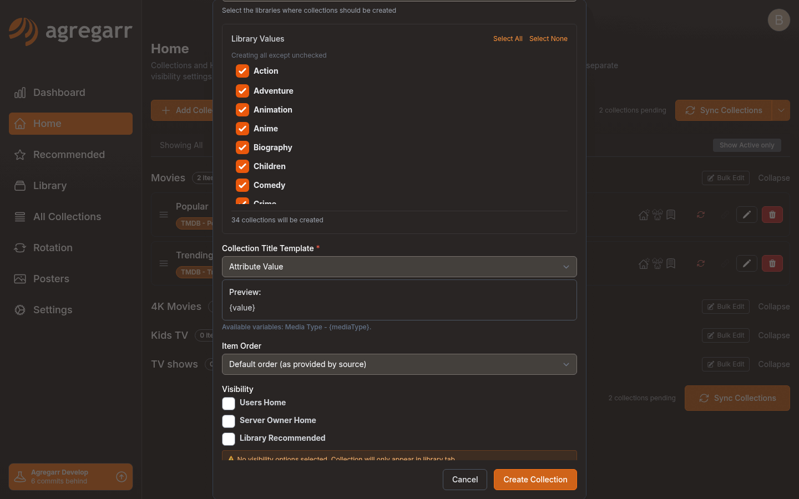
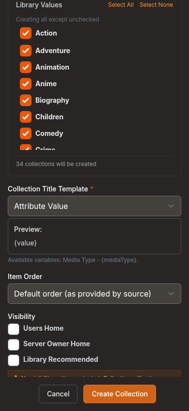
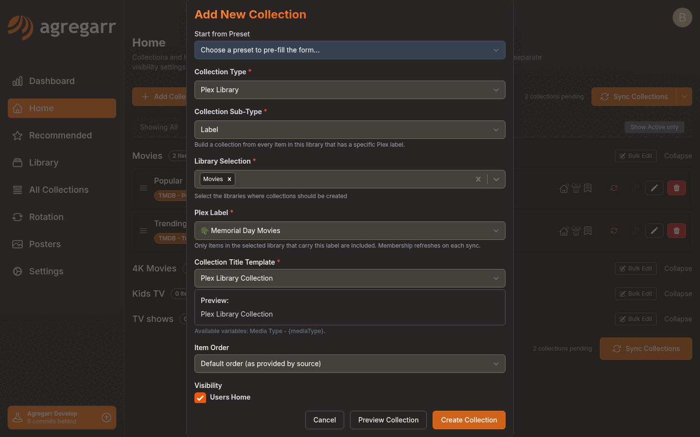
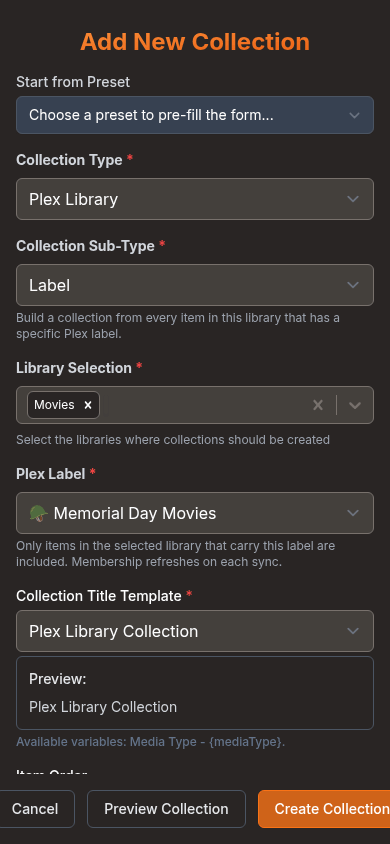
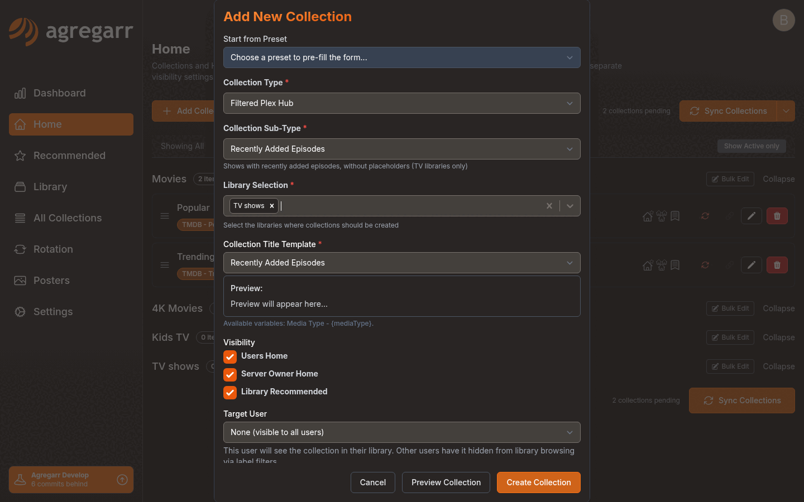
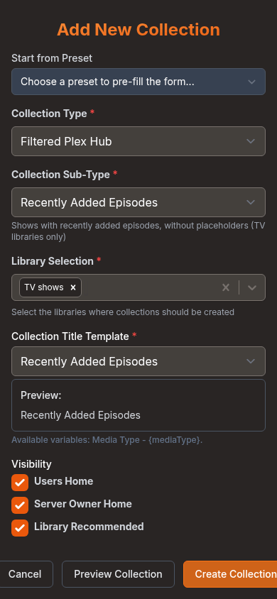

# Your servers

These sources read from your own servers. **Plex Library** builds collections from items already in a library. **Filtered Plex Hub** creates recently added and released rows without placeholders. **Radarr Tag** and **Sonarr Tag** turn a tag into a collection.

- [Library Essentials](#library-essentials): one collection for each genre, decade, resolution or content rating
- [Auto Director and Auto Actor](#auto-director-and-auto-actor): one collection for each person
- [Label collections](#label-collections): everything in a library carrying a Plex label
- [Separator collections](#separator-collections): an empty collection used as a divider
- [Filtered Plex Hub](#filtered-plex-hub): recently added and released rows without placeholders
- [Radarr Tag and Sonarr Tag](#radarr-tag-and-sonarr-tag): everything carrying a tag

## Library Essentials

Creates one smart collection for each genre, decade, resolution or content rating Plex finds in a library. Plex fills the collections from its own metadata, so membership stays current between syncs.

**Needs:** nothing beyond your Plex connection.

**Works with:** movie and TV libraries. Items carrying the `trailer-placeholder` label are left out.

### Use it

1. Click **Add Collection** and set **Collection Type** to **Plex Library**.
2. Set **Collection Sub-Type** to one of the four Essentials entries below.
3. Choose one library under **Library Selection**. The **Library Values** panel appears.
4. Untick any values you don't want. Tick **Use Separator** if you want a divider before the group.
5. Click **Create Collection**.

=== "Desktop"

    

=== "Phone"

    

**Check:** the **Library Values** panel ends with a line such as "12 collections will be created". Those collections appear in Plex after the next sync.

### Auto Genre Collections

One smart collection for each genre in the library.

### Auto Decade Collections

One collection for each decade (2020s, 2010s and so on).

### Auto Resolution Collections

One collection for each quality level (4K, 1080p and so on).

### Auto Content Rating Collections

One collection for each content rating. The panel groups values by the part before the slash, followed by **TV Ratings**, **Age-based** and **General**.

Each collection gets its name from **Collection Title Template**. The default is `{value}`, which uses the value itself. The template must include `{value}`, or the form won't save.

### Library Values

**Default:** every value ticked.

The panel lists every value Plex reports for the library. They all start ticked, and the panel reads **Creating all except unchecked**. There are two ways to use it:

- **Exclude mode** (the default): untick the values you don't want.
- **Include mode**: click **Select None**, then tick only the values you want. The panel changes to **Creating only checked**.

Changing the library or sub-type resets the list with every value ticked. The panel only appears when you've selected one library. If you select more than one, the same selection applies to every library, and the form says so. In the default exclude mode, each library gets a collection for every value.

### Select All

Returns to exclude mode with no values excluded.

### Select None

Changes to include mode with no values ticked.

### {count} collections will be created

Shows a running total for the current selection, for example "12 collections will be created".

### Existing collection

A badge shown on a value when its collection name matches one already in the library. Collections previously made by this configuration don't count. Change **Collection Title Template** if you want to avoid the clash.

### Use Separator

**Default:** off. Also available for Auto Director and Auto Actor.

Adds a separator collection before the group. While the group is in the A-Z section, the separator sorts at the top of that section and the genre collections sort under their own names. If you promote, demote or drag the group, Agregarr keeps the separator and its collections together, with the separator first. Untick this option to remove the separator on the next sync.

Ticking it reveals **Separator Title**, which supplies the separator's name and poster text. It starts as **Genre Collections**, **Decade Collections**, **Resolution Collections** or **Content Rating Collections**, depending on the sub-type. Once **Use Separator** is ticked, the title is required and must be at least 2 characters.

### Visibility

**Default:** **Users Home**, **Server Owner Home** and **Library Recommended** all off. **Auto-generate Collection posters** is off too.

The collections still appear in the library's Collections tab without filling the home screens. The hint below the boxes reads "This applies to all collections generated by this configuration." Switch to another source type, and the boxes return to ticked.

**How it refreshes and limits:**

- On each sync, Agregarr compares Plex's current values with your selection. New values get a collection. A collection is deleted if its value was unticked or has left the library.
- If Plex reports no values for the library, but Agregarr still manages collections there, the sync stops without deleting anything.
- Agregarr marks each managed collection with a Plex label beginning `AgregarrEssentials-`. Leave that label in place. It's how Agregarr finds the collection again.
- **Preview Collection**, **Placeholder Creation** and **Auto-Request Settings** aren't available because these collections don't use an external list.

**If it didn't work:**

- **The Library Values panel doesn't show.** Exactly one library needs to be selected. If several libraries are ticked, the form shows a note instead.
- **A collection I unticked is still in Plex.** Agregarr removes it during the next sync, not when you save.
- **A value is missing.** The list only contains the values Plex reports for that library at the time.

## Auto Director and Auto Actor

Creates one smart collection for each person who appears in enough items from your library. Each collection uses the person's name.

**Needs:** nothing beyond your Plex connection. With **Auto-generate Collection posters** on, Agregarr also looks up the person on TMDB for a photo and biography.

**Works with:** movie and TV libraries. Directors come from Plex's director tag, while actors come from the cast list. Items carrying the `trailer-placeholder` label don't count.

### Use it

1. Click **Add Collection** and set **Collection Type** to **Plex Library**.
2. Set **Collection Sub-Type** to **Auto Director Collections** or **Auto Actor Collections**.
3. Set **Minimum Items**.
4. Choose your library under **Library Selection**. The rest of the form appears.
5. Check that **Collection Title Template** includes `{director}` or `{actor}`, then click **Create Collection**.

**Check:** after the next sync, each person with at least that many items has a collection in the library's Collections tab.

### Auto Director Collections

One collection for each director.

### Auto Actor Collections

One collection for each actor. Cast lists can be long, so this may create a lot of collections. Raise **Minimum Items** to keep the list to people with more titles in the library.
<!-- OPEN: NEW: the Auto Actor Collections description says "the top 5 actors in this library" (CollectionTypeSection.tsx:407-410) but the code creates one collection for every actor with at least Minimum Items items (plexlibrary.ts:1495). Page describes the behaviour. -->

### Minimum Items

**Default:** the box shows 5 as a hint but starts empty on a new collection, so enter a number. Smallest allowed: 2. Required.

A person gets a collection only when they appear in at least this many library items. If they later fall below the limit, Agregarr deletes their collection on the next sync.

**How it refreshes and limits:**

- **Use Separator** works as described under [Use Separator](#use-separator). Its starting title is **Director Collections** or **Actor Collections**.
- **Visibility** is restricted to the library's Collections tab. All three boxes are locked off, and the form explains why.
- **Collection Title Template** defaults to `{director}` or `{actor}`. The form won't accept a template without the matching token.
- Each collection uses a Plex smart filter, so membership stays current between syncs. A sync adds collections for new people and removes collections for anyone who falls below **Minimum Items**.
- With **Auto-generate Collection posters** on, the poster uses the person's TMDB photo and up to 12 of their titles. Their TMDB biography becomes the collection summary. If TMDB doesn't return a match, the collection is still created without those details.
- **Preview Collection**, **Label Exclusion**, **Placeholder Creation** and **Auto-Request Settings** aren't available.

**If it didn't work:**

- **Nothing was created.** Nobody in the library reaches **Minimum Items**. Lower it, down to 2.
- **Far too many collections.** Raise **Minimum Items**.
- **A person is missing.** Plex uses its own name for the tag. Two spellings count as two separate people.

## Label collections

Creates one collection from every item in a library carrying a particular Plex label. This works for labels you apply by hand or labels added by another tool.

**Needs:** nothing beyond your Plex connection.

**Works with:** movie and TV libraries. Items carrying the `trailer-placeholder` label never come through, even when they also carry your chosen label.

### Use it

1. Click **Add Collection** and set **Collection Type** to **Plex Library**.
2. Set **Collection Sub-Type** to **Label**.
3. Choose your library under **Library Selection**.
4. Choose a **Plex Label**. The list contains the labels used in that library.
5. Set the title and other options, then click **Create Collection**.

=== "Desktop"

    

=== "Phone"

    

**Check:** **Preview Collection** lists the items carrying the label.

### Plex Label

**Default:** none. Required.

Only items carrying this label in the selected library are included. Membership refreshes on every sync. Each configuration supports one label.

If you select several libraries, the label list comes from the first one. When the dropdown reads **No labels found in this library**, that library doesn't have any labelled items yet.

**How it refreshes and limits:**

- The collection uses the same options as other sources, so **Max Items**, **Item Order** and **Collection Mutual Exclusion** apply.
- If the label has no items during a sync, Agregarr logs "No items found with label" and leaves the collection unchanged.

**If it didn't work:**

- **The Plex Label list says "Select a library above first".** Choose a library under **Library Selection**.
- **The collection didn't update.** Check that the label is on items in the library you selected, rather than another library.

## Separator collections

Creates an empty collection with a title card poster. It's useful for breaking up long rows of collections.

**Needs:** nothing beyond your Plex connection.

**Works with:** movie and TV libraries.

### Use it

1. Click **Add Collection** and set **Collection Type** to **Plex Library**.
2. Set **Collection Sub-Type** to **Separator**.
3. Enter a **Separator Title**.
4. Choose your library under **Library Selection**. The rest of the form appears.
5. Click **Create Collection**.

### Separator Title

**Default:** none. Required, at least 2 characters.

This text appears on the poster and is also used as the collection name. The remaining options are:

- **Posters**: leave **Auto-generate Collection posters** ticked to use the built-in Separator template, or choose another template. Untick it if you want to upload your own poster.
- **Visibility**: the standard visibility checkboxes.
- **Time Restrictions**: optional, as with other collections.

**How it refreshes and limits:**

- The collection contains no items and has no title template. Only its name, poster and visibility need refreshing.
- **Sort Title** isn't available for a standalone separator. In the A-Z section, Agregarr gives it a sort title beginning with `0`, which puts it before the alphabetical collections. Once promoted, it follows the promoted order like any other collection.

## Filtered Plex Hub

Creates a row of recently added or recently released titles without placeholders. A Coming Soon item won't appear as something that's ready to watch.

**Needs:** nothing beyond your Plex connection.

**Works with:** movie libraries (**Recently Added**, **Recently Released**) and TV libraries (all five). Anything carrying the `trailer-placeholder` label is left out.

### Use it

1. Click **Add Collection** and set **Collection Type** to **Filtered Plex Hub**.
2. Set **Collection Sub-Type**.
3. Choose your library under **Library Selection**.
4. Tick the **Visibility** boxes you want, such as **Users Home**, **Server Owner Home** and **Library Recommended**.
5. Click **Create Collection**.

=== "Desktop"

    

=== "Phone"

    

**Check:** after the next sync, the collection appears in the library and on each home screen you ticked.

### Recently Added

Items sorted by date added, newest first. For TV libraries, this is the date the show was first added, not the date of its newest episode.

### Recently Released

Movies sorted by release date, newest first. TV shows are sorted by their most recently aired episode, with future air dates left out.

### Recently Added Episodes

Shows sorted by their most recently added episode. TV libraries only.
<!-- OPEN: NEW: in the Collection Sub-Type list the value recently_released_episodes is labelled "Recently Added Episodes" and recently_added_episodes is "Recently Added Episodes (Individual)" (CollectionTypeSection.tsx:577-598). Page uses the UI labels; the mapping is confusing but intended. -->

### Recently Added Episodes (Individual)

The episodes themselves, sorted by date added. TV libraries only.

### Recently Released Episodes (Individual)

The episodes themselves, sorted by air date with the newest first. Episodes with a future air date or no air date are left out. TV libraries only.

**How it refreshes and limits:**

- Each hub is a Plex smart collection, so Plex fills it. Agregarr rewrites the smart filter on every sync. Changes to **Max Items** or exclusions take effect at that point. Collection syncs run every 12 hours by default, while **Sync Collections** starts one straight away.
- **Max Items** sets the limit on the smart collection.
- Both Individual hubs also exclude episodes from any show carrying the `trailer-placeholder` label. They don't support **Collection Mutual Exclusion** or automatic posters, so the form hides both options.
- **Item Order**, **Label Exclusion**, **Placeholder Creation** and **Auto-Request Settings** aren't available for any Filtered Plex Hub.
- Choosing an episode sub-type for a movie library breaks the sync. Use a TV library for those sub-types.
- A filtered hub appears alongside Plex's own hub. It doesn't replace it. The steps below cover that.

**If it didn't work:**

- **Placeholders still show on Home.** Plex's own Recently Added hub is still on. Turn it off using the steps below.
- **The collections page shows "Filtered Hubs Recommended".** A library has a collection with **Create placeholders for missing items** enabled while a Plex default hub is still switched on. The warning names the hub and tells you which filtered hub to create or which default hub to switch off.
- **A TV hub sorts a show too low.** The reason is covered below. Use **Recently Added Episodes**.

### Replacing Plex's Recently Added hub

A filtered hub appears alongside Plex's own **Recently Added Movies** or **Recently Added TV** hub. Switch Plex's hub off, or you'll get both: one with placeholders and one without.

1. Add a **Filtered Plex Hub** collection for the library. Choose **Recently Added** for a movie library and **Recently Added Episodes** for a TV library.
2. Tick the **Visibility** boxes you want on the new hub, such as **Users Home**, **Server Owner Home** and **Library Recommended**.
3. Find Plex's own Recently Added hub for that library on the **Home** or **Recommended** page. It has a **Plex Default** badge. Edit it, then untick all three **Visibility** boxes.

For TV libraries, use **Recently Added Episodes** rather than **Recently Added**. Plex keeps the date when a show was first added. For a Coming Soon show, that's the date Agregarr created its placeholder.

**Recently Added** sorts shows using that date. If a placeholder was created in January and the first episodes arrive in March, the show keeps its January date. It then sits behind anything added between those dates. **Recently Added Episodes** sorts each show by its newest episode, so the show moves to the front when the episodes arrive.

Sorting the TV library by **Date Added** in Plex has the same problem because it uses the same show-level date.

## Radarr Tag and Sonarr Tag

Creates a collection from everything carrying a particular tag in Radarr or Sonarr. Tag a film or show there, and it joins the collection on the next sync.

**Needs:** a Radarr server for **Radarr Tag**, or a Sonarr server for **Sonarr Tag**, configured under **Settings > Downloads**. If the required server isn't set up, the form shows **Radarr required.** or **Sonarr required.** with a **Configure Settings** link.

**Works with:** **Radarr Tag** is for movie libraries, while **Sonarr Tag** is for TV libraries. For Radarr Tag, the library picker shows "Detected Movies only. TV Shows collections will be empty until matching content is added." Sonarr Tag shows the TV equivalent. Pick a library of the matching type.

### Use it

1. Click **Add Collection** and set **Collection Type** to **Radarr Tag** or **Sonarr Tag**.
2. Choose a **Radarr Instance** or **Sonarr Instance**.
3. Choose a **Radarr Tag** or **Sonarr Tag**.
4. Choose your library under **Library Selection**. The rest of the form appears.
5. Click **Create Collection**.

**Check:** **Preview Collection** lists the tagged titles found in your Plex library.

### Radarr Instance

**Default:** none. Required.

Lists every Radarr server added under **Settings > Downloads**, using its name. The default server has **(Default)** after it.

### Sonarr Instance

**Default:** none. Required.

The same applies to Sonarr.

### Radarr Tag

**Default:** none. Required. It appears after you've selected an instance.

Lists the tags defined on that Radarr server. Changing the instance clears the selected tag.

### Sonarr Tag

**Default:** none. Required. It appears after you've selected an instance.

Lists the tags defined on that Sonarr server. Changing the instance clears the selected tag.

**How it refreshes and limits:**

- Each collections sync reads every film or show on the server and keeps those carrying the selected tag, whether they've been downloaded or not.
- Radarr titles are matched with Plex using TMDB ID. Sonarr titles use TVDB ID, with a TMDB lookup when needed. Agregarr skips a title when Radarr or Sonarr has no ID for it.
- Tagged titles missing from Plex count as missing items. **Placeholder Creation** and **Auto-Request Settings** work for them like any other source. See [Placeholders](../../Placeholders.md).
- The title presets use `{tagLabel} Movies` and similar text, but Agregarr doesn't fill `{tagLabel}` yet. Choose **Custom** and enter the title you want.

**If it didn't work:**

- **The Radarr Tag list is empty.** The Radarr server has no tags yet, or Agregarr couldn't reach it. For the second case, the form shows "Failed to load tags. Please try again."
- **The collection is empty.** No tagged title is in your Plex library yet. With placeholders and downloads off, a sync only gathers titles already in Plex.
- **A sync error says "No Radarr instances configured".** Add the server under **Settings > Downloads**.

## Related

- [Collections](../form/basics.md#add-collection-form-the-basics), for the options shared by every source
- [Placeholders](../../Placeholders.md), for Placeholder Creation and the `trailer-placeholder` label
- [Cycle Lists](../cycle-sources.md), which can use Streaming Originals, Radarr Tags and Sonarr Tags as sources
- [Networks](networks.md), for Networks Top 10 and Networks Originals
