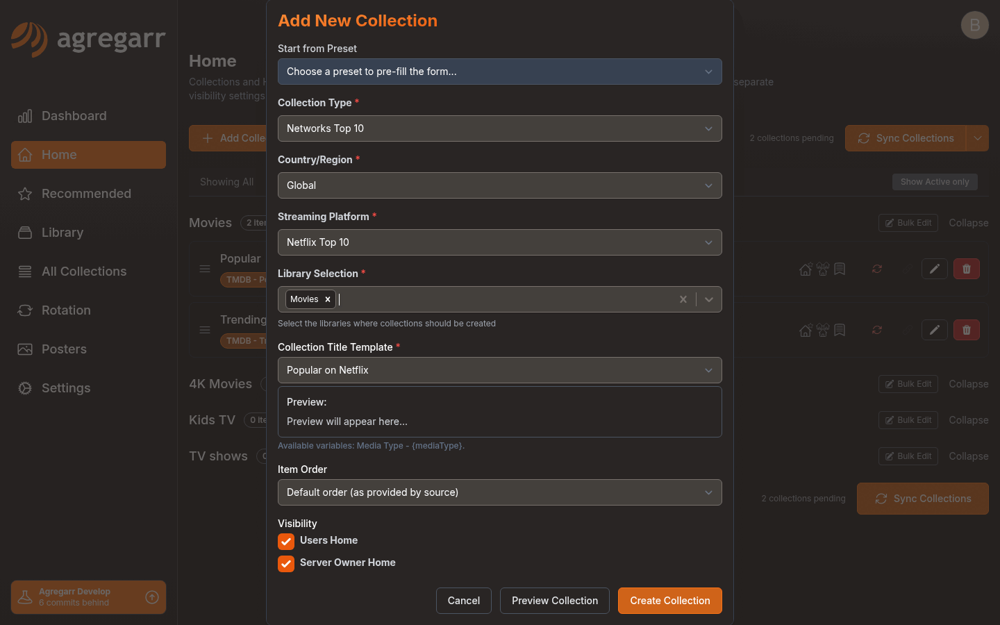
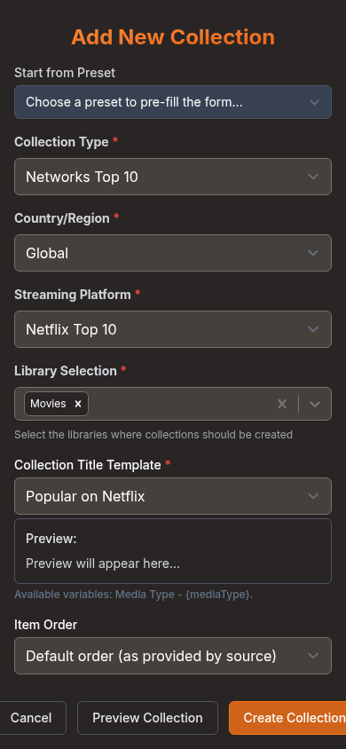

# Add a streaming Top 10 or Originals row

This page sets up a Plex row that follows a streaming service's daily Top 10 or lists the service's own productions. Both only show titles you already have unless you turn on placeholders or requests.

## Before you start

- Agregarr connected to Plex, with **Discover Existing Collections & Hubs** already run. See [Your first collection](../get-started/first-collection.md).
- A Plex movie or TV library. The library you choose decides whether the row contains movies or shows.
- For a Top 10 row: a Cloudflare solver such as FlareSolverr, Byparr or Trawl. The charts come from FlixPatrol, which sits behind Cloudflare.
- For an Originals row: an MDBList API key. Skip to the **Originals** variation below.

## Set it up

### 1. Add a solver

Run a solver alongside Agregarr. The [Cloudflare Solver](../Integrations.md#cloudflare-solver) page has a Compose example.

1. Go to **Settings > Sources**.
2. Under **Fetching Settings**, find **Cloudflare Solvers** and click **Add Solver**.
3. Enter a name and the solver's address, for example `http://flaresolverr:8191`.
4. Click **Save Changes**.

**Check:** the solver appears under **Cloudflare Solvers** after you reload the page.

### 2. Start the collection

1. Go to **Home** and click **Add Collection**.
2. Set **Collection Type** to **Networks Top 10**.

**Check:** there is no orange **Cloudflare Solver (FlareSolverr or Byparr) required.** warning under **Collection Type**. If the warning is there, step 1 hasn't saved. It includes a **Configure Settings** link.

### 3. Choose the chart

1. Pick a **Country/Region**. **Global** uses the worldwide chart.
2. Pick a **Streaming Platform**, for example **Netflix Top 10**.
3. Choose your library under **Library Selection**. The rest of the form appears.

=== "Desktop"

    

=== "Phone"

    

**Check:** **Max Items** reads 10 and **Collection Title Template** contains a name. **Preview Collection** lists the chart titles found in your library.

### 4. Create and sync it

Click **Create Collection**, then click **Sync Collections** on **Home**.

**Check:** the new card on **Home** has no error state and the line beside **Sync Collections** reads "Last sync:" followed by the time.

## Check it worked

In Plex, the row appears under the name from **Collection Title Template**. It shows on the Home screens ticked under **Visibility** and in the library's **Collections** tab, and holds only the chart titles you own, so it can have fewer than ten items.

## Variations

??? note "Originals instead of a Top 10"
    1. In **Settings > Sources**, find **MDBList Settings** and paste your key into **MDBList API Key**. Click **Save Changes**.
    2. Click **Add Collection** and set **Collection Type** to **Networks Originals**.
    3. Choose a **Streaming Service**, such as **Netflix Originals**, then your library.
    4. Click **Create Collection** and sync.

    **Check:** no **MDBList (Originals use MDBList lists) required.** warning appears. The collection poster carries the service's logo while **Auto-generate Collection posters** is ticked. No solver is needed.

??? note "Start from the Netflix preset"
    **Start from Preset** includes **Netflix Top 10 Movies**. It fills in the Global Netflix chart for a movie library.

## What it doesn't do

- Top 10 rows need a solver to work reliably. Without one, Agregarr falls back to its built-in browser, which Cloudflare usually blocks. Originals rows don't need a solver.
- It doesn't download anything by itself. Titles missing from your library count as missing. **Placeholder Creation** and **Auto-Request Settings** treat them like any other source.
- It doesn't let you choose the movie or TV half of a chart. Your library decides that.

## If it didn't work

- **The Streaming Platform list is empty.** Agregarr couldn't reach FlixPatrol. See [Networks Top 10](sources/networks.md#networks-top-10) and the [Cloudflare Solver health check](../Health-Checks.md#the-cloudflare-solver-check).
- **The row is empty after a sync.** FlixPatrol refused the solver, or none of the chart titles are in your library. The [Networks](sources/networks.md#networks-top-10) page covers both.
- **A title is wrong.** FlixPatrol doesn't provide a year, so TMDB matching starts with the title. Check the matches with **Preview Collection** before saving.
- **A sync error mentions the MDBList key.** Add it under **Settings > Sources**. See [Networks Originals](sources/networks.md#networks-originals).

## Related

- [Networks](sources/networks.md): every option, limit and refresh rule
- [Cloudflare Solver](../Integrations.md#cloudflare-solver)
- [Rotate several lists through one row](cycle-sources.md): rotate several services through one row
- [Name collections](name-collections.md)
