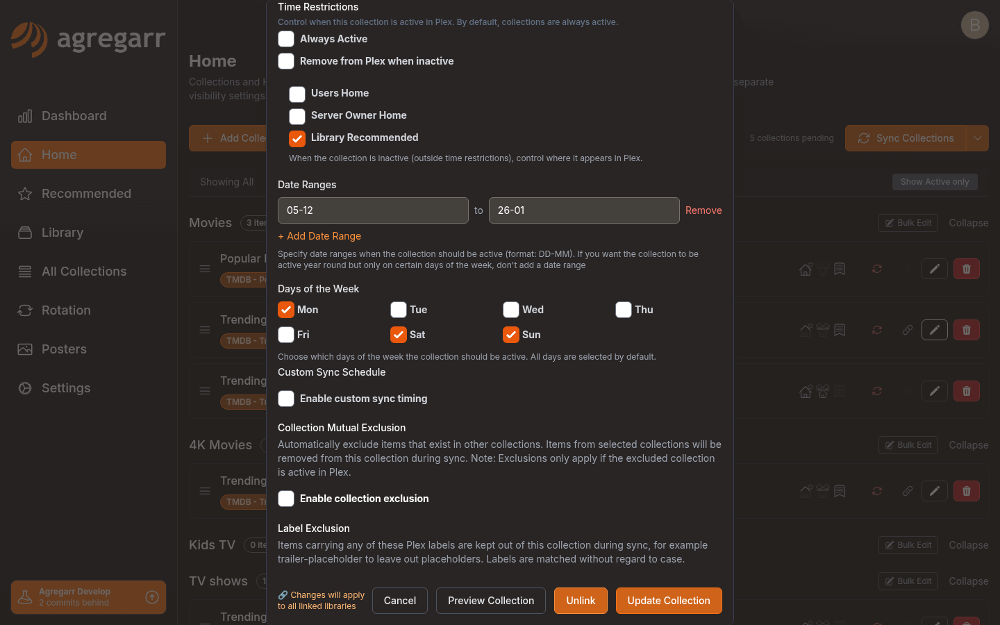
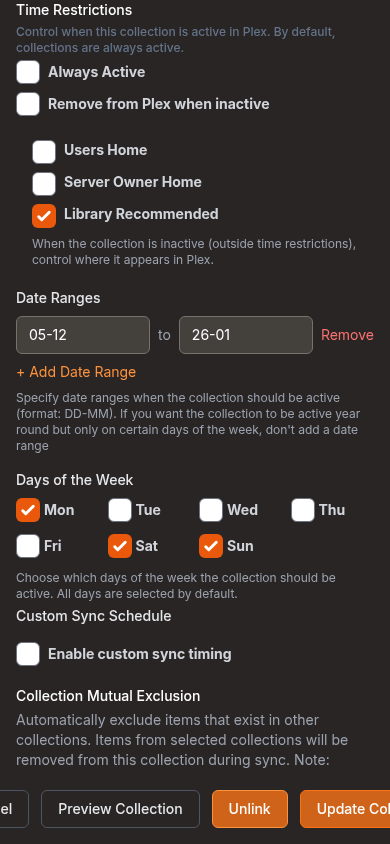

# Run a collection only at certain times

This page limits a collection to certain dates or days of the week. One example is a Christmas row that only runs in December. Outside that window, the collection either leaves Plex or drops off Home.

## Before you start

- A collection that already exists. Click the pencil (**Edit**) on its row.
- Your server's clock and time zone known. Agregarr uses the server's clock to judge the window, not yours.
- Hubs and imported Plex collections also get time restrictions, but Agregarr can't remove them from Plex.

## Set it up

1. Open the collection and scroll to **Time Restrictions**, after **Posters** and **Wallpapers and Theme**.
2. Untick **Always Active**. The date, day and inactive options appear.
3. Click **+ Add Date Range**. Enter the start and end as DD-MM, for example `01-12` to `26-12`.

    **Check:** both boxes accept the values. A row with only one end filled shows "Each date range needs a start and end date in DD-MM format" and the form won't save.

4. Leave **Days of the Week** alone if the collection should run every day in the range. Untick days to narrow it down. At least one day must stay ticked.
5. Choose what happens outside the window.
    - Tick **Remove from Plex when inactive** to delete the Plex collection. Its settings stay in Agregarr.
    - Leave it unticked to keep the collection in Plex. Use the inactive visibility boxes to choose where it appears. They start with **Library Recommended** only.
6. Click **Update Collection**.

    === "Desktop"

        

    === "Phone"

        

**Check:** the collection's row shows a **Time Restrictions Set** badge.

## Check it worked

Agregarr checks the window on every sync. Click **Sync Collections** to check the result now.

- Inside the window, the collection appears wherever **Visibility** puts it.
- Outside the window with **Remove from Plex when inactive** ticked, the collection is removed from Plex.
- Outside the window with that option unticked, it stays in Plex and appears only where the inactive boxes specify. It always stays on the library's **Collections** tab.

## Variations

??? note "Cross the new year"
    A range can end earlier in the calendar than it starts, such as `05-12` to `26-01`. Both end days count.

??? note "Weekends only"
    Leave **Date Ranges** empty and untick **Mon** to **Fri**. When both are set, today has to match both.

??? note "Switch over closer to midnight"
    A collection can lag behind its window by up to one sync interval. Give it a shorter interval by ticking **Enable custom sync timing** under **Custom Sync Schedule** and choosing a **Schedule** such as **Every hour**. The full sync then skips this collection. Only its own schedule updates it.

??? note "Refresh once a year"
    Tick **Enable custom sync timing**, choose **Once yearly**, untick **Start on next sync** and set **Start date** to `01-01`. Save it, then click the red circular-arrow icon on its row (its tooltip reads "Needs Sync") to fill it before then.

## What it doesn't do

- There is no time of day setting. Windows cover whole days.
- Date ranges don't include a year, so they repeat every year.
- Agregarr doesn't use your time zone. It uses the server's clock.
- A collection in a Rotation leaves its slot on the first sync after its window closes, then another collection takes the slot. When the window opens again, the collection goes back into the queue and returns when its turn comes. See [Rotation](../appear/rotation.md).

## If it didn't work

- **The form won't save.** A date range is missing an end or isn't in DD-MM format, or no day is ticked.
- **The collection is still showing after the window ended.** Agregarr checks the window during a sync. Run **Sync Collections** or give the collection its own schedule.
- **It never turns off.** Unticking **Always Active** without adding a date range or changing the days leaves the collection active every day.
- **The inactive boxes are missing.** They only appear while **Remove from Plex when inactive** is unticked.

## Related

- [Visibility and time restrictions](form/visibility.md#time-restrictions)
- [Collection pages](pages.md)
- [Rotate several lists through one row](cycle-sources.md)
