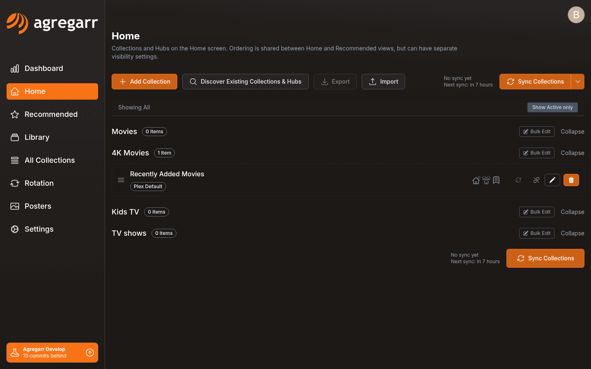
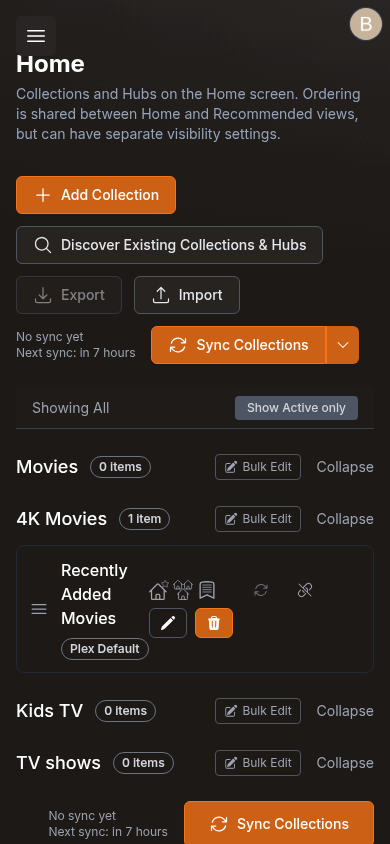
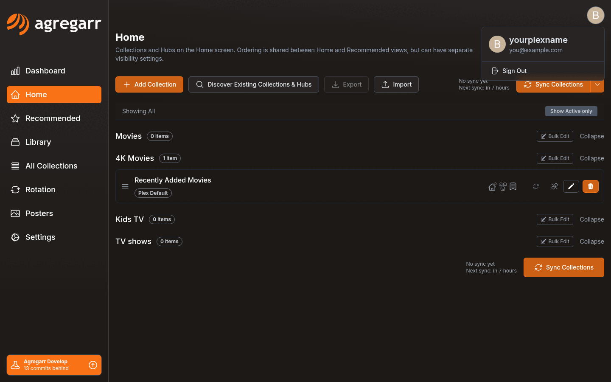
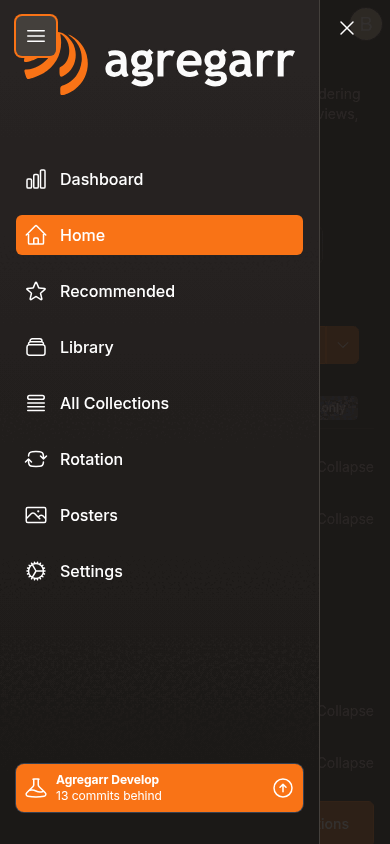

# Finding your way around

The main Agregarr screen has a sidebar with two badges below it and a user menu in the corner. On a phone, the sidebar moves into a menu. The setup wizard also has its own language picker. For the order to set everything up, see [First run: the setup wizard](setup-wizard.md).

=== "Desktop"

    

=== "Phone"

    

## The sidebar

On a wide screen, the sidebar sits on the left. It always lists the same eight pages in this order. The page you're currently on is highlighted in orange.

### Dashboard

A live view of the two sync jobs, the latest run of each background job, collection statistics and missing items. Only the admin can open it. Everyone else sees **Access Denied**.

Related: [Dashboard](../Overlays.md#dashboard-sync-progress) and [Health Checks](../Health-Checks.md#job-history).

### Home

The collections and hubs shown on the Plex Home screen, in the same order Plex shows them. Home and **Recommended** share one order, but their visibility settings can differ.

This is also the first page you land on after signing in.

### Recommended

The same collections and hubs, this time for the Recommended tabs in Plex.

### Library

Collections as they appear on each library's own tab. This order is separate from Home and **Recommended**.

### All Collections

The complete list of your Agregarr collections, default Plex hubs and collections that already existed in Plex. Only the admin can open it. Other accounts are sent back to **Home**.

### Rotation

Rotations swap a few Home rows across a larger set of collections. See [Rotation](../Rotation.md).

### Posters

This page has two tabs: **Poster Overlays** and **Collection Posters**. See [Overlays](../Overlays.md).

### Settings

Seven tabs run across the top: **General**, **Plex**, **Sources**, **Downloads**, **Logs**, **Jobs** and **About**. Only the admin can open them. See [Settings](../Settings.md).

## Why most of the sidebar is greyed out

On a fresh install, every link except **Settings** is greyed out and can't be clicked. The version badge is greyed out as well, and the health badge is hidden.

The lock lifts once Agregarr has at least one saved hub or collection. The quickest option is **Discover Existing Collections & Hubs** on **Home**. While the lock is active, that button pulses orange. **Add Collection** beside it stays greyed out until discovery has run.

Discovery saves any hubs and collections it finds in Plex. Once it finds and saves something, the lock lifts.

If discovery reports **No Plex hubs found to import.**, nothing was saved, so the lock stays in place. Check the connection under **Settings > Plex**.

## The version badge

The version badge is a small card below the sidebar links. It shows the type of build you're running and how it compares with the latest build.

- **Agregarr Stable** means you're running a tagged release. The line below shows the version number.
- **Agregarr Develop** means you're running a build from the `develop` branch. The line below shows the short commit ID.
- A line such as **3 commits behind** replaces that line when a develop build is behind the newest commit.
- **Out of Date** replaces it when the update check can't place a develop build in the recent list of commits.
- When an update is available, the card turns orange and shows an up arrow.

Click the badge to open **Settings > About**. It checks again every minute. During first run, before discovery, the badge is greyed out.

[Updating and image tags](updating.md) covers moving to a newer build.

## The health badge

The health badge is an amber or red card below the version badge. It reads **1 health issue** or **N health issues**.

Amber means there's at least one warning. Red means there's at least one error. The badge disappears when every check is OK, the checks haven't run yet, health checks are turned off or every problem has been muted. It's also hidden during the first-run lock.

Click it to open **Settings > About**, where the checks live. See [Health Checks](../Health-Checks.md).

## The user menu

The round avatar in the top right corner appears on every page. Click it to open a card with your Plex avatar, display name and email. A **Sign Out** link sits below them.

**Sign Out** ends your Agregarr session and returns you to the sign-in page. It doesn't sign you out of Plex.

Settings and the other pages are in the sidebar, not this menu.

## The language picker

The setup wizard has a language icon in the top right. When opened, it's labelled **Display Language**. It only exists on that page. You won't see it on the sign-in page or in the main layout.

After setup, change the language using the **Display Language** field under **Settings > General**.

## The phone menu

Below 1024 pixels wide, the sidebar is hidden. A three-line menu button appears in the top left corner over the page.

Click it to slide the sidebar in from the left. It contains the same links, version badge and health badge as the desktop sidebar.

Choosing a link closes the menu behind you. To close it without going anywhere, click the **X** to the right of the menu or tap outside it.

Agregarr is built desktop-first, so some pages are tighter on a phone than they are on a computer.

=== "Desktop"

    

=== "Phone"

    

## When a page doesn't exist

Mistyped or old addresses show **Page Not Found**, with a **Return Home** link.

## Related

[First run: the setup wizard](setup-wizard.md) · [How Agregarr works](how-it-works.md) · [Health Checks](../Health-Checks.md) · [Settings](../Settings.md)
