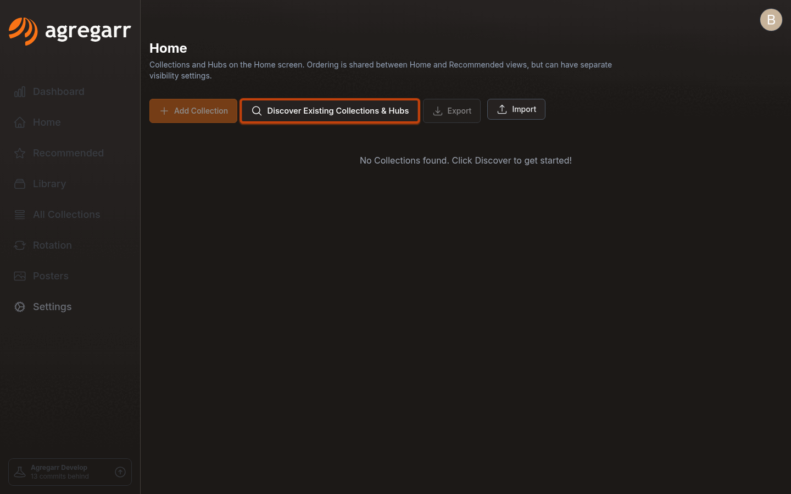
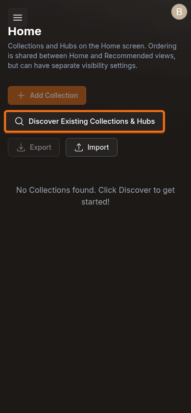
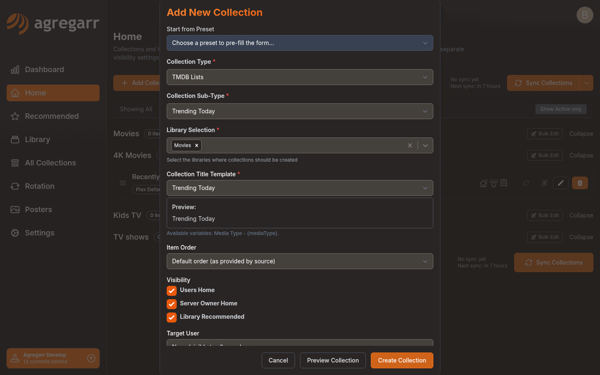
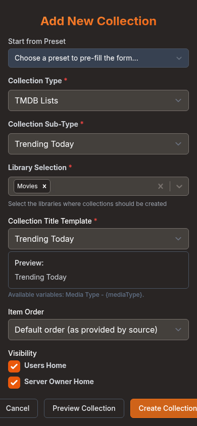

# Your first collection

This page sets up a row called **Trending Today** on your Plex Home. Agregarr fills it from TMDB's trending list and updates it on every sync.

## What you need

- Agregarr connected to your Plex server, with the setup wizard finished.
- A Plex movie library. A TV library works the same way.

You don't need a TMDB account or API key. TMDB lists work without anything else set up.

## Set it up

### 1. Run Discover first

A new Agregarr install starts locked. Until it has checked your Plex server, **Add Collection** and every sidebar item except **Settings** are greyed out.

1. Go to **Home**. The setup wizard leaves you there. If you've moved away, click the Agregarr logo at the top.
2. Click the pulsing orange **Discover Existing Collections & Hubs** button.

=== "Desktop"

    

=== "Phone"

    

Wait for **Discovering...** to finish. A message starting with "Imported" shows how many hubs and collections it imported, with the totals at the end.

**Check:** **Add Collection** is now solid. The sidebar items, including **Home**, **Recommended** and **Library** should no longer be greyed out.

Discover imports the hubs and collections already in your Plex libraries so Agregarr can manage them. It also tidies Plex's Home and Recommended lists for collections Agregarr manages, so it does write to Plex. You only need to run it once. If it finds nothing at all, the page stays locked. Start by checking the connection under **Settings > Plex**.

### 2. Add the collection

1. Click **Add Collection**. The **Add New Collection** window opens.
2. Set **Collection Type** to **TMDB Lists**.
3. Set **Collection Sub-Type** to **Trending Today**. If you'd prefer a slower-moving row, **Trending This Week** works the same way.
4. Under **Library Selection**, choose your movie library from **Select Libraries**. The rest of the form appears after you've picked one.

The form also has **Start from Preset**, a dropdown that pre-fills the form. Its **Trending Movies Today** preset sets up a similar collection, but with a different title, **Max Items** at 20 and **Users Home** unticked. The steps above give you the collection this page describes.

=== "Desktop"

    

=== "Phone"

    

**Check:** **Collection Title Template** reads **Trending Today**. The line starting with **Preview:** shows the name the collection will use in Plex.

### 3. Check the defaults

The settings below **Collection Title Template** are fine as they are for a first collection. Leave them untouched:

- Keep **Item Order** on **Default order (as provided by source)**. This preserves TMDB's ranking.
- **Users Home**, **Server Owner Home** and **Library Recommended** start ticked. **Server Owner Home** is your Plex Home, **Users Home** is the Home of the other people you share your server with and **Library Recommended** is the library's Recommended tab.
<!-- OPEN: NEW: Add Collection seeds Library Recommended ticked, but the comment at CollectionSettings.tsx:865 says the default is Users Home and Server Owner Home only -->
- **Max Items** starts at 30.
- Leave **Auto-generate Collection posters** ticked so Agregarr makes a poster for the collection.
- Leave **Time Restrictions** on **Always Active**.

**Check:** optionally, click **Preview Collection** to see which titles the list returns for your library before saving. Close the preview to return to the form.

### 4. Create it

Click **Create Collection**.

**Check:** a toast says "Collection created successfully!" and a **Trending Today** card appears on the **Home** page. Nothing is in Plex yet. Creating the collection only saves its settings. Plex doesn't change until a sync runs.

### 5. Sync it

Click **Sync Collections**.

The button changes to **Syncing...** and a message says "Collections sync started successfully!". A progress line appears while the sync runs, with a **View on Dashboard** link if you want to watch it. Once it finishes, the line beside the button changes from "No sync yet" to "Last sync:" followed by the time.

Agregarr also syncs automatically. The **Plex Collections Sync** job runs every 12 hours by default, so you only need the button when you want a change straight away.

**Check:** the **Trending Today** card on the **Home** page no longer shows a pending or error state.

### 6. See it in Plex

Open Plex and go to **Home**. You should see a row named **Trending Today** containing the movies trending on TMDB today. The same collection also appears under the library's **Collections** tab.

If the row isn't there, refresh Plex or reopen the app. Some Plex apps hold on to the old Home layout. For more, see [Collections](../collections/index.md).

## What you built

You ran Discover to unlock Agregarr, then created a collection that pulls TMDB's trending movies into a row on your Plex Home. Agregarr refreshes it on every sync.

## Next

[Your first overlay](first-overlay.md): add a 4K badge to your posters.
